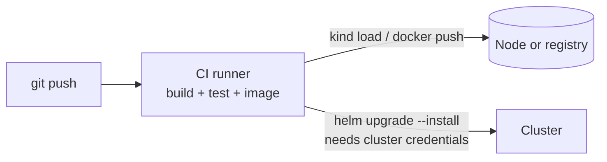
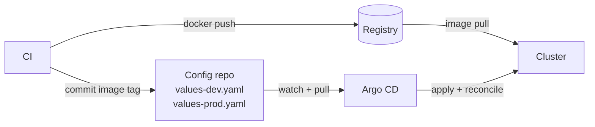
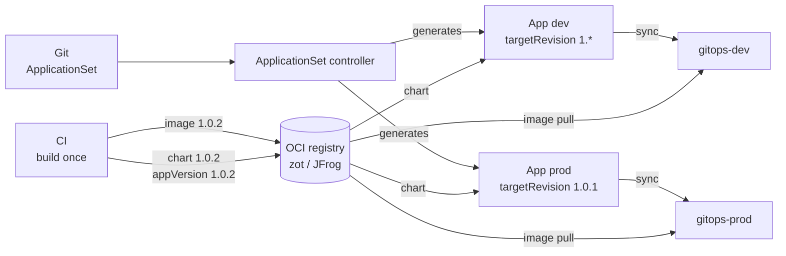
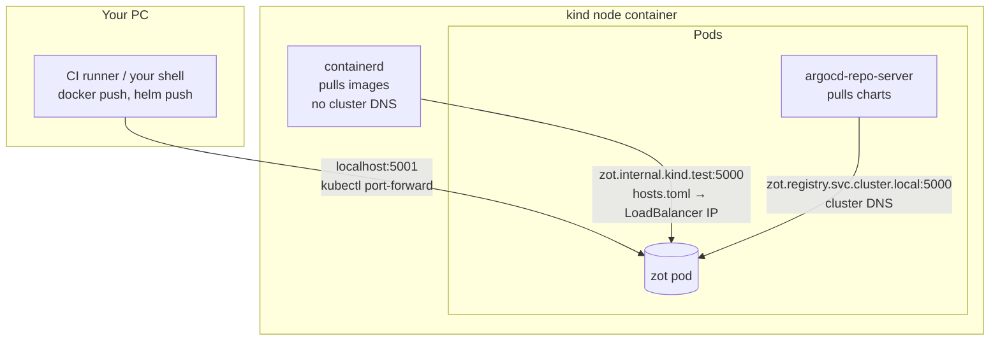
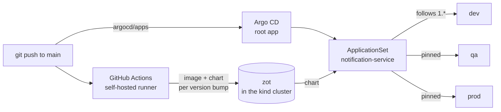

<Muted>
Builds on [OCI images and registries](/containers/oci-images-registries) (what a chart in a registry is) and [Enterprise CD on GitHub](/ci-cd/enterprise-cd-github) (promotion pipelines, and its Architecture B, hybrid GitOps). Versions: Argo CD v3.6.2, zot v2.1.23 (chart `project-zot/zot` 0.1.135), kind v0.31.0 (node v1.35.0, containerd 2.2.0), Helm v4.0.4, Docker 29.8.0, cloud-provider-kind v0.12.0.
</Muted>

<Note title="What was tested, and what wasn't">
Tested on the Ubuntu PC while writing this page, in a throwaway kind cluster (`gitops-verify`, deleted afterwards) next to your `kind` cluster:

1. zot installed from the chart with the values in [3.2](#im-zot), behind a cloud-provider-kind LoadBalancer. Pushes through a `kubectl port-forward` worked, and so did pulls by containerd on the node through `hosts.toml` ([3.3](#im-containerd)). The `manifest invalid` error without `compat: ["docker2s2"]` is from that run.
2. Your `notification-service` image and chart pushed as in [3.4](#im-push). Argo CD v3.6.2 installed from the official manifest. The repo credentials and the ApplicationSet in [3.6](#im-appset) deployed dev and prod. Both came up `Synced`/`Healthy` once your `gateway.yaml` Gateway existed, and both answered through the Gateway.
3. Charts 1.0.2 and 1.0.3 pushed. Dev (`1.*`) moved to 1.0.3 on its own after **241 s**, prod stayed on 1.0.1 until the ApplicationSet was changed, and a manual `kubectl scale` on prod was reverted by self-heal.

Output blocks come from that run, with three edits. The tunnel used port 5099 there, and the page uses 5001. zot ran in the namespace `zot` there, and the page uses `registry`, so the in-cluster URL is `zot.registry.svc.cluster.local`. The test promoted prod to 1.0.3, and [3.8](#im-promote) shows 1.0.2 to match the page's flow. IPs, digests and ages will differ.

Not run: the GitHub Actions workflow in [3.7](#im-ci) itself. Its commands are the ones tested by hand, but the workflow didn't run on the runner. Also not run: the alternative of `insecure-registries` with a Docker restart, and the cleanup of your own cluster.
</Note>

<Part level={1} id="arch" title="Architecture examples" toc="Architecture">

<Block id="arch-scenario" title="1.1 The scenario">

At work, CI builds the image, packages the Helm chart, and pushes **both** to JFrog Artifactory as OCI artifacts. Argo CD runs inside the cluster and pulls the chart **straight from the OCI registry**. An **ApplicationSet** generates one Argo CD Application per environment. Git holds the ApplicationSet (which environments exist and which chart version each one runs), not the rendered manifests.

The lab rebuilds that on your laptop with free parts:

| At work | In the lab |
| --- | --- |
| JFrog Artifactory (OCI repos for images and charts) | **zot**, inside the kind cluster |
| CI runners | Your self-hosted GitHub Actions runner `homepc` |
| Argo CD in each cluster | Argo CD in the kind cluster |
| dev / prod clusters | `gitops-dev` / `gitops-prod` namespaces in one cluster |

</Block>

<Block id="arch-a" title="1.2 Architecture A · Push-based: CI deploys" toc="1.2 A · Push-based">

Your pipeline today: the workflow builds the image and runs `kind load`, and you run `helm upgrade --install` by hand. In a team version, CI holds cluster credentials and runs `helm upgrade` or `kubectl apply` itself.



<Fit>
<Pros title="Fits when">
- One cluster, a small team, deploys that rarely change
- You want the simplest possible pipeline with no extra controller
</Pros>
<Cons title="Watch out for">
- CI holds admin credentials to every cluster it deploys to
- Nothing notices drift: a manual `kubectl edit` stays until the next deploy
- What's running is whatever the last job did, not something written down
</Cons>
</Fit>

</Block>

<Block id="arch-b" title="1.3 Architecture B · GitOps with a config repo" toc="1.3 B · Config repo">

The classic GitOps layout, and Architecture B of [Enterprise CD on GitHub](/ci-cd/enterprise-cd-github#arch-b). CI pushes the image, then **commits** the new tag into an environment config repo (values files or Kustomize overlays). Argo CD watches that repo and reconciles.



<Fit>
<Pros title="Fits when">
- You want every change, including every image bump, as a reviewed Git commit
- Charts are shared or come from upstream, and only the values differ per team
</Pros>
<Cons title="Watch out for">
- CI needs write access to the config repo, and bot commits pile up
- The chart and the image are versioned separately, so they can drift apart
</Cons>
</Fit>

</Block>

<Block id="arch-c" title="1.4 Architecture C · GitOps from OCI: versioned chart, ApplicationSet per environment" toc="1.4 C · OCI + ApplicationSet">

Your colleague's design, and this page's lab. CI publishes **one version** as two OCI artifacts: the image and a chart whose `appVersion` points at it. Argo CD reads the chart from the registry. The ApplicationSet, kept in Git, says which version each environment runs: dev a semver **range** (`1.*`), so it follows every release on its own, and prod an exact **pin** (`1.0.1`), so promotion is a one-line change.



<Fit>
<Pros title="Fits when">
- The team owns both the app and its chart, and wants them released as one version
- You have many environments, clusters or services that share one template
- You want promotion to be "change the pinned version", with no bot commits
</Pros>
<Cons title="Watch out for">
- The registry is now part of your desired state: tags must not be overwritten (JFrog can block this, zot by default doesn't)
- Dev changes without a Git commit; the record of what ran is Argo CD's history plus the registry
- Values per environment live in the ApplicationSet, which grows as environments diverge
</Cons>
</Fit>

</Block>

<Block id="arch-compare" title="1.5 Choosing between them">

| | A · Push | B · Config repo | C · OCI + ApplicationSet |
| --- | --- | --- | --- |
| Who changes the cluster | CI | Argo CD | Argo CD |
| Credentials in CI | Cluster admin | Registry + Git write | Registry only |
| Drift correction | None | Self-heal | Self-heal |
| Record of what runs | CI logs | Git commits | ApplicationSet in Git + registry versions |
| New environment | New pipeline job | New folder in config repo | New element in the list generator |
| Best for | Labs, one small cluster | Shared charts, strict review | Team-owned app + chart, many envs |

B and C mix well. Many teams keep C for dev and staging and require a pull request to change prod's pin, which is B's review step in C's layout.

</Block>

</Part>

<Part level={2} id="theory" title="Theory">

<Block id="th-gitops" title="2.1 What GitOps is" toc="2.1 GitOps">

OpenGitOps (a CNCF working group) defines GitOps by four principles. The desired state must be:

1. **Declarative:** "expressed declaratively".
2. **Versioned and immutable:** "stored in a way that enforces immutability, versioning and retains a complete version history".
3. **Pulled automatically:** "software agents automatically pull the desired state declarations from the source".
4. **Continuously reconciled:** "software agents continuously observe actual system state and attempt to apply the desired state".

Principle 3 is the change from Architecture A: the cluster pulls, so CI no longer needs cluster credentials. Principle 4 is what notices and undoes drift. In Architecture C the "source" is two places: Git for the ApplicationSet, and the OCI registry for the versioned chart. Principle 2 is why registry tags must be immutable.

</Block>

<Block id="th-components" title="2.2 Argo CD's components" toc="2.2 Components">

The install creates these pods in `argocd`:

| Component | Job |
| --- | --- |
| `argocd-server` | API server for the UI, CLI and CI: app management, sync and rollback, repository and cluster credentials (stored as Secrets), auth, RBAC, Git webhooks |
| `argocd-repo-server` | Fetches the source (Git repo, Helm repo or OCI artifact) and renders manifests for a given URL, revision, path and Helm values |
| `argocd-application-controller` | Compares live state with the target state, marks apps `OutOfSync`, syncs, runs hooks |
| `argocd-applicationset-controller` | Turns each ApplicationSet into Applications |
| `argocd-redis` | Cache |
| `argocd-dex-server` | SSO (unused in the lab) |
| `argocd-notifications-controller` | Notifications (unused in the lab) |

Helm is "only used to inflate charts with `helm template`". Argo CD applies the result itself, so `helm list` shows nothing for apps that Argo CD manages.

</Block>

<Block id="th-app" title="2.3 Applications: sync status, health, auto-sync" toc="2.3 Applications">

An **Application** is a source (where the manifests come from, at which revision) plus a destination (cluster and namespace). Argo CD reports two separate things:

- **Sync status:** does the live state match the rendered target? `Synced` or `OutOfSync`.
- **Health:** are the resources working? `Healthy`, `Progressing`, `Degraded`, `Missing`. In the test run, an app stayed `Progressing` with every pod running. The cause was an HTTPRoute whose Gateway didn't exist yet, so one unhealthy resource makes the whole app unhealthy.

With `syncPolicy.automated`, Argo CD syncs on its own when the target changes. The check interval is `timeout.reconciliation` in `argocd-cm`, which "defaults to `120s` with added jitter of `60s` for a maximum period of 3 minutes". The test's 241 s from `helm push` to new pods fits that: up to 3 minutes to notice, then the rollout. `prune: true` deletes resources that are no longer in the source. `selfHeal: true` re-syncs when the *live* state drifts, after a 5 s self-heal timeout.

</Block>

<Block id="th-appset" title="2.4 ApplicationSets and generators" toc="2.4 ApplicationSets">

An ApplicationSet is a template for Applications plus **generators** that produce parameters for it. Argo CD v3.6 has ten:

| Generator | Parameters come from | Typical use |
| --- | --- | --- |
| List | A literal list in the ApplicationSet | A fixed set of environments (the lab) |
| Cluster | Clusters registered in Argo CD | One app per cluster, new clusters picked up automatically |
| Git | Files or directories in a Git repo | One app per folder or per config file |
| Matrix / Merge | Two or more other generators | Every service × every cluster; per-env overrides |
| SCM Provider / Pull Request | GitHub and similar APIs | One app per repo; a preview env per open PR |
| OCI | Files or directories in an OCI artifact | Like Git, but from a registry |
| Cluster Decision Resource, Plugin | Custom resources, an HTTP plugin | Custom placement logic |

The docs suggest starting with List and Cluster. With `goTemplate: true` the template uses Go templates (`{{ .env }}`), and `missingkey=error` makes a typo fail instead of rendering an empty string.

Applications that an ApplicationSet creates get an owner reference and the `resources-finalizer.argocd.argoproj.io` finalizer. **Deleting the ApplicationSet deletes its Applications and everything they deployed**, unless `preserveResourcesOnDeletion` is set or you delete with `--cascade=orphan`.

</Block>

<Block id="th-oci" title="2.5 Charts from an OCI registry: two ways to point Argo CD at them" toc="2.5 OCI sources">

A chart pushed with `helm push` is an OCI artifact with config type `application/vnd.cncf.helm.config.v1+json` and one layer of type `application/vnd.cncf.helm.chart.content.v1.tar+gzip` (see [OCI images and registries](/containers/oci-images-registries#im-helm)). Argo CD can read it two ways:

| | Helm source with OCI | Native OCI source (this lab) |
| --- | --- | --- |
| `repoURL` | `registry/path`, **no** `oci://` | `oci://registry/path/chart` |
| Chart | `chart: notification-service` | Part of the URL, `path: .` |
| Credentials | Secret `type: helm`, `enableOCI: "true"` | Secret `type: oci` |
| Plain HTTP | No option for it | `insecureOCIForceHttp: "true"` |
| Semver ranges | Yes | Yes |

The last two rows are from Argo CD's source code (v3.6.2), not the user guide. `GetOCICreds()` passes `InsecureHTTPOnly: repo.InsecureOCIForceHttp` to the OCI client, which sets ORAS's `PlainHTTP`. `GetHelmCreds()` has no such field. The native client's `ResolveRevision` "resolves a tag, digest, or semantic version constraint to a concrete digest". That's why the lab uses the native source: zot serves plain HTTP. With TLS (JFrog at work), either form works.

The ranges follow Argo CD's tracking table: pin `1.2.0` for production, `1.2.*` for patches, `1.*` for minor releases, `*` for anything. Pre-releases need a `-0` suffix (`*-0`). Argo CD resolves the range to a **digest** and syncs that digest, which is what `REVISION` shows in [3.6](#im-appset).

</Block>

<Block id="th-network" title="2.6 One registry, three network views" toc="2.6 Three network views">

The hardest part of running a registry *inside* kind is reaching it. Three different clients need it, and each one sees the network differently:



- **containerd** runs on the node, not in a pod, so it **can't resolve `*.svc.cluster.local`**. Image references therefore use a name that `hosts.toml` maps to the zot Service's LoadBalancer IP. kind's node images (v0.27.0+) already read `/etc/containerd/certs.d`, and the test confirmed containerd 2.2.0's `config_path = '/etc/containerd/certs.d:/etc/docker/certs.d'`, so no cluster rebuild is needed.
- **Pods** (Argo CD's repo-server) use the cluster DNS name. kind's own docs make the same point: code inside a pod "will not see the containerd config".
- **Your PC** pushes through a port-forward to `localhost`, because Docker allows plain HTTP only for `localhost` without extra config. Helm takes `--plain-http`.

It's one registry and one set of repositories (`notification-service`, `charts/notification-service`) under three addresses. At work JFrog has one DNS name with TLS that all three resolve, so this problem goes away.

</Block>

<Block id="th-zot" title="2.7 Why zot for the lab registry" toc="2.7 Why zot">

| Registry | For a kind lab |
| --- | --- |
| **zot** | One pod, OCI-native, stores images and charts, optional UI and search, htpasswd auth. Official Helm chart. |
| Harbor | The closest free match to Artifactory (projects, RBAC, scanning, replication), but it runs many pods. Its docs list a 2 CPU / 4 GB minimum. |
| `registry:3` (CNCF Distribution) | Push and pull, nothing else |

zot stores OCI media types. Docker with the classic image store (your daemon uses `overlay2`) pushes **Docker v2 schema 2** manifests, and zot rejects those unless `http.compat` includes `docker2s2`. Without it the test got `manifest invalid: manifest invalid`.

</Block>

<Block id="th-proscons" title="2.8 Problems solved, pros and cons" toc="2.8 Pros and cons">

<Fit>
<Pros>
- CI keeps registry credentials only. It never touches the cluster.
- Every environment converges on its own, and drift is reverted
- One version number names the image, the chart and the release
- Adding an environment is one list element
- Rollback means pinning the previous version, or `argocd app rollback`
</Pros>
<Cons>
- Another system to run, upgrade and secure (Argo CD has cluster-admin-like power)
- Mutable tags break principle 2. Enforce immutability in the registry.
- A dev range means dev changes without a commit. Audit lives in Argo CD and the registry.
- Debugging moves from "read the CI log" to "read app status, events and repo-server logs"
</Cons>
</Fit>

</Block>

</Part>

<Part level={3} id="impl" title="Implementation">

<Muted>
Runs on your existing `kind` cluster, with cloud-provider-kind running and the Gateway from [kind/gateway.yaml](/practical/kind/gateway.yaml) (`*.internal.kind.test`, address 172.18.128.0). Nothing here needs a new cluster or `sudo`. The lab deploys to new namespaces `gitops-dev` and `gitops-prod`, so your hand-installed release in `dev` keeps working. Suggested place for your files: `wq_practical_book/Lab/argocd-gitops/NN-<part>/`.
</Muted>

<Block id="im-tools" title="3.1 Tools" toc="3.1 Tools">

You already have Docker 29.8.0, kind v0.31.0, kubectl, Helm v4.0.4 and the `argocd` CLI v3.2.3. A CLI one or two minor versions behind the server works for the commands here. To match the server, download v3.6.2 from the [releases page](https://github.com/argoproj/argo-cd/releases/tag/v3.6.2).

```bash
kubectl config current-context   # expect: kind-kind
kubectl get gateway -n gateway-infra gateway
```

```text output
kind-kind
NAME      CLASS                 ADDRESS        PROGRAMMED   AGE
gateway   cloud-provider-kind   172.18.128.0   True         6d
```

</Block>

<Block id="im-zot" title="3.2 Install zot in the cluster" toc="3.2 zot">

A LoadBalancer Service gives zot an IP on the `kind` Docker network, so the nodes' containerd can reach it ([2.6](#th-network)). `persistence: true` keeps images in a PVC (kind's `standard` StorageClass), so they survive a pod restart.

```yaml title="Lab/argocd-gitops/01-zot/zot-values.yaml"
service:
  type: LoadBalancer
  port: 5000
persistence: true
pvc:
  create: true
  storage: 5Gi
mountConfig: true
configFiles:
  config.json: |-
    {
      "distSpecVersion": "1.1.1",
      "storage": { "rootDirectory": "/var/lib/registry" },
      "http": {
        "address": "0.0.0.0",
        "port": "5000",
        "compat": ["docker2s2"]
      },
      "log": { "level": "info" },
      "extensions": {
        "search": { "enable": true },
        "ui": { "enable": true }
      }
    }
```

- `mountConfig: true` makes the chart mount `configFiles` as zot's config. Without it, the chart's `configFiles` aren't used.
- `compat: ["docker2s2"]` lets `docker push` work ([2.7](#th-zot)).
- `search` and `ui` turn on the web UI. There is no auth: fine on a laptop, not anywhere else.

```bash
helm repo add project-zot https://zotregistry.dev/helm-charts
helm repo update project-zot
helm upgrade --install zot project-zot/zot --version 0.1.135 \
  -n registry --create-namespace -f zot-values.yaml --wait
kubectl get pods,svc,pvc -n registry
```

```text output
NAME        READY   STATUS    RESTARTS   AGE
pod/zot-0   1/1     Running   0          34s

NAME          TYPE           CLUSTER-IP     EXTERNAL-IP    PORT(S)          AGE
service/zot   LoadBalancer   10.96.55.130   172.18.128.2   5000:30321/TCP   34s

NAME                                  STATUS   VOLUME                                     CAPACITY   ACCESS MODES   STORAGECLASS   ...
persistentvolumeclaim/zot-pvc-zot-0   Bound    pvc-859ae4b4-924e-4b94-aae1-96df5966f322   5Gi        RWO            standard       ...
```

Note the `EXTERNAL-IP`. Yours will be a different 172.18.128.x, because your Gateway already has .0. Check that it answers from the PC and from the node:

```bash
ZOT_IP=$(kubectl get svc -n registry zot -o jsonpath='{.status.loadBalancer.ingress[0].ip}')
curl -s -o /dev/null -w 'from PC: %{http_code}\n' http://$ZOT_IP:5000/v2/
docker exec kind-control-plane curl -s -o /dev/null -w 'from node: %{http_code}\n' http://$ZOT_IP:5000/v2/
```

```text output
from PC: 200
from node: 200
```

The UI is at `http://<ZOT_IP>:5000/` in your browser.

</Block>

<Block id="im-containerd" title="3.3 Teach containerd the registry's name" toc="3.3 containerd hosts.toml">

Image references will be `zot.internal.kind.test:5000/notification-service:<version>`. The directory name under `certs.d` must match that `host:port` exactly. `server` and `[host.…]` say where to actually connect, over plain HTTP. containerd reads this file at pull time, so it needs no restart. kind's own [local registry script](https://kind.sigs.k8s.io/docs/user/local-registry/) writes the file the same way, with `docker exec`.

```bash
ZOT_IP=$(kubectl get svc -n registry zot -o jsonpath='{.status.loadBalancer.ingress[0].ip}')
DIR=/etc/containerd/certs.d/zot.internal.kind.test:5000
for node in $(kind get nodes); do
  docker exec "$node" mkdir -p "$DIR"
  cat <<EOF | docker exec -i "$node" cp /dev/stdin "$DIR/hosts.toml"
server = "http://$ZOT_IP:5000"

[host."http://$ZOT_IP:5000"]
  capabilities = ["pull", "resolve"]
EOF
done
docker exec kind-control-plane cat "$DIR/hosts.toml"
```

<Note title="When this file disappears">
It lives in the node container's filesystem. It survives `docker restart`, but not `kind delete cluster`. If zot's LoadBalancer IP changes (for example after cloud-provider-kind is re-created), re-run this step. A pull that fails with `connect: connection refused` or `no such host` on `zot.internal.kind.test` means this file is missing or points at the wrong IP.
</Note>

</Block>

<Block id="im-push" title="3.4 Publish version 1.0.1 by hand: image and chart" toc="3.4 Push by hand">

First, change two values in your chart so the image comes from zot and its tag comes from the chart's `appVersion`. With this, CI only has to set one version ([3.7](#im-ci)).

```yaml title="wq_practical_book/helm/notification-service/values.yaml (image block)"
image:
  repository: zot.internal.kind.test:5000/notification-service
  pullPolicy: IfNotPresent
  # Empty: the template falls back to .Chart.AppVersion
  tag: ""
```

Your `deployment.yaml` already renders `{{ .Values.image.tag | default .Chart.AppVersion }}`. If you later `helm upgrade` your hand-installed `dev` release from this chart, it will pull from zot too.

Open a tunnel and keep it running in a second terminal:

```bash
kubectl port-forward -n registry svc/zot 5001:5000
```

Push the image you already have (`notification-service:1.0.1`), then package the chart with `--version` and `--app-version` set to the same number, and push it:

```bash
docker tag notification-service:1.0.1 localhost:5001/notification-service:1.0.1
docker push localhost:5001/notification-service:1.0.1

cd wq_practical_book
helm package helm/notification-service --version 1.0.1 --app-version 1.0.1 -d /tmp/charts
helm push /tmp/charts/notification-service-1.0.1.tgz oci://localhost:5001/charts --plain-http

curl -s localhost:5001/v2/notification-service/tags/list; echo
curl -s localhost:5001/v2/charts/notification-service/tags/list; echo
```

```text output
1.0.1: digest: sha256:b8b1b29d3926e2f177f9d0336f4695cd833ce66368254b35b1743b15c670519e size: 7851
Pushed: localhost:5001/charts/notification-service:1.0.1
Digest: sha256:81c81c88f7772e6b1057a2d50ad3ffea0cb94166e3333b829abc543d3dfdd4b0
{"name":"notification-service","tags":["1.0.1"]}
{"name":"charts/notification-service","tags":["1.0.1"]}
```

Now prove the node can pull the image by its other name:

```bash
docker exec kind-control-plane crictl pull zot.internal.kind.test:5000/notification-service:1.0.1
```

```text output
Image is up to date for sha256:beefbcc3df4185a0c0ba4c40ad733e58dbff8e0f018a48707d229bfc85dbe0eb
```

<Tip title="Same repository, different addresses">
You pushed to `localhost:5001/notification-service` and the node pulled `zot.internal.kind.test:5000/notification-service`. The repository path is the same, and the host part is only how each client reaches zot ([2.6](#th-network)).
</Tip>

</Block>

<Block id="im-argocd" title="3.5 Install Argo CD" toc="3.5 Argo CD">

The official manifest, pinned. `--server-side` is required because some Argo CD CRDs (ApplicationSet among them) exceed the annotation size limit of client-side apply.

```bash
kubectl create namespace argocd
kubectl apply -n argocd --server-side --force-conflicts \
  -f https://raw.githubusercontent.com/argoproj/argo-cd/v3.6.2/manifests/install.yaml
kubectl wait -n argocd --for=condition=Available deploy --all --timeout=300s
kubectl get pods -n argocd
```

```text output
deployment.apps/argocd-applicationset-controller condition met
...
NAME                                                READY   STATUS    RESTARTS   AGE
argocd-application-controller-0                     1/1     Running   0          94s
argocd-applicationset-controller-5db7744674-8fvnv   1/1     Running   0          94s
argocd-dex-server-7cb954c845-lq2nq                  1/1     Running   0          94s
argocd-notifications-controller-69bf5659f4-dpdgp    1/1     Running   0          94s
argocd-redis-7f99ff8f49-hdzg9                       1/1     Running   0          94s
argocd-repo-server-74795ff99c-82wcm                 1/1     Running   0          94s
argocd-server-5bfff567dd-tdjkk                      1/1     Running   0          94s
```

To use the UI, get the generated `admin` password, port-forward, then open https://localhost:8080. The certificate is self-signed, so accept the browser warning.

```bash
argocd admin initial-password -n argocd
kubectl port-forward svc/argocd-server -n argocd 8080:443
```

For the CLI without logging in, `argocd ... --core` talks to the Kubernetes API directly. It reads apps from your kube context's current namespace, so set that to `argocd` with `kubectl config set-context --current --namespace=argocd`, and switch back afterwards with `--namespace=default`. The `kubectl` commands on this page pass `-n` explicitly, so they work either way.

</Block>

<Block id="im-appset" title="3.6 Registry credentials and the ApplicationSet" toc="3.6 ApplicationSet">

A **credential template** (`secret-type: repo-creds`) applies to every repository URL that starts with its `url`, so one Secret covers every chart in zot. `type: oci` with `insecureOCIForceHttp` is the plain-HTTP option from [2.5](#th-oci). At work it would carry a JFrog username and token in place of the HTTP flag.

```yaml title="Lab/argocd-gitops/02-argocd/zot-repo-creds.yaml"
apiVersion: v1
kind: Secret
metadata:
  name: zot-oci
  namespace: argocd
  labels:
    argocd.argoproj.io/secret-type: repo-creds
stringData:
  name: zot
  type: oci
  url: oci://zot.registry.svc.cluster.local:5000
  insecureOCIForceHttp: "true"
```

The ApplicationSet. One list element per environment: dev tracks `1.*`, prod is pinned. Each environment also gets its own HTTPRoute hostname, because both attach to the same Gateway.

```yaml title="Lab/argocd-gitops/02-argocd/appset.yaml"
apiVersion: argoproj.io/v1alpha1
kind: ApplicationSet
metadata:
  name: notification-service
  namespace: argocd
spec:
  goTemplate: true
  goTemplateOptions: ["missingkey=error"]
  generators:
  - list:
      elements:
      - env: dev
        chartVersion: "1.*"     # follow every 1.x release
      - env: prod
        chartVersion: "1.0.1"   # pinned; promote by editing this
  template:
    metadata:
      name: 'notification-service-{{ .env }}'
    spec:
      project: default
      source:
        repoURL: oci://zot.registry.svc.cluster.local:5000/charts/notification-service
        path: .
        targetRevision: '{{ .chartVersion }}'
        helm:
          releaseName: notification-service
          valuesObject:
            httpRoute:
              hostnames:
              - 'notification-service-{{ .env }}.internal.kind.test'
      destination:
        server: https://kubernetes.default.svc
        namespace: 'gitops-{{ .env }}'
      syncPolicy:
        automated:
          prune: true
          selfHeal: true
        syncOptions:
        - CreateNamespace=true
```

- `repoURL` uses the **cluster DNS** name: the repo-server is a pod.
- `path: .` is required for OCI Helm charts.
- `valuesObject` is merged over the chart's `values.yaml`, like `helm -f`.
- `destination.server: https://kubernetes.default.svc` is the cluster Argo CD runs in.

```bash
kubectl apply -f zot-repo-creds.yaml -f appset.yaml
kubectl get applicationset,applications -n argocd
kubectl get applications -n argocd -o custom-columns='NAME:.metadata.name,SYNC:.status.sync.status,HEALTH:.status.health.status,TARGET:.spec.source.targetRevision,REVISION:.status.sync.revision'
```

```text output
NAME                                              AGE
applicationset.argoproj.io/notification-service   40s

NAME                                                SYNC STATUS   HEALTH STATUS
application.argoproj.io/notification-service-dev    Synced        Healthy
application.argoproj.io/notification-service-prod   Synced        Healthy

NAME                        SYNC     HEALTH    TARGET   REVISION
notification-service-dev    Synced   Healthy   1.*      sha256:81c81c88f7772e6b1057a2d50ad3ffea0cb94166e3333b829abc543d3dfdd4b0
notification-service-prod   Synced   Healthy   1.0.1    sha256:81c81c88f7772e6b1057a2d50ad3ffea0cb94166e3333b829abc543d3dfdd4b0
```

`REVISION` is the chart's digest from [3.4](#im-push): Argo CD resolved `1.*` to `1.0.1`, then to its digest. Call both environments through the Gateway:

```bash
GW=$(kubectl get gateway -n gateway-infra gateway -o jsonpath='{.status.addresses[0].value}')
for e in dev prod; do
  curl -s --resolve notification-service-$e.internal.kind.test:80:$GW \
    http://notification-service-$e.internal.kind.test/actuator/health; echo " <- $e"
done
```

```text output
{"groups":["liveness","readiness"],"status":"UP"} <- dev
{"groups":["liveness","readiness"],"status":"UP"} <- prod
```

<Note title="If an app stays Progressing or shows an error">
- `argocd app get notification-service-dev --core` lists each resource's health. An `HTTPRoute ... Progressing` means the route isn't accepted: check that the Gateway `gateway` in `gateway-infra` exists.
- A `ComparisonError` about TLS or HTTPS (Go's wording is `server gave HTTP response to HTTPS client`) most likely means `insecureOCIForceHttp` isn't applied. Check the Secret's label, and check that its `url` is a prefix of `repoURL`. The test didn't produce this error, so the exact text is unverified.
- Pods in `ErrImagePull`: run `kubectl describe pod` and read the pull error. Then check [3.3](#im-containerd).
- `kubectl logs -n argocd deploy/argocd-repo-server` shows fetch and render errors.
</Note>

</Block>

<Block id="im-ci" title="3.7 CI publishes, Argo CD deploys" toc="3.7 CI pipeline">

Change `.github/workflows/notification-service.yml` so that, after building the image, it **publishes** to zot. It no longer loads the image into kind. The runner is on the same PC, so it opens the same `localhost` tunnel. `kind get kubeconfig` works for `gh-runner` because it's in the `docker` group. Replace the last two steps ("Load the image into KinD" and "Check the image is in the KinD node") with:

```yaml title=".github/workflows/notification-service.yml (steps after 'Check the image is on the runner')"
      - name: Open a tunnel to zot
        run: |
          kind get kubeconfig --name "$KIND_CLUSTER" > "$RUNNER_TEMP/kubeconfig"
          kubectl --kubeconfig "$RUNNER_TEMP/kubeconfig" \
            port-forward -n registry svc/zot "${REGISTRY_PORT}:5000" > "$RUNNER_TEMP/pf.log" 2>&1 &
          echo $! > "$RUNNER_TEMP/pf.pid"
          for i in $(seq 1 20); do
            curl -sf "http://localhost:${REGISTRY_PORT}/v2/" > /dev/null && exit 0
            sleep 1
          done
          cat "$RUNNER_TEMP/pf.log"; exit 1

      - name: Push the image
        run: |
          docker tag "${IMAGE}:${VERSION}" "localhost:${REGISTRY_PORT}/${IMAGE}:${VERSION}"
          docker push "localhost:${REGISTRY_PORT}/${IMAGE}:${VERSION}"

      - name: Package and push the chart (chart version = app version)
        run: |
          helm package wq_practical_book/helm/notification-service \
            --version "$VERSION" --app-version "$VERSION" -d "$RUNNER_TEMP"
          helm push "$RUNNER_TEMP/notification-service-${VERSION}.tgz" \
            "oci://localhost:${REGISTRY_PORT}/charts" --plain-http

      - name: Close the tunnel
        if: always()
        run: kill "$(cat "$RUNNER_TEMP/pf.pid")" 2>/dev/null || true
```

And add the port to the workflow's `env:` block:

```yaml
env:
  APP_DIR: wq_practical_book/apps/notification-service
  IMAGE: notification-service
  KIND_CLUSTER: kind
  REGISTRY_PORT: "5001"
```

Stop your own port-forward from [3.4](#im-push) first, or the runner's will fail with "address already in use".

Now release 1.0.2. Bump `<version>` in `apps/notification-service/pom.xml` to `1.0.2-SNAPSHOT`, commit and push. CI strips `-SNAPSHOT`, builds, and publishes image and chart 1.0.2. Then watch dev move on its own and prod stay put:

```bash
kubectl get deploy -A -l app.kubernetes.io/name=notification-service \
  -o custom-columns='NS:.metadata.namespace,IMAGE:.spec.template.spec.containers[0].image' -w
```

```text output
NS            IMAGE
gitops-dev    zot.internal.kind.test:5000/notification-service:1.0.2
gitops-prod   zot.internal.kind.test:5000/notification-service:1.0.1
```

Allow up to about four minutes: up to three for Argo CD to notice ([2.3](#th-app)), plus the rollout. In the test this took 241 s. For an immediate check, click **Refresh** in the UI, or run `kubectl annotate app -n argocd notification-service-dev argocd.argoproj.io/refresh=normal --overwrite`.

<Note title="Things to know about this pipeline">
- The workflow runs on pushes to **any** branch, so a feature branch publishes a version that dev (`1.*`) deploys. At work you'd publish pre-release versions (`1.0.2-rc.1`) from branches, which `1.*` ignores ([2.5](#th-oci)).
- Re-pushing an existing version overwrites the tag in zot. Bump the version instead, and treat tags as immutable.
- The kubeconfig gives the runner admin access to the cluster, only to open the tunnel. At work CI talks to the registry's public name and never needs a kubeconfig.
- Alternative without the tunnel: add `"insecure-registries": ["zot.internal.kind.test:5000"]` to snap Docker's `/var/snap/docker/current/config/daemon.json`, add `/etc/hosts` entries for that name and run `sudo snap restart docker`. Then push to `zot.internal.kind.test:5000` directly. **Not tested.** The restart also stops the `--rm` cloud-provider-kind container, which you'd re-run.
</Note>

</Block>

<Block id="im-promote" title="3.8 Promote to prod, and watch self-heal" toc="3.8 Promote + self-heal">

Promotion is a one-line change to the pinned version. Here you edit the file and apply it. In a team, that edit is a pull request to the repo that holds the ApplicationSet.

```bash
sed -i 's/chartVersion: "1.0.1"/chartVersion: "1.0.2"/' appset.yaml
kubectl apply -f appset.yaml
kubectl get applications -n argocd -o custom-columns='NAME:.metadata.name,SYNC:.status.sync.status,HEALTH:.status.health.status,TARGET:.spec.source.targetRevision'
argocd app history notification-service-prod --core
```

```text output
NAME                        SYNC     HEALTH    TARGET
notification-service-dev    Synced   Healthy   1.*
notification-service-prod   Synced   Healthy   1.0.2

SOURCE  oci://zot.registry.svc.cluster.local:5000/charts/notification-service
ID      DATE                           REVISION
0       2026-11-21 12:40:15 +0800 +08  1.0.1 (sha256:)
1       2026-11-21 12:47:34 +0800 +08  1.0.2 (sha256:)
```

The CLI v3.2.3 also prints a harmless error about `helm version --client` (Helm 4 dropped that flag). Now drift prod by hand and watch Argo CD undo it:

```bash
kubectl scale deploy -n gitops-prod notification-service --replicas=3
sleep 15
kubectl get deploy -n gitops-prod notification-service
```

```text output
deployment.apps/notification-service scaled
NAME                   READY   UP-TO-DATE   AVAILABLE   AGE
notification-service   1/1     1            1           7m54s
```

The chart says `replicaCount: 1`, so self-heal put it back. To scale for real, change the value in the ApplicationSet's `valuesObject`.

</Block>

<Block id="im-working" title='3.9 What "working" looks like' toc="3.9 Working">

<Tip title='What "working" looks like'>
A version bump pushed to GitHub ends up running in dev a few minutes later, and you never ran `kind load`, `helm upgrade` or `kubectl apply` for it. Prod changes only when you change its pin.
</Tip>

<Checklist>
- zot answers `200` on `/v2/` from the PC and from the node
- `crictl pull zot.internal.kind.test:5000/notification-service:1.0.1` works on the node
- Both Applications are `Synced` and `Healthy`, with a `sha256:` revision
- Both environments answer `/actuator/health` through the Gateway
- A CI run for 1.0.2 moves dev to 1.0.2 within about four minutes, and prod stays on 1.0.1
- Changing prod's `chartVersion` moves prod; `argocd app history` shows both revisions
- A manual `kubectl scale` on prod is reverted
</Checklist>

</Block>

<Block id="im-cleanup" title="3.10 Clean up" toc="3.10 Clean up">

Deleting the ApplicationSet deletes its Applications and their resources ([2.4](#th-appset)). The namespaces were created by `CreateNamespace` and stay, so delete them too.

```bash
kubectl delete -f appset.yaml -f zot-repo-creds.yaml
kubectl delete namespace gitops-dev gitops-prod
kubectl delete -n argocd \
  -f https://raw.githubusercontent.com/argoproj/argo-cd/v3.6.2/manifests/install.yaml
kubectl delete namespace argocd
helm uninstall zot -n registry && kubectl delete namespace registry   # deletes the PVC and the stored images
for node in $(kind get nodes); do
  docker exec "$node" rm -rf /etc/containerd/certs.d/zot.internal.kind.test:5000
done
docker image rm localhost:5001/notification-service:1.0.1
```

If you keep the workflow change from [3.7](#im-ci), revert it before removing zot, or CI will fail at "Open a tunnel to zot". Revert the chart's `image` block too, if your hand-installed `dev` release should go back to the `kind load` image.

</Block>

<Block id="refs" title="References">

- [OpenGitOps · Principles](https://opengitops.dev/) ([source text](https://github.com/open-gitops/documents/blob/main/PRINCIPLES.md))
- Argo CD v3.6 docs: [Getting started](https://argo-cd.readthedocs.io/en/stable/getting_started/), [Architecture](https://argo-cd.readthedocs.io/en/stable/operator-manual/architecture/), [OCI](https://argo-cd.readthedocs.io/en/stable/user-guide/oci/), [Helm](https://argo-cd.readthedocs.io/en/stable/user-guide/helm/), [Declarative setup (repositories, credential templates)](https://argo-cd.readthedocs.io/en/stable/operator-manual/declarative-setup/), [Tracking strategies (semver ranges)](https://argo-cd.readthedocs.io/en/stable/user-guide/tracking_strategies/), [Automated sync](https://argo-cd.readthedocs.io/en/stable/user-guide/auto_sync/)
- Argo CD ApplicationSet: [Generators](https://argo-cd.readthedocs.io/en/stable/operator-manual/applicationset/Generators/), [List generator](https://argo-cd.readthedocs.io/en/stable/operator-manual/applicationset/Generators-List/), [Application deletion](https://argo-cd.readthedocs.io/en/stable/operator-manual/applicationset/Application-Deletion/)
- Argo CD source v3.6.2: [`repository_types.go`](https://github.com/argoproj/argo-cd/blob/v3.6.2/pkg/apis/application/v1alpha1/repository_types.go) (`insecureOCIForceHttp`, `GetOCICreds`), [`util/oci/client.go`](https://github.com/argoproj/argo-cd/blob/v3.6.2/util/oci/client.go) (`PlainHTTP`, semver `ResolveRevision`)
- [Argo CD v3.6.2 release](https://github.com/argoproj/argo-cd/releases/tag/v3.6.2)
- [zot](https://zotregistry.dev/), [zot Helm chart](https://github.com/project-zot/helm-charts) (values for 0.1.135), [CoreWeave · Deploy zot (docker2s2 compat)](https://docs.coreweave.com/products/cks/tutorials/deploy-zot-registry)
- [kind · Local registry](https://kind.sigs.k8s.io/docs/user/local-registry/) and its [script](https://github.com/kubernetes-sigs/kind/blob/v0.31.0/site/static/examples/kind-with-registry.sh)
- [containerd · Registry host configuration (`hosts.toml`)](https://github.com/containerd/containerd/blob/main/docs/hosts.md)
- [Helm · Use OCI-based registries](https://helm.sh/docs/topics/registries/)
- [Harbor · Installation prerequisites](https://goharbor.io/docs/install-config/installation-prereqs/)
- [Kubernetes blog · Experimenting with Gateway API using kind](https://kubernetes.io/blog/2026/01/28/experimenting-gateway-api-with-kind/)

</Block>

</Part>

<Part level={4} id="self" title="Self implementation" toc="Self implementation">

<Block id="self-run" title="4.1 My run on KinD" toc="4.1 My run">

I ran this lab on my existing KinD cluster, not a throwaway one, and went further than the page: Argo CD manages its own ApplicationSet from Git, and every version bump reaches dev with no manual step. Every command, values file and error is in the Practical Book:

- **[Lab 01 · zot (README-zot.md)](/practical/Lab/argocd-gitops/01-zot/README-zot.md)**
- **[Lab 02 · Argo CD (README.md)](/practical/Lab/argocd-gitops/02-argocd/README.md)**
- **[Lab 03 · Chart as OCI (README-oci.md)](/practical/Lab/argocd-gitops/03-oci/README-oci.md)**
- **[Lab 04 · ApplicationSet (README-appset.md)](/practical/Lab/argocd-gitops/04-applicationset/README-appset.md)**

The GitOps files are [`argocd/root.yaml`](/practical/argocd/root.yaml) and [`argocd/apps/notification-service.yaml`](/practical/argocd/apps/notification-service.yaml).



**Status: complete.** Two triggers reach the cluster, and neither needs a `kubectl apply`. A version bump on `main` makes CI publish a new image and chart, and dev follows it. A commit to `argocd/apps/` changes the ApplicationSet.

<Checklist>

- [x] zot in `registry` with a PVC, UI and API over HTTPS at `zot.internal.kind.test` through the Gateway
- [x] The kind nodes pull `zot.internal.kind.test/notification-service` (node DNS and CA set by `kind/zot-node-setup.sh`)
- [x] Argo CD installed with Helm, UI at `argocd.internal.kind.test` on the Gateway
- [x] Argo CD pulls the chart from zot by its in-cluster name, with a credential template
- [x] `root` applies `argocd/apps` from `main`, and the ApplicationSet generates dev, qa and prod
- [x] CI pushes the image and the chart at the same version; dev followed `1.*` to `1.0.4` while qa and prod stayed pinned to `1.0.3`
- [x] A Git commit to the ApplicationSet changes a running environment (dev `replicaCount: 2`)
- [x] Argo CD shows `root` and all three environments `Healthy` and `Synced` ([screenshot in Lab 04](/practical/Lab/argocd-gitops/04-applicationset/README-appset.md))

</Checklist>

</Block>

<Block id="self-diff" title="4.2 How my run differs from the page" toc="4.2 Differences">

| | This page | My run |
| --- | --- | --- |
| Registry access | zot's LoadBalancer IP over plain HTTP on `:5000`, mapped in containerd's `hosts.toml` | HTTPS through the Envoy Gateway, with a cert-manager wildcard certificate from my own root CA ([Private CA for HTTPS](/security/private-ca-https)) |
| Node pulls | `hosts.toml` only | `/etc/hosts` line plus the CA in `certs.d`, re-applied by `kind/zot-node-setup.sh` from cron, because the `/etc/hosts` line is lost when the node restarts |
| Argo CD install | `install.yaml` manifests | Helm chart `argo/argo-cd` 10.18.2, UI on an HTTPRoute, `server.insecure` because TLS ends at the Gateway |
| zot credentials | a repo-creds Secret applied by hand | `configs.credentialTemplates` in the Argo CD Helm values |
| ApplicationSet | `kubectl apply -f appset.yaml` | From Git: `root.yaml` (app of apps on `main`) applies `argocd/apps/` |
| Environments | `gitops-dev`, `gitops-prod` | `dev`, `qa`, `prod`, with per-environment Helm values through `templatePatch` and `valuesObject` |
| CI push | through a port-forward tunnel to zot | by name over HTTPS from the self-hosted runner, image and chart in one job |
| Promotion | `sed` the pin, then `kubectl apply` | edit the pin, push to `main` |

</Block>

<Block id="self-problems" title="4.3 Problems I hit" toc="4.3 Problems">

| Problem | Cause | Fix |
| --- | --- | --- |
| The node couldn't pull from zot: `no such host`, then `failed to verify certificate` | The node's DNS is Docker's (`172.18.0.1`), which doesn't read my PC's `/etc/hosts`, and containerd doesn't trust my CA | `/etc/hosts` line and `certs.d/.../ca.crt` on every node, kept in place by a cron job ([Lab 01, section 7](/practical/Lab/argocd-gitops/01-zot/README-zot.md)) |
| `argocd-repo-server` can't use `zot.internal.kind.test` | It's a pod: CoreDNS doesn't know the name, and the pod doesn't trust my CA | The in-cluster URL `oci://zot.registry.svc.cluster.local:5000` with `insecureOCIForceHttp` |
| A new chart version still ran the old image | `image.tag` was pinned in the chart's `values.yaml` | `tag: ""`, so the tag follows `appVersion`, and every app release is also a chart release ([Lab 03](/practical/Lab/argocd-gitops/03-oci/README-oci.md)) |
| `helm-lint` failed on the vendored Argo CD chart | kubeconform has no schema for `CustomResourceDefinition` | `helm/argo-cd/ci/lint-values.yaml` sets `crds.install: false` for CI only |
| CI's chart step failed: `Chart.yaml file is missing`, then `permission denied` | It packaged the app folder, not `helm/notification-service`, and wrote to a `/tmp/charts` owned by my user, not the runner's | The chart's path, and `$RUNNER_TEMP/charts` |
| `replicas: 2` did nothing, and Argo CD still showed Synced | The chart reads `replicaCount`; Helm drops keys a chart doesn't use | `replicaCount: 2` ([Lab 04, gotcha](/practical/Lab/argocd-gitops/04-applicationset/README-appset.md)) |

Next:

- Promote prod through Git ([3.8](#im-promote)): change its `chartVersion` to `1.0.4` and push to `main`, then check that a manual `kubectl scale` on prod is reverted
- A `values.schema.json` for the notification-service chart, so an unknown key fails the render instead of being ignored
- Move zot, Prometheus and Grafana under Argo CD as `argocd/infrastructure/` Applications

</Block>

</Part>
