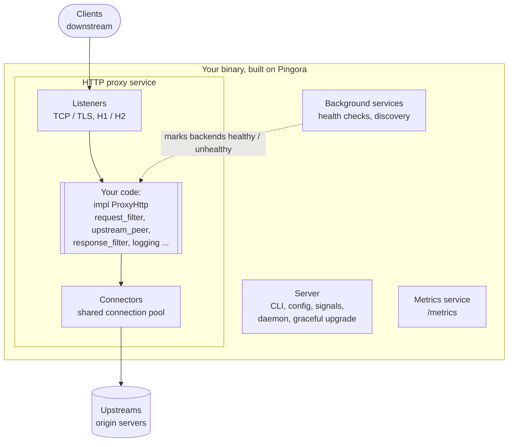
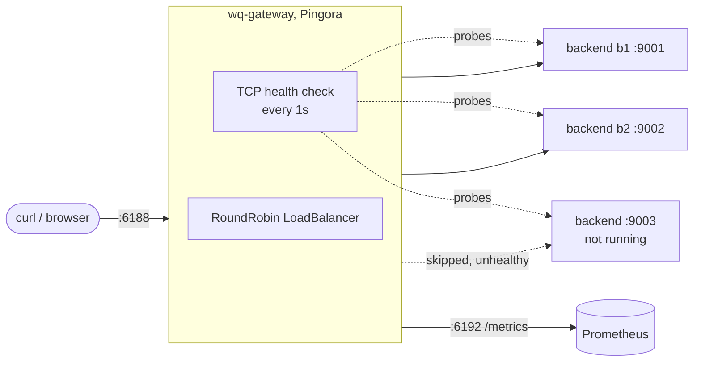
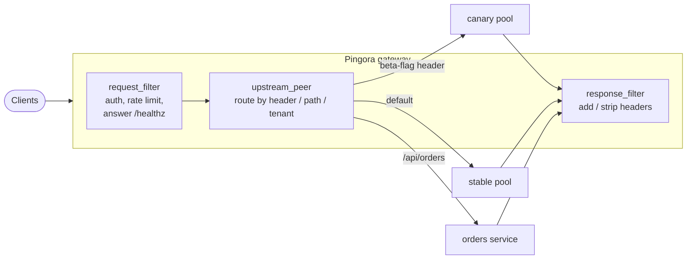
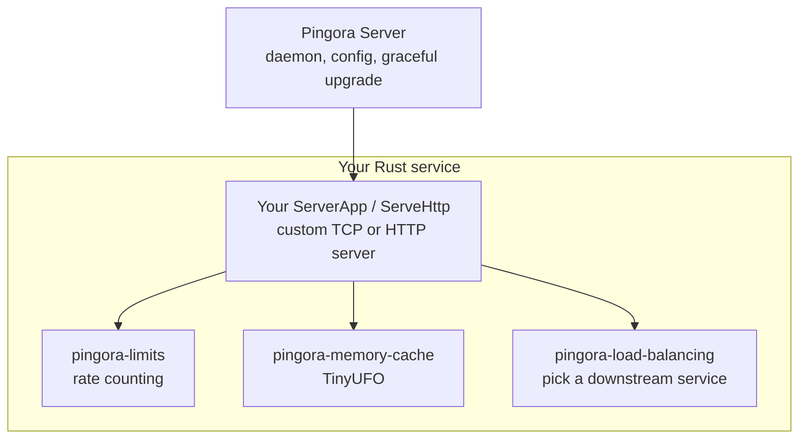
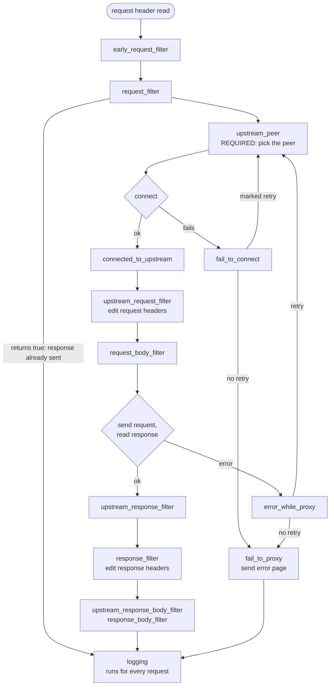
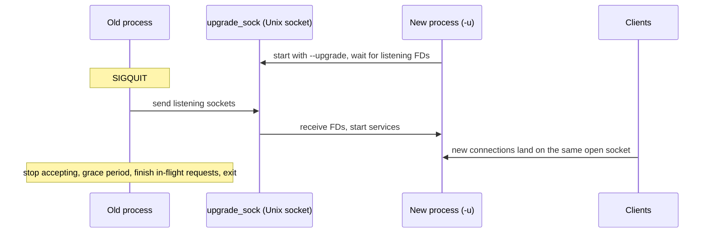

<Muted>
Written against Pingora 0.9.1 (crates.io, tag `0.9.1` of [cloudflare/pingora](https://github.com/cloudflare/pingora/tree/0.9.1), released 2026-11-02) with Rust 1.97.0, and Cloudflare's two Pingora blog posts (2022 and 2024). The gateway in Part 3 was compiled and run in this session on Linux, and every output shown is copied from that run.
</Muted>

<Part level={1} id="arch" title="Architecture examples" toc="Architecture">

<Block id="arch-idea" title="1.1 The idea: a proxy you write, not a proxy you configure" toc="1.1 The idea">

NGINX, HAProxy and Envoy are programs you **configure**. Pingora is a Rust **library**. You write a small program, and your code decides what happens to each request. Cloudflare's open-source announcement puts it this way: "Pingora is a library and toolset, not an executable binary. In other words, Pingora is the engine that powers a car, not the car itself."

What the framework does for you, and what you write:



- **The framework:**
  - parses HTTP/1 and HTTP/2;
  - handles TLS (OpenSSL, BoringSSL, s2n-tls, or rustls, which is experimental);
  - pools connections to upstreams;
  - runs retries, timeouts and the graceful restart.
- **You write:** which upstream to use, what to change on the way in and out, when to reject a request, and what to log.

</Block>

<Block id="arch-a" title="1.2 Architecture A · A load balancer in front of a backend pool (this lab)" toc="1.2 A · Load balancer">

One Pingora process listens on a port and spreads requests over a pool of backends. A background service health-checks the pool.



`pingora-load-balancing` ships:

- **selection algorithms:** `RoundRobin`, `Random`, `FNVHash`, `Consistent` (Ketama);
- **health checks:** `TcpHealthCheck` or `HttpHealthCheck`;
- **service discovery:** `Static`, or your own.

<Fit>
<Pros title="Fits when">

- You need an L7 load balancer with logic a config file can't express. For example: retry on a *different* backend with *different* headers, which is the NGINX limitation Cloudflare names in its 2022 post.
- You want the load balancer to be ordinary Rust code: versioned, reviewed and unit-tested.

</Pros>
<Cons title="Watch out for">

- Every change is a rebuild and a redeploy (made smooth by the graceful upgrade, [2.6](#th-upgrade)).
- Your team has to be comfortable with async Rust.
- For a plain "spread traffic over N hosts" job, NGINX, HAProxy or a cloud load balancer is less work.

</Cons>
</Fit>

</Block>

<Block id="arch-b" title="1.3 Architecture B · A programmable edge / API gateway" toc="1.3 B · API gateway">

The same process does more per request: authentication, rate limiting, header-based routing (canary, beta users, tenants), header rewriting, and per-request metrics. The repo's own examples are `gateway.rs` (login check plus a metric), `ctx.rs` (beta-user routing) and `rate_limiter.rs`.



<Fit>
<Pros title="Fits when">

- The gateway logic is your product's logic: per-tenant limits, custom auth, unusual routing.
- You'd otherwise end up with large NGINX + Lua (OpenResty) scripts. Cloudflare cites missing static typing in big Lua code bases and the C/Lua memory-safety burden as reasons it moved.

</Pros>
<Cons title="Watch out for">

- You own everything a product gateway gives you for free: an admin UI, declarative routes, plugins.
- If you only need standard API-gateway features, a ready-made gateway is faster to adopt.

</Cons>
</Fit>

</Block>

<Block id="arch-c" title="1.4 Architecture C · Pingora as building blocks for other services" toc="1.4 C · Building blocks">

Pingora isn't only for HTTP proxies. The open-source post says it "provides building blocks for not only proxies but also clients and servers." The repo has:

- an HTTP echo server (`pingora/examples/app/echo.rs`, built on the `ServerApp` and `ServeHttp` traits);
- an HTTP client example;
- crates you can use on their own: `pingora-limits` (rate counting), `pingora-memory-cache` (with the TinyUFO eviction algorithm), `pingora-ketama`, `pingora-timeout`.



<Fit>
<Pros title="Fits when">

- You're writing a network service in Rust anyway and want production-grade pieces: graceful upgrade, rate counters, a cache with stampede protection, consistent hashing.

</Pros>
<Cons title="Watch out for">

- The README calls the cache integration "experimental", with APIs that are "currently highly volatile". The 0.9.0 changelog still labels caching "alpha".
- Pin versions and read the changelog when you upgrade.

</Cons>
</Fit>

</Block>

<Block id="arch-compare" title="1.5 Choosing between them">

| | A · Load balancer | B · API gateway | C · Building blocks |
| --- | --- | --- | --- |
| Pingora traits you write | `ProxyHttp`: `upstream_peer` (+ a few filters) | `ProxyHttp`: many filters + `CTX` | `ServerApp` / `ServeHttp`, or crates only |
| Extra crates | `pingora-load-balancing` | + `pingora-limits`, `pingora-prometheus` | Whatever you need |
| Good first project? | Yes: the lab is this | After A | When you already build Rust services |
| Ready-made alternative | NGINX, HAProxy, cloud LB | Envoy-based or other API gateways | — |

If you want Pingora's engine but **no** coding, there is [River](https://github.com/memorysafety/river): a reverse-proxy application built on Pingora by ISRG's Prossimo project, configured with a KDL file. Its README says it is at v0.5.0, "Until further notice, there is no expectation of stability". The latest commit on its main branch is from 2024-09-06.

</Block>

</Part>

<Part level={2} id="theory" title="Theory">

<Block id="th-why" title="2.1 Why Cloudflare built it: the NGINX limits" toc="2.1 Why it exists">

From Cloudflare's 2022 post, "How we built Pingora":

- **Process-per-worker hurts balance.** "In NGINX each request can only be served by a single worker", which causes uneven load across cores. CPU-heavy or blocking requests slow down the others on the same worker.
- **Connection reuse gets worse as you scale.** "The NGINX connection pool is per worker". When you add workers, connections are scattered across more isolated pools, so fewer requests can reuse a warm TCP+TLS connection. That means a slower time to first byte and more handshakes.
- **Hard-to-add features.** Their example: retrying on a different origin with a different set of request headers, which "is not something NGINX allows us to do".
- **Language risk.** NGINX is C ("not memory safe by design"). The Lua around it was "less performant" and had no static typing.

The design choices that followed:

- **Rust**, for memory safety at C-like speed.
- **A custom HTTP library** instead of hyper, to tolerate the non-RFC-compliant traffic of the real Internet, for example status codes above 599.
- **Multithreading instead of multiprocessing**, so connection pools are shared across threads.
- **A work-stealing Tokio runtime.**
- **A "life of a request" phase API** similar to NGINX/OpenResty, so NGINX developers can move over quickly.

<Grid>
<InfoCard title="Reported results (Cloudflare, 2022)">

- 5 ms lower median and 80 ms lower p95 time to first byte.
- A third as many new connections per second.
- For one large customer, connection reuse went from 87.1% to 99.92%, "160x" fewer new connections.
- "About 70% less CPU and 67% less memory" than the old service at the same traffic.

</InfoCard>
<InfoCard title="Read these numbers carefully">

They come from Cloudflare's own production, compared against **their** NGINX/Lua setup. Most of the latency gain is from better connection reuse, not faster code: "Even our old service could handle requests in the sub-millisecond range." For an ordinary NGINX deployment, I'm unsure how much of this carries over. I found no independent benchmark I could verify.

</InfoCard>
</Grid>

</Block>

<Block id="th-model" title="2.2 Server, services, listeners, connectors" toc="2.2 Building blocks">

From the user guide's "Pingora internals" page:

| Piece | What it is |
| --- | --- |
| **Server** | The process. It parses the CLI (`-c`, `-d`, `-u`, `-t`), reads the YAML config, handles signals, daemonizes, and does the graceful upgrade. It "has no particular notion of a Proxy". |
| **Service** | Listens on one or more endpoints and hands each connection to its *app*. "Each service has its own threadpool/tokio runtime"; threads are not shared across services. Background services, such as the health check, listen on nothing. |
| **Listener / TransportStack** | A listening socket (TCP or Unix socket) plus optional TLS settings. |
| **App** | `HttpProxy` (from `pingora-proxy`) is one app. It drives the request phases and calls *your* `ProxyHttp` implementation. |
| **Connector** | Connects to a **peer** (an upstream) and keeps the connection pool shared across downstream clients and threads. Choosing *which* peer happens one level up, in your `upstream_peer()`. |

In this vocabulary, **downstream** is the client side and **upstream** is the server side.

</Block>

<Block id="th-phases" title="2.3 The life of a request: phases and filters" toc="2.3 Request phases">

You implement the `ProxyHttp` trait. `upstream_peer()` is the only required method; every other phase has a default. This is the order from the user guide's phase chart, simplified (no cache):



| Phase | Typical use (from the guide) | In the lab |
| --- | --- | --- |
| `request_filter` | "validating request inputs, rate limiting, and initializing context". Return `true` if you already responded. | `/healthz` answer, 429 rate limit |
| `upstream_peer` | Choose the upstream and how to connect (TLS, SNI, timeouts) | Round robin, skipping a failed backend |
| `fail_to_connect` | Report and decide if the error is retryable | Retry once on another backend |
| `upstream_request_filter` | Modify the request before it goes upstream | Add `X-Forwarded-By` |
| `response_filter` | Modify the response before it goes downstream | `Server`, `X-Upstream` |
| `logging` | "the last phase that runs after the request is finished (or errors)" | Log line + Prometheus counter |

**CTX** is your own struct, created once per request with `new_ctx()` and passed mutably to every phase. It's how phases talk to each other. In the lab, `upstream_peer` records the chosen backend, and `response_filter` and `logging` read it. State shared **across** requests (counters, caches) is plain Rust: `static`, `Arc`, atomics, or a mutex.

</Block>

<Block id="th-failover" title="2.4 Failures, retries and failover" toc="2.4 Failover">

From the "Handling failures and failover" guide:

- **Before** the response header has gone downstream, you can send an error page, retry the same upstream, or try another one. **After** it has gone, "there is nothing the proxy can do other than logging an error and then giving up on the request."
- To retry, `fail_to_connect()` or `error_while_proxy()` calls `e.set_retry(true)`. For failover, they also note in `CTX` which peer failed, so `upstream_peer()` can pick a different one.
- **Safety:** "When `fail_to_connect()` is called, pingora-proxy guarantees that nothing was sent upstream", so retrying there is always safe. After `error_while_proxy()`, only retry idempotent requests (`GET`) unless you know the upstream.

Health checks and retries work together:

- **The health check** removes a dead backend from selection within its frequency (1 s in the lab).
- **The retry** covers the gap before the check notices. In [3.6](#im-failover), the requests in that gap still return 200.

</Block>

<Block id="th-pool" title="2.5 Connection pooling" toc="2.5 Connection pooling">

Connection reuse is the main reason Pingora exists ([2.1](#th-why)):

- The connectors keep idle upstream connections and hand them to later requests, from *any* client and *any* thread. That skips TCP and TLS handshakes.
- Pool size is set with `upstream_keepalive_pool_size` (per Tokio worker, so the ceiling is pool size × `threads`).
- 0.9.0 "reworked connection pooling with sharded storage and a true global LRU".
- Only connections to the *same* peer are reused. Per the pooling guide, that means the same IP:port, scheme, SNI, client cert, verify settings, `alternative_cn` and proxy settings.
- An `idle_timeout` of 0 disables pooling for a peer, and a connection that had an error is not reused.

</Block>

<Block id="th-upgrade" title="2.6 Graceful upgrade without dropping requests" toc="2.6 Graceful upgrade">

Because Pingora is a binary you rebuild, upgrades have to be cheap. The graceful-upgrade guide promises:

- "No request will see connection refused when trying to connect to the server endpoints."
- "A request that can finish within the grace period is guaranteed not to be terminated."

How it works on Linux:



- The listening socket **is never closed**. It just changes owner. Both processes need the same `upgrade_sock` path in the config.
- `-t` / `--test` lets you check that the new binary and config start before you signal the old one.
- `SIGTERM` is a graceful shutdown (no handover).
- `systemd` integration is covered in the user guide.

</Block>

<Block id="th-compare" title="2.7 Pingora, NGINX or Envoy?" toc="2.7 vs NGINX / Envoy">

| | Pingora 0.9 | NGINX | Envoy |
| --- | --- | --- | --- |
| What you get | A Rust library: you build the binary | A server you configure | A proxy you configure; "a self contained process" |
| Custom logic | Rust code in phase callbacks | Config, C modules; Lua via OpenResty | Pluggable filter chain; "dynamic configuration APIs for centralized management" |
| Process model | Multithreaded, shared pools (Tokio) | Worker processes, pool per worker | See Envoy's threading docs (not checked for this page) |
| Language | Rust | C | "high performance C++ distributed proxy" |
| License / home | Apache-2.0, Cloudflare | see nginx.org | CNCF-hosted project |
| Typical home | Custom edge proxies, gateways, load balancers | Web server, reverse proxy, general use | Service mesh data plane, edge, API gateways |

Rules of thumb:

- If a config file can do it, a **configured** proxy (NGINX, HAProxy, Envoy, a cloud load balancer) is less to own.
- Pick **Pingora** when you need:
  - logic per request that config can't express;
  - memory safety;
  - very high connection reuse;
  - all of the above, with a team willing to maintain a Rust service.

<Note title="Unsure">
- I didn't benchmark Pingora against NGINX or Envoy. The numbers on this page are Cloudflare's own ([2.1](#th-why)).
- I didn't check Envoy's threading model for this page.
- HTTP/3 was "on the roadmap" in the 2024 announcement. I found no HTTP/3 entry in the changelog up to 0.9.1, so I'm assuming it isn't supported yet. Check the current changelog before you rely on that.
</Note>

</Block>

<Block id="th-proscons" title="2.8 Problems solved, pros and cons" toc="2.8 Pros and cons">

Problems it solves:

- **Memory-safety bugs** in C/C++ network code.
- **Poor connection reuse** with per-process pools.
- **Logic that won't fit in config** (custom retries and routing).
- **Restarts that drop traffic.**

<Fit>
<Pros>

- Memory-safe Rust and a fast, shared, multithreaded design.
- Full control at every request phase, with typed per-request state.
- Zero-downtime upgrades are built in ([3.7](#im-upgrade) shows 400 of 400 requests succeeding across one).
- Proven at Cloudflare scale: "more than 40 million Internet requests per second" (README).
- Apache-2.0, with useful standalone crates.

</Pros>
<Cons>

- You write and maintain a Rust program, not a config file.
- Linux is the only tier-1 platform. macOS is best effort, and Windows support is "preliminary".
- Pre-1.0 (0.9.x), with breaking changes listed in changelogs. Caching is still alpha.
- No admin UI, declarative routes or plugin ecosystem out of the box (River aims at that, but is not stable).
- No HTTP/3 yet, as far as I could verify ([2.7](#th-compare)).

</Cons>
</Fit>

</Block>

</Part>

<Part level={3} id="impl" title="Implementation">

<Block id="im-prereqs" title="3.1 Prerequisites (Ubuntu)" toc="3.1 Prerequisites">

The lab is plain HTTP, so no TLS library is needed. It still needs a C toolchain and **CMake**: one of Pingora's compression dependencies (`libz-ng-sys`) builds with CMake.

```bash
sudo apt update && sudo apt install -y build-essential cmake curl python3
curl --proto '=https' --tlsv1.2 -sSf https://sh.rustup.rs | sh      # official rustup installer
source "$HOME/.cargo/env"
rustc --version      # Pingora's MSRV is 1.85; this page used 1.97.0
```

<Note title="macOS and Windows">
Pingora's README: "Linux is our tier 1 environment". macOS should mostly work, but "some features might be missing". The graceful upgrade in [3.7](#im-upgrade) is Linux only. On Windows, use WSL2 (not tested).
</Note>

</Block>

<Block id="im-files" title="3.2 The files" toc="3.2 Files">

```text
pingora-lab/
├── backends/backend.py        # two tiny upstreams that say who they are
└── wq-gateway/
    ├── Cargo.toml
    ├── conf.yaml
    └── src/main.rs
```

The backends answer every `GET` with their name and the `X-Forwarded-By` header they received, so you can see the gateway's work:

```python title="backends/backend.py"
# Tiny upstream for the lab: answers every request with its own name and the headers it got.
import json, sys
from http.server import BaseHTTPRequestHandler, ThreadingHTTPServer

NAME, PORT = sys.argv[1], int(sys.argv[2])

class Handler(BaseHTTPRequestHandler):
    def do_GET(self):
        body = json.dumps({
            "backend": NAME,
            "path": self.path,
            "x_forwarded_by": self.headers.get("X-Forwarded-By"),
        }).encode() + b"\n"
        self.send_response(200)
        self.send_header("Content-Type", "application/json")
        self.send_header("Content-Length", str(len(body)))
        self.end_headers()
        self.wfile.write(body)

    def log_message(self, *args):  # keep the terminal quiet
        pass

ThreadingHTTPServer(("127.0.0.1", PORT), Handler).serve_forever()
```

```toml title="wq-gateway/Cargo.toml"
[package]
name = "wq-gateway"
version = "0.1.0"
edition = "2021"

[dependencies]
async-trait = "0.1"
pingora = { version = "0.9.1", features = ["lb"] }   # "lb" pulls in the proxy and load balancing; no TLS feature: plain HTTP only
pingora-limits = "0.9.1"
pingora-prometheus = "0.9.1"
prometheus = "0.14"
once_cell = "1"
log = "0.4"
env_logger = "0.11"
bytes = "1"
```

The gateway. Each phase is commented with what it does:

```rust title="wq-gateway/src/main.rs"
// wq-gateway: a small Pingora reverse proxy for the WQ Learn Book lab.
// Round robin over local backends, TCP health checks, one failover retry,
// per-appid rate limiting, extra headers, and Prometheus metrics.
use async_trait::async_trait;
use bytes::Bytes;
use log::info;
use once_cell::sync::Lazy;
use pingora::prelude::*;
use pingora_limits::rate::Rate;
use prometheus::{register_int_counter_vec, IntCounterVec};
use std::sync::Arc;
use std::time::Duration;

const BACKENDS: [&str; 3] = ["127.0.0.1:9001", "127.0.0.1:9002", "127.0.0.1:9003"]; // 9003 is never started
const MAX_REQ_PER_SEC: isize = 5;

static RATE: Lazy<Rate> = Lazy::new(|| Rate::new(Duration::from_secs(1)));
static REQUESTS: Lazy<IntCounterVec> = Lazy::new(|| {
    register_int_counter_vec!(
        "wq_gateway_requests_total",
        "Requests handled by wq-gateway",
        &["status", "upstream"]
    )
    .unwrap()
});

pub struct Gateway {
    lb: Arc<LoadBalancer<RoundRobin>>,
}

/// Per-request state shared by all phases of one request.
#[derive(Default)]
pub struct Ctx {
    tries: usize,
    failed: Option<String>,   // backend that refused us; skip it on the retry
    upstream: Option<String>, // backend that served the request
}

#[async_trait]
impl ProxyHttp for Gateway {
    type CTX = Ctx;
    fn new_ctx(&self) -> Ctx {
        Ctx::default()
    }

    // Phase 1: answer or reject before any upstream is involved.
    async fn request_filter(&self, session: &mut Session, _ctx: &mut Ctx) -> Result<bool> {
        if session.req_header().uri.path() == "/healthz" {
            session.respond_error_with_body(200, Bytes::from_static(b"ok\n")).await?;
            return Ok(true); // true = response already sent, stop here
        }
        let appid = session
            .req_header()
            .headers
            .get("appid")
            .and_then(|v| v.to_str().ok())
            .map(str::to_owned);
        if let Some(appid) = appid {
            if RATE.observe(&appid, 1) > MAX_REQ_PER_SEC {
                let mut header = ResponseHeader::build(429, None)?;
                header.insert_header("X-Rate-Limit-Limit", MAX_REQ_PER_SEC.to_string())?;
                header.insert_header("Content-Length", "0")?;
                session.set_keepalive(None);
                session.write_response_header(Box::new(header), true).await?;
                return Ok(true);
            }
        }
        Ok(false)
    }

    // Phase 2 (required): pick the upstream for this request.
    async fn upstream_peer(&self, _session: &mut Session, ctx: &mut Ctx) -> Result<Box<HttpPeer>> {
        let failed = ctx.failed.clone();
        let backend = self
            .lb
            .select_with(b"", 256, |b, healthy| healthy && Some(b.addr.to_string()) != failed)
            .ok_or_else(|| Error::explain(HTTPStatus(503), "no healthy upstream"))?;
        let addr = backend.addr.to_string();
        ctx.upstream = Some(addr.clone());
        let mut peer = Box::new(HttpPeer::new(addr, false, String::new())); // plain HTTP, no SNI
        peer.options.connection_timeout = Some(Duration::from_millis(500));
        Ok(peer)
    }

    // Connecting failed: nothing was sent yet, so one retry on another backend is safe.
    fn fail_to_connect(
        &self,
        _session: &mut Session,
        peer: &HttpPeer,
        ctx: &mut Ctx,
        mut e: Box<Error>,
    ) -> Box<Error> {
        if ctx.tries == 0 {
            ctx.tries += 1;
            ctx.failed = Some(peer._address.to_string());
            info!("connect to {} failed, retrying on another backend", peer._address);
            e.set_retry(true);
        }
        e
    }

    // Phase 3: change the request on its way to the upstream.
    async fn upstream_request_filter(
        &self,
        _session: &mut Session,
        upstream_request: &mut RequestHeader,
        _ctx: &mut Ctx,
    ) -> Result<()> {
        upstream_request.insert_header("X-Forwarded-By", "wq-gateway")?;
        Ok(())
    }

    // Phase 4: change the response on its way to the client.
    async fn response_filter(
        &self,
        _session: &mut Session,
        upstream_response: &mut ResponseHeader,
        ctx: &mut Ctx,
    ) -> Result<()> {
        upstream_response.insert_header("Server", "wq-gateway")?;
        if let Some(up) = &ctx.upstream {
            upstream_response.insert_header("X-Upstream", up.as_str())?;
        }
        Ok(())
    }

    // Last phase: runs for every request, success or error.
    async fn logging(&self, session: &mut Session, _e: Option<&pingora::Error>, ctx: &mut Ctx) {
        let status = session.response_written().map_or(0, |r| r.status.as_u16());
        let upstream = ctx.upstream.as_deref().unwrap_or("none");
        REQUESTS.with_label_values(&[&status.to_string(), upstream]).inc();
        info!("{} -> {} status={}", self.request_summary(session, ctx), upstream, status);
    }
}

fn main() {
    env_logger::init();
    let mut server = Server::new(Some(Opt::parse_args())).unwrap(); // -c conf.yaml, -d, -u, -t
    server.bootstrap();

    let mut upstreams = LoadBalancer::try_from_iter(BACKENDS).unwrap();
    upstreams.set_health_check(TcpHealthCheck::new());
    upstreams.health_check_frequency = Some(Duration::from_secs(1));
    let health = background_service("health check", upstreams);
    let lb = health.task();

    let mut proxy = http_proxy_service(&server.configuration, Gateway { lb });
    proxy.add_tcp("0.0.0.0:6188");

    let mut metrics = pingora_prometheus::prometheus_http_service();
    metrics.add_tcp("127.0.0.1:6192");

    server.add_service(health);
    server.add_service(proxy);
    server.add_service(metrics);
    server.run_forever();
}
```

Pingora's server config, used for the daemon and the upgrade in [3.7](#im-upgrade):

```yaml title="wq-gateway/conf.yaml"
---
version: 1
threads: 2
pid_file: /tmp/wq-gateway.pid
error_log: /tmp/wq-gateway.err.log
upgrade_sock: /tmp/wq-gateway.sock      # old and new process hand the listening socket over here
grace_period_seconds: 3                 # after SIGQUIT/SIGTERM: keep serving this long
graceful_shutdown_timeout_seconds: 5    # then give in-flight requests this long to finish
```

Notes on the code:

- **`features = ["lb"]`** enables the proxy and the load balancer without a TLS backend. Add `"openssl"` (and `HttpPeer::new(addr, true, sni)`) to proxy to HTTPS upstreams, as the [quick start](https://github.com/cloudflare/pingora/blob/0.9.1/docs/quick_start.md) does with 1.1.1.1.
- **`select_with`** is `select` plus your own filter. It picks the next backend that is healthy *and* is not the one that just failed.
- **`peer._address`** is a public field of `HttpPeer`; the leading underscore is just its name in Pingora's API.
- **Prometheus labels** stay bounded: status codes, plus a fixed set of three backends.

</Block>

<Block id="im-build" title="3.3 Build and start" toc="3.3 Build and start">

Terminal 1, the backends:

```bash
cd pingora-lab
python3 backends/backend.py b1 9001 &
python3 backends/backend.py b2 9002 &
```

Terminal 2, the gateway. The first build downloads and compiles about 210 crates; on this session's machine it took 1 min 40 s:

```bash
cd pingora-lab/wq-gateway
cargo build --release
RUST_LOG=info ./target/release/wq-gateway
```

```text output
INFO  pingora_core::server] Starting services in dependency order: ["Prometheus metric HTTP", "Pingora HTTP Proxy Service", "BG health check"]
INFO  pingora_core::server] Starting service: Prometheus metric HTTP
INFO  pingora_core::server] Starting service: Pingora HTTP Proxy Service
INFO  pingora_core::server] Starting service: BG health check
WARN  pingora_load_balancing] Backend { addr: Inet(127.0.0.1:9003), weight: 1, ext: {} } becomes unhealthy,  ConnectRefused ... Connection refused (os error 111)
```

The health check flagged `:9003` (never started) as unhealthy straight away, so no request will be sent there.

</Block>

<Block id="im-verify" title="3.4 Round robin and the filters" toc="3.4 Round robin">

```bash
for i in 1 2 3 4; do curl -s -D - http://127.0.0.1:6188/hello -o body.txt | grep -i '^x-upstream'; cat body.txt; done
```

```text output
X-Upstream: 127.0.0.1:9001
{"backend": "b1", "path": "/hello", "x_forwarded_by": "wq-gateway"}
X-Upstream: 127.0.0.1:9002
{"backend": "b2", "path": "/hello", "x_forwarded_by": "wq-gateway"}
X-Upstream: 127.0.0.1:9001
{"backend": "b1", "path": "/hello", "x_forwarded_by": "wq-gateway"}
X-Upstream: 127.0.0.1:9002
{"backend": "b2", "path": "/hello", "x_forwarded_by": "wq-gateway"}
```

Three phases are visible here:

- `upstream_peer` alternated b1 and b2, never `:9003`.
- `upstream_request_filter` added `X-Forwarded-By`, which the backend echoes.
- `response_filter` added `X-Upstream`, and `Server: wq-gateway` (check with `curl -s -D - -o /dev/null http://127.0.0.1:6188/`).

The gateway's log (terminal 2), written by `logging`:

```text output
INFO  wq_gateway] GET /hello, Host: 127.0.0.1:6188 -> 127.0.0.1:9001 status=200
INFO  wq_gateway] GET /hello, Host: 127.0.0.1:6188 -> 127.0.0.1:9002 status=200
```

</Block>

<Block id="im-filter" title="3.5 Answer without an upstream: /healthz and the rate limit" toc="3.5 Health and rate limit">

```bash
curl -si http://127.0.0.1:6188/healthz
for i in $(seq 1 8); do curl -s -o /dev/null -w '%{http_code} ' -H 'appid: team-a' http://127.0.0.1:6188/; done; echo
curl -si -H 'appid: team-a' http://127.0.0.1:6188/
```

```text output
HTTP/1.1 200 OK
Server: Pingora
Content-Length: 3
Cache-Control: private, no-store
Connection: close

ok

200 200 200 200 200 429 429 429

HTTP/1.1 429 Too Many Requests
X-Rate-Limit-Limit: 5
Content-Length: 0
Connection: close
```

`request_filter` answered both itself, and returned `Ok(true)` so no upstream was involved:

- **`/healthz`** shows `Server: Pingora`, because `response_filter` only runs on proxied responses.
- **The rate limit** allowed 5 requests per second per `appid` and refused the rest. `pingora-limits` counts per key in a 1-second window; wait a second and `team-a` is allowed again. Requests without an `appid` header are not limited, as in the guide's example.

</Block>

<Block id="im-failover" title="3.6 Kill a backend: failover between health checks" toc="3.6 Failover">

Stop b2, then send requests right away, before the 1-second health check notices:

```bash
kill %2            # or: kill <pid of "backend.py b2 9002">
for i in 1 2 3 4; do curl -s -o /dev/null -w '%{http_code} via %header{x-upstream}\n' http://127.0.0.1:6188/; done
```

```text output
200 via 127.0.0.1:9001
200 via 127.0.0.1:9001
200 via 127.0.0.1:9001
200 via 127.0.0.1:9001
```

The gateway log shows the retry doing its job:

```text output
INFO  wq_gateway] connect to 127.0.0.1:9002 failed, retrying on another backend
WARN  pingora_proxy] Fail to proxy: Upstream ConnectRefused context: Fail to connect to addr: 127.0.0.1:9002, scheme: HTTP ...
INFO  wq_gateway] GET /, Host: 127.0.0.1:6188 -> 127.0.0.1:9001 status=200
```

The `WARN` records the failed attempt. The client still got a 200 from b1, because `fail_to_connect` marked the error retryable and `upstream_peer` skipped b2.

Start b2 again. Within a second the health check logs `Backend { addr: Inet(127.0.0.1:9002), ... } becomes healthy`, and round robin includes it again:

```bash
python3 ../backends/backend.py b2 9002 &
sleep 2; for i in 1 2; do curl -s -o /dev/null -w '%{http_code} via %header{x-upstream}\n' http://127.0.0.1:6188/; done
```

```text output
200 via 127.0.0.1:9002
200 via 127.0.0.1:9001
```

The metrics endpoint shows all of the above, from the `logging` phase:

```bash
curl -s http://127.0.0.1:6192/metrics | grep wq_gateway
```

```text output
# HELP wq_gateway_requests_total Requests handled by wq-gateway
# TYPE wq_gateway_requests_total counter
wq_gateway_requests_total{status="200",upstream="127.0.0.1:9001"} 14
wq_gateway_requests_total{status="200",upstream="127.0.0.1:9002"} 6
wq_gateway_requests_total{status="200",upstream="none"} 1
wq_gateway_requests_total{status="429",upstream="none"} 4
```

Your counts will differ with how many requests you sent. To graph it, point the Prometheus from [OTel Java on KinD](/observability/otel-java-kind) at `:6192`, or scrape it with Vector's `prometheus_scrape` source ([Vector observability pipeline](/observability/vector-observability-pipeline)).

</Block>

<Block id="im-upgrade" title="3.7 Zero-downtime upgrade under load (Linux)" toc="3.7 Graceful upgrade">

Stop the foreground gateway (Ctrl+C), then run it as a daemon with `conf.yaml`:

```bash
./target/release/wq-gateway -c conf.yaml -t          # check the config first
RUST_LOG=info ./target/release/wq-gateway -c conf.yaml -d
cat /tmp/wq-gateway.pid
```

```text output
INFO  pingora_core::server::bootstrap_services] Server Test passed, exiting
INFO  pingora_core::server] Daemonizing the server
6132
```

Start 400 requests in the background, one every 20 ms, and upgrade in the middle. In real life the new binary would be a rebuilt one; here it's the same binary, which still shows the handover. Follow the guide's order: start the new process with `-u` first, then send `SIGQUIT` to the old one:

```bash
OLD=$(cat /tmp/wq-gateway.pid)
( for i in $(seq 1 400); do curl -s -o /dev/null -w '%{http_code}\n' --max-time 2 http://127.0.0.1:6188/; sleep 0.02; done > load.txt ) &
sleep 2
RUST_LOG=info ./target/release/wq-gateway -c conf.yaml -d -u &   # step 1: waits for the socket
sleep 1
kill -QUIT $OLD                                                 # step 2: hand it over
wait; sleep 6
sort load.txt | uniq -c
cat /tmp/wq-gateway.pid
```

```text output
    400 200
6471
```

All 400 requests succeeded, and a new PID now serves. The error log (`/tmp/wq-gateway.err.log`) shows the handover and the old process's graceful exit:

```text output
INFO  pingora_core::server] SIGQUIT received, sending socks and gracefully exiting
INFO  pingora_core::server] Trying to send socks
INFO  pingora_core::server] listener sockets sent
INFO  pingora_core::server] Starting service: Pingora HTTP Proxy Service        <- the new process
INFO  pingora_core::server] Broadcasting graceful shutdown                     <- old process, 5 s later
INFO  pingora_core::server] Graceful shutdown: grace period 3s starts
INFO  pingora_core::server] Graceful shutdown: grace period ends
INFO  pingora_core::server] All runtimes exited, exiting now
```

The 3 s grace period is `grace_period_seconds` from `conf.yaml`. The 5 s wait before it matches the constant `CLOSE_TIMEOUT = 5` in `pingora-core/src/server/mod.rs` ("the graceful period for the new service to get ready").

<Tip title="The mistake I made first">
Run the `-u` process **in the background** (`&`). In the foreground, it blocks while it waits for the socket, so your `kill -QUIT` never runs. After about 6 retries it gives up: `Giving up reading socket from: /tmp/wq-gateway.sock, error: EAGAIN`. The old process keeps serving, so nothing breaks, but nothing upgrades either.
</Tip>

</Block>

<Block id="im-next" title="3.8 Where to go next" toc="3.8 Next steps">

- **HTTPS upstreams:** add the `openssl` (or `boringssl`) feature, then use `HttpPeer::new(addr, true, "sni.example".into())`. See the quick start.
- **TLS and HTTP/2 for clients:** `TlsSettings::intermediate(cert, key)`, `enable_h2()`, `add_tls_with_settings(...)`. This is how `pingora-proxy/examples/load_balancer.rs` does it.
- **Routing by header:** `pingora-proxy/examples/ctx.rs` and `multi_lb.rs`.
- **HTTP health checks** (status code instead of TCP connect): `HttpHealthCheck` in `pingora-load-balancing`.
- **Run under systemd:** the user guide's "Systemd integration" page.

</Block>

<Block id="im-troubleshoot" title="3.9 Troubleshooting" toc="3.9 Troubleshooting">

| Symptom | Cause | Fix |
| --- | --- | --- |
| Build fails in `libz-ng-sys` | CMake missing | `sudo apt install cmake` |
| Build fails in `openssl-sys` / `boring-sys` | You enabled a TLS feature without its build tools | Install what the README lists (Clang for BoringSSL, Perl 5 for OpenSSL); the build error names the missing piece |
| Every request to a local backend is `502` | TLS is on for a plain-HTTP upstream | `HttpPeer::new(addr, false, String::new())`, as the quick start says |
| HTTPS upstream returns `403` | Host header is still the proxy's | Set `Host` in `upstream_request_filter` (the 2024 blog's exact example) |
| `-u` process exits with `EAGAIN` | Old process never got `SIGQUIT`, or `upgrade_sock` paths differ | Run `-u` in the background, then `kill -QUIT`; same `conf.yaml` for both |
| A backend that's down still gets traffic | No health check, or it hasn't run yet | `set_health_check` + `health_check_frequency`, and keep a retry in `fail_to_connect` |
| `curl -I` gets `501` | The lab's Python backend has no `HEAD` handler | Use `curl -s -D - -o /dev/null` (a `GET`) |

</Block>

<Block id="im-cleanup" title="3.10 Clean up" toc="3.10 Clean up">

```bash
kill -TERM $(cat /tmp/wq-gateway.pid)          # graceful shutdown of the daemon
kill %1 %2 2>/dev/null                         # the Python backends (or kill their PIDs)
rm -f /tmp/wq-gateway.pid /tmp/wq-gateway.sock /tmp/wq-gateway.err.log
cargo clean                                    # in wq-gateway/: frees the build directory
```

</Block>

<Block id="refs" title="References">

- [cloudflare/pingora (tag 0.9.1)](https://github.com/cloudflare/pingora/tree/0.9.1): [README](https://github.com/cloudflare/pingora/blob/0.9.1/README.md), [CHANGELOG](https://github.com/cloudflare/pingora/blob/0.9.1/CHANGELOG.md), [LICENSE (Apache-2.0)](https://github.com/cloudflare/pingora/blob/0.9.1/LICENSE)
- [Quick start: load balancer](https://github.com/cloudflare/pingora/blob/0.9.1/docs/quick_start.md) and the [user guide](https://github.com/cloudflare/pingora/blob/0.9.1/docs/user_guide/index.md)
- User guide pages: [phases and filters](https://github.com/cloudflare/pingora/blob/0.9.1/docs/user_guide/phase.md), [CTX](https://github.com/cloudflare/pingora/blob/0.9.1/docs/user_guide/ctx.md), [failover](https://github.com/cloudflare/pingora/blob/0.9.1/docs/user_guide/failover.md), [graceful upgrade](https://github.com/cloudflare/pingora/blob/0.9.1/docs/user_guide/graceful.md), [configuration](https://github.com/cloudflare/pingora/blob/0.9.1/docs/user_guide/conf.md), [rate limiter](https://github.com/cloudflare/pingora/blob/0.9.1/docs/user_guide/rate_limiter.md), [Prometheus](https://github.com/cloudflare/pingora/blob/0.9.1/docs/user_guide/prom.md), [internals](https://github.com/cloudflare/pingora/blob/0.9.1/docs/user_guide/internals.md)
- Examples: [pingora-proxy/examples](https://github.com/cloudflare/pingora/tree/0.9.1/pingora-proxy/examples) and [pingora/examples](https://github.com/cloudflare/pingora/tree/0.9.1/pingora/examples)
- Crates: [pingora](https://crates.io/crates/pingora), [pingora-limits](https://crates.io/crates/pingora-limits), [pingora-prometheus](https://crates.io/crates/pingora-prometheus) and [API docs](https://docs.rs/pingora)
- Cloudflare blog: [How we built Pingora, the proxy that connects Cloudflare to the Internet (2022)](https://blog.cloudflare.com/how-we-built-pingora-the-proxy-that-connects-cloudflare-to-the-internet/) and [Open sourcing Pingora (2024)](https://blog.cloudflare.com/pingora-open-source/)
- [memorysafety/river](https://github.com/memorysafety/river): reverse proxy application built on Pingora
- For the comparison: [What is Envoy](https://www.envoyproxy.io/docs/envoy/latest/intro/what_is_envoy), [envoyproxy/envoy README](https://github.com/envoyproxy/envoy), [NGINX core module (worker_processes)](https://nginx.org/en/docs/ngx_core_module.html)
- [rustup](https://rustup.rs/)

</Block>

</Part>
