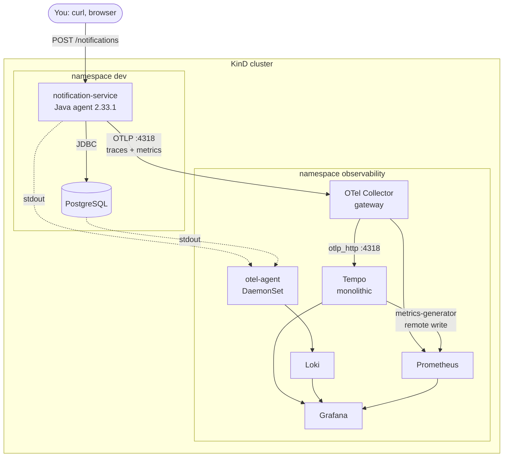
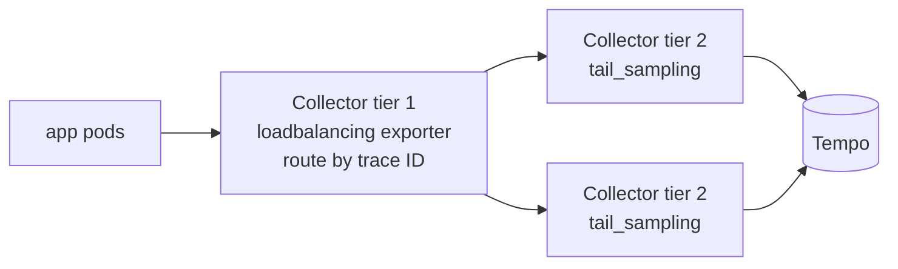
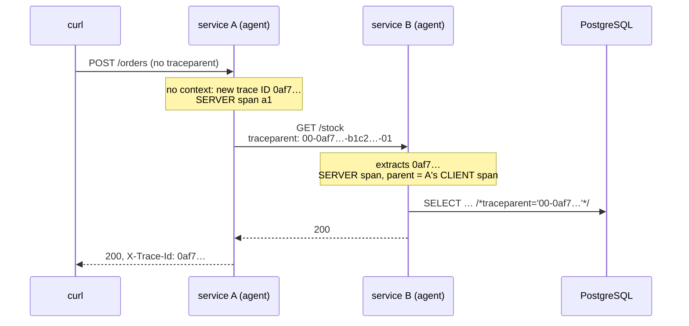

<Muted>
Builds on [OTel Java on KinD](/observability/otel-java-kind) and your Labs 01–03 (Collector gateway, Prometheus, Loki, `otel-agent`, Grafana). Versions: OTel Java agent 2.33.1, chart `grafana-community/tempo` 3.2.1 (Tempo 3.1.1), PostgreSQL 18, Spring Boot 4.1.2.
</Muted>

<Note title="What was tested, and what wasn't">
Tested on the Ubuntu PC while writing this page:

1. The app changes in [3.6](#im-txid) and [3.7](#im-db) were built with `./mvnw package`, and the existing test passes (H2 in-memory database for the test).
2. The jar ran with the **same agent jar you use (2.33.1)** against `postgres:18` in Docker, first with the console exporter, then exporting to **Tempo 3.1.1** running with the config that chart 3.2.1 renders. The span names, attributes, the Postgres log line with the `traceparent` comment, the span tree and every TraceQL query in [3.8](#im-traceql) come from that run.
3. The Tempo chart was rendered with `helm template` and the values below.

Not run: the `kind`, `kubectl` and `helm install` steps, the Collector's traces pipeline, Tempo's metrics-generator and service graph, and the Grafana links. Those follow the docs linked in [References](#refs).
</Note>

<Part level={1} id="arch" title="Architecture examples" toc="Architecture">

<Block id="arch-scenario" title="1.1 The scenario">

Your OTel Java on KinD stack already carries metrics and logs. Traces use the same agent and the same gateway Collector. Only the backend is new:

- **Tempo** in `observability`: stores traces, answers TraceQL queries, and (optionally) turns spans into metrics for Prometheus.
- **PostgreSQL** in `dev`: a small database for `notification-service`, so traces show database calls.
- **Grafana**: a Tempo data source, linked to Loki and Prometheus.



</Block>

<Block id="arch-a" title="1.2 Architecture A · Agent → gateway Collector → Tempo (this page)" toc="1.2 A · Via the gateway">

The agent sends spans to the same Collector Service it already uses for metrics. The Collector's `traces` pipeline exports to Tempo. Every span is kept (no sampling).

<Fit>
<Pros title="Fits when">
- One OTLP address for all three signals, already in place
- Low traffic (a lab, a small team), so keeping every trace is affordable
- You want to swap the trace backend later by changing one Collector exporter
</Pros>
<Cons title="Watch out for">
- Storage grows with request count: every request is a trace
- One Collector replica is a single point of loss for spans in flight
- Health-check probes create traces too (see [3.7](#im-db))
</Cons>
</Fit>

</Block>

<Block id="arch-b" title="1.3 Architecture B · Tail sampling in a Collector tier" toc="1.3 B · Tail sampling">

At production volume most traces are healthy and boring. **Tail sampling** decides per trace, after all its spans have arrived, for example "keep every trace with an error or slower than 1 s, plus 5 % of the rest". The decision needs **all spans of a trace in one Collector**, so a first tier routes spans by trace ID (the contrib `loadbalancing` exporter) to a second tier running the `tail_sampling` processor.



<Fit>
<Pros title="Fits when">
- High traffic: keeping everything is too expensive
- You must keep every error and slow trace, which head sampling can't guarantee
</Pros>
<Cons title="Watch out for">
- The OTel docs call tail samplers "difficult to implement" and "difficult to operate": stateful, buffering, two Collector tiers
- Spans of one trace must reach the same tier-2 Collector
- Tempo's service graph also needs both sides of each call, so heavy sampling distorts it
</Cons>
</Fit>

</Block>

<Block id="arch-c" title="1.4 Architecture C · A different trace backend (Jaeger, a vendor)" toc="1.4 C · Other backends">

The app and Collector stay the same. Only the exporter changes: Jaeger (its v2 is built on the OpenTelemetry Collector and accepts OTLP), a cloud service such as Google Cloud Trace ([OTel Java on GCP](/observability/otel-java-gcp)), or Grafana Cloud.

<Fit>
<Pros title="Fits when">
- You already run Jaeger or a vendor APM
- You don't want to operate trace storage
</Pros>
<Cons title="Watch out for">
- Linking to Loki and Prometheus in Grafana is smoothest with Tempo
- Vendor pricing usually scales with spans ingested
</Cons>
</Fit>

</Block>

<Block id="arch-compare" title="1.5 Choosing between them">

| Concern | A · Via the gateway | B · Tail sampling | C · Other backend |
| --- | --- | --- | --- |
| Traces kept | All | Errors, slow ones + a percentage | Depends on the exporter's config |
| Components | Collector + Tempo | 2 Collector tiers + Tempo | Collector + Jaeger/vendor |
| Hard part | Storage size | Operating the sampling tier | Cost, lock-in |
| Fits | **This lab**, small systems | High-traffic production | Teams with an existing APM |

</Block>

</Part>

<Part level={2} id="theory" title="Theory">

<Block id="th-trace" title="2.1 Traces and spans" toc="2.1 Traces and spans">

A **trace** is the record of one request as it moves through your system. It is a tree of **spans**. The OTel docs: "A span represents a unit of work or operation. Spans are the building blocks of Traces." All spans of a trace share one **trace ID**, and each span except the root points to its parent's **span ID**.

This is a real trace from `notification-service` after the changes in Part 3 (from the test run):

```text output
POST /notifications  [SERVER]  6.47 ms  span_id=765a06d211749da7
  NotificationService.send  [INTERNAL]  4.60 ms  span_id=d02113453dc8955f
    INSERT notifications  [CLIENT]  3.09 ms  span_id=2a7b4141bfda0069
    SELECT notifications  [CLIENT]  0.47 ms  span_id=5a4c199e764b7f35
```

Read it top-down: the HTTP request took 6.47 ms, 4.60 ms of it in `send()`, and inside that 3.09 ms waiting for the INSERT. The 1.87 ms in the server span outside `send()` is Spring, JSON and the filter chain. That breakdown is what metrics and logs can't give you.

Each span has:

| Field | What it holds | Example above |
| --- | --- | --- |
| Name | The operation | `INSERT notifications` |
| Kind | Its role (table below) | `CLIENT` |
| Start, end | Timestamps, so the duration | 3.09 ms |
| Span context | Trace ID, span ID, trace flags, trace state. This is what travels to other services. | |
| Parent span ID | Empty for the root span | |
| Attributes | Key-value metadata | `http.route=/notifications`, `db.system.name=postgresql` |
| Events | "A structured log message (or annotation) on a Span", at a point in time | An exception being thrown |
| Links | Points to spans in other traces, "implying a causal relationship" | A batch job linked to the requests that queued its items |
| Status | `Unset` (the default, "completed without an error"), `Error`, `Ok` | |

The **span kind** tells the backend how spans fit together across services:

| Kind | OTel docs | In this app |
| --- | --- | --- |
| `SERVER` | "a synchronous incoming remote call such as an incoming HTTP request" | `POST /notifications` (made by the Tomcat instrumentation) |
| `CLIENT` | "a synchronous outgoing remote call such as an outgoing HTTP request or database call" | The JDBC spans |
| `INTERNAL` | "operations which do not cross a process boundary" | `NotificationService.send` (your `@WithSpan`) |
| `PRODUCER` | "the creation of a job which may be asynchronously processed later" | Sending to Kafka |
| `CONSUMER` | "the processing of a job created by a producer" | Reading from Kafka |

</Block>

<Block id="th-propagation" title="2.2 How a trace crosses services: context propagation" toc="2.2 Propagation">

A trace only spans several services if each one learns the trace ID from the caller. The caller's instrumentation **injects** its span context into the outgoing request (for HTTP, a header), and the receiver's instrumentation **extracts** it and starts its `SERVER` span as a child. The OTel default is the W3C Trace Context header, `traceparent`:

```text
traceparent: 00-0af7651916cd43dd8448eb211c80319c-b7ad6b7169203331-01
             │  │                                │                └─ trace-flags: 01 = sampled
             │  │                                └─ parent-id: the caller's span ID (16 hex)
             │  └─ trace-id (32 hex, 16 bytes)
             └─ version (00)
```



- With the Java agent, inject and extract are automatic for the HTTP clients, servers and messaging libraries it instruments. You write no propagation code.
- `tracestate` is a companion header for vendor-specific data. You can ignore it.
- A service that isn't instrumented, or a proxy that drops headers, **breaks the chain**: the next service starts a new trace.
- **Security:** the OTel docs warn about accepting forged trace context from untrusted callers, and about leaking internal IDs to external endpoints. Edge services often start a new trace for requests from the internet.

</Block>

<Block id="th-txid" title='2.3 "Transaction ID": which ID for what' toc="2.3 Transaction IDs">

"Trace a transaction ID" can mean three different IDs. They do different jobs:

| ID | Who creates it | Lives for | Use it to |
| --- | --- | --- | --- |
| **Trace ID** | The first instrumented service (random) | One request, across every service it touches | See the whole path and timing of that request |
| **Business ID** (`notification.id`, an order or payment ID) | Your code | As long as the business object, across many requests | Find every request that touched *this* order |
| **Log correlation** (`trace_id` in each log line) | The agent, from the current span | One log line | Jump from a log line to its trace and back |

**1 · Trace ID as the request's transaction ID.** It already exists for every request. Make it visible to the caller, so a support ticket can quote it: in [3.6](#im-txid) a 15-line filter returns it as the `X-Trace-Id` response header. The test run returned `X-Trace-Id: 0fe48eddec85c0161e404e1514be4555`, the same ID as the spans in Tempo.

<Note title="Unsure">
W3C has worked on a standard response header (`traceresponse`) in a newer level of Trace Context. The published Recommendation (Level 1) doesn't contain it, and I couldn't confirm its status. A custom `X-Trace-Id` header works everywhere.
</Note>

**2 · Business ID as a span attribute.** Put the ID on a span: `Span.current().setAttribute("notification.id", id)`. Tempo can then find the trace by that value:

```text
{ span.notification.id = "1dec6d0c-e82e-4c56-afdf-2c55efd01e68" }
```

This is **the opposite of the Loki rule** from OTel Java on KinD. A unique ID per request must not be a Loki label or a Prometheus label, because each value creates a new stream or series. In a trace, an attribute is just data stored with that one span, so high-cardinality values like IDs are exactly what span attributes are for.

**3 · Carrying the business ID to other services: baggage.** Baggage is a key-value store that travels with the context (in the `baggage` header) to every downstream service. It is **not** added to spans automatically: "Baggage … is unassociated with attributes on spans, metrics, or logs without explicitly adding them." Each service reads it and sets the attribute itself. The OTel docs also warn that baggage can reach "unintended resources, like third-party APIs", is visible on the network, and has no integrity check. So put IDs in it, never credentials or personal data.

**4 · Log lines carry the trace ID.** The agent puts `trace_id`, `span_id` and `trace_flags` into the logging MDC of every log call made inside a span. Over OTLP they become structured metadata (OTel Java on KinD). On stdout they only appear if the log pattern prints them, which [3.9](#im-grafana) sets up for your `otel-agent` path.

</Block>

<Block id="th-db" title="2.4 Tracing down to the database" toc="2.4 Database tracing">

There are two sides to a database call, and tracing sees them differently.

**The client side: what the app sees.** The agent instruments the database client libraries, so every statement becomes a `CLIENT` span with no code change. From the agent's supported-libraries list:

| Library | Instrumented | Notes |
| --- | --- | --- |
| JDBC (any driver: PostgreSQL, MySQL, Oracle…) | Yes | Spans and `db.client.operation.duration` |
| HikariCP, DBCP, c3p0, Tomcat JDBC, … | Pool **metrics** | Connection count, pending requests, wait time |
| Hibernate | Disabled by default | Adds session-level spans above the JDBC ones |
| R2DBC, MongoDB, Cassandra, Elasticsearch | Yes | |
| Redis (Lettuce, Jedis) | Yes | |
| Kafka clients | Yes | `PRODUCER` and `CONSUMER` spans |

A DB span, from the test run, with the stable attribute names turned on:

```text output
'INSERT notifications' CLIENT [tracer: io.opentelemetry.jdbc:2.33.1-alpha]
  db.system.name   = postgresql
  db.namespace     = notifications|notification
  db.query.summary = INSERT notifications
  db.query.text    = INSERT INTO notifications (id, created_at) VALUES (?, CURRENT_TIMESTAMP)
  server.address   = 127.0.0.1
  server.port      = 55432
```

- **The span measures the call as the app sees it:** sending the statement, the database executing it, and the reply over the network. The spec says retries inside one call belong to the same span. A slow `INSERT` span tells you the app waited. It doesn't say whether the time went to the network, a lock or the disk.
- **Query text is sanitized.** The spec says query text should be collected by default only with sanitization that replaces literals with `?`, and parameterized queries are left as they are. The agent's sanitizer is on by default. Bind parameter values are never captured by default, because they may hold personal data.
- **Pool waits are not in the DB span.** Waiting for a free connection happens before the statement. It shows as a gap between spans, and in the HikariCP pool metrics.

<Note title="Agent 2.33.1 still uses the old attribute names by default">
The spec's stable names are `db.system.name`, `db.namespace` and `db.query.text`. Agent 2.33.1 emits the **old** ones unless you opt in. The same INSERT without the opt-in, from the test run:

```text
'INSERT notifications.notifications' CLIENT
  db.system=postgresql, db.name=notifications, db.operation=INSERT, db.sql.table=notifications,
  db.statement=INSERT INTO notifications (id, created_at) VALUES (?, CURRENT_TIMESTAMP),
  db.user=notification, db.connection_string=postgresql://127.0.0.1:55432
```

`OTEL_SEMCONV_STABILITY_OPT_IN=database` switches to the stable names. The lab sets it, because Tempo's service graph and newer Grafana views look for `db.system.name`. The agent's changelog (unreleased section, after 2.33) moves database telemetry to the stable names, so a later agent version won't need the opt-in.
</Note>

**The server side: what happens inside the database.** Query plans, lock waits, buffer reads and slow statements are only visible in the database itself: its log, `EXPLAIN`, statistics views. The trace stops at the client span. Two techniques bridge the gap:

1. **sqlcommenter.** The client appends the trace context to each statement as an SQL comment. The database logs it with the statement, so a slow statement in the DB log carries the trace ID of the request that sent it. The OTel Java agent supports it as an **experimental** option. The test run's Postgres log, with `log_min_duration_statement=0` (log every statement):

   ```text output
   LOG:  duration: 0.088 ms  execute <unnamed>: INSERT INTO notifications (id, created_at) VALUES ($1, CURRENT_TIMESTAMP) /*traceparent='00-e938fa52779a4cbeff1a22365df1a6be-9641b7374aef0511-03'*/
   ```

   The trace ID `e938fa52…` is the trace from that request. The parent-id `9641b737…` was the span ID of `NotificationService.send`, the caller of the INSERT, not of the INSERT span itself. Your `otel-agent` already ships Postgres's stdout to Loki, so the DB log line can be searched by trace ID next to the app's logs ([3.7](#im-db)).

   The OTel spec says sqlcommenter "SHOULD NOT be enabled by default", because a changing comment can hurt performance on some databases. It names MySQL prepared statements, Oracle and SQL Server. Treat it as a debugging tool, or measure before you turn it on everywhere.
2. **Tempo's service graph.** Tempo's metrics-generator treats a `CLIENT` span with a `db.*` attribute as a call to a **virtual database node**. The service graph then draws `notification-service → postgres` with request rate, errors and latency, even though Postgres sends no spans.

<Note title="Unsure">
The trace-flags field in that comment is `03`, not `01`. Bit 1 (`01`) is "sampled". I believe the extra bit is the "random trace ID" flag from a newer level of W3C Trace Context, but I didn't verify it. Tools treat `03` as sampled.
</Note>

</Block>

<Block id="th-sampling" title="2.5 Sampling: which traces to keep" toc="2.5 Sampling">

| | Head sampling | Tail sampling |
| --- | --- | --- |
| When it decides | At the first span, before anything happened | After the whole trace arrived |
| Based on | Usually the trace ID and a percentage ("consistent probability sampling") | Anything in the trace: errors, latency, attributes |
| Where | The SDK/agent (`OTEL_TRACES_SAMPLER`) | A Collector tier (`tail_sampling` processor, [1.3](#arch-b)) |
| Upside | "easy to understand, easy to configure, efficient" | Keeps every error and slow trace |
| Downside | "it is not possible to make a sampling decision based on data in the entire trace" | Stateful, buffers spans, needs routing by trace ID |

The default sampler (OTel's `OTEL_TRACES_SAMPLER` default) is `parentbased_always_on`: keep every trace, and follow the caller's sampled flag when there is one. **Parent-based** matters: if service A decides not to sample, B follows A's flag, so you never get half a trace. The OTel docs suggest you need sampling at all from around 1000 traces per second. The lab keeps everything.

</Block>

<Block id="th-tempo" title="2.6 Tempo" toc="2.6 Tempo">

Tempo stores traces in object storage (or local disk for a lab), indexed only by trace ID, and searches them with **TraceQL**.

- **Tempo 3 has a new architecture,** previously known as "Project Rhythm". Ingesters and the compactor are gone. In **microservices mode** (chart `tempo-distributed`), distributors write to a Kafka-compatible queue, a block-builder writes Parquet blocks to object storage, and a live-store serves recent data. In **monolithic mode** (chart `tempo`, used here) all components run in one process, and "No Kafka is required".
- **TraceQL** selects spans with `{ … }`. Attributes use a dot (`span.http.route`, `resource.service.name`). Intrinsics use a colon: `span:duration`, `span:kind`, `span:status`, `trace:rootService`, `trace:duration`. `>>` means "descendant of" and `>` means "child of". The queries in [3.8](#im-traceql) were tested on Tempo 3.1.1.
- **Recent traces take a moment to become searchable.** In the test, fetching a trace by ID worked immediately, but TraceQL search found it only after Tempo completed its in-memory block, about 30–60 s later. Don't conclude "no traces" from the first search.
- **The metrics-generator** (off by default) turns spans into Prometheus metrics with remote write. **Span metrics** are RED metrics per span name (`traces_spanmetrics_calls_total`, `traces_spanmetrics_latency_bucket`). **Service graphs** are `traces_service_graph_request_total{client, server, connection_type}`, where `connection_type="database"` marks the virtual DB nodes from [2.4](#th-db).

</Block>

<Block id="th-correlate" title="2.7 Linking traces, logs and metrics in Grafana" toc="2.7 Linking signals">

| From → to | How | Configured on |
| --- | --- | --- |
| Trace → its logs | "Logs for this span" builds a Loki query from the span's resource attributes (by default `service.name` → `service_name`) plus the trace ID | Tempo data source, `tracesToLogsV2` |
| Log line → trace | A **derived field** finds the trace ID in the line (regex) or in a label/structured metadata, and links to Tempo | Loki data source, `derivedFields` |
| Trace → metrics, service map | Prometheus queries on the span-metrics and service-graph metrics | Tempo data source, `tracesToMetrics`, `serviceMap` |

Grafana's docs call out a common mistake: "Configuring the Tempo data source without also configuring the Loki data source". Both directions need their own setup.

Your app's logs now reach Loki from stdout ([Lab 02 · Logs](/practical/Lab/otel-java-kind/02-logs/README-Setup-Logs.md)). A stdout line only has a trace ID if the log pattern prints it, so [3.9](#im-grafana) adds `trace_id=…` to the pattern.

</Block>

<Block id="th-proscons" title="2.8 Problems solved, pros and cons" toc="2.8 Pros and cons">

**Problems tracing solves:** "which service or query made this request slow", "what did this one failed order do", "what calls what" (the service graph), and with sqlcommenter, "which request sent this slow SQL".

<Fit>
<Pros title="Pros">
- Per-request timing breakdown across services and into DB calls
- Zero-code with the agent: HTTP, JDBC, Kafka, Redis spans come for free
- Business IDs as attributes make individual transactions findable
- Links logs and metrics through the trace ID
</Pros>
<Cons title="Cons">
- Volume grows with requests, so production needs sampling
- One uninstrumented hop or header-stripping proxy breaks the trace
- Spans show *that* the DB was slow, not *why*: that still needs DB-side tools
- Attributes can leak data (query text, IDs). Keep sanitization on.
</Cons>
</Fit>

</Block>

</Part>

<Part level={3} id="impl" title="Implementation">

All of this goes on top of your running OTel Java on KinD stack. Run commands from `wq_practical_book/`, like your other labs.

<Block id="im-prereqs" title="3.1 What you need" toc="3.1 Prerequisites">

- Labs 01–03 running: gateway Collector `opentelemetry-collector`, Prometheus, Loki, `otel-agent`, Grafana, all in `observability`
- `notification-service` in `dev`, with the Java agent 2.33.1
- The `grafana-community` Helm repo (you added it for Loki): `helm repo update`

</Block>

<Block id="im-tempo" title="3.2 Install Tempo" toc="3.2 Install Tempo">

```yaml title="Lab/otel-java-kind/04-traces/tempo-values.yaml"
# grafana-community/tempo 3.2.1: monolithic (single binary), local disk
tempo:
  retention: 24h
  streamOverHttpEnabled: true        # lets Grafana stream search results
  reportingEnabled: false            # no anonymous usage report to Grafana Labs
  metricsGenerator:
    enabled: true                    # span metrics + service graph → Prometheus
    remoteWriteUrl: http://prometheus-server.observability.svc.cluster.local:80/api/v1/write
  overrides:
    defaults:
      metrics_generator:
        processors: [service-graphs, span-metrics]
persistence:
  enabled: false                     # lab: traces live in an emptyDir, gone on restart
```

```bash
helm upgrade --install tempo grafana-community/tempo --version 3.2.1 \
  -n observability -f Lab/otel-java-kind/04-traces/tempo-values.yaml
kubectl -n observability rollout status statefulset/tempo
kubectl -n observability get svc tempo
```

The rendered chart creates a StatefulSet `tempo` and a ClusterIP Service `tempo`. The Service ports that matter: **4318** (OTLP/HTTP in), **4317** (OTLP/gRPC in) and **3200** (query API, for Grafana). The rest are Jaeger, Zipkin and legacy receivers that the chart turns on.

</Block>

<Block id="im-prom" title="3.3 Let Prometheus accept remote write" toc="3.3 Prometheus remote write">

The metrics-generator pushes with the Prometheus remote-write protocol to `/api/v1/write`. Prometheus only accepts that with a flag. Add it next to the OTLP one in your Prometheus values:

```yaml title="Lab/otel-java-kind/01-metrics/prometheus-values.yaml (server.extraFlags)"
  extraFlags:
    - web.enable-lifecycle
    - web.enable-otlp-receiver          # OTLP metrics from the Collector
    - web.enable-remote-write-receiver  # span metrics + service graph from Tempo
```

Then run your `helm upgrade --install prometheus …` command from Lab 01. Without the flag, Tempo's log shows remote-write errors, and the service graph stays empty.

</Block>

<Block id="im-collector" title="3.4 Send traces from the Collector to Tempo" toc="3.4 Collector → Tempo">

The chart's default config already has a `traces` pipeline (receiver `otlp`, exporter `debug`). Add Tempo as an exporter in your gateway values:

```yaml title="Lab/otel-java-kind/01-metrics/opentelemetry-collector-values.yaml"
config:
  exporters:
    # … debug, otlp_http/prometheus, otlp_http/loki as before
    otlp_http/tempo:
      endpoint: "http://tempo.observability.svc.cluster.local:4318"   # exporter appends /v1/traces
  service:
    pipelines:
      # … metrics and logs as before
      traces:
        exporters: [debug, otlp_http/tempo]
```

Upgrade the Collector with your Lab 01 command. The app already sends to this Service and port, so the app needs no new endpoint.

</Block>

<Block id="im-traces-on" title="3.5 Turn traces on in the app" toc="3.5 Traces on">

In `helm/notification-service/values.yaml`:

```yaml
env:
  # … as before
  OTEL_TRACES_EXPORTER: otlp                  # was: none
  OTEL_SEMCONV_STABILITY_OPT_IN: database     # stable DB attribute names (see 2.4)
```

Upgrade the app, send a few requests, and wait about a minute (see [2.6](#th-tempo)):

```bash
kubectl -n dev port-forward svc/notification-service 8080:8080   # or your Gateway hostname
for i in 1 2 3; do curl -s -X POST http://localhost:8080/notifications; echo; done

kubectl -n observability port-forward svc/tempo 3200:3200
curl -sG http://localhost:3200/api/search \
  --data-urlencode 'q={ resource.service.name = "notification-service" }' | jq '.traces[] | {traceID, rootTraceName, durationMs}'
```

At this point each trace is **a single span**, `POST /notifications`, because the app does nothing the agent instruments below the HTTP layer. The test run showed no Spring MVC controller span either. The next two steps add depth.

</Block>

<Block id="im-txid" title="3.6 Make the business ID searchable and return the trace ID" toc="3.6 Transaction ID">

Add the OTel API (for `Span.current()`) and the annotations (for `@WithSpan`) to `pom.xml`. Spring Boot 4.1.2 manages `opentelemetry-api` (1.62.0), which the agent 2.33.1 bridges. The annotations need an explicit version, matching the agent:

```xml title="pom.xml (dependencies)"
<!-- OTel API: Span.current(). The agent provides the implementation at runtime. -->
<dependency>
    <groupId>io.opentelemetry</groupId>
    <artifactId>opentelemetry-api</artifactId>
</dependency>
<!-- @WithSpan / @SpanAttribute, picked up by the agent. -->
<dependency>
    <groupId>io.opentelemetry.instrumentation</groupId>
    <artifactId>opentelemetry-instrumentation-annotations</artifactId>
    <version>2.33.1</version>
</dependency>
```

In the service, `@WithSpan` makes an `INTERNAL` span named `NotificationService.send`, and the business ID becomes an attribute on it. (This version already uses the database from [3.7](#im-db). Without a database, keep your in-memory counter and only add the two OTel lines.)

```java title="src/main/java/com/example/notification/NotificationService.java"
@WithSpan // an INTERNAL span "NotificationService.send", child of the HTTP server span
public SendResult send() {
    UUID id = UUID.randomUUID();
    // The business ID goes on the span as an attribute, so it is searchable in Tempo.
    Span.current().setAttribute("notification.id", id.toString());

    jdbc.sql("INSERT INTO notifications (id, created_at) VALUES (?, CURRENT_TIMESTAMP)")
            .param(id)
            .update(); // the agent's JDBC instrumentation makes a CLIENT span for this
    sentCounter.increment();

    long total = sentCount();
    log.info("Notification sent, id={}, total sent={}", id, total);
    return new SendResult(id.toString(), total);
}

public record SendResult(String id, long sent) {
}
```

The controller's `POST` returns `NotificationService.SendResult` instead of `NotificationCount`, so the caller gets the business ID: `{"id":"…","sent":1}`.

A filter returns the trace ID as a response header:

```java title="src/main/java/com/example/notification/TraceIdHeaderFilter.java"
package com.example.notification;

import java.io.IOException;

import io.opentelemetry.api.trace.Span;
import io.opentelemetry.api.trace.SpanContext;
import jakarta.servlet.FilterChain;
import jakarta.servlet.ServletException;
import jakarta.servlet.http.HttpServletRequest;
import jakarta.servlet.http.HttpServletResponse;
import org.springframework.stereotype.Component;
import org.springframework.web.filter.OncePerRequestFilter;

/** Returns the trace ID to the caller, so a support ticket can quote it. */
@Component
public class TraceIdHeaderFilter extends OncePerRequestFilter {

    @Override
    protected void doFilterInternal(HttpServletRequest request, HttpServletResponse response,
            FilterChain chain) throws ServletException, IOException {
        SpanContext ctx = Span.current().getSpanContext();
        if (ctx.isValid()) { // invalid (all zeros) when no agent is attached, e.g. in tests
            response.setHeader("X-Trace-Id", ctx.getTraceId());
        }
        chain.doFilter(request, response);
    }
}
```

`Span.current()` works in a servlet filter because the agent starts the `SERVER` span in Tomcat, before the filter chain runs.

</Block>

<Block id="im-db" title="3.7 Add PostgreSQL and see database spans" toc="3.7 Database spans">

**The database.** A plain Deployment in `dev`, with every statement logged (`log_min_duration_statement=0`) so the sqlcommenter comments show up:

```yaml title="Lab/otel-java-kind/04-traces/postgres.yaml"
# Lab only: password in plain text, no volume (data is gone on restart)
apiVersion: apps/v1
kind: Deployment
metadata:
  name: postgres
  namespace: dev
spec:
  replicas: 1
  selector:
    matchLabels: { app: postgres }
  template:
    metadata:
      labels: { app: postgres }
    spec:
      containers:
        - name: postgres
          image: postgres:18
          args: ["-c", "log_min_duration_statement=0"]   # log every statement with its duration
          env:
            - { name: POSTGRES_DB, value: notifications }
            - { name: POSTGRES_USER, value: notification }
            - { name: POSTGRES_PASSWORD, value: lab }
          ports:
            - containerPort: 5432
---
apiVersion: v1
kind: Service
metadata:
  name: postgres
  namespace: dev
spec:
  selector: { app: postgres }
  ports:
    - port: 5432
```

**The app.** Add JDBC and the driver (versions managed by Spring Boot), plus H2 so the existing `@SpringBootTest` still has a database:

```xml title="pom.xml (dependencies)"
<dependency>
    <groupId>org.springframework.boot</groupId>
    <artifactId>spring-boot-starter-jdbc</artifactId>
</dependency>
<dependency>
    <groupId>org.postgresql</groupId>
    <artifactId>postgresql</artifactId>
    <scope>runtime</scope>
</dependency>
<dependency>
    <groupId>com.h2database</groupId>
    <artifactId>h2</artifactId>
    <scope>test</scope>
</dependency>
```

```sql title="src/main/resources/schema.sql"
CREATE TABLE IF NOT EXISTS notifications (
    id         UUID PRIMARY KEY,
    created_at TIMESTAMP WITH TIME ZONE NOT NULL
);
```

```properties title="src/main/resources/application.properties (add)"
# Run schema.sql on start-up against any database, not only embedded ones.
spring.sql.init.mode=always
```

The service takes a `JdbcClient` in its constructor, and `sentCount()` becomes `SELECT count(*) FROM notifications`:

```java title="NotificationService.java (constructor and count)"
public NotificationService(JdbcClient jdbc, MeterRegistry registry) {
    this.jdbc = jdbc;
    this.sentCounter = Counter.builder("notifications.sent")
            .description("Number of notifications sent")
            .register(registry);
}

public long sentCount() {
    long total = jdbc.sql("SELECT count(*) FROM notifications").query(Long.class).single();
    log.debug("Count requested, total sent={}", total);
    return total;
}
```

Point the app at the database and turn on sqlcommenter:

```yaml title="helm/notification-service/values.yaml (env)"
  SPRING_DATASOURCE_URL: jdbc:postgresql://postgres.dev.svc.cluster.local:5432/notifications
  SPRING_DATASOURCE_USERNAME: notification
  SPRING_DATASOURCE_PASSWORD: lab                       # lab only
  # experimental: appends /*traceparent='…'*/ to every statement
  OTEL_INSTRUMENTATION_COMMON_DB_EXPERIMENTAL_SQLCOMMENTER_ENABLED: "true"
```

Build (`./mvnw clean package` runs the test), build a new image tag, load it into kind and upgrade, the same way as in Lab 01. Apply `postgres.yaml` first. Then send a notification:

```bash
curl -s -i -X POST http://localhost:8080/notifications | grep -iE "x-trace-id|^\{"
```

```text output
X-Trace-Id: d3bdbc7a4fb720d208af0a48472543a5
{"id":"1dec6d0c-e82e-4c56-afdf-2c55efd01e68","sent":6}
```

Fetch that trace by ID. It shows up immediately:

```bash
curl -s http://localhost:3200/api/v2/traces/d3bdbc7a4fb720d208af0a48472543a5 | jq '[.trace.resourceSpans[].scopeSpans[].spans[] | {name, kind}]'
```

The tree, from the test run:

```text output
POST /notifications  [SERVER]  6.47 ms
  NotificationService.send  [INTERNAL]  4.60 ms
    INSERT notifications  [CLIENT]  3.09 ms
    SELECT notifications  [CLIENT]  0.47 ms
```

**The same request in Postgres's log, and so in Loki.** Your `otel-agent` collects Postgres's stdout, so the statement with its trace context is searchable by trace ID:

```logql
{k8s_namespace_name="dev", k8s_container_name="postgres"} |= "<the X-Trace-Id value>"
```

In the test run (a different request, trace `e938fa52…`), Postgres logged:

```text output
LOG:  duration: 0.088 ms  execute <unnamed>: INSERT INTO notifications (id, created_at) VALUES ($1, CURRENT_TIMESTAMP) /*traceparent='00-e938fa52779a4cbeff1a22365df1a6be-9641b7374aef0511-03'*/
```

That line is the database's own record of the statement, found by the app's trace ID. That is "tracing to DB level" as far as it goes without a database that emits spans.

<Note title="Expect health-check traces">
`/actuator/health` checks the database, so every Kubernetes probe creates a trace with a `GET /actuator/health` span and JDBC spans. The test run showed them next to the real requests. Filter them out in queries (`span.http.route = "/notifications"`), or drop them later with sampling rules.
</Note>

</Block>

<Block id="im-traceql" title="3.8 Query traces with TraceQL" toc="3.8 TraceQL">

All of these ran against Tempo 3.1.1 with the traces from the test. Run them in Grafana's Explore (Tempo data source, TraceQL tab) or through the API (`/api/search?q=…`).

| Question | TraceQL | Test result |
| --- | --- | --- |
| Which request created notification `1dec6d0c…`? | `{ span.notification.id = "1dec6d0c-e82e-4c56-afdf-2c55efd01e68" }` | 1 trace, `POST /notifications` |
| All `POST /notifications` requests | `{ resource.service.name = "notification-service" && span.http.route = "/notifications" }` | 3 traces |
| Requests that reached the database | `{ span:kind = server && span.http.route = "/notifications" } >> { span.db.system.name = "postgresql" }` | 3 traces, matched spans = the 2 DB spans each |
| Slow DB calls | `{ span.db.system.name = "postgresql" && span:duration > 1ms }` | 7 traces (incl. start-up and health checks) |
| Show the SQL of the INSERTs | `{ span.db.query.summary = "INSERT notifications" } \| select(span.db.query.text)` | each match with `db.query.text` |
| Slow requests overall | `{ trace:rootService = "notification-service" && trace:duration > 2ms }` | 5 traces |

- `span.` and `resource.` are attribute scopes. `service.name` is a **resource** attribute, so it's `resource.service.name`.
- `span:duration` is one span's time and `trace:duration` is the whole trace. The unscoped `duration` means `span:duration`.
- `>>` returns the right-hand spans (the DB spans) that sit anywhere under the left-hand ones.
- Without `OTEL_SEMCONV_STABILITY_OPT_IN=database` the attribute is `span.db.system`, not `span.db.system.name`.

</Block>

<Block id="im-grafana" title="3.9 Grafana: Tempo data source and links to logs" toc="3.9 Grafana links">

**Put `trace_id` into the stdout lines.** The agent fills the MDC. Spring Boot prints it if the level pattern includes it (the pattern is from the agent's MDC docs):

```yaml title="helm/notification-service/values.yaml (env)"
  LOGGING_PATTERN_LEVEL: "trace_id=%mdc{trace_id} span_id=%mdc{span_id} %5p"
```

Lines logged inside a request then read `… trace_id=d3bdbc7a… span_id=… INFO …`.

**Provision the data sources** in your Grafana values. This also replaces the ones added in the UI, which are lost on restart anyway (see your Lab 03 caveat):

```yaml title="Lab/otel-java-kind/03-grafana/grafana-values.yaml (datasources)"
datasources:
  datasources.yaml:
    apiVersion: 1
    datasources:
      - name: Prometheus
        uid: prometheus
        type: prometheus
        url: http://prometheus-server.observability.svc.cluster.local
        isDefault: true
      - name: Loki
        uid: loki
        type: loki
        url: http://loki.observability.svc.cluster.local:3100
        jsonData:
          derivedFields:                      # log line → trace
            - name: TraceID
              matcherRegex: 'trace_id=(\w+)'
              datasourceUid: tempo
              url: '$${__value.raw}'
              urlDisplayLabel: View trace
      - name: Tempo
        uid: tempo
        type: tempo
        url: http://tempo.observability.svc.cluster.local:3200
        jsonData:
          streamingEnabled:
            search: true
          tracesToLogsV2:                     # trace → its logs
            datasourceUid: loki
            spanStartTimeShift: '-1m'
            spanEndTimeShift: '1m'
            filterByTraceID: true
            tags:
              - { key: service.name, value: service_name }
          serviceMap:                         # service graph from the metrics-generator
            datasourceUid: prometheus
          nodeGraph:
            enabled: true
```

The `$$` in `url` is Grafana's escape for a literal `$` in provisioning files. Delete the UI-created Prometheus and Loki data sources first if the names clash, then `helm upgrade` Grafana.

**Try both directions:**

1. Explore → Tempo → run `{ span.http.route = "/notifications" }` → open a trace → on `NotificationService.send`, **Logs for this span** → Loki shows the "Notification sent" line.
2. Explore → Loki → `{service_name="notification-service"} |= "Notification sent"` → expand a line → **View trace** opens it in Tempo.
3. Explore → Tempo → **Service Graph** tab: `notification-service` → `postgres` (a database node), from `traces_service_graph_request_total`.

<Note title="Unsure">
The Grafana docs show `matcherRegex` derived fields in provisioning YAML, but not the **label** type that matches structured metadata. If you switch app logs back to OTLP (trace ID in structured metadata), configure that derived field in the UI ("Type: Label", label `trace_id`). The regex above only fits the stdout path.
</Note>

</Block>

<Block id="im-check" title='3.10 What "working" looks like' toc="3.10 Checklist">

<Tip title='What "working" looks like'>
<Checklist>

- `POST /notifications` returns `X-Trace-Id` and `{"id":…,"sent":…}`
- That trace in Tempo has 4 spans: `SERVER` → `INTERNAL` → 2 × `CLIENT` with `db.system.name=postgresql`
- `{ span.notification.id = "<id>" }` finds exactly that trace
- The Postgres log in Loki has the statement with `/*traceparent='00-<trace id>-…'*/`
- Trace → logs and log → trace links work in Grafana
- The service graph shows `notification-service → postgres`

</Checklist>
</Tip>

</Block>

<Block id="im-troubleshoot" title="3.11 Troubleshooting" toc="3.11 Troubleshooting">

| Symptom | Likely cause | Check / fix |
| --- | --- | --- |
| Search finds nothing right after sending | Tempo hasn't completed the block yet ([2.6](#th-tempo)) | Fetch by ID (`/api/v2/traces/<id>`), or wait about a minute |
| No traces at all | `OTEL_TRACES_EXPORTER` still `none`, or the Collector's `traces` pipeline has no Tempo exporter | The Collector's `debug` exporter logs a line per batch of spans; check the Tempo log too |
| Traces, but only the `SERVER` span | App not rebuilt with `@WithSpan`, or no DB calls | Rebuild, check the image tag in the Deployment |
| `span.db.system.name` matches nothing | Opt-in not set, so the agent uses old names | Query `span.db.system`, or set `OTEL_SEMCONV_STABILITY_OPT_IN=database` |
| No `traceparent` in Postgres's log | sqlcommenter env var not set, or `log_min_duration_statement` not set | `kubectl -n dev logs deploy/postgres` |
| Service graph empty | Prometheus rejects remote write | Tempo log for remote-write errors; `web.enable-remote-write-receiver` flag |
| "Logs for this span" finds nothing | Log lines have no `trace_id`, or labels don't match | `LOGGING_PATTERN_LEVEL` set? `tags` mapping `service.name` → `service_name` |

</Block>

<Block id="im-cleanup" title="3.12 Clean up" toc="3.12 Clean up">

```bash
helm -n observability uninstall tempo
kubectl delete -f Lab/otel-java-kind/04-traces/postgres.yaml
# app: set OTEL_TRACES_EXPORTER back to none and remove the SPRING_DATASOURCE_* / sqlcommenter env, then helm upgrade
# Collector: remove otlp_http/tempo from the traces pipeline, then helm upgrade
```

</Block>

<Block id="refs" title="References">

- OpenTelemetry concepts: [Traces](https://opentelemetry.io/docs/concepts/signals/traces/), [Context propagation](https://opentelemetry.io/docs/concepts/context-propagation/), [Baggage](https://opentelemetry.io/docs/concepts/signals/baggage/), [Sampling](https://opentelemetry.io/docs/concepts/sampling/)
- [W3C Trace Context (Recommendation)](https://www.w3.org/TR/trace-context/)
- [SDK environment variables (`OTEL_TRACES_SAMPLER`)](https://opentelemetry.io/docs/specs/otel/configuration/sdk-environment-variables/)
- Semantic conventions: [Database client spans](https://opentelemetry.io/docs/specs/semconv/database/database-spans/), [SQL](https://opentelemetry.io/docs/specs/semconv/database/sql/), [Database metrics](https://opentelemetry.io/docs/specs/semconv/database/database-metrics/)
- OTel Java agent: [Supported libraries](https://github.com/open-telemetry/opentelemetry-java-instrumentation/blob/main/docs/supported-libraries.md), [Instrumentation config](https://opentelemetry.io/docs/zero-code/java/agent/instrumentation/), [Annotations](https://opentelemetry.io/docs/zero-code/java/agent/annotations/), [API](https://opentelemetry.io/docs/zero-code/java/agent/api/), [Logger MDC](https://github.com/open-telemetry/opentelemetry-java-instrumentation/blob/main/docs/logger-mdc-instrumentation.md), [CHANGELOG](https://github.com/open-telemetry/opentelemetry-java-instrumentation/blob/main/CHANGELOG.md) (sqlcommenter setting, DB semconv)
- [sqlcommenter](https://google.github.io/sqlcommenter/)
- Tempo: [Architecture](https://grafana.com/docs/tempo/latest/introduction/architecture/), [3.0 release notes](https://grafana.com/docs/tempo/latest/release-notes/v3-0/), [3.1 release notes](https://grafana.com/docs/tempo/latest/release-notes/v3-1/), [Construct TraceQL queries](https://grafana.com/docs/tempo/latest/traceql/construct-traceql-queries/), [Metrics from traces](https://grafana.com/docs/tempo/latest/metrics-from-traces/), [Service graphs](https://grafana.com/docs/tempo/latest/metrics-from-traces/service_graphs/), [Helm charts](https://grafana.com/docs/tempo/latest/setup/helm-chart/)
- [grafana-community/helm-charts: tempo chart](https://github.com/grafana-community/helm-charts/tree/main/charts/tempo)
- Grafana: [Tempo data source](https://grafana.com/docs/grafana/latest/datasources/tempo/configure-tempo-data-source/), [Trace to logs](https://grafana.com/docs/grafana/latest/datasources/tempo/configure-tempo-data-source/configure-trace-to-logs/), [Provisioning the Tempo data source](https://grafana.com/docs/grafana/latest/datasources/tempo/configure-tempo-data-source/provision/), [Loki data source (derived fields)](https://grafana.com/docs/grafana/latest/datasources/loki/configure/)

</Block>

</Part>
