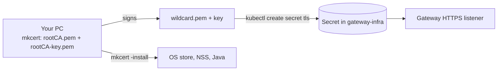
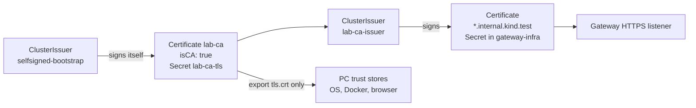
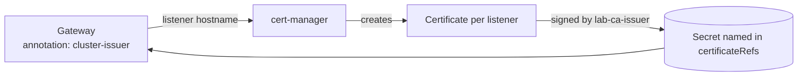
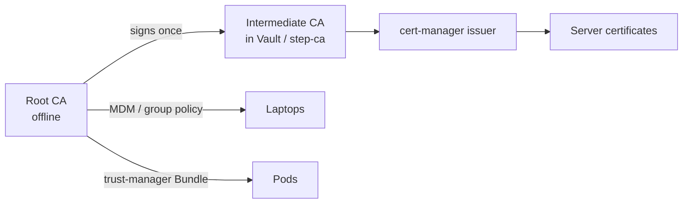
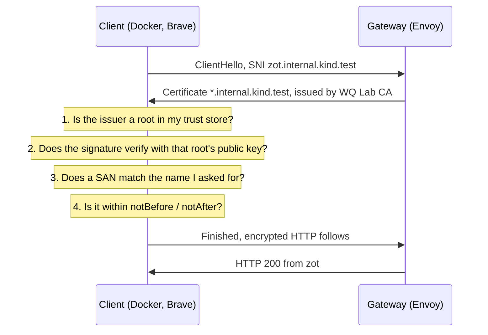

<Muted>
Builds on [Argo CD GitOps from OCI](/ci-cd/argocd-gitops) (zot runs in the cluster behind the Gateway, and Docker refuses plain HTTP to it). Versions: cert-manager v1.21.3, kind v0.31.0, cloud-provider-kind v0.12.0, Docker 29.8.0 (snap), Ubuntu, Brave.
</Muted>

<Note title="What was tested, and what wasn't">
Run on your `kind` cluster on 2026-11-21 and 2026-11-22: cert-manager install, the CA, the wildcard certificate, the HTTPS listener, moving the zot, Grafana and Prometheus routes to it, and trusting the CA in Ubuntu's store, Docker (snap) and Brave. The output blocks in Part 3 are from that run, read from the cluster. The `curl` and `docker push` results were reported as working, but their exact output wasn't captured, so those blocks show the expected shape.

Not run: Docker's per-registry `/etc/docker/certs.d` directory with the snap Docker, the `certutil` command line for Brave (the settings UI was used), whether Envoy picks up a renewed certificate without a restart, Architecture C (cert-manager's Gateway annotation), and mkcert.
</Note>

<Part level={1} id="arch" title="Architecture examples" toc="Architecture">

<Block id="arch-scenario" title="1.1 The scenario">

Everything in the lab answers on `*.internal.kind.test` through one Gateway. That worked over HTTP until Docker had to push to zot: Docker uses HTTPS for every registry except `localhost`. Let's Encrypt can't help, because `.test` is reserved and nobody owns it ([2.2](#th-public)). So you need a CA of your own and a way to get every client to trust it.

Every architecture below has the same three parts. What changes is where the CA key lives and who issues the server certificates:

| Part | Question |
| --- | --- |
| Root CA | Where is its private key, and who can sign with it? |
| Server certificate | Who issues it, and who renews it? |
| Trust | How does each client (OS, Docker, browser, pods) get the root? |

</Block>

<Block id="arch-a" title="1.2 Architecture A · A CA on your laptop (mkcert or openssl)" toc="1.2 A · Laptop CA">

A tool on your PC creates the root and signs the server certificate. You copy the certificate and key into the cluster as a TLS Secret by hand. [mkcert](https://github.com/FiloSottile/mkcert) "is a simple tool for making locally-trusted development certificates": `mkcert -install` creates a root and adds it to the system store, NSS (Firefox, Chrome) and Java, and `mkcert "*.internal.kind.test"` signs a certificate.



<Fit>
<Pros title="Fits when">
- One developer, one machine, no cert-manager in the cluster
- You want the root trusted everywhere on the PC with one command
</Pros>
<Cons title="Watch out for">
- Renewal is manual: you re-run it and re-create the Secret
- `rootCA-key.pem` sits in your home directory, and mkcert's README warns it "gives complete power to intercept secure requests from your machine"
- The cluster can't issue certificates for new names on its own
</Cons>
</Fit>

</Block>

<Block id="arch-b" title="1.3 Architecture B · cert-manager runs the CA in the cluster" toc="1.3 B · cert-manager CA">

The lab's choice. A self-signed ClusterIssuer creates the root once, a CA ClusterIssuer signs with it, and a `Certificate` resource asks for `*.internal.kind.test`. cert-manager writes the certificate into a Secret next to the Gateway and renews it. You export only the root's **public** certificate to your PC.



<Fit>
<Pros title="Fits when">
- cert-manager is (or will be) in the cluster anyway
- You want automatic renewal and new certificates by writing YAML
- The root key should stay off your laptop
</Pros>
<Cons title="Watch out for">
- Delete the cluster and the CA is gone: a new cluster means a new root to re-trust
- The root key is a Secret, readable by anyone who can read Secrets in `cert-manager`
- One more controller to install and keep up to date
</Cons>
</Fit>

</Block>

<Block id="arch-c" title="1.4 Architecture C · cert-manager watches the Gateway" toc="1.4 C · Gateway annotation">

The same CA as B, but you don't write the `Certificate`. You annotate the Gateway with `cert-manager.io/cluster-issuer: lab-ca-issuer`, and cert-manager creates a Certificate for each listener that has a `hostname`, `tls.mode: Terminate` and a `certificateRefs` name ([cert-manager · Gateway](https://cert-manager.io/docs/usage/gateway/)). Gateway support has to be switched on with the Helm value `config.gatewayAPI.enabled=true`. It "is no longer gated behind a feature flag" since 1.15, "but you still need to enable" it.



<Fit>
<Pros title="Fits when">
- Many listeners or hostnames come and go
- You want the Gateway to be the only thing you edit
</Pros>
<Cons title="Watch out for">
- Needs a cert-manager setting and the Gateway API CRDs present when cert-manager starts
- Cross-namespace Secret references aren't supported
- Less explicit: the Certificate is generated, so its options come from more annotations
</Cons>
</Fit>

</Block>

<Block id="arch-d" title="1.5 Architecture D · An enterprise private PKI" toc="1.5 D · Enterprise PKI">

At work the root is usually offline, and an **intermediate** CA does the signing. The intermediate lives in a PKI service, such as HashiCorp Vault, Smallstep step-ca or Active Directory Certificate Services. cert-manager talks to it through a matching issuer (Vault, or ACME for step-ca). Laptops receive the root through device management, and pods through a bundle that [trust-manager](https://cert-manager.io/docs/trust/trust-manager/) copies into namespaces. trust-manager "adds the `Bundle` custom Kubernetes resource (CRD) which can read input from various CA sources".



<Note title="Unsure">
The product details here (Vault and step-ca as signers, cert-manager's Vault and ACME issuers, MDM for laptops) are general practice. They weren't checked against those products' docs for this page.
</Note>

<Fit>
<Pros title="Fits when">
- Many teams, clusters and laptops have to trust the same names
- Auditors ask who can sign certificates and how a compromised CA is revoked
</Pros>
<Cons title="Watch out for">
- Running a PKI is a service with its own on-call
- Too heavy for a laptop lab
</Cons>
</Fit>

</Block>

<Block id="arch-compare" title="1.6 Choosing between them">

| | A · Laptop CA | B · cert-manager CA | C · Gateway annotation | D · Enterprise PKI |
| --- | --- | --- | --- | --- |
| Root key lives | Your home directory | A Secret in the cluster | A Secret in the cluster | Offline, plus an intermediate in a PKI service |
| Who renews server certs | You | cert-manager | cert-manager | cert-manager or the PKI |
| New hostname | Re-run the tool | Edit a Certificate (a wildcard covers it) | Add a listener | Request through the PKI |
| Survives deleting the cluster | Yes | No | No | Yes |
| Good for | One laptop | **This lab** | Many listeners | Production |

Choose **B** for the lab. It's what you'll meet at work in miniature (cert-manager plus an issuer), the root key never touches your laptop, and renewal is automatic. One wildcard covers every `*.internal.kind.test` route, so you never need C's per-listener certificates here.

</Block>

</Part>

<Part level={2} id="theory" title="Theory">

<Block id="th-trust" title="2.1 What a CA does: the chain of trust" toc="2.1 Chain of trust">

TLS proves two things to a client: the traffic is encrypted, and the server really is the name you typed. The second part is the job of certificates. A certificate binds a public key to names, and someone the client already trusts signs it.



A **root CA** is a certificate that signed itself: its subject and issuer are the same name. Nothing vouches for a root. A client trusts it only because the root is in its trust store. That's why making a CA is the easy part, and getting it trusted is most of the work ([2.4](#th-stores)).

</Block>

<Block id="th-public" title="2.2 Why a public CA can't sign *.internal.kind.test" toc="2.2 No public certificate">

A public CA such as Let's Encrypt only signs for a name after you prove you control it (DNS or HTTP). `.test` is reserved by [RFC 6761](https://www.rfc-editor.org/rfc/rfc6761#section-6.2): "Test names are reserved for use in private networks", and "DNS Registries/Registrars MUST NOT grant requests to register test names". Nobody can own `internal.kind.test`, so nobody can prove control of it.

Let's Encrypt says the same about `localhost`, that it "can't provide certificates for "localhost" because nobody uniquely owns it". Its advice is to "Generate your own certificate, either self-signed or signed by a local root, and trust it in your operating system's trust store" ([Certificates for localhost](https://letsencrypt.org/docs/certificates-for-localhost/)).

A private CA costs nothing. The price is that only clients you configure will trust it.

</Block>

<Block id="th-x509" title="2.3 The certificate fields that matter" toc="2.3 X.509 fields">

| Field | In the root | In the wildcard | Why it matters |
| --- | --- | --- | --- |
| Subject | `CN=WQ Lab CA` | empty | A root needs a name, because it's the issuer of everything it signs |
| Issuer | `CN=WQ Lab CA` (itself) | `CN=WQ Lab CA` | Subject equal to issuer means self-signed |
| Basic Constraints | `CA:TRUE`, critical | not a CA | "The cA boolean indicates whether the certified public key may be used to verify certificate signatures" ([RFC 5280 §4.2.1.9](https://www.rfc-editor.org/rfc/rfc5280#section-4.2.1.9)) |
| Subject Alternative Name | — | `DNS:*.internal.kind.test`, critical | This is the field clients match the hostname against |

**The SAN is what clients check, not the Common Name.** Go, which Docker is written in, stopped "treating the `CommonName` field on X.509 certificates as a host name when no Subject Alternative Names are present" in [Go 1.15](https://go.dev/doc/go1.15). cert-manager's `dnsNames` fills in the SAN.

**Why the SAN is critical here.** The wildcard Certificate has no `commonName`, so its subject is empty. [RFC 5280 §4.2.1.6](https://www.rfc-editor.org/rfc/rfc5280#section-4.2.1.6) says: "If the subject field contains an empty sequence, then the issuing CA MUST include a subjectAltName extension that is marked as critical." cert-manager does that for you.

**A wildcard covers one label.** [RFC 9525 §6.3](https://www.rfc-editor.org/rfc/rfc9525#section-6.3): "A wildcard in a presented identifier can only match one label in a reference identifier." So `*.internal.kind.test` matches `zot.internal.kind.test` and `grafana.internal.kind.test`. It doesn't match `a.zot.internal.kind.test` or the bare `internal.kind.test`; that follows from the one-label rule, though the RFC gives no example.

**The SelfSigned issuer and an empty subject.** cert-manager's docs warn that if a certificate issued by a SelfSigned issuer has no subject, "the Issuer DN will be empty and the certificate will technically be invalid" ([SelfSigned](https://cert-manager.io/docs/configuration/selfsigned/)). That's why the root sets `commonName: WQ Lab CA`. The wildcard is signed by the CA issuer, so its issuer is the root's name, and it may leave its own subject empty.

</Block>

<Block id="th-stores" title="2.4 Every client has its own trust store" toc="2.4 Trust stores">

Making one root is easy. The work is that each client looks for trusted roots in a different place:

| Client | Where it looks | How you add the root |
| --- | --- | --- |
| Ubuntu (curl, most CLI tools) | `/etc/ssl/certs`, built from `/usr/local/share/ca-certificates` | Copy a PEM file ending in `.crt` there, run `update-ca-certificates` |
| Docker Engine | `/etc/docker/certs.d/<registry-host>/*.crt`, merged with the system roots | Either of the two. Docker: "All `*.crt` files are added to this directory as CA roots" |
| Chromium, Chrome, Brave on Linux | The NSS shared DB, not `/etc/ssl` | Browser settings → Manage certificates, or `certutil` |
| Firefox | Its own NSS DB | Firefox settings → Certificates |
| Pods in the cluster | Whatever is in their image, unless you mount a bundle | trust-manager, or mount the root yourself |

The Ubuntu man page is strict about the format: "Certificates must be in PEM format and have a .crt extension", and "There should be one certificate per file" ([update-ca-certificates](https://manpages.ubuntu.com/manpages/noble/man8/update-ca-certificates.8.html)).

Chromium's [Linux cert management](https://chromium.googlesource.com/chromium/src/+/main/docs/linux/cert_management.md) doc: "On Linux, Chromium uses the NSS Shared DB." "Since M146, Chromium defaults to $HOME/.local/share/pki/nssdb", but "If you still have an existing $HOME/.pki/nssdb database, Chromium will use that instead."

**Don't trust `ca.crt` from a server Secret directly.** cert-manager writes the issuer's certificate into each Secret as `ca.crt`, but warns: "DO NOT directly mount the `ca.crt` value into the application's trust store, as it will be updated when the certificate is renewed" ([Certificate](https://cert-manager.io/docs/usage/certificate/)). Export the root from the root's own Secret, and use trust-manager to distribute it inside the cluster.

</Block>

<Block id="th-rotation" title="2.5 Renewal and rotation" toc="2.5 Renewal">

From cert-manager's [Certificate](https://cert-manager.io/docs/usage/certificate/) docs:

- "Default value for `spec.duration` is 90 days."
- Renewal happens, "By default", "2/3 through the X.509 certificate's duration". `renewBefore` or `renewBeforePercentage` changes it.
- `privateKey.rotationPolicy` is `Never` or `Always`. The [1.18 release notes](https://cert-manager.io/docs/releases/release-notes/release-notes-1.18/) say "The default value of `Certificate.Spec.PrivateKey.RotationPolicy` changed from `Never` to `Always`." So every renewal makes a new key.

What that means for the two certificates:

- **The wildcard** (90 days) renews every 60 days with a new key, signed by the same root. Clients trust the root, so they don't notice. The Gateway has to load the new Secret ([3.8](#im-rotation)).
- **The root** is the one that hurts. A renewed root has a new key, so every client that trusts the old root has to be given the new one. That's why the lab gives it a 10-year `duration`. Deleting the cluster has the same effect much sooner.

</Block>

<Block id="th-risk" title="2.6 The risk of trusting your own root" toc="2.6 Risk">

A root in your trust store can vouch for **any** name, not only `*.internal.kind.test`. Whoever holds its key could sign a certificate for your bank, and your PC would accept it. mkcert's README says the same of its key: it "gives complete power to intercept secure requests from your machine", and "you should _not_ export or share `rootCA-key.pem`."

Ways to keep that small:

- Keep the key where few can read it. In the lab it's the `lab-ca-tls` Secret in a cluster on your own PC.
- Prefer narrow trust. Docker's `/etc/docker/certs.d/<host>/` trusts the root for one registry host only, while the system store trusts it for everything.
- Remove the root from every store when the lab is gone ([3.10](#im-cleanup)).
- **Name constraints.** [RFC 5280 §4.2.1.10](https://www.rfc-editor.org/rfc/rfc5280#section-4.2.1.10) lets a CA certificate list the only names it may sign (for example, only `internal.kind.test`). cert-manager can set `nameConstraints` on a CA Certificate, but its docs warn that its own CA and SelfSigned issuers don't check the constraints when issuing: "The certificate may get issued successfully, but be rejected by clients during TLS handshakes."

<Note title="Unsure">
cert-manager's 1.18.2 release notes mention a `NameConstraints` feature gate. Whether v1.21 still needs that gate wasn't confirmed, and name constraints weren't tried in the lab.
</Note>

</Block>

<Block id="th-proscons" title="2.7 Problems solved, pros and cons" toc="2.7 Pros and cons">

<Fit>
<Pros title="What a private CA gives you">
- HTTPS for names no public CA will sign, at no cost
- Tools that insist on TLS (Docker registries, some SDKs) work without "insecure" flags
- One wildcard covers every lab hostname behind the Gateway
- With cert-manager, renewal is automatic
</Pros>
<Cons title="What it costs">
- Every client needs the root, and each client keeps its own store
- A trusted root can sign for any name, so its key is sensitive
- Replacing the root (a new cluster, a renewal) means re-trusting it everywhere
- Pods need the root too, if they call these names over HTTPS
</Cons>
</Fit>

</Block>

</Part>

<Part level={3} id="impl" title="Implementation">

<Muted>
Runs on your existing `kind` cluster, with cloud-provider-kind running and the Gateway from [kind/gateway.yaml](/practical/kind/gateway.yaml) (`gateway-infra/gateway`, address 172.18.128.0, HTTP listener `default` for `*.internal.kind.test`). Nothing here needs a new cluster.
</Muted>

<Block id="im-certmanager" title="3.1 Install cert-manager" toc="3.1 cert-manager">

`crds.enabled=true` makes the chart install the CRDs (Issuer, ClusterIssuer, Certificate). Without it, the ClusterIssuer in [3.2](#im-ca) fails with `no matches for kind`.

```bash
helm repo add jetstack https://charts.jetstack.io
helm repo update jetstack
helm search repo jetstack/cert-manager          # pick the latest CHART VERSION
helm upgrade --install cert-manager jetstack/cert-manager --version v1.21.3 \
  -n cert-manager --create-namespace --set crds.enabled=true --wait
helm list -n cert-manager
kubectl get pods -n cert-manager
```

```text output
NAME          NAMESPACE     REVISION  STATUS    CHART                 APP VERSION
cert-manager  cert-manager  1         deployed  cert-manager-v1.21.3  v1.21.3

NAME                                       READY   STATUS    RESTARTS   AGE
cert-manager-7b64759498-cn9lj              1/1     Running   0          3m20s
cert-manager-cainjector-5d85cc9c99-qg5g2   1/1     Running   0          3m20s
cert-manager-webhook-674b6c7468-gm528      1/1     Running   0          3m20s
```

</Block>

<Block id="im-ca" title="3.2 Create the root CA" toc="3.2 Root CA">

The pattern from cert-manager's [Bootstrapping CA Issuers](https://cert-manager.io/docs/configuration/selfsigned/#bootstrapping-ca-issuers): a self-signed issuer signs the root, and a CA issuer signs with the root.

```yaml title="Lab/cert-manager/ca-certificate-creation.yaml"
apiVersion: cert-manager.io/v1
kind: ClusterIssuer
metadata:
  name: selfsigned-bootstrap
spec:
  selfSigned: {}
---
apiVersion: cert-manager.io/v1
kind: Certificate
metadata:
  name: lab-ca
  namespace: cert-manager
spec:
  isCA: true
  commonName: WQ Lab CA
  secretName: lab-ca-tls
  duration: 87600h        # 10 years
  privateKey:
    algorithm: ECDSA
    size: 256
  issuerRef:
    name: selfsigned-bootstrap
    kind: ClusterIssuer
    group: cert-manager.io
---
apiVersion: cert-manager.io/v1
kind: ClusterIssuer
metadata:
  name: lab-ca-issuer
spec:
  ca:
    secretName: lab-ca-tls
```

- **`namespace: cert-manager`.** A CA ClusterIssuer reads its Secret from the "Cluster Resource Namespace", which "is defaulted as being the `cert-manager` namespace" ([CA issuer](https://cert-manager.io/docs/configuration/ca/)). Anywhere else, `lab-ca-issuer` can't find it.
- **`commonName`.** The root needs a name, because it becomes the issuer name of everything it signs ([2.3](#th-x509)).
- **`duration: 87600h`.** The default is 90 days, and a renewed root has a new key that every client would have to re-trust ([2.5](#th-rotation)).

```bash
kubectl apply -f Lab/cert-manager/ca-certificate-creation.yaml
kubectl get clusterissuer
kubectl get certificate -n cert-manager lab-ca
kubectl get secret -n cert-manager lab-ca-tls -o jsonpath='{.data.tls\.crt}' | base64 -d \
  | openssl x509 -noout -subject -issuer -dates -ext basicConstraints
```

```text output
NAME                   READY   AGE
lab-ca-issuer          True    67s
selfsigned-bootstrap   True    67s

NAME     READY   SECRET       AGE
lab-ca   True    lab-ca-tls   67s

subject=CN=WQ Lab CA
issuer=CN=WQ Lab CA
notBefore=Nov 21 14:56:27 2026 GMT
notAfter=Nov 18 14:56:27 2036 GMT
X509v3 Basic Constraints: critical
    CA:TRUE
```

Subject equal to issuer means a self-signed root. `CA:TRUE` means it may sign other certificates.

</Block>

<Block id="im-wildcard" title="3.3 Issue the wildcard certificate next to the Gateway" toc="3.3 Wildcard">

The Certificate goes into `gateway-infra` because a listener's `certificateRefs` without a namespace means the Gateway's own namespace. A Secret anywhere else would need a ReferenceGrant: "Without that ReferenceGrant, the cross-namespace reference would be invalid" ([Gateway API · TLS](https://gateway-api.sigs.k8s.io/guides/tls/)). `lab-ca-issuer` is cluster-wide, so it can sign into any namespace.

```yaml title="Lab/cert-manager/wildcard-certficate.yaml"
apiVersion: cert-manager.io/v1
kind: Certificate
metadata:
  name: wildcard-internal-kind-test
  namespace: gateway-infra
spec:
  secretName: wildcard-internal-kind-test-tls
  dnsNames:
    - "*.internal.kind.test"    # quoted: a bare * starts a YAML alias
  privateKey:
    algorithm: ECDSA
    size: 256
  issuerRef:
    name: lab-ca-issuer
    kind: ClusterIssuer
    group: cert-manager.io
```

```bash
kubectl apply -f Lab/cert-manager/wildcard-certficate.yaml
kubectl get certificate -n gateway-infra
kubectl get secret -n gateway-infra wildcard-internal-kind-test-tls -o jsonpath='{.data.tls\.crt}' | base64 -d \
  | openssl x509 -noout -subject -issuer -ext subjectAltName
```

```text output
NAME                          READY   SECRET                            AGE
wildcard-internal-kind-test   True    wildcard-internal-kind-test-tls   58s

subject=
issuer=CN=WQ Lab CA
X509v3 Subject Alternative Name: critical
    DNS:*.internal.kind.test
```

The empty subject and the critical SAN go together ([2.3](#th-x509)).

</Block>

<Block id="im-listener" title="3.4 Add an HTTPS listener to the Gateway" toc="3.4 HTTPS listener">

Add a second listener to `kind/gateway.yaml` and keep `default` for anything still on HTTP. `mode: Terminate` means Envoy decrypts and forwards plain HTTP to the backend, so zot and the other apps need no certificate of their own. The Gateway API guide notes "mode defaults to `Terminate` when omitted".

```yaml title="kind/gateway.yaml (listeners)"
  listeners:
  - name: default
    hostname: "*.internal.kind.test"
    port: 80
    protocol: HTTP
    allowedRoutes:
      namespaces:
        from: All
  - name: https
    hostname: "*.internal.kind.test"
    port: 443
    protocol: HTTPS
    tls:
      mode: Terminate
      certificateRefs:
      - kind: Secret
        name: wildcard-internal-kind-test-tls
    allowedRoutes:
      namespaces:
        from: All
```

```bash
kubectl apply -f kind/gateway.yaml
kubectl get gateway -n gateway-infra gateway \
  -o jsonpath='{range .status.listeners[*]}{.name}{"  attached="}{.attachedRoutes}{"\n"}{range .conditions[*]}{"   "}{.type}={.status} {.reason}: {.message}{"\n"}{end}{end}'
```

```text output
default  attached=3
   ResolvedRefs=True ResolvedRefs: All references resolved
   Accepted=True Accepted: Listener is valid
   Programmed=True Programmed: Listener is programmed
https  attached=1
   ResolvedRefs=True ResolvedRefs: All references resolved
   Accepted=True Accepted: Listener is valid
   Programmed=True Programmed: Listener is programmed
```

cloud-provider-kind's docs only show HTTP listeners, so this output is what confirmed that it terminates TLS too. Reading other results:

| Result for `https` | Meaning |
| --- | --- |
| `ResolvedRefs=False`, `InvalidCertificateRef` | The Secret is missing, in another namespace, or not a TLS Secret |
| `Accepted=False`, `UnsupportedProtocol` | The Gateway implementation doesn't support HTTPS listeners |

</Block>

<Block id="im-routes" title="3.5 Move routes to the HTTPS listener" toc="3.5 Routes">

A route with `sectionName` attaches to that one listener only. Change it from `default` to `https` for each app that should use HTTPS. In a Helm chart this is usually the `parentRefs` value, as in zot's values.

```yaml
  parentRefs:
    - name: gateway
      namespace: gateway-infra
      sectionName: https      # was: default
```

```bash
kubectl get httproute -A -o custom-columns='NS:.metadata.namespace,NAME:.metadata.name,SECTION:.spec.parentRefs[*].sectionName,HOST:.spec.hostnames[*]'
```

```text output
NS              NAME                   SECTION   HOST
dev             notification-service   default   notification-service.internal.kind.test
observability   grafana                https     grafana.internal.kind.test
observability   prometheus-server      https     prometheus.internal.kind.test
registry        zot                    https     zot.internal.kind.test
```

A route attached only to `https` no longer answers on `http://`. To serve both, list two `parentRefs`, one per `sectionName`, or leave `sectionName` out to attach to every listener that allows the route.

</Block>

<Block id="im-trust" title="3.6 Trust the root on your PC" toc="3.6 Trust the root">

Export the root's **public** certificate. It's safe to commit. Never export `tls.key`, and never commit `kubectl get secret -o yaml` output, because it contains the key in base64.

```bash
kubectl get secret -n cert-manager lab-ca-tls -o jsonpath='{.data.tls\.crt}' \
  | base64 -d > Lab/cert-manager/wq-lab-ca.crt
curl -i --cacert Lab/cert-manager/wq-lab-ca.crt https://zot.internal.kind.test/v2/
```

```text output
HTTP/1.1 200 OK
docker-distribution-api-version: registry/2.0
...
```

`--cacert` tests the chain before anything is installed. Then add the root to each store.

**Ubuntu's system store.** curl and most tools then trust it, and so does Docker, which merges in the system roots:

```bash
sudo cp Lab/cert-manager/wq-lab-ca.crt /usr/local/share/ca-certificates/wq-lab-ca.crt
sudo update-ca-certificates        # reports "1 added"
sudo snap restart docker
```

**Or Docker only, for one registry.** This is narrower ([2.6](#th-risk)). The directory name is the registry host, with no port when it's 443: "If the Docker registry is accessed without a port number, do not add the port to the directory name" ([Docker docs](https://docs.docker.com/engine/security/certificates/)).

```bash
sudo mkdir -p /etc/docker/certs.d/zot.internal.kind.test
sudo cp Lab/cert-manager/wq-lab-ca.crt /etc/docker/certs.d/zot.internal.kind.test/ca.crt
```

<Note title="Unsure">
Not tested with the snap Docker, which may not see `/etc/docker`. The system store route above is the one that worked.
</Note>

**Brave, Chrome, Chromium.** Settings → Privacy and security → Security → Manage certificates (or `brave://certificate-manager`), import `wq-lab-ca.crt` as a trusted certificate authority for websites, then fully quit and reopen the browser. From the command line, with Chromium's own example flags:

```bash
sudo apt install libnss3-tools
certutil -d sql:$HOME/.local/share/pki/nssdb -A -t "C,," -n "WQ Lab CA" -i Lab/cert-manager/wq-lab-ca.crt
```

`-t "C,,"` trusts it as a CA for TLS servers only. Use `$HOME/.pki/nssdb` instead if that directory exists ([2.4](#th-stores)). A browser installed as a snap or Flatpak has its own sandboxed database, so use the settings UI there.

</Block>

<Block id="im-push" title="3.7 Push to the registry over HTTPS" toc="3.7 Docker push">

Port 443 is the default, so the image name has no port:

```bash
docker tag alpine:3.20 zot.internal.kind.test/test/alpine:3.20
docker push zot.internal.kind.test/test/alpine:3.20
```

```text output
The push refers to repository [zot.internal.kind.test/test/alpine]
...: Layer already exists
3.20: digest: sha256:... size: ...
```

`Layer already exists` appears when the image was pushed before through a port-forward. zot stores blobs once, whichever address was used to push them. `x509: certificate signed by unknown authority` means Docker doesn't see the root: check the store you used in [3.6](#im-trust) and restart Docker.

</Block>

<Block id="im-rotation" title="3.8 Check renewal" toc="3.8 Renewal">

```bash
kubectl get certificate -A -o custom-columns='NS:.metadata.namespace,NAME:.metadata.name,NOT_AFTER:.status.notAfter,RENEWAL:.status.renewalTime'
```

```text output
NS              NAME                          NOT_AFTER              RENEWAL
cert-manager    lab-ca                        2036-11-18T14:56:27Z   2033-07-20T22:56:27Z
gateway-infra   wildcard-internal-kind-test   2027-02-19T16:36:28Z   2027-01-20T16:36:28Z
```

Both renewal times are two thirds of the way through their duration ([2.5](#th-rotation)). To check that the Gateway picks up a renewed certificate without a restart, note the serial, delete the Secret (cert-manager re-issues it within seconds), and compare:

```bash
echo | openssl s_client -connect zot.internal.kind.test:443 -servername zot.internal.kind.test 2>/dev/null \
  | openssl x509 -noout -serial -dates
kubectl delete secret -n gateway-infra wildcard-internal-kind-test-tls
kubectl get certificate -n gateway-infra -w      # READY True again, then Ctrl-C
# run the openssl line again: a new serial means Envoy reloaded it
```

<Note title="Unsure">
Not run. cloud-provider-kind's docs don't say whether its Envoy reloads a changed Secret. If the serial stays the same, the Gateway needs a restart after each renewal.
</Note>

</Block>

<Block id="im-working" title='3.9 What "working" looks like' toc="3.9 Working">

<Tip title='What "working" looks like'>
`https://zot.internal.kind.test`, `https://grafana.internal.kind.test` and `https://prometheus.internal.kind.test` open in Brave with a padlock and no warning, the certificate viewer shows "Issued by WQ Lab CA", and `docker push zot.internal.kind.test/...` works without any insecure-registry setting.
</Tip>

<Checklist>
- `lab-ca-issuer` is `READY True`, and `lab-ca` shows `CA:TRUE` with subject equal to issuer
- The wildcard Secret has `issuer=CN=WQ Lab CA` and `DNS:*.internal.kind.test`
- The Gateway's `https` listener is `Accepted`, `ResolvedRefs` and `Programmed`
- `curl --cacert wq-lab-ca.crt https://zot.internal.kind.test/v2/` returns `200`
- `curl https://zot.internal.kind.test/v2/` returns `200` without `--cacert` once the root is in the system store
- `docker push zot.internal.kind.test/test/alpine:3.20` succeeds
- Brave shows no warning for `*.internal.kind.test`
</Checklist>

</Block>

<Block id="im-cleanup" title="3.10 Clean up" toc="3.10 Clean up">

Remove the root from every store first. It can sign for any name ([2.6](#th-risk)).

```bash
sudo rm /usr/local/share/ca-certificates/wq-lab-ca.crt
sudo update-ca-certificates --fresh
sudo rm -rf /etc/docker/certs.d/zot.internal.kind.test
sudo snap restart docker
certutil -d sql:$HOME/.local/share/pki/nssdb -D -n "WQ Lab CA"    # or remove it in browser settings
```

Then the cluster side. Move routes back to `sectionName: default` and remove the `https` listener from `kind/gateway.yaml` before deleting the Secret it uses.

```bash
kubectl apply -f kind/gateway.yaml
kubectl delete -f Lab/cert-manager/wildcard-certficate.yaml
kubectl delete secret -n gateway-infra wildcard-internal-kind-test-tls
kubectl delete -f Lab/cert-manager/ca-certificate-creation.yaml
kubectl delete secret -n cert-manager lab-ca-tls
helm uninstall cert-manager -n cert-manager
kubectl delete namespace cert-manager
```

cert-manager keeps its CRDs on `helm uninstall` ([Helm install docs](https://cert-manager.io/docs/installation/helm/)). Delete them only if nothing else uses cert-manager.

<Muted>
Removing a file from `/usr/local/share/ca-certificates` and running `--fresh` is common practice. The man page documents `--fresh` ("Remove symlinks in /etc/ssl/certs directory") but not the removal steps as such.
</Muted>

</Block>

<Block id="refs" title="References">

- cert-manager: [SelfSigned issuer (bootstrapping CA issuers)](https://cert-manager.io/docs/configuration/selfsigned/), [CA issuer](https://cert-manager.io/docs/configuration/ca/), [Certificate resource](https://cert-manager.io/docs/usage/certificate/), [Gateway API](https://cert-manager.io/docs/usage/gateway/), [Helm install](https://cert-manager.io/docs/installation/helm/), [trust-manager](https://cert-manager.io/docs/trust/trust-manager/), [1.18 release notes](https://cert-manager.io/docs/releases/release-notes/release-notes-1.18/)
- [Gateway API · TLS configuration](https://gateway-api.sigs.k8s.io/guides/tls/)
- [Docker · Use self-signed certificates (certs.d)](https://docs.docker.com/engine/security/certificates/)
- [Chromium · Linux cert management](https://chromium.googlesource.com/chromium/src/+/main/docs/linux/cert_management.md)
- [Ubuntu · update-ca-certificates(8)](https://manpages.ubuntu.com/manpages/noble/man8/update-ca-certificates.8.html)
- [mkcert](https://github.com/FiloSottile/mkcert)
- [Let's Encrypt · Certificates for localhost](https://letsencrypt.org/docs/certificates-for-localhost/)
- [RFC 5280 · X.509 certificate profile](https://www.rfc-editor.org/rfc/rfc5280), [RFC 9525 · Service identity (wildcards)](https://www.rfc-editor.org/rfc/rfc9525), [RFC 6761 · Special-use names (.test)](https://www.rfc-editor.org/rfc/rfc6761)
- [Go 1.15 release notes (CommonName no longer a host name)](https://go.dev/doc/go1.15)
- [cloud-provider-kind · Gateway API](https://github.com/kubernetes-sigs/cloud-provider-kind/blob/main/docs/user/gateway/gatewayapi.md)

</Block>

</Part>

<Part level={4} id="self" title="Self implementation">

Your notes: [README-cert-manager.md](/practical/Lab/cert-manager/README-cert-manager.md), with [ca-certificate-creation.yaml](/practical/Lab/cert-manager/ca-certificate-creation.yaml), [wildcard-certficate.yaml](/practical/Lab/cert-manager/wildcard-certficate.yaml) and [kind/gateway.yaml](/practical/kind/gateway.yaml).

**Done:** all of Part 3 except the renewal test in [3.8](#im-rotation). zot, Grafana and Prometheus are on the `https` listener, and `notification-service` stays on `default`. Docker pushes to `zot.internal.kind.test` over HTTPS, and Brave shows the padlock.

**How your setup differs:** you trusted the root through Ubuntu's system store and restarted the snap Docker, rather than through Docker's per-registry `certs.d`. That's broader trust, but the path that's known to work with the snap.

**Problems hit:**

- After the zot route moved to `sectionName: https`, `http://zot.internal.kind.test` stopped answering. That's expected: a route with a `sectionName` attaches to that listener only ([3.5](#im-routes)).
- Brave still showed "Not secure" after `update-ca-certificates`, because Chromium-based browsers on Linux use the NSS database, not `/etc/ssl/certs`. Importing the root in Brave's certificate settings fixed it.

</Part>
