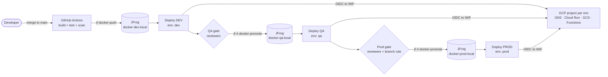
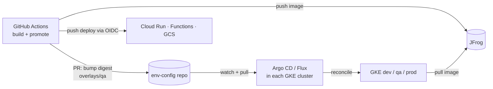
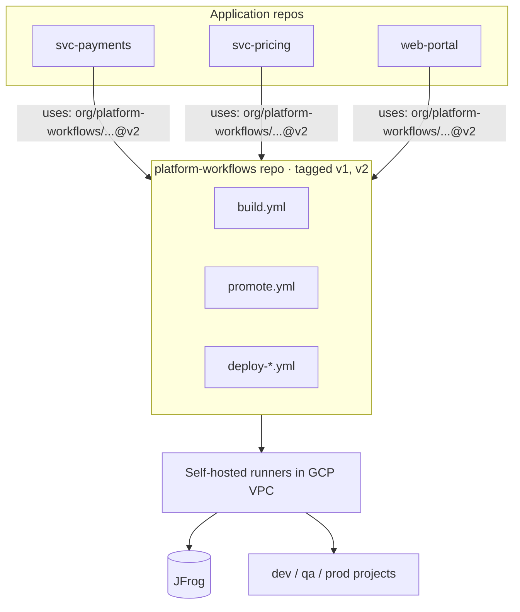

<Part level={1} id="arch" title="Architecture examples" toc="Architecture">

<Block id="arch-scenario" title="1.1 The reference scenario">

All three architectures solve the same problem:

- **Source and orchestration:** GitHub (repos, Actions, Environments).
- **Artifact store:** JFrog Artifactory for Docker images and generic artifacts (function zips, static site bundles).
- **Environments:** `dev`, `qa`, `prod`. The common enterprise layout is one GCP project per environment, which gives you separate IAM, quotas and billing per stage.
- **Targets:** GKE (Kubernetes), Cloud Run, Cloud Storage (static assets), Cloud Functions.

The rule shared by all three: **build once, promote the same artifact**. Prod runs the exact bytes that passed QA.

</Block>

<Block id="arch-a" title="1.2 Architecture A · Push-based promotion pipeline" toc="1.2 A · Push-based promotion">

GitHub Actions does everything. One workflow builds and pushes to JFrog. A second workflow walks the artifact through environments. Each stage is a job bound to a GitHub Environment, which supplies approvals and environment-scoped variables. Promotion in JFrog is a copy between repositories (`docker-dev-local` → `docker-qa-local` → `docker-prod-local`). A two-repo layout (nonprod → prod) also works; see [2.3](#th-repos) for the trade-off.



<Fit>
<Pros title="Fits when">
- One team owns app and pipeline
- Mixed targets (serverless + GKE)
- You want one place (GitHub UI) to see every deploy
</Pros>
<Cons title="Watch out for">
- Runners need network access to every target
- GitHub holds deploy rights to prod (kept short-lived via OIDC)
- Drift in GKE is not corrected between deploys
</Cons>
</Fit>

</Block>

<Block id="arch-b" title="1.3 Architecture B · Hybrid GitOps (pull for GKE, push for serverless)" toc="1.3 B · Hybrid GitOps">

GitHub Actions still builds and promotes in JFrog. For GKE, instead of running `kubectl apply`, the pipeline commits the new image digest into an **environment config repo**. A GitOps controller inside each cluster (Argo CD or Flux) pulls that repo and reconciles. Cloud Run, Functions and GCS have no in-cluster controller, so they stay push-based from Actions.



<Fit>
<Pros title="Fits when">
- GKE is the main platform and several teams share clusters
- You want Git as the audit log of what runs in prod
- Clusters are private and should not accept inbound deploys
</Pros>
<Cons title="Watch out for">
- Two deployment models to operate and explain
- Pipeline "success" no longer means "running"; you need sync status feedback
- Extra repo and controller to maintain
</Cons>
</Fit>

</Block>

<Block id="arch-c" title="1.4 Architecture C · Platform-owned reusable workflows with private runners" toc="1.4 C · Platform-owned templates">

A platform team publishes versioned **reusable workflows** (build, promote, deploy-gke, deploy-run, deploy-gcs, deploy-function) in one central repo. Application repos call them with a few inputs and cannot change the deploy logic. Jobs run on **self-hosted runners inside GCP** (for example Actions Runner Controller on a GKE tooling cluster), so private GKE endpoints and an internal JFrog are reachable without public exposure.



<Fit>
<Pros title="Fits when">
- Many repos must follow the same controls (SOX/MAS-style audit)
- Targets are private-network only
- A platform team exists to own the templates
</Pros>
<Cons title="Watch out for">
- Template changes affect every team; version them like an API
- Self-hosted runners are infrastructure you patch and secure
- Less flexibility for unusual apps
</Cons>
</Fit>

</Block>

<Block id="arch-compare" title="1.5 Choosing between them">

| Concern | A · Push promotion | B · Hybrid GitOps | C · Platform templates |
| --- | --- | --- | --- |
| Who applies changes to GKE | Runner (`kubectl`) | In-cluster controller | Runner, via shared template |
| Drift correction | No | Yes, continuous | No (unless combined with B) |
| Network exposure | Runner must reach targets | Cluster only pulls outbound | Private runners, no public endpoints |
| Standardisation across teams | Low | Medium | High |
| Setup effort | Lowest | Medium | Highest |
| Good first step? | Yes | After A works | When you have 10+ repos |

<Muted>
These combine. A common end state is C's templates running B's model for GKE and A's model for serverless targets.
</Muted>

</Block>

</Part>

<Part level={2} id="theory" title="Theory">

<Block id="th-what" title="2.1 What continuous deployment is" toc="2.1 What CD is">

**Continuous integration** merges and tests code often. **Continuous delivery** keeps every passing build in a releasable state, with a human deciding when to release. **Continuous deployment** removes that last manual step for some or all environments.

In regulated enterprises the usual shape is continuous deployment to dev, and continuous delivery to QA and prod: the pipeline is fully automated, but approvals gate the higher environments. That is the model on this page.

</Block>

<Block id="th-principles" title="2.2 Core principles and why the industry uses them" toc="2.2 Core principles">

<Grid>
<InfoCard title="Build once, promote many">
Rebuilding per environment can produce different bytes (new base image, new dependency). Promoting the same artifact means QA tested exactly what prod runs.
</InfoCard>
<InfoCard title="Immutable, addressable artifacts">
Deploy by image digest (`@sha256:…`), not a mutable tag like `latest`. A tag can be moved; a digest cannot.
</InfoCard>
<InfoCard title="Config separate from artifact">
The image is identical across environments. Environment differences (project ID, URLs, replica counts) come from environment variables, overlays or Secret Manager.
</InfoCard>
<InfoCard title="Promotion as a state change">
Moving an artifact to `docker-qa-local` records that it passed dev. The repository it sits in tells you how far it has progressed.
</InfoCard>
<InfoCard title="Keyless, short-lived credentials">
OIDC federation lets each job exchange a GitHub-signed token for short-lived GCP and JFrog credentials. No long-lived keys stored in GitHub.
</InfoCard>
<InfoCard title="Least privilege per environment">
Each environment has its own GCP project, service account and trust condition. A dev job cannot get prod credentials.
</InfoCard>
</Grid>

</Block>

<Block id="th-repos" title="2.3 Artifact repo layout: three repos or two?" toc="2.3 Repo layout: 3 vs 2">

The non-negotiable part is a **hard boundary in front of prod**: prod clusters and services can only pull from a repo that artifacts enter by promotion alone. Both layouts below give you that. They differ in how the dev and QA stages are recorded.

| Concern | Three repos (used on this page) | Two repos (alternative) |
| --- | --- | --- |
| Layout | `docker-dev-local` → `docker-qa-local` → `docker-prod-local` | `docker-nonprod-local` → `docker-prod-local` |
| How stage is recorded | By location: the repo an image sits in is its stage | By metadata: an Artifactory property (e.g. `qa.status=passed`), build promotion status, or GitHub deployment history |
| QA pulls only dev-passed images | Enforced by repo permissions | Not enforced by the store; relies on the pipeline |
| Retention | Clean dev aggressively, keep QA candidates longer, per repo | One cleanup policy must tell dev-only from QA-approved images, usually by property |
| Scan policy per stage | Attach stricter policies from the QA repo onward | One policy for all nonprod, or rules keyed on properties |
| Promotion steps | Two (dev→qa, qa→prod) | One (nonprod→prod) |
| Repos, credentials and pull secrets to manage | More | Fewer |

<Grid>
<InfoCard title="Why this page uses three">
The scenario is a regulated enterprise. Three repos let the artifact store itself show audit evidence of how far each image got, enforce that QA never runs an untested dev build, and apply different retention and scanning per stage, without depending on tags or properties being set correctly.
</InfoCard>
<InfoCard title="When to choose two">
QA is a test environment rather than a control point, and the audit trail of what reached QA can live in GitHub Environments and deployment history. You get one promotion step, fewer repos and simpler credentials. The prod boundary is unchanged.
</InfoCard>
</Grid>

<Note title="Unsure">
Newer JFrog platforms offer Release Lifecycle Management, where a release bundle is promoted between named environments instead of copied between repos. That could replace repo-per-stage entirely, but I have not verified its current behaviour or licensing. Check your Artifactory version before designing around it.
</Note>

</Block>

<Block id="th-github" title="2.4 GitHub building blocks">

| Feature | What it gives you | Used for |
| --- | --- | --- |
| Environments | Named targets with their own secrets and variables, readable only by jobs that reference the environment, and only after its rules pass | dev / qa / prod config and gating |
| Required reviewers | Up to 6 people or teams; one approval releases the job. Optional "prevent self-review" | QA and prod sign-off |
| Wait timer | Delay in minutes before the job proceeds | Soak time after QA |
| Deployment branches and tags | Only matching branches or tags may deploy to the environment | Prod only from `main` or release tags |
| Custom protection rules | A GitHub App approves or rejects the deployment | Change-ticket checks, monitoring gates |
| Reusable workflows | `workflow_call` workflows invoked by other workflows | One deploy definition for all environments |
| OIDC token | Job requests a signed JWT with `permissions: id-token: write` | Auth to GCP (Workload Identity Federation) and JFrog |
| Concurrency groups | Serialise or cancel runs sharing a group key | Never two prod deploys at once |

<Note title="Plan check">
Per GitHub's docs, on Free, Pro and Team plans, required reviewers and wait timers on environments are only available for public repositories. For private repos you need GitHub Enterprise. I could not confirm the exact Enterprise wording from the page, so confirm against your org's plan.
</Note>

</Block>

<Block id="th-targets" title="2.5 How each GCP target behaves" toc="2.5 Per-target behaviour">

| Target | Artifact | How it gets the artifact | Release strategy |
| --- | --- | --- | --- |
| GKE | Docker image in JFrog | Nodes pull directly from JFrog using an `imagePullSecret`, or through an Artifact Registry remote repo | Rolling update (default); canary or blue/green with Gateway API or Argo Rollouts |
| Cloud Run | Docker image in JFrog | Not a direct pull from JFrog. Use an **Artifact Registry remote repository** pointing at JFrog, or copy the image into Artifact Registry | Deploy a revision with no traffic, then shift traffic gradually |
| Cloud Storage | Static bundle (zip/tar) in a JFrog generic repo | Download from JFrog, then `gcloud storage rsync` to the bucket | Versioned prefixes or bucket object versioning; rollback by re-syncing the previous bundle |
| Cloud Functions (2nd gen) | Source zip in a JFrog generic repo | Deploy from source; Google builds the container during deploy | New revision per deploy; underlying service is Cloud Run |

<Note title="Two caveats">
**Cloud Run and JFrog:** Google documents Artifact Registry remote repositories as the way to use images from JFrog or Nexus, including private ones with credentials in Secret Manager. There is also a newer "connector repository" mode that does not cache; Google labels it Pre-GA.

**Cloud Functions and build-once:** because Functions builds from source at deploy time, each environment produces its own container. You can promote the same source zip, but not the same image. If byte-identical promotion matters, package the function as a container and deploy it to Cloud Run instead.
</Note>

</Block>

<Block id="th-problems" title="2.6 Problems it solves">

- **"It worked in QA":** promotion of one artifact removes rebuild differences.
- **Untraceable releases:** JFrog build info links image → commit → workflow run; GitHub records who approved each deployment.
- **Leaked cloud keys:** OIDC removes JSON service-account keys from GitHub secrets.
- **Manual, slow releases:** deploy steps are code, reviewed and repeatable.
- **Separation of duties:** the author cannot approve their own prod deploy when prevent self-review is on.
- **Slow rollback:** the previous digest is still in JFrog; redeploying it is one run.

</Block>

<Block id="th-proscons" title="2.7 Pros and cons">

<Fit>
<Pros>
- One artifact, full lineage from commit to prod
- Approvals and audit trail native to GitHub
- No stored cloud credentials
- Same deploy code for every environment
- JFrog acts as a single gate for scanning and retention
</Pros>
<Cons>
- More moving parts: GitHub, JFrog, WIF, per-env projects
- Cloud Run needs the Artifact Registry bridge to JFrog
- Functions cannot be fully build-once
- Approval gates add lead time; teams may batch changes
- Harder to test the pipeline itself locally (see 3.5)
</Cons>
</Fit>

</Block>

</Part>

<Part level={3} id="impl" title="Implementation">

<Muted>
This implements Architecture A. Names in `UPPER_CASE` are placeholders. Action versions are those in the official READMEs I checked; pin them to commit SHAs in production, as GitHub recommends.
</Muted>

<Block id="im-setup" title="3.1 One-time setup">

<Steps>
<Step title="Repository layout">

```text
.github/workflows/
  build.yml          # CI: build, test, push to JFrog dev
  deploy.yml         # reusable: deploy one env, all targets
  pipeline.yml       # CD: dev -> qa -> prod
k8s/
  base/              # Deployment, Service
  overlays/dev|qa|prod/kustomization.yaml
function/            # Cloud Functions source
web/                 # static site for GCS
```

</Step>
<Step title="GitHub Environments">

Create `dev`, `qa`, `prod` under Settings → Environments. Add environment **variables** (not secrets; nothing here is secret):

```text
GCP_PROJECT_ID      = my-app-dev | my-app-qa | my-app-prod
GCP_REGION          = asia-southeast1
WIF_PROVIDER        = projects/PROJECT_NUMBER/locations/global/workloadIdentityPools/github/providers/github
DEPLOY_SA           = deployer@my-app-ENV.iam.gserviceaccount.com
GKE_CLUSTER         = gke-ENV
JF_DOCKER_REPO      = docker-ENV-local
```

Protection: `qa` gets required reviewers; `prod` gets required reviewers, prevent self-review and deployment branches limited to `main`.

</Step>
<Step title="Workload Identity Federation (per GCP project)">

Google requires an attribute condition that restricts to your organisation, because GitHub uses one issuer for everyone. Adding the environment to the condition means only jobs running in the `prod` environment can use the prod provider.

```bash
gcloud iam workload-identity-pools create github \
  --project=my-app-prod --location=global

gcloud iam workload-identity-pools providers create-oidc github \
  --project=my-app-prod --location=global \
  --workload-identity-pool=github \
  --issuer-uri="https://token.actions.githubusercontent.com/" \
  --attribute-mapping="google.subject=assertion.sub,attribute.repository_id=assertion.repository_id,attribute.environment=assertion.environment" \
  --attribute-condition="assertion.repository_owner=='MY_ORG' && assertion.environment=='prod'"

gcloud iam service-accounts add-iam-policy-binding \
  deployer@my-app-prod.iam.gserviceaccount.com \
  --role=roles/iam.workloadIdentityUser \
  --member="principalSet://iam.googleapis.com/projects/PROJECT_NUMBER/locations/global/workloadIdentityPools/github/attribute.repository_id/REPO_ID"
```

<Muted>
Google recommends numeric claims such as `repository_id` over names, because a deleted repo name can be re-registered by someone else. Grant the deployer SA only what it needs, for example `roles/container.developer`, `roles/run.developer`, `roles/cloudfunctions.developer`, bucket-level `roles/storage.objectAdmin`, plus `roles/iam.serviceAccountUser` on the runtime service accounts.
</Muted>

</Step>
<Step title="JFrog OIDC integration">

In the JFrog Platform, create an OIDC integration for GitHub (provider name, e.g. `github-oidc`) and an identity mapping. GitHub's guide recommends a claims JSON including `iss`, `repository` and `event_name`; mappings match claims exactly.

```json
{
  "iss": "https://token.actions.githubusercontent.com",
  "repository": "MY_ORG/my-app",
  "event_name": "push"
}
```

Create local repos `docker-dev-local`, `docker-qa-local`, `docker-prod-local` and a generic repo `generic-releases-local`. For the two-repo layout from [2.3](#th-repos), create `docker-nonprod-local` and `docker-prod-local` instead.

</Step>
<Step title="Let Cloud Run reach JFrog">

In each project, create an Artifact Registry Docker remote repository whose upstream is your JFrog registry. Credentials go in Secret Manager.

```bash
gcloud artifacts repositories create jfrog-remote \
  --project=my-app-prod --location=asia-southeast1 \
  --repository-format=docker --mode=remote-repository \
  --remote-docker-repo=https://MYCO.jfrog.io/artifactory/api/docker/docker-prod-local \
  --remote-username=JFROG_READONLY_USER \
  --remote-password-secret-version=projects/my-app-prod/secrets/jfrog-token/versions/1
```

<Note title="Unsure">
The exact upstream URL format JFrog expects for a remote Docker client (the `/artifactory/api/docker/…` path vs. a repo subdomain) depends on your Artifactory reverse-proxy setup. I have not verified it; check with your JFrog admin.
</Note>

</Step>
</Steps>

</Block>

<Block id="im-build" title="3.2 Build workflow (CI → JFrog dev)" toc="3.2 Build workflow">

```yaml title=".github/workflows/build.yml"
name: build
on:
  push:
    branches: [main]

permissions:
  contents: read
  id-token: write          # OIDC for JFrog

env:
  JF_URL: ${{ vars.JF_URL }}               # https://myco.jfrog.io
  REGISTRY: myco.jfrog.io
  IMAGE: myco.jfrog.io/docker-dev-local/my-app

jobs:
  build:
    runs-on: ubuntu-latest
    outputs:
      digest: ${{ steps.push.outputs.digest }}
      version: ${{ steps.ver.outputs.version }}
    steps:
      - uses: actions/checkout@v4

      - id: ver
        run: echo "version=$(date +%Y.%m.%d)-${GITHUB_SHA::7}" >> "$GITHUB_OUTPUT"

      - id: jf
        uses: jfrog/setup-jfrog-cli@v4
        with:
          oidc-provider-name: github-oidc

      - uses: docker/login-action@v3
        with:
          registry: ${{ env.REGISTRY }}
          username: ${{ steps.jf.outputs.oidc-user }}
          password: ${{ steps.jf.outputs.oidc-token }}

      - name: Test
        run: make test

      - name: Build and push image
        id: push
        run: |
          TAG="${IMAGE}:${{ steps.ver.outputs.version }}"
          docker build -t "$TAG" .
          jf docker push "$TAG"
          DIGEST=$(docker inspect --format '{{index .RepoDigests 0}}' "$TAG" | cut -d@ -f2)
          echo "digest=$DIGEST" >> "$GITHUB_OUTPUT"

      - name: Package function and static site
        run: |
          V=${{ steps.ver.outputs.version }}
          (cd function && zip -r ../function-$V.zip .)
          (cd web && npm ci && npm run build && tar -czf ../web-$V.tgz -C dist .)
          jf rt upload "function-$V.zip" "generic-releases-local/my-app/$V/"
          jf rt upload "web-$V.tgz"      "generic-releases-local/my-app/$V/"

  cd:
    needs: build
    uses: ./.github/workflows/pipeline.yml
    with:
      version: ${{ needs.build.outputs.version }}
      digest:  ${{ needs.build.outputs.digest }}
    secrets: inherit
```

<Muted>
setup-jfrog-cli sets the build name and number from the workflow and publishes build info to Artifactory automatically when the workflow ends, which links the image to this run.
</Muted>

</Block>

<Block id="im-deploy" title="3.3 Reusable deploy workflow (one environment, all targets)" toc="3.3 Reusable deploy workflow">

```yaml title=".github/workflows/deploy.yml"
name: deploy
on:
  workflow_call:
    inputs:
      environment: { type: string, required: true }
      version:     { type: string, required: true }
      digest:      { type: string, required: true }

jobs:
  deploy:
    runs-on: ubuntu-latest
    environment: ${{ inputs.environment }}       # gates + env vars apply here
    concurrency: deploy-${{ inputs.environment }}
    permissions:
      contents: read
      id-token: write
    env:
      V: ${{ inputs.version }}
    steps:
      - uses: actions/checkout@v4

      - uses: google-github-actions/auth@v3
        with:
          workload_identity_provider: ${{ vars.WIF_PROVIDER }}
          service_account: ${{ vars.DEPLOY_SA }}

      - uses: google-github-actions/setup-gcloud@v2

      - uses: jfrog/setup-jfrog-cli@v4
        env: { JF_URL: "${{ vars.JF_URL }}" }
        with: { oidc-provider-name: github-oidc }

      # ---------- GKE ----------
      - uses: google-github-actions/get-gke-credentials@v2
        with:
          cluster_name: ${{ vars.GKE_CLUSTER }}
          location: ${{ vars.GCP_REGION }}
      - name: Deploy to GKE
        run: |
          cd k8s/overlays/${{ inputs.environment }}
          kustomize edit set image my-app=myco.jfrog.io/${{ vars.JF_DOCKER_REPO }}/my-app@${{ inputs.digest }}
          kustomize build . | kubectl apply -f -
          kubectl rollout status deployment/my-app --timeout=5m

      # ---------- Cloud Run (via AR remote repo) ----------
      - name: Deploy to Cloud Run (no traffic)
        run: |
          IMG=${{ vars.GCP_REGION }}-docker.pkg.dev/${{ vars.GCP_PROJECT_ID }}/jfrog-remote/my-app@${{ inputs.digest }}
          gcloud run deploy my-app-api --image="$IMG" \
            --region=${{ vars.GCP_REGION }} --no-traffic --tag=v-${GITHUB_RUN_NUMBER}
      - name: Shift traffic
        run: |
          gcloud run services update-traffic my-app-api \
            --region=${{ vars.GCP_REGION }} --to-tags=v-${GITHUB_RUN_NUMBER}=100

      # ---------- Cloud Functions ----------
      - name: Fetch function source
        run: |
          jf rt download "generic-releases-local/my-app/$V/function-$V.zip" fn.zip --flat
          mkdir fn && unzip -q fn.zip -d fn
      - uses: google-github-actions/deploy-cloud-functions@v4
        with:
          name: my-app-events
          runtime: python312
          entry_point: handle
          source_dir: fn
          region: ${{ vars.GCP_REGION }}

      # ---------- Cloud Storage ----------
      - name: Publish static site
        run: |
          jf rt download "generic-releases-local/my-app/$V/web-$V.tgz" web.tgz --flat
          mkdir site && tar -xzf web.tgz -C site
          gcloud storage rsync site gs://${{ vars.GCP_PROJECT_ID }}-web \
            --recursive --delete-unmatched-destination-objects
```

<Note title="Check before use">
I confirmed `auth@v3` and `deploy-cloud-functions@v4` from Google's README. I could not open the READMEs for `setup-gcloud` and `get-gke-credentials` in this session, so `@v2` for those is from memory; confirm the current major version. The Cloud Run steps use `gcloud` directly; flags `--no-traffic`, `--tag` and `--to-tags` are standard `gcloud run` flags.
</Note>

</Block>

<Block id="im-pipeline" title="3.4 Promotion pipeline (dev → qa → prod)" toc="3.4 Promotion pipeline">

```yaml title=".github/workflows/pipeline.yml"
name: pipeline
on:
  workflow_call:
    inputs:
      version: { type: string, required: true }
      digest:  { type: string, required: true }

permissions:
  contents: read
  id-token: write

jobs:
  dev:
    uses: ./.github/workflows/deploy.yml
    with: { environment: dev, version: "${{ inputs.version }}", digest: "${{ inputs.digest }}" }

  promote-qa:
    needs: dev
    runs-on: ubuntu-latest
    environment: qa                      # reviewer approval happens here
    steps:
      - uses: jfrog/setup-jfrog-cli@v4
        env: { JF_URL: "${{ vars.JF_URL }}" }
        with: { oidc-provider-name: github-oidc }
      - run: |
          jf rt docker-promote my-app docker-dev-local docker-qa-local \
            --source-tag=${{ inputs.version }} --copy

  qa:
    needs: promote-qa
    uses: ./.github/workflows/deploy.yml
    with: { environment: qa, version: "${{ inputs.version }}", digest: "${{ inputs.digest }}" }

  promote-prod:
    needs: qa
    runs-on: ubuntu-latest
    environment: prod                    # reviewers + no self-review + main only
    steps:
      - uses: jfrog/setup-jfrog-cli@v4
        env: { JF_URL: "${{ vars.JF_URL }}" }
        with: { oidc-provider-name: github-oidc }
      - run: |
          jf rt docker-promote my-app docker-qa-local docker-prod-local \
            --source-tag=${{ inputs.version }} --copy

  prod:
    needs: promote-prod
    uses: ./.github/workflows/deploy.yml
    with: { environment: prod, version: "${{ inputs.version }}", digest: "${{ inputs.digest }}" }
```

<Tip title="Why the digest stays valid">
`docker-promote --copy` copies the same manifest to the next repo, so the digest from the build job is the digest prod deploys.
</Tip>

#### Two-repo variant

Build pushes to `docker-nonprod-local`; dev and QA both deploy from it. Replace `promote-qa` with a step that records the QA approval as metadata, and promote once to prod:

```yaml
  mark-qa:
    needs: dev
    runs-on: ubuntu-latest
    environment: qa
    steps:
      - uses: jfrog/setup-jfrog-cli@v4
        env: { JF_URL: "${{ vars.JF_URL }}" }
        with: { oidc-provider-name: github-oidc }
      - run: |
          jf rt set-props "docker-nonprod-local/my-app/${{ inputs.version }}/" "qa.status=approved"

  # ... qa deploy job as before ...

  promote-prod:
    needs: qa
    runs-on: ubuntu-latest
    environment: prod
    steps:
      - uses: jfrog/setup-jfrog-cli@v4
        env: { JF_URL: "${{ vars.JF_URL }}" }
        with: { oidc-provider-name: github-oidc }
      - run: |
          jf rt docker-promote my-app docker-nonprod-local docker-prod-local \
            --source-tag=${{ inputs.version }} --copy
```

<Note title="Unsure">
I have not verified the exact path argument `jf rt set-props` needs for a Docker image folder in Artifactory. Check the JFrog CLI reference before using it.
</Note>

<Note title="Unsure">
Here both `promote-prod` and the `prod` deploy job reference the `prod` environment. I have not verified whether GitHub asks for approval once or once per job in that case. If it asks twice, move the promotion step to the top of `deploy.yml` (guarded by `if: inputs.environment != 'dev'`) so each environment needs one approval.
</Note>

</Block>

<Block id="im-local" title="3.5 Test it locally">

You cannot fully reproduce GitHub Environments, approvals or OIDC on a laptop. Test the pipeline in four layers instead, from cheapest to most realistic.

<Steps>
<Step title="Lint the workflows">

`actionlint` catches YAML, expression and shell errors before you push.

```bash
brew install actionlint    # or: go install github.com/rhysd/actionlint/cmd/actionlint@latest
actionlint .github/workflows/*.yml
```

</Step>
<Step title="Run job logic with act">

`act` runs workflow jobs in Docker. Pass variables and secrets from files. Its docs do not say whether OIDC or environment approvals work, so assume they do not and skip cloud auth steps when running locally.

```bash
# .vars
JF_URL=http://host.docker.internal:5000
GCP_REGION=asia-southeast1

act push -j build --var-file .vars --secret-file .secrets \
  -P ubuntu-latest=catthehacker/ubuntu:full-latest
```

```yaml
# In the workflow: skip real cloud auth under act
- uses: google-github-actions/auth@v3
  if: ${{ !env.ACT }}
```

</Step>
<Step title="Simulate promotion and GKE with kind + a local registry">

A plain Docker registry stands in for JFrog. Three repos (paths) stand in for dev / qa / prod, and three namespaces stand in for the three clusters.

```bash
docker run -d -p 5000:5000 --name registry registry:2
kind create cluster --name cd-lab      # see kind's "local registry" guide to wire it in

docker build -t localhost:5000/dev/my-app:1.0 . && docker push localhost:5000/dev/my-app:1.0

# "promote" = copy the same image to the next repo
docker tag localhost:5000/dev/my-app:1.0 localhost:5000/qa/my-app:1.0
docker push localhost:5000/qa/my-app:1.0

# confirm the digest did not change between repos
docker buildx imagetools inspect localhost:5000/dev/my-app:1.0 | grep Digest
docker buildx imagetools inspect localhost:5000/qa/my-app:1.0  | grep Digest

for ns in dev qa prod; do kubectl create ns $ns; done
kubectl -n qa apply -k k8s/overlays/qa
kubectl -n qa rollout status deploy/my-app
```

<Muted>
If you want the real Artifactory UI and the `jf` commands, JFrog Container Registry (the free edition) ships as the `jfrog/artifactory-jcr` image; JFrog's docs give default login `admin` / `password` and point to their Docker Compose installer. I did not confirm ports or a one-line `docker run`.
</Muted>

</Step>
<Step title="Exercise each serverless target locally">

- **Cloud Run:** run the container the same way Cloud Run does, with the `PORT` variable set: `docker run -e PORT=8080 -p 8080:8080 localhost:5000/qa/my-app:1.0`.
- **Cloud Functions:** use Google's Functions Framework for your runtime, e.g. `pip install functions-framework` then `functions-framework --target=handle`.
- **Cloud Storage:** `fsouza/fake-gcs-server` emulates the GCS API in Docker for testing upload and sync scripts.

<Tip title='What "working" looks like'>
Same digest in every repo; rollout status reports success in each namespace; the container answers on `:8080`; the function responds to a local `curl`; the fake bucket contains exactly the files in the bundle after sync.
</Tip>

</Step>
<Step title="Final check in a sandbox org">

Approvals, environment-scoped OIDC claims and WIF conditions only run on GitHub and GCP. Prove them once in a throwaway repo and sandbox GCP project, including a negative test: a job in `dev` must fail to authenticate to the prod provider.

</Step>
</Steps>

</Block>

<Block id="refs" title="References">

- [GitHub Docs · Managing environments](https://docs.github.com/en/actions/how-tos/deploy/configure-and-manage-deployments/manage-environments)
- [GitHub Docs · OIDC in JFrog](https://docs.github.com/en/actions/how-tos/secure-your-work/security-harden-deployments/oidc-in-jfrog)
- [jfrog/setup-jfrog-cli](https://github.com/jfrog/setup-jfrog-cli)
- [JFrog · Docker advanced operations (docker-promote)](https://docs.jfrog.com/artifactory/docs/docker-advanced-operations)
- [JFrog CLI command reference](https://docs.jfrog.com/integrations/docs/jfrog-cli-command-reference)
- [Google Cloud · Workload Identity Federation with deployment pipelines](https://docs.cloud.google.com/iam/docs/workload-identity-federation-with-deployment-pipelines)
- [Google Cloud · Deploying container images to Cloud Run](https://docs.cloud.google.com/run/docs/deploying)
- [Google Cloud · Artifact Registry remote repositories](https://docs.cloud.google.com/artifact-registry/docs/repositories/remote-repo)
- [Google Cloud · Artifact Registry connector repositories](https://docs.cloud.google.com/artifact-registry/docs/repositories/connector-repo)
- [google-github-actions/deploy-cloud-functions](https://github.com/google-github-actions/deploy-cloud-functions)
- [gcloud storage rsync reference](https://docs.cloud.google.com/sdk/gcloud/reference/storage/rsync)
- [JFrog · Set up JFrog Container Registry](https://docs.jfrog.com/artifactory/docs/get-started-jfrog-container-registry)

</Block>

</Part>
