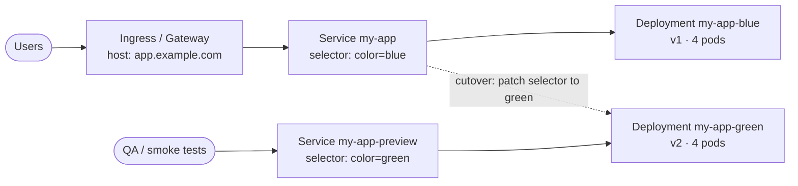
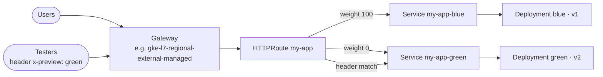
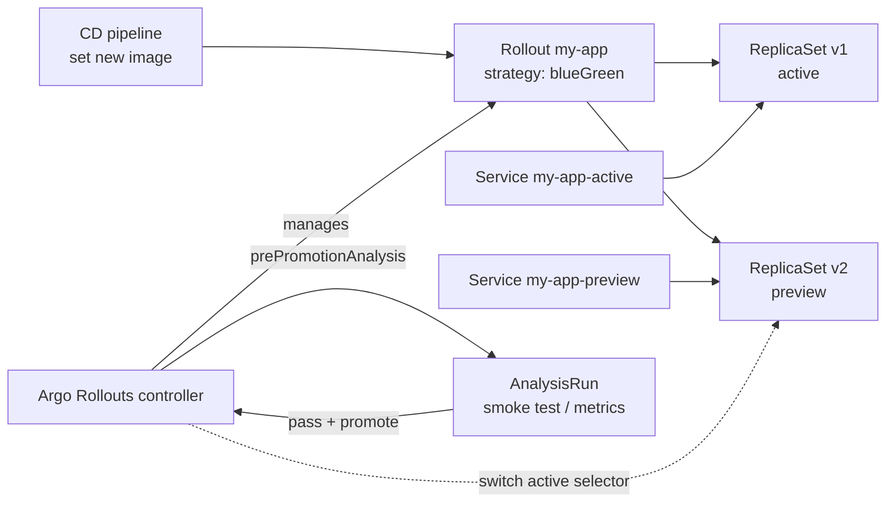

<Tip title="Hands-on lab">
[Subtopic 02a · Blue-Green Lab on Ubuntu](/topics/02a-blue-green-lab-ubuntu) walks through Architecture A and Architecture C step by step on a single Ubuntu machine.
</Tip>

<Part level={1} id="arch" title="Architecture examples" toc="Architecture">

<Block id="arch-scenario" title="1.1 The scenario">

One production application, one Kubernetes cluster (for example a GKE cluster in the prod project from [Topic 01](/topics/01-enterprise-cd-github)). The current version is <Pill color="blue">blue</Pill> and serves all users. The new version is <Pill color="green">green</Pill>.

- Both versions run at the same time, each at full or near-full capacity.
- Green can be reached privately (preview) before any user sees it.
- Cutover moves 100% of traffic at once. Rollback moves it back at once.
- Blue stays running for a while after cutover, then is scaled down.

The three architectures differ in **where the switch lives**: the Kubernetes Service, the Gateway route, or a controller that does it for you.

</Block>

<Block id="arch-a" title="1.2 Architecture A · Service selector switch (native Kubernetes)" toc="1.2 A · Service selector switch">

Two Deployments, each labelled with its colour. One production Service selects pods by `color`. Cutover is a single patch that changes the Service selector from `blue` to `green`. A second Service always points at the idle colour for preview testing.



<Fit>
<Pros title="Fits when">
- You want no extra tooling
- The team is learning the pattern
- Traffic is plain HTTP or TCP behind a Service
</Pros>
<Cons title="Watch out for">
- The switch is a manual or scripted `kubectl patch`; no built-in checks
- Existing long-lived connections stay on blue until they close
- Only all-or-nothing; no gradual option
</Cons>
</Fit>

</Block>

<Block id="arch-b" title="1.3 Architecture B · Gateway API route switch" toc="1.3 B · Gateway API route switch">

Each colour gets its own Deployment and its own Service. An `HTTPRoute` sends production traffic to both Services with weights: `blue: 100, green: 0`. Cutover changes the weights to `0 / 100`. A second rule (a preview hostname or a header such as `x-preview: green`) always reaches green, so testers can use the real production entry point before cutover.



<Fit>
<Pros title="Fits when">
- You already use Gateway API (GKE Gateway, Envoy Gateway, Istio)
- You want preview on the real hostname via headers
- You may later want canary (weights 90/10) with the same setup
</Pros>
<Cons title="Watch out for">
- The load balancer applies route changes asynchronously; on a cloud LB this can take time
- Support for weights and header matching depends on the GatewayClass
- Still no automatic checks unless you script them
</Cons>
</Fit>

</Block>

<Block id="arch-c" title="1.4 Architecture C · Argo Rollouts controller" toc="1.4 C · Argo Rollouts controller">

Replace the Deployment with an Argo Rollouts `Rollout` resource using the `blueGreen` strategy. You declare an active Service and a preview Service. When the image changes, the controller creates the new ReplicaSet, points the preview Service at it, optionally runs analysis (smoke tests, metrics), waits for promotion, switches the active Service, and scales the old ReplicaSet down after a delay.



<Fit>
<Pros title="Fits when">
- Production, repeatable releases with an audit trail
- You want automatic gating and abort on failed checks
- You use Argo CD or another GitOps tool (the Rollout is just YAML)
</Pros>
<Cons title="Watch out for">
- A controller and CRDs to install and upgrade
- Teams must learn `Rollout` instead of `Deployment`
- Some tooling expects Deployments and needs adjusting
</Cons>
</Fit>

</Block>

<Block id="arch-compare" title="1.5 Choosing between them">

| Concern | A · Selector switch | B · Gateway route | C · Argo Rollouts |
| --- | --- | --- | --- |
| Where the switch lives | Service selector | HTTPRoute weights | Service selectors, changed by the controller |
| Extra components | None | Gateway API implementation | Rollouts controller + CRDs |
| Preview on real hostname | No (separate Service) | Yes (header or host rule) | Via preview Service; combine with B for hostname preview |
| Automated checks and abort | Scripted by you | Scripted by you | Built-in (AnalysisTemplates) |
| Old version cleanup | Manual | Manual | Automatic after `scaleDownDelaySeconds` |
| Path to canary later | No | Yes, change weights | Yes, switch strategy to canary |
| Recommended for | Learning, simple apps | Teams already on Gateway API | Production default |

<Muted>
Other tools implement the same pattern, for example Flagger or a service mesh such as Istio. They are not covered here.
</Muted>

</Block>

</Part>

<Part level={2} id="theory" title="Theory">

<Block id="th-what" title="2.1 What blue-green deployment is" toc="2.1 What blue-green is">

Blue-green keeps **two production environments**: one live, one idle. You deploy the new version to the idle one, test it there with production configuration, then **switch the router** so all traffic goes to it. The old environment stays ready, so rollback is the same switch in reverse.

Doing this inside **one cluster** means the "environments" are two sets of pods, not two clusters. That keeps cost and complexity down, but both colours share the cluster, its nodes, its config objects and its downstream dependencies (database, queues, caches). Most of the difficulty comes from that sharing.

</Block>

<Block id="th-vs" title="2.2 Versus rolling update and canary" toc="2.2 Versus rolling and canary">

| Strategy | How traffic moves | Versions live at once | Rollback | Extra capacity |
| --- | --- | --- | --- | --- |
| Rolling (Kubernetes default) | Pods replaced in batches; users hit old and new during rollout | Both, mixed | Another rolling update; takes as long as the rollout | Small (`maxSurge`) |
| Blue-green | All at once, at the switch | Both running, only one serving | Instant: switch back | Up to 2× |
| Canary | Small share first (e.g. 5%), increased in steps | Both serving | Set new share to 0% | Small to medium |

The industry picks blue-green when a release must be **verified before any user sees it** and **reversible in seconds**, and when serving two versions to users at once is unacceptable (for example, an API contract change that clients must not see mixed). Canary is preferred when you would rather expose a small share of real users and watch metrics.

</Block>

<Block id="th-traffic" title="2.3 How the switch actually moves traffic" toc="2.3 How the switch moves traffic">

- **Service selector (A, C):** changing the selector updates the Service's endpoints. kube-proxy (or the dataplane in use) on every node then reprograms its rules. This is not instantaneous across nodes; Argo Rollouts' docs give this propagation delay as the reason old pods are kept for `scaleDownDelaySeconds` (default 30) after the switch.
- **Existing connections:** with a ClusterIP Service, connections already open to blue pods are not moved. HTTP keep-alive, gRPC and WebSocket clients stay on blue until the connection closes. This is why blue must not be scaled down immediately.
- **Gateway weights (B):** an L7 proxy picks the backend per request, so new requests follow the new weights once the proxy has the updated config. With a cloud load balancer (GKE Gateway), the change is pushed to Google's load balancer, which can take noticeably longer than an in-cluster proxy.

</Block>

<Block id="th-hard" title="2.4 The hard parts in a single cluster" toc="2.4 The hard parts">

<Grid>
<InfoCard title="Database schema">
Blue and green share one database. Any schema change must work with both versions at once. The usual approach is expand/contract: add new columns or tables first (both versions work), cut over, then remove old ones in a later release.
</InfoCard>
<InfoCard title="Background workers and consumers">
Green pods start consuming queues and running scheduled jobs as soon as they start, before cutover. Keep consumers off in the idle colour (scale them separately, or gate with a flag), or both versions process the same work.
</InfoCard>
<InfoCard title="Capacity">
Green at full size doubles pod count during the release. The cluster needs node headroom or an autoscaler, and any ResourceQuota must allow it. Argo Rollouts' `previewReplicaCount` keeps green small until promotion, at the cost of a scale-up just before the switch.
</InfoCard>
<InfoCard title="Config and secrets">
If both colours read the same ConfigMap and you edit it for green, blue changes too. Version config objects (e.g. `my-app-config-v2`) or generate them with a hash suffix, so each colour reads its own.
</InfoCard>
<InfoCard title="Graceful shutdown">
When blue is finally scaled down, in-flight requests must finish. Use readiness probes, a `preStop` delay and a suitable `terminationGracePeriodSeconds`.
</InfoCard>
<InfoCard title="Sessions and caches">
In-memory sessions are lost when users move to green. Keep session state external (Redis, a database, or stateless tokens). Shared caches must tolerate both versions' data formats.
</InfoCard>
</Grid>

<Note title="Limit of single-cluster blue-green">
Both colours depend on the same cluster. It protects you from a bad application release, not from a bad cluster upgrade, node pool problem or control-plane outage. Covering those needs blue-green across two clusters, which is a separate topic.
</Note>

</Block>

<Block id="th-problems" title="2.5 Problems it solves">

- **Downtime during release:** green is fully ready before it receives traffic.
- **Slow rollback:** rollback is a selector or weight change, not a redeploy.
- **Mixed versions:** users never hit v1 and v2 within the same rollout window, unlike a rolling update.
- **Untested-in-prod surprises:** green runs with production config, secrets, network policies and dependencies, and can be smoke-tested there before cutover.
- **Release-time pressure:** deploy and release are separate steps; you can deploy green early and switch at a planned time.

</Block>

<Block id="th-proscons" title="2.6 Pros and cons">

<Fit>
<Pros>
- Near-instant cutover and rollback
- Verification in production before exposure
- No mixed-version serving
- Simple mental model: two colours, one switch
</Pros>
<Cons>
- Up to double compute during release
- Schema and shared-state changes need care
- All users move at once, so a bug missed in preview hits everyone
- Workers, cron jobs and consumers need special handling
- Single cluster is still a shared failure domain
</Cons>
</Fit>

</Block>

</Part>

<Part level={3} id="impl" title="Implementation">

<Muted>
Each example uses one app, `my-app`, in namespace `prod`. Images are placeholders; for the local test in 3.5 they are swapped for small demo images.
</Muted>

<Block id="im-a" title="3.1 A · Service selector switch">

```yaml title="k8s/bluegreen-a.yaml"
apiVersion: apps/v1
kind: Deployment
metadata:
  name: my-app-blue
  labels: { app: my-app, color: blue }
spec:
  replicas: 4
  selector:
    matchLabels: { app: my-app, color: blue }
  template:
    metadata:
      labels: { app: my-app, color: blue }
    spec:
      terminationGracePeriodSeconds: 40
      containers:
        - name: app
          image: REGISTRY/my-app:1.4.0
          ports: [{ containerPort: 8080 }]
          readinessProbe:
            httpGet: { path: /healthz, port: 8080 }
          lifecycle:
            preStop:
              exec: { command: ["sleep", "15"] }   # let endpoints update before shutdown
---
# my-app-green is identical except: name my-app-green, color: green, image 1.5.0
---
apiVersion: v1
kind: Service
metadata:
  name: my-app            # production
spec:
  selector: { app: my-app, color: blue }
  ports: [{ port: 80, targetPort: 8080 }]
---
apiVersion: v1
kind: Service
metadata:
  name: my-app-preview    # always the idle colour
spec:
  selector: { app: my-app, color: green }
  ports: [{ port: 80, targetPort: 8080 }]
```

```bash title="scripts/cutover.sh"
#!/usr/bin/env bash
set -euo pipefail
NS=prod
TO=${1:?usage: cutover.sh blue|green}
FROM=$([ "$TO" = green ] && echo blue || echo green)

# 1. Target colour must be fully rolled out and ready
kubectl -n $NS rollout status deploy/my-app-$TO --timeout=5m

# 2. Smoke test through the preview Service (run from inside the cluster)
kubectl -n $NS run smoke-$RANDOM --rm -i --restart=Never --image=curlimages/curl -- \
  -fsS http://my-app-preview/healthz      # args go to the image's curl entrypoint

# 3. Switch production, then point preview at the old colour
kubectl -n $NS patch service my-app \
  -p "{\"spec\":{\"selector\":{\"app\":\"my-app\",\"color\":\"$TO\"}}}"
kubectl -n $NS patch service my-app-preview \
  -p "{\"spec\":{\"selector\":{\"app\":\"my-app\",\"color\":\"$FROM\"}}}"

echo "Live: $TO. Keep $FROM running until you are satisfied, then:"
echo "  kubectl -n $NS scale deploy/my-app-$FROM --replicas=0"
```

<Muted>
Rollback is `./cutover.sh blue` while blue is still running.
</Muted>

</Block>

<Block id="im-b" title="3.2 B · Gateway API route switch" toc="3.2 B · Gateway API">

Deployments as in 3.1, but each colour has its own Service: `my-app-blue` and `my-app-green`.

```yaml title="k8s/route.yaml"
apiVersion: gateway.networking.k8s.io/v1
kind: HTTPRoute
metadata:
  name: my-app
  namespace: prod
spec:
  parentRefs:
    - name: prod-gateway
  hostnames: ["app.example.com"]
  rules:
    # Preview: testers send header x-preview: green
    - matches:
        - headers:
            - name: x-preview
              value: green
      backendRefs:
        - name: my-app-green
          port: 80
    # Production: all users
    - backendRefs:
        - name: my-app-blue
          port: 80
          weight: 100
        - name: my-app-green
          port: 80
          weight: 0
```

Cutover is a change to the two weights (100/0 → 0/100), committed to Git and applied, or patched directly:

```bash
kubectl -n prod patch httproute my-app --type=json -p '[
  {"op":"replace","path":"/spec/rules/1/backendRefs/0/weight","value":0},
  {"op":"replace","path":"/spec/rules/1/backendRefs/1/weight","value":100}
]'
```

<Muted>
Weights are proportional, not percentages, and default to 1 if omitted, so always set both explicitly. The more specific header rule takes precedence over the catch-all rule under Gateway API's matching rules.
</Muted>

<Note title="Check before use">
Google's Gateway docs list the GKE GatewayClasses but did not state per class whether weighted backends and header matching are supported; check the "GatewayClass capabilities" page for your class.
</Note>

</Block>

<Block id="im-c" title="3.3 C · Argo Rollouts">

```yaml title="k8s/rollout.yaml"
apiVersion: argoproj.io/v1alpha1
kind: Rollout
metadata:
  name: my-app
  namespace: prod
spec:
  replicas: 4
  revisionHistoryLimit: 2
  selector:
    matchLabels: { app: my-app }
  template:
    metadata:
      labels: { app: my-app }
    spec:
      containers:
        - name: app
          image: REGISTRY/my-app:1.5.0
          ports: [{ containerPort: 8080 }]
          readinessProbe:
            httpGet: { path: /healthz, port: 8080 }
  strategy:
    blueGreen:
      activeService: my-app-active      # required; production traffic
      previewService: my-app-preview    # optional; reaches the new version
      autoPromotionEnabled: false       # default true; false = wait for promote
      scaleDownDelaySeconds: 300        # default 30; keep old version warm 5 min
      # previewReplicaCount: 1          # omit = preview gets 100% of replicas
      prePromotionAnalysis:
        templates:
          - templateName: smoke-test
---
apiVersion: v1
kind: Service
metadata: { name: my-app-active, namespace: prod }
spec:
  selector: { app: my-app }             # controller adds a ReplicaSet hash to this
  ports: [{ port: 80, targetPort: 8080 }]
---
apiVersion: v1
kind: Service
metadata: { name: my-app-preview, namespace: prod }
spec:
  selector: { app: my-app }
  ports: [{ port: 80, targetPort: 8080 }]
```

```yaml title="k8s/analysis-smoke.yaml"
apiVersion: argoproj.io/v1alpha1
kind: AnalysisTemplate
metadata:
  name: smoke-test
  namespace: prod
spec:
  metrics:
    - name: smoke
      provider:
        job:
          spec:
            backoffLimit: 0
            template:
              spec:
                restartPolicy: Never
                containers:
                  - name: smoke
                    image: curlimages/curl
                    args: ["-fsS", "http://my-app-preview.prod/healthz"]
```

<Note title="Unsure">
I verified the `blueGreen` fields and defaults above against the Argo Rollouts docs. I did not verify the Job-provider `AnalysisTemplate` schema in this session; check it against the Analysis section of the docs before use.
</Note>

Release commands with the kubectl plugin:

```bash
kubectl argo rollouts -n prod set image my-app app=REGISTRY/my-app:1.6.0
kubectl argo rollouts -n prod get rollout my-app --watch
kubectl argo rollouts -n prod promote my-app      # cut over after checks
kubectl argo rollouts -n prod abort my-app        # back out before promotion
kubectl argo rollouts -n prod undo my-app         # roll back to previous revision
```

</Block>

<Block id="im-pipeline" title="3.4 Wiring into the CD pipeline">

In the Topic 01 pipeline, the prod deploy job changes the image (by digest) and the release becomes two steps under the `prod` environment:

1. **Deploy green:** update the image on the idle colour (A/B) or on the Rollout (C). No user impact.
2. **Release:** after preview checks pass, run the cutover: the selector patch (A), the weight change (B), or `kubectl argo rollouts promote` (C). This can be a separate job behind its own environment approval.

With GitOps (Topic 01, Architecture B), the pipeline commits these changes to the config repo instead of calling `kubectl`. For C, Argo CD applies the new image and the Rollout pauses for promotion.

</Block>

<Block id="im-local" title="3.5 Test it locally with kind" toc="3.5 Test it locally">

<Muted>
For a full step-by-step version on Ubuntu, see [Subtopic 02a](/topics/02a-blue-green-lab-ubuntu).
</Muted>

Goal: watch traffic flip from blue to green with zero failed requests, then flip back. Uses `hashicorp/http-echo`, which returns fixed text (default port 5678), so each colour is easy to tell apart.

<Steps>
<Step title="Create a cluster and two colours">

```bash
kind create cluster --name bg-lab
kubectl create ns prod

for c in blue green; do
kubectl -n prod apply -f - <<EOF
apiVersion: apps/v1
kind: Deployment
metadata: { name: my-app-$c }
spec:
  replicas: 3
  selector: { matchLabels: { app: my-app, color: $c } }
  template:
    metadata: { labels: { app: my-app, color: $c } }
    spec:
      containers:
        - name: app
          image: hashicorp/http-echo
          args: ["-text=$c"]
          ports: [{ containerPort: 5678 }]
          readinessProbe: { httpGet: { path: /, port: 5678 } }
EOF
done

kubectl -n prod create service clusterip my-app --tcp=80:5678
kubectl -n prod patch service my-app \
  -p '{"spec":{"selector":{"app":"my-app","color":"blue"}}}'
```

</Step>
<Step title="Generate traffic from inside the cluster">

Use a pod, not `kubectl port-forward`: port-forward to a Service connects to a single pod when it starts and will not follow the selector switch.

```bash
kubectl -n prod run tester --image=curlimages/curl --restart=Never --command -- \
  sh -c 'while true; do
    r=$(curl -s -m 2 -w " %{http_code}" http://my-app) || r="ERR"
    echo "$(date +%T) $r"; sleep 0.2; done'

kubectl -n prod logs -f tester
```

</Step>
<Step title="Cut over, then roll back">

```bash
kubectl -n prod patch service my-app \
  -p '{"spec":{"selector":{"app":"my-app","color":"green"}}}'
# logs switch from "blue 200" to "green 200"

kubectl -n prod patch service my-app \
  -p '{"spec":{"selector":{"app":"my-app","color":"blue"}}}'
```

<Tip title='What "working" looks like'>
The log changes from `blue 200` to `green 200` within a few seconds, and no line shows `ERR` or a non-200 code. Because `curl` opens a new connection each time, this tests new connections only.
</Tip>

</Step>
<Step title="Try B: Gateway API with Envoy Gateway">

Envoy Gateway is a Gateway API implementation that runs in kind. Its quickstart (v1.7.5 shown; check for the current release):

```bash
helm install eg oci://docker.io/envoyproxy/gateway-helm --version v1.7.5 \
  -n envoy-gateway-system --create-namespace
kubectl wait --timeout=5m -n envoy-gateway-system \
  deployment/envoy-gateway --for=condition=Available
kubectl apply -n default \
  -f https://github.com/envoyproxy/gateway/releases/download/v1.7.5/quickstart.yaml
```

The quickstart creates a Gateway named `eg`. Create Services `my-app-blue` and `my-app-green` (port 80 → 5678), apply the HTTPRoute from 3.2 with `parentRefs` pointing at `eg` in `default` and hostname `www.example.com`, then reach it locally as Envoy Gateway's docs show:

```bash
export ENVOY_SERVICE=$(kubectl get svc -n envoy-gateway-system \
  --selector=gateway.envoyproxy.io/owning-gateway-namespace=default,gateway.envoyproxy.io/owning-gateway-name=eg \
  -o jsonpath='{.items[0].metadata.name}')
kubectl -n envoy-gateway-system port-forward service/${ENVOY_SERVICE} 8888:80 &

curl -s -H "Host: www.example.com" http://localhost:8888/                       # blue
curl -s -H "Host: www.example.com" -H "x-preview: green" http://localhost:8888/  # green
```

<Muted>
A route in another namespace (`prod`) attaching to the Gateway in `default` only works if the Gateway's listener allows routes from that namespace. If attachment fails, put the test resources in `default`. Port-forward is fine here: it targets the proxy, and the proxy does the routing.
</Muted>

</Step>
<Step title="Try C: Argo Rollouts">

```bash
kubectl create namespace argo-rollouts
kubectl apply -n argo-rollouts \
  -f https://github.com/argoproj/argo-rollouts/releases/latest/download/install.yaml
brew install argoproj/tap/kubectl-argo-rollouts
```

Apply the Rollout from 3.3 with image `argoproj/rollouts-demo:blue`, container port `8080` and the analysis block removed. Then:

```bash
kubectl argo rollouts -n prod set image my-app app=argoproj/rollouts-demo:green
kubectl argo rollouts -n prod get rollout my-app --watch   # paused, preview = green
kubectl argo rollouts -n prod promote my-app               # active switches to green
```

<Tip title='What "working" looks like'>
After `set image`, the Rollout shows a new revision as preview and pauses; `my-app-active` still serves blue. After `promote`, active serves green and the old ReplicaSet scales down after `scaleDownDelaySeconds`.
</Tip>

</Step>
</Steps>

</Block>

<Block id="refs" title="References">

- [Argo Rollouts · BlueGreen deployment strategy](https://argo-rollouts.readthedocs.io/en/latest/features/bluegreen/)
- [Argo Rollouts · Installation](https://argo-rollouts.readthedocs.io/en/latest/installation/)
- [Gateway API · HTTP traffic splitting](https://gateway-api.sigs.k8s.io/guides/traffic-splitting/)
- [Google Cloud · About Gateway API (GKE GatewayClasses)](https://docs.cloud.google.com/kubernetes-engine/docs/concepts/gateway-api)
- [Envoy Gateway · Install](https://gateway.envoyproxy.io/_print/v1.7/install/)
- [Envoy Gateway · Tasks (quickstart testing)](https://gateway.envoyproxy.io/_print/v1.8/tasks/)

</Block>

</Part>
