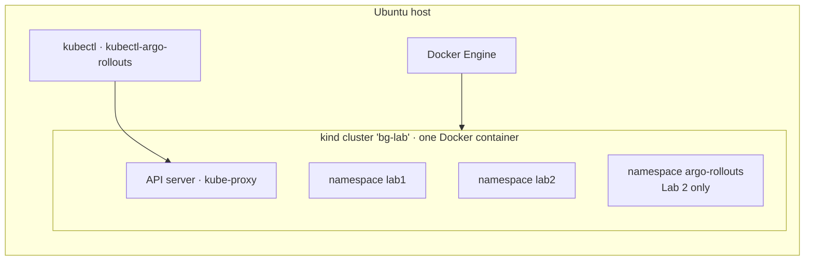
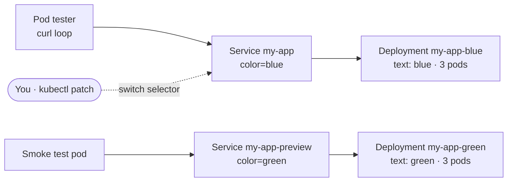
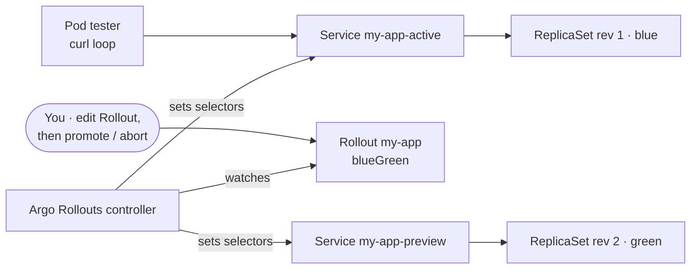

<Part level={1} id="arch" title="Lab architecture">

<Block id="arch-host" title="1.1 The host">

Everything runs on one Ubuntu machine (laptop, VM or cloud instance). **kind** ("Kubernetes in Docker") runs a full Kubernetes node as a Docker container, so you get a real API server, kube-proxy and Services without any cloud account.

The app is `hashicorp/http-echo`, a tiny web server that returns a fixed text. Blue returns `blue`, green returns `green`, so every response tells you which version served it. Both labs use the same app, so the only difference between them is the release mechanism.



</Block>

<Block id="arch-l1" title="1.2 Lab 1 · without Argo Rollouts">

Architecture A from [Topic 02](/topics/02-blue-green-one-cluster): two Deployments, a production Service and a preview Service. You do the switch yourself by patching the production Service selector. A tester pod inside the cluster sends a request every 0.2 seconds and logs which colour answered.



</Block>

<Block id="arch-l2" title="1.3 Lab 2 · with Argo Rollouts">

Architecture C from [Topic 02](/topics/02-blue-green-one-cluster): one `Rollout` resource and two Services. You only change the app version and run `promote`; the controller creates the new ReplicaSet, wires up the preview Service, switches the active Service and scales the old version down.



</Block>

</Part>

<Part level={2} id="theory" title="What the tests prove">

<Block id="th-goals" title="2.1 Test goals">

| Behaviour | Lab 1 | Lab 2 |
| --- | --- | --- |
| Green can be tested before users see it | Smoke test via `my-app-preview` | Rollout pauses; test via `my-app-preview` |
| Cutover is all-at-once | One selector patch | `promote` |
| No failed requests during cutover | Tester log | Tester log |
| Rollback is fast | Patch selector back | `undo` after promotion |
| A bad release can be stopped before cutover | Simply don't switch | `abort` |
| Old version is cleaned up | You scale it to 0 | Controller, after `scaleDownDelaySeconds` |

</Block>

<Block id="th-measure" title="2.2 How we measure">

- **Traffic comes from a pod in the cluster**, not from your terminal. `kubectl port-forward` to a Service picks one pod when it starts and keeps using it, so it would never show the switch.
- **Each request opens a new connection** (`curl` runs once per loop). This tests what new clients see. Long-lived connections behave differently: they stay on the old pods until closed, which these labs do not measure.
- **Each log line is** `time colour status`, or `ERR` if the request failed or timed out after 2 seconds. Counting `ERR` lines gives the failure count.

</Block>

<Block id="th-pass" title="2.3 Pass criteria">

<Checklist>
- Before cutover, every response is `blue 200`, while the preview Service already returns `green`.
- After cutover, responses change to `green 200` within a few seconds.
- `ERR` count across the whole test is 0.
- Rollback returns responses to the previous colour, again with 0 errors.
- Lab 2 only: after `abort`, users never see the bad version.
</Checklist>

<Note title="Not proven here">
A one-node kind cluster has no real network between nodes, so endpoint updates propagate faster than on a multi-node GKE cluster. Passing here shows the mechanism works; it does not prove the same timing in production.
</Note>

</Block>

</Part>

<Part level={3} id="impl" title="Run the labs">

<Block id="im-setup" title="3.1 Prepare Ubuntu">

Needs Ubuntu 22.04 or 24.04 on x86-64, about 4 GB free RAM, and internet access to Docker Hub and GitHub.

<Steps>
<Step title="Install Docker Engine">

From Docker's official Ubuntu instructions (apt repository method):

```bash
sudo apt update
sudo apt install -y ca-certificates curl
sudo install -m 0755 -d /etc/apt/keyrings
sudo curl -fsSL https://download.docker.com/linux/ubuntu/gpg -o /etc/apt/keyrings/docker.asc
sudo chmod a+r /etc/apt/keyrings/docker.asc

sudo tee /etc/apt/sources.list.d/docker.sources <<EOF
Types: deb
URIs: https://download.docker.com/linux/ubuntu
Suites: $(. /etc/os-release && echo "${UBUNTU_CODENAME:-$VERSION_CODENAME}")
Components: stable
Signed-By: /etc/apt/keyrings/docker.asc
EOF

sudo apt update
sudo apt install -y docker-ce docker-ce-cli containerd.io docker-buildx-plugin docker-compose-plugin

# run docker without sudo
sudo usermod -aG docker $USER
newgrp docker
docker run hello-world
```

<Note title="Check">
I could not reach docs.docker.com from my workspace to confirm the exact current text of the `.sources` file. If `apt update` complains about it, copy that block from Docker's page instead.
</Note>

</Step>
<Step title="Install kind and kubectl">

```bash
# kind (binary from GitHub releases; v0.27.0 verified to exist, check for newer)
curl -Lo ./kind https://github.com/kubernetes-sigs/kind/releases/download/v0.27.0/kind-linux-amd64
chmod +x ./kind
sudo mv ./kind /usr/local/bin/kind
kind version

# kubectl (latest stable, per kubernetes.io)
curl -LO "https://dl.k8s.io/release/$(curl -L -s https://dl.k8s.io/release/stable.txt)/bin/linux/amd64/kubectl"
sudo install -o root -g root -m 0755 kubectl /usr/local/bin/kubectl
kubectl version --client
```

</Step>
<Step title="Create the cluster">

```bash
kind create cluster --name bg-lab
kubectl cluster-info --context kind-bg-lab
kubectl get nodes          # one node, STATUS Ready
```

</Step>
</Steps>

</Block>

<Block id="im-l1" title="3.2 Lab 1 · Blue-green without Argo Rollouts" toc="3.2 Lab 1 · Selector switch">

<Steps>
<Step title="Deploy blue and green">

```yaml title="lab1.yaml"
apiVersion: v1
kind: Namespace
metadata: { name: lab1 }
---
apiVersion: apps/v1
kind: Deployment
metadata: { name: my-app-blue, namespace: lab1 }
spec:
  replicas: 3
  selector: { matchLabels: { app: my-app, color: blue } }
  template:
    metadata: { labels: { app: my-app, color: blue } }
    spec:
      containers:
        - name: app
          image: hashicorp/http-echo
          args: ["-text=blue"]
          ports: [{ containerPort: 5678 }]
          readinessProbe: { httpGet: { path: /, port: 5678 }, periodSeconds: 2 }
---
apiVersion: apps/v1
kind: Deployment
metadata: { name: my-app-green, namespace: lab1 }
spec:
  replicas: 3
  selector: { matchLabels: { app: my-app, color: green } }
  template:
    metadata: { labels: { app: my-app, color: green } }
    spec:
      containers:
        - name: app
          image: hashicorp/http-echo
          args: ["-text=green"]
          ports: [{ containerPort: 5678 }]
          readinessProbe: { httpGet: { path: /, port: 5678 }, periodSeconds: 2 }
---
apiVersion: v1
kind: Service
metadata: { name: my-app, namespace: lab1 }          # production
spec:
  selector: { app: my-app, color: blue }
  ports: [{ port: 80, targetPort: 5678 }]
---
apiVersion: v1
kind: Service
metadata: { name: my-app-preview, namespace: lab1 }  # idle colour
spec:
  selector: { app: my-app, color: green }
  ports: [{ port: 80, targetPort: 5678 }]
```

```bash
kubectl apply -f lab1.yaml
kubectl -n lab1 rollout status deploy/my-app-blue
kubectl -n lab1 rollout status deploy/my-app-green
kubectl -n lab1 get endpoints my-app my-app-preview   # 3 IPs each, different sets
```

</Step>
<Step title="Start the traffic generator">

Leave this running in a second terminal for the rest of Lab 1.

```bash
kubectl -n lab1 run tester --image=curlimages/curl --restart=Never --command -- \
  sh -c 'while true; do
    r=$(curl -s -m 2 -w " %{http_code}" http://my-app) || r="ERR"
    echo "$(date +%T) $r"; sleep 0.2; done'

kubectl -n lab1 logs -f tester
```

```text output
06:10:01 blue 200
06:10:01 blue 200
06:10:02 blue 200
```

<Muted>
`--command` matters: the curl image's entrypoint is `curl`, so without it `sh -c …` would be passed to curl as arguments.
</Muted>

</Step>
<Step title="Smoke-test green through the preview Service">

```bash
kubectl -n lab1 run smoke --rm -i --restart=Never --image=curlimages/curl -- \
  -s http://my-app-preview
# expected: green
```

<Muted>
The tester log should still show only `blue`: green is running but not serving users.
</Muted>

</Step>
<Step title="Cut over to green">

```bash
kubectl -n lab1 patch service my-app \
  -p '{"spec":{"selector":{"app":"my-app","color":"green"}}}'
kubectl -n lab1 patch service my-app-preview \
  -p '{"spec":{"selector":{"app":"my-app","color":"blue"}}}'
```

```text output
06:11:14 blue 200
06:11:14 blue 200
06:11:15 green 200
06:11:15 green 200
```

</Step>
<Step title="Roll back, then forward again">

```bash
# rollback: blue is still running, so this is instant
kubectl -n lab1 patch service my-app \
  -p '{"spec":{"selector":{"app":"my-app","color":"blue"}}}'

# forward again
kubectl -n lab1 patch service my-app \
  -p '{"spec":{"selector":{"app":"my-app","color":"green"}}}'
```

</Step>
<Step title="Do the next release on the idle colour">

Green is live, so blue is now the idle slot. Ship "v3" to it, test, and switch, exactly as a real second release would work.

```bash
kubectl -n lab1 patch deploy my-app-blue --type=json \
  -p '[{"op":"replace","path":"/spec/template/spec/containers/0/args","value":["-text=blue-v3"]}]'
kubectl -n lab1 rollout status deploy/my-app-blue

kubectl -n lab1 run smoke --rm -i --restart=Never --image=curlimages/curl -- \
  -s http://my-app-preview          # expected: blue-v3, users still on green

kubectl -n lab1 patch service my-app \
  -p '{"spec":{"selector":{"app":"my-app","color":"blue"}}}'
```

</Step>
<Step title="Check the result">

```bash
kubectl -n lab1 logs tester | grep -c ERR                        # expect 0
kubectl -n lab1 logs tester | awk '{print $2}' | uniq -c          # colour sequence
```

```text output
      0
    412 blue
    197 green
     85 blue
     63 green
    140 blue-v3
```

<Muted>
Your counts will differ; the sequence of colours and a 0 error count is what matters.
</Muted>

</Step>
<Step title="Optional: a reusable cutover script">

```bash title="cutover.sh"
#!/usr/bin/env bash
set -euo pipefail
NS=${NS:-lab1}
TO=${1:?usage: cutover.sh blue|green}
FROM=$([ "$TO" = green ] && echo blue || echo green)

kubectl -n "$NS" rollout status "deploy/my-app-$TO" --timeout=2m
kubectl -n "$NS" patch service my-app-preview \
  -p "{\"spec\":{\"selector\":{\"app\":\"my-app\",\"color\":\"$TO\"}}}"
kubectl -n "$NS" run "smoke-$RANDOM" --rm -i --restart=Never \
  --image=curlimages/curl -- -fsS http://my-app-preview

kubectl -n "$NS" patch service my-app \
  -p "{\"spec\":{\"selector\":{\"app\":\"my-app\",\"color\":\"$TO\"}}}"
kubectl -n "$NS" patch service my-app-preview \
  -p "{\"spec\":{\"selector\":{\"app\":\"my-app\",\"color\":\"$FROM\"}}}"
echo "live: $TO   idle: $FROM"
```

<Muted>
`curl -f` makes the smoke step fail on an HTTP error, and `set -e` then stops the script before the production switch.
</Muted>

</Step>
<Step title="Finish Lab 1">

```bash
kubectl delete ns lab1
```

</Step>
</Steps>

</Block>

<Block id="im-l2" title="3.3 Lab 2 · Blue-green with Argo Rollouts" toc="3.3 Lab 2 · Argo Rollouts">

<Steps>
<Step title="Install the controller and kubectl plugin">

```bash
kubectl create namespace argo-rollouts
kubectl apply -n argo-rollouts \
  -f https://github.com/argoproj/argo-rollouts/releases/latest/download/install.yaml
kubectl -n argo-rollouts rollout status deploy/argo-rollouts

# plugin binary (Linux, no Homebrew needed)
curl -LO https://github.com/argoproj/argo-rollouts/releases/latest/download/kubectl-argo-rollouts-linux-amd64
chmod +x kubectl-argo-rollouts-linux-amd64
sudo mv kubectl-argo-rollouts-linux-amd64 /usr/local/bin/kubectl-argo-rollouts
kubectl argo rollouts version
```

<Muted>
Both download URLs were checked and resolve on GitHub. kubectl finds any executable named `kubectl-<name>` on your PATH as a plugin, which is why the rename is needed.
</Muted>

</Step>
<Step title="Deploy the Rollout (blue)">

```yaml title="lab2.yaml"
apiVersion: v1
kind: Namespace
metadata: { name: lab2 }
---
apiVersion: v1
kind: Service
metadata: { name: my-app-active, namespace: lab2 }
spec:
  selector: { app: my-app }
  ports: [{ port: 80, targetPort: 5678 }]
---
apiVersion: v1
kind: Service
metadata: { name: my-app-preview, namespace: lab2 }
spec:
  selector: { app: my-app }
  ports: [{ port: 80, targetPort: 5678 }]
---
apiVersion: argoproj.io/v1alpha1
kind: Rollout
metadata: { name: my-app, namespace: lab2 }
spec:
  replicas: 3
  revisionHistoryLimit: 3
  selector: { matchLabels: { app: my-app } }
  template:
    metadata: { labels: { app: my-app } }
    spec:
      containers:
        - name: app
          image: hashicorp/http-echo
          args: ["-text=blue"]
          ports: [{ containerPort: 5678 }]
          readinessProbe: { httpGet: { path: /, port: 5678 }, periodSeconds: 2 }
  strategy:
    blueGreen:
      activeService: my-app-active
      previewService: my-app-preview
      autoPromotionEnabled: false     # wait for a manual promote
      scaleDownDelaySeconds: 60       # keep old version 60 s after switch
```

```bash
kubectl apply -f lab2.yaml
kubectl argo rollouts -n lab2 get rollout my-app      # Status: Healthy, 1 revision
```

</Step>
<Step title="Start the traffic generator">

```bash
kubectl -n lab2 run tester --image=curlimages/curl --restart=Never --command -- \
  sh -c 'while true; do
    r=$(curl -s -m 2 -w " %{http_code}" http://my-app-active) || r="ERR"
    echo "$(date +%T) $r"; sleep 0.2; done'

kubectl -n lab2 logs -f tester          # blue 200 ...
```

</Step>
<Step title="Release green and watch it pause">

Any change to the pod template creates a new revision. Here the "new version" is a new text argument. With a real app you would run `kubectl argo rollouts set image`.

```bash
kubectl -n lab2 patch rollout my-app --type=json \
  -p '[{"op":"replace","path":"/spec/template/spec/containers/0/args","value":["-text=green"]}]'

kubectl argo rollouts -n lab2 get rollout my-app --watch
```

You should see two ReplicaSets: revision 1 marked `stable, active` and revision 2 marked `preview`, with the Rollout `Paused`. Press Ctrl+C to stop watching.

```bash
kubectl -n lab2 run smoke --rm -i --restart=Never --image=curlimages/curl -- \
  -s http://my-app-preview            # green
kubectl -n lab2 get svc my-app-active my-app-preview -o wide   # selectors now include a hash
```

</Step>
<Step title="Promote">

```bash
kubectl argo rollouts -n lab2 promote my-app
kubectl argo rollouts -n lab2 get rollout my-app --watch
```

The tester log changes from `blue 200` to `green 200`. Revision 1 stays up for about 60 seconds (`scaleDownDelaySeconds`), then scales to 0.

</Step>
<Step title="Test abort: stop a bad release before users see it">

```bash
kubectl -n lab2 patch rollout my-app --type=json \
  -p '[{"op":"replace","path":"/spec/template/spec/containers/0/args","value":["-text=bad-release"]}]'

kubectl -n lab2 run smoke --rm -i --restart=Never --image=curlimages/curl -- \
  -s http://my-app-preview            # bad-release: smoke test "fails" by eye

kubectl argo rollouts -n lab2 abort my-app
kubectl argo rollouts -n lab2 get rollout my-app
```

The tester never shows `bad-release`; users stay on green. The aborted revision is scaled down and the Rollout reports `Degraded` because its spec still asks for the bad version. Put the spec back to the stable version to clear it:

```bash
kubectl -n lab2 patch rollout my-app --type=json \
  -p '[{"op":"replace","path":"/spec/template/spec/containers/0/args","value":["-text=green"]}]'
kubectl argo rollouts -n lab2 get rollout my-app      # Healthy again
```

<Note title="Unsure">
I expect `Degraded` after abort and `Healthy` once the spec matches the stable revision again, but I have not run this exact sequence. Note what you actually see.
</Note>

</Step>
<Step title="Test rollback after promotion with undo">

```bash
kubectl argo rollouts -n lab2 undo my-app
kubectl argo rollouts -n lab2 get rollout my-app --watch
```

`undo` sets the Rollout back to the previous revision's template (blue). Because this Rollout uses `autoPromotionEnabled: false`, it goes through preview and pauses again; run `promote` to complete the rollback.

<Note title="Unsure">
Whether `undo` on this Rollout returns to `blue` or to another earlier revision depends on the revision history after the abort step. Check which text the preview Service returns before you promote.
</Note>

</Step>
<Step title="Check the result">

```bash
kubectl -n lab2 logs tester | grep -c ERR                 # expect 0
kubectl -n lab2 logs tester | awk '{print $2}' | uniq -c   # never shows bad-release
```

</Step>
</Steps>

</Block>

<Block id="im-clean" title="3.4 Clean up">

```bash
kind delete cluster --name bg-lab
```

<Muted>
This removes the whole cluster, including Argo Rollouts. Docker, kind, kubectl and the plugin stay installed for the next lab.
</Muted>

</Block>

<Block id="im-trouble" title="3.5 Troubleshooting">

| Symptom | Likely cause | Fix |
| --- | --- | --- |
| `permission denied … docker.sock` | User not in the `docker` group yet | Run `newgrp docker` or log out and back in |
| Pods stuck in `ImagePullBackOff` | No access to Docker Hub (proxy, firewall, rate limit) | `kubectl -n lab1 describe pod …`; pull on the host and load with `kind load docker-image hashicorp/http-echo --name bg-lab` |
| Pods stuck in `Pending` | Not enough memory for the kind node | Free memory or reduce `replicas` to 2 |
| Tester logs show `curl: option -c` style errors | `--command` missing from `kubectl run` | Delete the pod and re-run with `--command` |
| `kubectl argo rollouts`: unknown command | Plugin not on PATH or wrong name | Binary must be named `kubectl-argo-rollouts` in a PATH directory |
| Rollout never pauses | `autoPromotionEnabled` missing (default is true) | Set it to `false` |
| Some `ERR` lines around the switch | Timing on a slow machine, or pods removed too early | Check old pods were still Running at cutover; record it as a finding |

</Block>

<Block id="refs" title="References">

- [Topic 02 · Blue-Green Deployment in One Kubernetes Cluster](/topics/02-blue-green-one-cluster)
- [kind · Quick start](https://kind.sigs.k8s.io/docs/user/quick-start/)
- [kind · Releases](https://github.com/kubernetes-sigs/kind/releases)
- [Kubernetes · Install kubectl on Linux](https://kubernetes.io/docs/tasks/tools/install-kubectl-linux/)
- [Docker · Install Docker Engine on Ubuntu](https://docs.docker.com/engine/install/ubuntu/)
- [Argo Rollouts · Installation](https://argo-rollouts.readthedocs.io/en/latest/installation/)
- [Argo Rollouts · BlueGreen](https://argo-rollouts.readthedocs.io/en/latest/features/bluegreen/)
- [Argo Rollouts · Releases](https://github.com/argoproj/argo-rollouts/releases)

</Block>

</Part>
