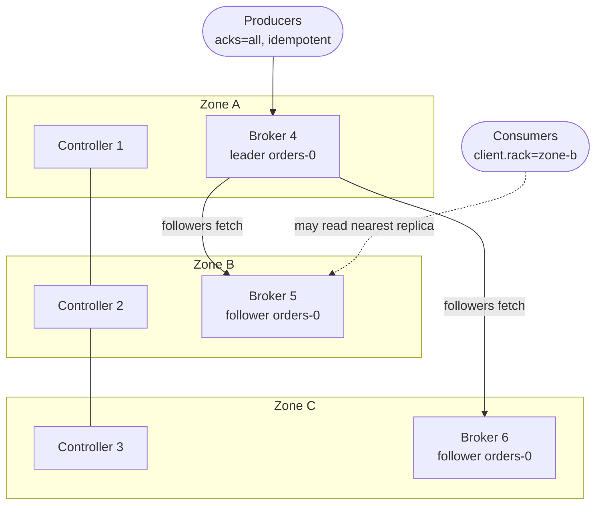
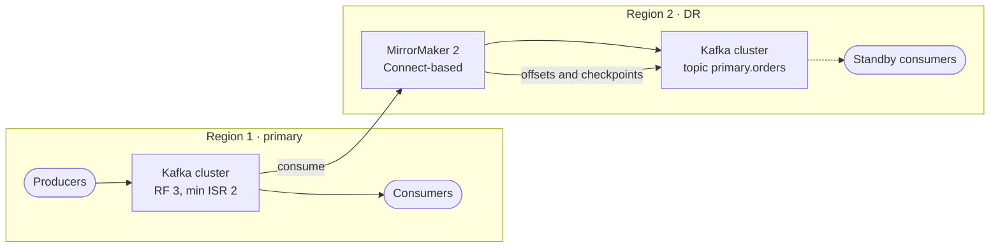
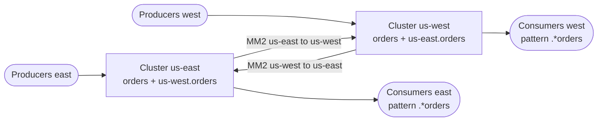

<Muted>
Written against Apache Kafka 4.4 (released 22 October 2026). Config names, defaults and quoted behaviour come from the 4.4 documentation. The lab in [3.6](#im-lab) was run three times on `apache/kafka:4.4.0`. Its output blocks are copied from the last run, with `WARN` lines removed.
</Muted>

<Part level={1} id="arch" title="Architecture examples" toc="Architecture">

<Block id="arch-scenario" title="1.1 The scenario">

Order and payment services publish events to Kafka. The requirement:

- **No acknowledged event is lost.** If the producer got a success response, the event must still be there after any single failure.
- **No duplicates from retries.** A network blip must not write the same event twice.
- **Keep accepting writes** when one broker or one availability zone is down.
- **Survive losing a whole region or data centre**, with a known recovery point and a way to move consumers over.

Kafka's main tool for this is **replication**. Each partition is copied to several brokers. One copy is the leader and the others are followers. The **in-sync replica set (ISR)** is the leader plus the followers that are caught up. The three architectures below add protection in layers: inside one cluster, then across clusters.

</Block>

<Block id="arch-a" title="1.2 Architecture A · One cluster across three zones" toc="1.2 A · One cluster, three zones">

One Kafka cluster in one region. It has three KRaft controllers and at least three brokers, spread over three availability zones (racks). Every topic has replication factor 3 with `min.insync.replicas=2`, and producers send with `acks=all`. Rack awareness places one replica of each partition in each zone.



<Fit>
<Pros title="Fits when">
- The failures to survive are a broker, a disk or one zone
- Producers and consumers sit in the same region
- You want this as the baseline for every production cluster
</Pros>
<Cons title="Watch out for">
- A whole-region outage takes the cluster down
- Replication traffic crosses zones, which most clouds charge for
- With RF 3 and min ISR 2, losing two zones stops writes (by design)
</Cons>
</Fit>

</Block>

<Block id="arch-b" title="1.3 Architecture B · Primary cluster + DR cluster with MirrorMaker 2" toc="1.3 B · Active/passive DR">

Architecture A in each of two regions. **MirrorMaker 2** (MM2) copies topics, topic configs, consumer group offsets and ACLs from the primary to the DR cluster. This is the docs' "Active/Passive" pattern (`primary->dr`). Producers and consumers use only the primary. In a disaster you move them to DR, and consumers continue from translated offsets.



<Fit>
<Pros title="Fits when">
- You must survive a region or data-centre loss
- A non-zero recovery point (MM2 replication lag) is acceptable
- Compliance requires a copy of the data somewhere else
</Pros>
<Cons title="Watch out for">
- Replication is asynchronous, so events acknowledged on the primary can be missing in DR (RPO greater than 0)
- Topics are renamed in DR (`primary.orders`), so consumers must subscribe to the new name or you change the replication policy
- Failover and failback are runbooks you have to write and practise
</Cons>
</Fit>

</Block>

<Block id="arch-c" title="1.4 Architecture C · Active/active with bidirectional MirrorMaker 2" toc="1.4 C · Active/active">

Both regions take writes from local producers. MM2 runs both flows, `A->B` and `B->A`. The default replication policy prefixes remote topics with the source alias, so `orders` written in `us-east` appears as `us-east.orders` in `us-west`. That prefix also stops a record from looping back. Consumers that need a global view subscribe to both the local and the remote topic, for example with a pattern like `.*orders`.



<Fit>
<Pros title="Fits when">
- Producers in each region must keep writing during the other region's outage
- Clients should talk to a nearby cluster for latency
- The data is naturally partitioned by region (orders from region X)
</Pros>
<Cons title="Watch out for">
- No global ordering. Two regions can write related events in different orders.
- Applications must handle the same business key arriving from both regions
- Twice the MM2 topology to run and monitor
</Cons>
</Fit>

</Block>

<Block id="arch-compare" title="1.5 Choosing between them">

| Concern | A · One cluster, 3 zones | B · Active/passive DR | C · Active/active |
| --- | --- | --- | --- |
| Survives a broker or zone | Yes, no data loss for acked writes | Yes (A in each region) | Yes (A in each region) |
| Survives a region | No | Yes, after failover | Yes, the other region keeps running |
| Data loss on region failure (RPO) | Whatever was in that region | MM2 replication lag | MM2 replication lag |
| Write path | Synchronous ISR replication | Synchronous inside primary, async to DR | Synchronous locally, async across |
| Ordering | Per partition | Per partition (primary only writes) | Per partition per region; nothing global |
| Operational load | One cluster | Two clusters + MM2 + failover runbook | Two clusters + two MM2 flows + app changes |
| Recommended for | Every production cluster (the baseline) | Most enterprise DR needs | Multi-region products that must write everywhere |

<Muted>
Another option is a single "stretched" cluster across regions, which turns region loss into a zone-style failure. The Kafka docs' geo-replication section only covers MirrorMaker, so this page doesn't cover stretched clusters. Their main cost is that every `acks=all` write waits for a replica in another region.
</Muted>

</Block>

</Part>

<Part level={2} id="theory" title="Theory">

<Block id="th-replication" title="2.1 Replication, leaders and the ISR" toc="2.1 Replication and the ISR">

The Kafka design docs describe replication like this:

- **The unit of replication is the topic partition.** Each partition has one leader and zero or more followers. The total number of copies, leader included, is the **replication factor (RF)**.
- **All writes go to the leader.** Followers fetch from the leader, much like a consumer does, and apply the same records at the same offsets.
- **"In sync"** means two things: the broker keeps its session with the controller (KRaft heartbeats, timeout `broker.session.timeout.ms`, default 9 s), and, as a follower, it keeps up with the leader.
- **Followers that fall behind leave the ISR.** If a follower has not fetched, or has not reached the leader's log end, for `replica.lag.time.max.ms` (default **30 s**), the leader removes it from the ISR.
- **Committed** means every replica in the ISR has the record. The docs: "Once a published message is committed, it will not be lost as long as one broker that replicates the partition to which this message was written remains 'alive'."
- **Leader failover:** when a leader's broker fails, the controller elects a new leader from the ISR.

</Block>

<Block id="th-acks" title="2.2 acks and min.insync.replicas: the durability contract" toc="2.2 acks + min.insync.replicas">

The producer's `acks` setting decides when a send counts as successful:

| `acks` | The leader replies when… | What can be lost |
| --- | --- | --- |
| `0` | It doesn't reply. The record counts as sent once it is in the socket buffer. | Anything. Retries don't apply, and the returned offset is always -1. |
| `1` | The record is in the leader's own log | Records the leader acked but followers had not copied when it failed |
| `all` (`-1`, **the default**) | Every replica currently in the ISR has the record | Nothing, while at least one in-sync replica survives |

`acks=all` alone has a gap. The docs: "acknowledgement by all replicas" does not guarantee that the full set of assigned replicas have received the message. If the ISR has shrunk to the leader alone, `acks=all` means only one copy. **`min.insync.replicas`** (default **1**) closes the gap. With `acks=all`, the leader rejects writes with `NotEnoughReplicas` while the ISR is smaller than this value.

<Tip title="The standard enterprise setting">
The docs' own recommendation: "create a topic with a replication factor of 3, set min.insync.replicas to 2, and produce with acks of 'all'. This ensures that a majority of replicas must persist a write before it's considered successful."
</Tip>

| RF / min ISR | Broker failures with writes still accepted | Copies of each acked write |
| --- | --- | --- |
| 3 / 1 | 2, but you may be down to one copy | At least 1 |
| **3 / 2** | **1** | **At least 2** |
| 3 / 3 | 0, so any broker restart blocks writes | 3 |
| 5 / 3 | 2 | At least 3 |

The trade-off, in the docs' words: a higher min ISR "guarantees better consistency … However, it reduces availability since the partition will be unavailable for writes if the number of in-sync replicas drops below the minimum threshold."

One more detail, confirmed in the lab: "Regardless of the acks setting, the messages will not be visible to the consumers until they are replicated to all in-sync replicas and the min.insync.replicas condition is met." When the ISR is below the minimum, an `acks=1` write is accepted but stays invisible to consumers. It is also unprotected until the ISR recovers.

</Block>

<Block id="th-elections" title="2.3 Leader elections: unclean election and ELR" toc="2.3 Unclean election and ELR">

**What happens if every in-sync replica dies?** Kafka can either wait for an ISR member to come back (consistent, but unavailable meanwhile) or promote whichever replica returns first (available, but "its log becomes the source of truth even though it is not guaranteed to have every committed message"). `unclean.leader.election.enable` chooses between them. Its default is **`false`**: Kafka waits for a consistent replica. Keep it `false` for business events. Set it to `true` only on topics where uptime matters more than completeness, such as some metrics.

**Eligible Leader Replicas (ELR, KIP-966).** Added in Kafka 4.0 and **enabled by default on new clusters from 4.1**. With the "strict min ISR" rule, the high watermark cannot advance while the ISR is smaller than `min.insync.replicas`. That makes some replicas outside the ISR safe to elect. The controller records them as ELR and elects in this order:

1. A member of the ISR, if there is one.
2. An unfenced member of the ELR.
3. The last known leader, if it is unfenced.

The lab shows ELR live. After two of three brokers are stopped, `Isr: 4  Elr: 5`. Broker 5 left the ISR when the ISR fell below 2, so it still holds every committed record.

<Note title="ELR changes how min.insync.replicas is configured">
With ELR enabled, a cluster-level `min.insync.replicas` is created from the active controller's static config. Broker-level `min.insync.replicas` values are removed and can't be changed. Changing the cluster-level or a topic's value clears the ELR state. In practice, set the default on the controllers and override it per topic. The lab's controllers set `KAFKA_MIN_INSYNC_REPLICAS: 2` for this reason.
</Note>

</Block>

<Block id="th-producer" title="2.4 Idempotent and transactional producers" toc="2.4 Idempotence and transactions">

Replication protects data that reached the broker. It does nothing about a producer retrying a send whose response was lost. That retry is the classic source of duplicates.

- **Idempotent producer** (`enable.idempotence`, **default `true`**). "The broker assigns each producer an ID and deduplicates messages using a sequence number." It requires `acks=all`, `retries > 0` and `max.in.flight.requests.per.connection ≤ 5` (default 5). Ordering is preserved. **Trap:** if you set a conflicting value (for example `acks=1`) without explicitly enabling idempotence, Kafka silently turns idempotence off. If you set `enable.idempotence=true` explicitly, a conflicting value fails with a `ConfigException`. **Set it explicitly** so a wrong setting fails loudly.
- **Delivery time limit:** `delivery.timeout.ms` (default 2 min) caps how long `send()` keeps retrying before it reports failure. Your code must handle that failure, for example with an outbox or a dead-letter path, because Kafka has given up.
- **Transactions** (`transactional.id`). These give atomic writes across several partitions and topics, which is the basis of exactly-once consume-process-produce. Setting `transactional.id` implies idempotence. Consumers must use `isolation.level=read_committed` to skip aborted data. The default is `read_uncommitted`. Transactions need the internal `__transaction_state` topic, which defaults to RF 3 (`transaction.state.log.replication.factor`) with min ISR 2 (`transaction.state.log.min.isr`). So by default they need at least three brokers.

<Grid>
<InfoCard title="At least once (recommended default)">
`acks=all`, idempotence on, consumers commit offsets **after** processing (`enable.auto.commit` defaults to `true`, so turn it off or make sure processing finishes before the next poll). Consumers must tolerate redelivery after a crash.
</InfoCard>
<InfoCard title="Exactly once inside Kafka">
Transactional producer plus `read_committed` consumers, or Kafka Streams with exactly-once enabled. This only covers Kafka-to-Kafka. Writes to an external database still need idempotent handling on that side.
</InfoCard>
</Grid>

</Block>

<Block id="th-enterprise" title="2.5 Other features an enterprise cluster relies on" toc="2.5 Enterprise features">

<Grid>
<InfoCard title="Rack / zone awareness">
Set `broker.rack` (for example `us-east-1d`) on every broker. When replicas are assigned, each partition spans `min(#racks, RF)` racks, so a zone outage removes at most one replica. Use the same number of brokers per rack. With uneven racks, the racks with fewer brokers get more replicas.
</InfoCard>
<InfoCard title="Follower fetching (KIP-392)">
On brokers, set `replica.selector.class=org.apache.kafka.common.replica.RackAwareReplicaSelector`. On consumers, set `client.rack` to match their zone. Consumers then read from a replica in their own zone instead of the leader, which cuts cross-zone traffic. By default consumers read only from the leader.
</InfoCard>
<InfoCard title="KRaft controller quorum">
Kafka 4.x runs only in KRaft mode. ZooKeeper is gone. The metadata quorum needs a majority of controllers alive: "With 3 controllers, the cluster can tolerate 1 controller failure; with 5 controllers … 2." Put one controller per zone. Sizing is covered in [2.6](#th-kraft).
</InfoCard>
<InfoCard title="Internal topic RF">
`offsets.topic.replication.factor` and `transaction.state.log.replication.factor` both default to 3. Committed consumer offsets and transaction state need the same protection as your data. Don't lower them outside a lab.
</InfoCard>
<InfoCard title="Safe defaults on the broker">
`default.replication.factor` defaults to **1**. Set it to 3. Turn off `auto.create.topics.enable` so a typo in a topic name can't create an unreplicated topic. Create topics in code or GitOps with explicit RF and min ISR.
</InfoCard>
<InfoCard title="Leader balance">
After a broker restarts, it is a follower for every partition it hosts. With `auto.leader.rebalance.enable=true` (the default), the controller moves leadership back to the preferred replicas. It checks every `leader.imbalance.check.interval.seconds` (default 300). To do it now, run `kafka-leader-election.sh --election-type preferred`.
</InfoCard>
<InfoCard title="Monitoring that matters">
Alert on `UnderMinIsrPartitionCount > 0` (writes are being rejected), `UnderReplicatedPartitions > 0` (redundancy is reduced), `AtMinIsrPartitionCount` (one more failure blocks writes) and `OfflineReplicaCount`. All are under `kafka.server:type=ReplicaManager`. For DR, also watch MM2 replication latency.
</InfoCard>
<InfoCard title="Security and data contracts">
Kafka supports TLS encryption, SASL authentication (GSSAPI/Kerberos, PLAIN, SCRAM-SHA-256/512, OAUTHBEARER) and ACL authorization. The docs also recommend a schema registry (third-party, not part of Kafka) so producers can't write events that consumers can't read.
</InfoCard>
</Grid>

<Muted>
Tiered storage (`remote.log.storage.system.enable`, default `false`) moves older log segments to object storage. It helps with long retention and faster broker replacement, and it is not a replacement for replication. This page does not cover it further.
</Muted>

</Block>

<Block id="th-kraft" title="2.6 KRaft controllers: Kafka's control plane" toc="2.6 KRaft controllers">

Each Kafka server has one or both roles, set with `process.roles`. The 4.4 docs describe the split in control-plane terms: "In KRaft mode … the control plane functionality is fully integrated into Kafka itself. … brokers handle data-related requests, while the controllers (a.k.a., quorum controller) manage metadata-related requests."

| | Control plane: controllers | Data plane: brokers |
| --- | --- | --- |
| `process.roles` | `controller` | `broker` |
| Handles | Cluster metadata: topics, partitions, partition leaders, configs, broker liveness | Produce, fetch, and replication between brokers |
| Listener | `controller.listener.names` (port 9093 in the lab) | Client and inter-broker listeners (port 9092 in the lab) |
| When it fails | No new leader elections or topic changes. Writes need a majority of controllers. | That broker's partitions lose a replica or their leader |

**What controllers do:**
- **Track broker liveness.** Brokers heartbeat to the controller. A broker with no heartbeat for `broker.session.timeout.ms` (default 9 s) is offline and is removed from the ISR.
- **Elect partition leaders.** The controller picks the new leader from the ISR, or from the ELR (see [2.3](#th-elections)). It batches elections, which keeps the window of unavailability short.
- **Keep the metadata log.** Each controller in the quorum (a "voter") holds a full copy. "Each controller is either an active or a hot standby for the current active controller."

<Note title="Controllers have no replication factor">
Replication factor and `min.insync.replicas` apply to **topic partitions** on brokers. The number of metadata copies is simply the number of voters. Losing controllers and losing brokers are separate failures. Losing a controller majority stops metadata changes. Losing brokers affects data availability, which RF and min ISR protect (see [2.2](#th-acks)).
</Note>

**Sizing the quorum.** The docs: "A majority of the controllers must be alive in order to maintain availability," and admins "typically select 3 or 5" controllers. The majority of *n* is ⌊n/2⌋ + 1:

| Controllers | Majority needed | Failures tolerated | Survives losing 1 of 3 zones? |
| --- | --- | --- | --- |
| 1 | 1 | 0 | No |
| 2 | 2 | 0 | No |
| **3** (1 per zone) | 2 | **1** | **Yes** (2 of 3 remain) |
| 4 (2 + 1 + 1) | 3 | 1 | **No** if the zone holding 2 fails (2 of 4 remain) |
| **5** (2 + 2 + 1) | 3 | **2** | **Yes** (3 of 5 remain in the worst case) |
| 6 (2 + 2 + 2) | 4 | 2 | Yes (4 of 6 remain), but tolerates no more failures than 5 |

**Why 4 is skipped.** Going from 3 to 4 controllers adds a machine but no extra failure tolerance (both survive 1 failure), and it is slightly worse:

1. **Same limit, more things to break.** Quorum is lost at 2 failures either way, and 2 failures among 4 machines is more likely than among 3.
2. **More acknowledgements per write.** A metadata change is committed once a majority has it: 3 machines instead of 2.
3. **A 2-2 network split stops everything.** If the network splits the 4 into two halves, neither half has a majority, so neither side can elect an active controller. An odd number always leaves one side with a majority.
4. **It doesn't fit three zones.** One zone has to hold 2 controllers, and losing that zone loses the quorum (table above).

So 3 is the smallest quorum that survives one failure, and 5 is the next size that buys anything: it survives any two failed controllers, or the loss of any one zone with a 2-2-1 layout. (Not both at once: after losing a zone that holds 2, the remaining 3 can't lose another.) Six has the same weakness as four: it costs an extra machine and tolerates no more failures than five.

<Note title="Where the reasoning comes from">
The quotes and the "3 or 5" guidance are from the Kafka 4.4 docs. The "why not 4" reasoning and the zone column are majority-vote arithmetic that applies to any Raft-style quorum (etcd, ZooKeeper). It is not stated in the Kafka docs.
</Note>

**Combined vs dedicated controllers.** A server with `process.roles=broker,controller` is "combined". The docs call that "simpler to operate for small use cases like a development environment". The drawback is that "the controller will be less isolated from the rest of the system". For example, you can't roll or scale controllers separately from brokers. The lab in [3.6](#im-lab) uses 3 dedicated controllers and 3 brokers. `kafka-metadata-quorum.sh describe --status` shows the active controller as `LeaderId` and the three voters as `CurrentVoters`.

**What losing the quorum looks like.** I tested this on the lab cluster from [3.1](#im-compose), with all three brokers up:

```bash
docker stop controller-2 controller-3          # 1 of 3 controllers left: no majority
K kafka-topics.sh $B --create --topic payments --partitions 3 --replication-factor 3   # hangs
K kafka-topics.sh $B --describe --topic orders                                         # times out
echo order-2 | K kafka-console-producer.sh $B --topic orders --command-property acks=all
K kafka-get-offsets.sh $B --topic orders
docker start controller-2 controller-3
```

| Operation with 1 of 3 controllers | Result in the lab |
| --- | --- |
| Create a topic | Hung. I stopped it after 60 s. |
| `kafka-topics.sh --describe` | `TimeoutException` (`listPartitionReassignments` needs a controller) |
| `acks=all` produce to an existing topic | **Succeeded.** Offsets went from 1 to 2, then to 3 on a second send. |
| Console consumer in a new group | Read nothing within 40 s |
| After restarting the 2 controllers | Topic creation worked, and the consumer read `order-1 order-2 order-3` |

So existing partitions with healthy leaders keep serving writes. Anything that changes metadata waits for a majority. A broker failure during that time can't be handled, because no new leader can be elected.

<Note title="Unsure">
I didn't find out why the new consumer group read nothing. My guess is that the `__consumer_offsets` topic didn't exist yet in this fresh cluster, and creating it needs the controllers. I haven't confirmed that, and I didn't test a consumer group that already existed before the outage.
</Note>

</Block>

<Block id="th-mm2" title="2.7 MirrorMaker 2: replication between clusters" toc="2.7 MirrorMaker 2">

Replication inside a cluster is synchronous with the producer when `acks=all` is used. **MirrorMaker 2 is separate.** It is built on Kafka Connect, consumes from a source cluster and produces to a target cluster. The docs list what it replicates: topic data and configs, consumer groups with offsets, and ACLs. It also preserves partitioning and detects new topics and partitions automatically.

- **Flows** are written `source->target` and enabled per flow: `primary->dr.enabled = true`, plus a topic regex in `primary->dr.topics`.
- **Remote topic names** follow `DefaultReplicationPolicy`: `{source}.{topic}`, for example `primary.orders`. You can change the separator with `replication.policy.separator`, or swap the class with `replication.policy.class`.
- **Offset translation:** offsets in the DR copy differ from the source. MM2 writes checkpoints (`emit.checkpoints.enabled`, default `true`). With `sync.group.offsets.enabled=true` (default **`false`**), it also writes translated offsets into the DR cluster's `__consumer_offsets`, as long as no consumer in that group is active on the DR cluster. In the lab, translated offsets trailed the primary for the first minute or two, then caught up. A consumer that fails over after that resumes where it stopped. One that fails over earlier reprocesses some events.
- **It is asynchronous.** An event can be acknowledged on the primary before MM2 has copied it, so DR gives you a recovery point (RPO), not zero loss. If you need zero loss across regions, the write path itself has to span regions, as in a stretched cluster.

<Note title="Unsure">
The docs explain how to configure MM2 but give no failover or failback runbook. Repointing producers, dealing with events that never reached DR, and reversing the flow afterwards are your design work. Test them, for example with the lab in 3.6.
</Note>

</Block>

<Block id="th-proscons" title="2.8 Problems solved, pros and cons" toc="2.8 Pros and cons">

**Problems this setup solves:** lost events when a broker dies after acking, duplicates from producer retries, write outages during rolling restarts and patching, zone outages, and (with MM2) region loss and cloud migration.

<Fit>
<Pros>
- An acked event survives any single broker or zone failure
- Idempotence is on by default, so retries don't duplicate events
- Rolling restarts with no downtime (RF 3 / min ISR 2 tolerates one broker down)
- Rack awareness and follower fetching keep it efficient across zones
- The same building blocks extend to DR with MM2
</Pros>
<Cons>
- 3× storage, plus cross-zone network cost
- `acks=all` adds latency (the docs: "on the order of 10 ms")
- Two failures in the same partition's replica set stop writes to it
- DR across regions is asynchronous, so RPO is greater than 0
- Easy to undo by accident: conflicting producer configs, auto-created topics, RF 1 defaults
</Cons>
</Fit>

</Block>

</Part>

<Part level={3} id="impl" title="Implementation">

<Muted>
Everything runs on a laptop with Docker (about 4 GB free RAM). You need no Java or Kafka install, because all the CLI tools run inside the `apache/kafka:4.4.0` containers. Put the files from 3.1 to 3.3 in one folder, `kafka-ha-lab/`.
</Muted>

<Block id="im-compose" title="3.1 The cluster: 3 controllers, 3 brokers in 3 zones" toc="3.1 Docker Compose cluster">

This follows the isolated-mode example from the Apache Kafka repo (`docker/examples/.../cluster/isolated`), with production durability settings added. Brokers have node IDs 4, 5 and 6, in racks `zone-a`, `zone-b` and `zone-c`.

```yaml title="kafka-ha-lab/docker-compose.yml"
# Lab: 3 KRaft controllers + 3 brokers (one per "rack"/zone) + optional DR cluster
x-kafka: &kafka
  image: apache/kafka:4.4.0
  restart: "no"

x-controller-env: &controller-env
  KAFKA_PROCESS_ROLES: controller
  KAFKA_LISTENERS: CONTROLLER://:9093
  KAFKA_CONTROLLER_LISTENER_NAMES: CONTROLLER
  KAFKA_CONTROLLER_QUORUM_VOTERS: 1@controller-1:9093,2@controller-2:9093,3@controller-3:9093
  CLUSTER_ID: 4L6g3nShT-eMCtK--X86sw
  KAFKA_LOG_DIRS: /var/lib/kafka/data
  KAFKA_HEAP_OPTS: -Xms256m -Xmx256m
  # cluster defaults are read from the controllers (see 2.3)
  KAFKA_DEFAULT_REPLICATION_FACTOR: 3
  KAFKA_MIN_INSYNC_REPLICAS: 2

x-broker-env: &broker-env
  KAFKA_PROCESS_ROLES: broker
  KAFKA_LISTENERS: PLAINTEXT://:9092
  KAFKA_LISTENER_SECURITY_PROTOCOL_MAP: CONTROLLER:PLAINTEXT,PLAINTEXT:PLAINTEXT
  KAFKA_INTER_BROKER_LISTENER_NAME: PLAINTEXT
  KAFKA_CONTROLLER_LISTENER_NAMES: CONTROLLER
  KAFKA_CONTROLLER_QUORUM_VOTERS: 1@controller-1:9093,2@controller-2:9093,3@controller-3:9093
  CLUSTER_ID: 4L6g3nShT-eMCtK--X86sw
  KAFKA_LOG_DIRS: /var/lib/kafka/data
  KAFKA_HEAP_OPTS: -Xms512m -Xmx512m
  # durability defaults
  KAFKA_DEFAULT_REPLICATION_FACTOR: 3
  KAFKA_MIN_INSYNC_REPLICAS: 2
  KAFKA_UNCLEAN_LEADER_ELECTION_ENABLE: "false"
  KAFKA_AUTO_CREATE_TOPICS_ENABLE: "false"
  KAFKA_OFFSETS_TOPIC_REPLICATION_FACTOR: 3
  KAFKA_TRANSACTION_STATE_LOG_REPLICATION_FACTOR: 3
  KAFKA_TRANSACTION_STATE_LOG_MIN_ISR: 2
  # consumers may read from a replica in their own rack
  KAFKA_REPLICA_SELECTOR_CLASS: org.apache.kafka.common.replica.RackAwareReplicaSelector
  KAFKA_GROUP_INITIAL_REBALANCE_DELAY_MS: 0

services:
  controller-1: { <<: *kafka, container_name: controller-1, hostname: controller-1, environment: { <<: *controller-env, KAFKA_NODE_ID: 1 } }
  controller-2: { <<: *kafka, container_name: controller-2, hostname: controller-2, environment: { <<: *controller-env, KAFKA_NODE_ID: 2 } }
  controller-3: { <<: *kafka, container_name: controller-3, hostname: controller-3, environment: { <<: *controller-env, KAFKA_NODE_ID: 3 } }

  kafka-1:
    <<: *kafka
    container_name: kafka-1
    hostname: kafka-1
    depends_on: [controller-1, controller-2, controller-3]
    environment:
      <<: *broker-env
      KAFKA_NODE_ID: 4
      KAFKA_BROKER_RACK: zone-a
      KAFKA_ADVERTISED_LISTENERS: PLAINTEXT://kafka-1:9092
  kafka-2:
    <<: *kafka
    container_name: kafka-2
    hostname: kafka-2
    depends_on: [controller-1, controller-2, controller-3]
    environment:
      <<: *broker-env
      KAFKA_NODE_ID: 5
      KAFKA_BROKER_RACK: zone-b
      KAFKA_ADVERTISED_LISTENERS: PLAINTEXT://kafka-2:9092
  kafka-3:
    <<: *kafka
    container_name: kafka-3
    hostname: kafka-3
    depends_on: [controller-1, controller-2, controller-3]
    environment:
      <<: *broker-env
      KAFKA_NODE_ID: 6
      KAFKA_BROKER_RACK: zone-c
      KAFKA_ADVERTISED_LISTENERS: PLAINTEXT://kafka-3:9092

  # ---- Optional: disaster-recovery cluster + MirrorMaker 2 (docker compose --profile dr up -d)
  kafka-dr:
    <<: *kafka
    profiles: [dr]
    container_name: kafka-dr
    hostname: kafka-dr
    environment:
      KAFKA_NODE_ID: 1
      KAFKA_PROCESS_ROLES: broker,controller
      KAFKA_LISTENERS: PLAINTEXT://:9092,CONTROLLER://:9093
      KAFKA_ADVERTISED_LISTENERS: PLAINTEXT://kafka-dr:9092
      KAFKA_LISTENER_SECURITY_PROTOCOL_MAP: CONTROLLER:PLAINTEXT,PLAINTEXT:PLAINTEXT
      KAFKA_CONTROLLER_LISTENER_NAMES: CONTROLLER
      KAFKA_CONTROLLER_QUORUM_VOTERS: 1@kafka-dr:9093
      CLUSTER_ID: dRdRdRdRSxuTzk3ABCDEFg
      KAFKA_LOG_DIRS: /var/lib/kafka/data
      KAFKA_HEAP_OPTS: -Xms512m -Xmx512m
      KAFKA_OFFSETS_TOPIC_REPLICATION_FACTOR: 1   # lab only: one DR node
      KAFKA_TRANSACTION_STATE_LOG_REPLICATION_FACTOR: 1
      KAFKA_TRANSACTION_STATE_LOG_MIN_ISR: 1
      KAFKA_SHARE_COORDINATOR_STATE_TOPIC_REPLICATION_FACTOR: 1
      KAFKA_SHARE_COORDINATOR_STATE_TOPIC_MIN_ISR: 1
  mirrormaker:
    <<: *kafka
    profiles: [dr]
    container_name: mirrormaker
    depends_on: [kafka-dr, kafka-1]
    volumes:
      - ./mm2.properties:/etc/mm2/mm2.properties:ro
    environment:
      KAFKA_HEAP_OPTS: -Xms256m -Xmx256m
    command: ["/opt/kafka/bin/connect-mirror-maker.sh", "/etc/mm2/mm2.properties"]
```

<Muted>
The image maps `KAFKA_*` environment variables to broker properties: `KAFKA_MIN_INSYNC_REPLICAS` becomes `min.insync.replicas`, and so on. The repo's examples use `controller.quorum.voters`, a static quorum. The 4.4 KRaft docs show `controller.quorum.bootstrap.servers`, which supports a dynamic quorum. Both work for this lab.
</Muted>

</Block>

<Block id="im-topic" title="3.2 Topics and the durable producer config" toc="3.2 Topic + producer config">

Create topics explicitly, with RF and min ISR stated, even though the broker defaults match:

```bash
kafka-topics.sh --bootstrap-server kafka-1:9092 --create --topic orders \
  --partitions 3 --replication-factor 3 --config min.insync.replicas=2
```

Producer settings for business events. Most of these are already the 4.4 defaults. Setting them explicitly documents your intent, and setting `enable.idempotence=true` turns a conflicting value into an error instead of a silent downgrade:

```properties title="kafka-ha-lab/producer.properties"
bootstrap.servers=kafka-1:9092,kafka-2:9092,kafka-3:9092
acks=all
enable.idempotence=true
max.in.flight.requests.per.connection=5
delivery.timeout.ms=120000
request.timeout.ms=30000
compression.type=zstd
client.rack=zone-a
```

Consumer settings to match:

```properties title="kafka-ha-lab/consumer.properties"
bootstrap.servers=kafka-1:9092,kafka-2:9092,kafka-3:9092
group.id=billing
# commit after processing (at least once)
enable.auto.commit=false
# needed if producers use transactions
isolation.level=read_committed
# read from the zone-b replica (follower fetching)
client.rack=zone-b
```

<Note title="Unsure">
The lab checks that the follower-fetching settings are accepted, and that `RackAwareReplicaSelector` exists in the 4.4 client jar. It does not measure which replica the consumer actually fetches from. To confirm in your own cluster, compare broker network metrics with and without `client.rack`.
</Note>

</Block>

<Block id="im-mm2" title="3.3 MirrorMaker 2 config (active/passive)" toc="3.3 MirrorMaker 2 config">

```properties title="kafka-ha-lab/mm2.properties"
clusters = primary, dr
primary.bootstrap.servers = kafka-1:9092,kafka-2:9092,kafka-3:9092
dr.bootstrap.servers = kafka-dr:9092

# one-way (active/passive) flow
primary->dr.enabled = true
primary->dr.topics = orders
dr->primary.enabled = false

# translate committed consumer offsets into the DR cluster
primary->dr.sync.group.offsets.enabled = true
primary->dr.sync.group.offsets.interval.seconds = 10
primary->dr.emit.checkpoints.interval.seconds = 10

# DR side has one node in this lab; use 3 in real life
replication.factor = 1
checkpoints.topic.replication.factor = 1
heartbeats.topic.replication.factor = 1
offset-syncs.topic.replication.factor = 1
offset.storage.replication.factor = 1
status.storage.replication.factor = 1
config.storage.replication.factor = 1
```

<Muted>
In production, run MM2 near the **target** cluster, give the DR cluster three brokers, and keep every `*.replication.factor` above at 3. For active/active (Architecture C), also enable the `dr->primary` flow and have consumers subscribe with a pattern.
</Muted>

</Block>

<Block id="im-production" title="3.4 Production checklist" toc="3.4 Production checklist">

<Checklist>

- At least 3 brokers across 3 zones with `broker.rack` set, the same broker count per zone
- 3 KRaft controllers (5 if you must survive two failures), one per zone
- `default.replication.factor=3`, `min.insync.replicas=2` (cluster-level on the controllers when ELR is on), `auto.create.topics.enable=false`
- `unclean.leader.election.enable=false`, the default
- Internal topics at RF 3: `offsets.topic.replication.factor`, `transaction.state.log.replication.factor`
- Producers: `acks=all` and an explicit `enable.idempotence=true`, with code that handles a failed `send()` after `delivery.timeout.ms`
- Consumers: commit after processing, `read_committed` if transactions are used, idempotent downstream writes
- Alerts on `UnderMinIsrPartitionCount`, `UnderReplicatedPartitions`, `AtMinIsrPartitionCount`, `OfflineReplicaCount`
- Rolling restarts one broker at a time, waiting for under-replicated partitions to reach 0 between brokers
- TLS + SASL + ACLs on every listener
- If region loss matters: MM2 to a DR cluster, with failover and failback rehearsed

</Checklist>

</Block>

<Block id="im-rolling" title="3.5 Day-2 commands" toc="3.5 Day-2 commands">

```bash
# Health of the metadata quorum
kafka-metadata-quorum.sh --bootstrap-server kafka-1:9092 describe --status

# Replicas, ISR and ELR per partition
kafka-topics.sh --bootstrap-server kafka-1:9092 --describe --topic orders

# Anything with reduced redundancy, or already refusing acks=all writes?
kafka-topics.sh --bootstrap-server kafka-1:9092 --describe --under-replicated-partitions
kafka-topics.sh --bootstrap-server kafka-1:9092 --describe --under-min-isr-partitions

# Move leadership back to preferred replicas after a restart
kafka-leader-election.sh --bootstrap-server kafka-1:9092 --election-type preferred --all-topic-partitions
```

</Block>

<Block id="im-lab" title="3.6 Lab: break brokers and check that nothing is lost" toc="3.6 Lab: break brokers">

From the `kafka-ha-lab/` folder. `K` is a shortcut that runs Kafka's CLI tools inside `kafka-1`.

```bash
K() { docker exec -i kafka-1 /opt/kafka/bin/"$@"; }
B="--bootstrap-server kafka-1:9092"
```

<Steps>
<Step title="Start the cluster and create a topic">

```bash
docker compose up -d
sleep 20
K kafka-metadata-quorum.sh $B describe --status | grep -E "LeaderId|CurrentVoters"
K kafka-topics.sh $B --create --topic orders --partitions 3 --replication-factor 3 --config min.insync.replicas=2
K kafka-topics.sh $B --describe --topic orders
```

```text output
LeaderId:               3
CurrentVoters:          [{"id": 1, "endpoints": ["CONTROLLER://controller-1:9093"]}, {"id": 2, "endpoints": ["CONTROLLER://controller-2:9093"]}, {"id": 3, "endpoints": ["CONTROLLER://controller-3:9093"]}]
Created topic orders.
Topic: orders	TopicId: aJeHyfutRMiejkJrSXd7Rw	PartitionCount: 3	ReplicationFactor: 3	Configs: min.insync.replicas=2,unclean.leader.election.enable=false
	Topic: orders	Partition: 0	Leader: 5	Replicas: 5,6,4	Isr: 5,6,4	Elr: 	LastKnownElr: 
	Topic: orders	Partition: 1	Leader: 6	Replicas: 6,4,5	Isr: 6,4,5	Elr: 	LastKnownElr: 
	Topic: orders	Partition: 2	Leader: 4	Replicas: 4,5,6	Isr: 4,5,6	Elr: 	LastKnownElr: 
```

The three controllers form the quorum, and one of them is the active controller (`LeaderId`). Every partition has three replicas, one per zone, and all three are in sync. Leaders are spread over brokers 4, 5 and 6. IDs and leader placement will differ on your run.

</Step>
<Step title="Lose one broker: writes keep working">

```bash
seq 1 5 | sed 's/^/order-/' | K kafka-console-producer.sh $B --topic orders --command-property acks=all
docker stop kafka-3 && sleep 12
K kafka-topics.sh $B --describe --topic orders
seq 6 10 | sed 's/^/order-/' | K kafka-console-producer.sh $B --topic orders --command-property acks=all; echo "exit=$?"
```

```text output
	Topic: orders	Partition: 0	Leader: 5	Replicas: 5,6,4	Isr: 5,4	Elr: 	LastKnownElr: 
	Topic: orders	Partition: 1	Leader: 4	Replicas: 6,4,5	Isr: 4,5	Elr: 	LastKnownElr: 
	Topic: orders	Partition: 2	Leader: 4	Replicas: 4,5,6	Isr: 4,5	Elr: 	LastKnownElr: 
exit=0
```

Broker 6 dropped out of every ISR, and partition 1's leadership moved from broker 6 to broker 4. Two in-sync replicas meet `min.insync.replicas=2`, so `acks=all` writes still succeed.

</Step>
<Step title="Lose a second broker: acks=all is refused, by design">

```bash
docker stop kafka-2 && sleep 12
K kafka-topics.sh $B --describe --topic orders
echo order-11 | K kafka-console-producer.sh $B --topic orders \
  --command-property acks=all --command-property delivery.timeout.ms=15000 --command-property request.timeout.ms=5000
echo order-12-acks1 | K kafka-console-producer.sh $B --topic orders --command-property acks=1
K kafka-get-offsets.sh $B --topic orders
```

```text output
	Topic: orders	Partition: 0	Leader: 4	Replicas: 5,6,4	Isr: 4	Elr: 5	LastKnownElr: 
	Topic: orders	Partition: 1	Leader: 4	Replicas: 6,4,5	Isr: 4	Elr: 5	LastKnownElr: 
	Topic: orders	Partition: 2	Leader: 4	Replicas: 4,5,6	Isr: 4	Elr: 5	LastKnownElr: 
ERROR Error when sending message to topic orders with key: null, value: 8 bytes with error:
org.apache.kafka.common.errors.NotEnoughReplicasException: Messages are rejected since there are fewer in-sync replicas than required.
Skip getting offsets for topic-partition orders-0 due to error: org.apache.kafka.common.errors.TimeoutException: Timed out waiting for a node assignment. Call: listOffsets(api=LIST_OFFSETS)
orders:1:0
orders:2:5
```

With one in-sync replica, the `acks=all` producer **gets an error** instead of a false success, so the application knows to retry or fail over. Broker 5 is listed under `Elr`: it is safe to elect because it left the ISR only when the ISR fell below the minimum.

The `acks=1` send "succeeded" with no error. The leader accepted it, but the high watermark can't advance while the ISR is below the minimum, so consumers can't see the record yet. If broker 4 died now, that record would be lost.

<Muted>
Right after the leader changes, `kafka-get-offsets.sh` can time out on a partition, as `orders-0` did here. Run it again. In an earlier run of this step, the three partitions reported 5, 0 and 5: the 10 `acks=all` records, with the `acks=1` record not counted.
</Muted>

</Step>
<Step title="Recover and verify every acknowledged event">

```bash
docker start kafka-2 kafka-3 && sleep 25
K kafka-topics.sh $B --describe --topic orders
K kafka-console-consumer.sh $B --topic orders --from-beginning --group billing --timeout-ms 8000 2>/dev/null | sort -V | tr '\n' ' '; echo
K kafka-leader-election.sh $B --election-type preferred --all-topic-partitions
```

```text output
	Topic: orders	Partition: 0	Leader: 4	Replicas: 5,6,4	Isr: 4,5,6	Elr: 	LastKnownElr: 
	Topic: orders	Partition: 1	Leader: 4	Replicas: 6,4,5	Isr: 4,5,6	Elr: 	LastKnownElr: 
	Topic: orders	Partition: 2	Leader: 4	Replicas: 4,5,6	Isr: 4,5,6	Elr: 	LastKnownElr: 
order-1 order-2 order-3 order-4 order-5 order-6 order-7 order-8 order-9 order-10 order-12-acks1 
Successfully completed leader election (PREFERRED) for partitions orders-0, orders-1
```

The ISR is back to three. All 10 `acks=all` events are there. `order-11` is missing because it was rejected, and the producer was told. The `acks=1` record became visible once the ISR recovered. Broker 4 led every partition until the preferred election moved leadership back. Without the election, the controller would do it at its next imbalance check, which runs every 300 s by default.

</Step>
<Step title="Kill a broker under load: no loss, no duplicates">

```bash
K kafka-topics.sh $B --create --topic payments --partitions 6 --replication-factor 3 --config min.insync.replicas=2
K kafka-producer-perf-test.sh --bootstrap-server kafka-1:9092,kafka-2:9092 --topic payments \
  --num-records 60000 --record-size 200 --throughput 2000 \
  --command-property acks=all enable.idempotence=true &
sleep 10; docker stop kafka-3; sleep 10; docker start kafka-3; wait
K kafka-get-offsets.sh $B --topic payments | awk -F: '{s+=$3} END {print "total records in topic:", s}'
```

```text output
60000 records sent, 1998.800720 records/sec (0.38 MB/sec), 12.76 ms avg latency, 586.00 ms max latency, 6 ms 50th, 48 ms 95th, 194 ms 99th, 227 ms 99.9th.
total records in topic: 60000
```

A broker was stopped and restarted during a 30-second run at 2,000 events/s. Latency spiked during leader failover, with a 586 ms max. Records stored equal records sent, so there was no loss and no duplicate from retries. The same check passed on all three runs of this lab.

</Step>
<Step title="Optional: transactions">

```bash
docker cp producer.properties kafka-1:/tmp/producer.properties
K kafka-producer-perf-test.sh --topic payments --num-records 10000 --record-size 200 --throughput -1 \
  --command-config /tmp/producer.properties --transactional-id payments-tx-1 --transaction-duration-ms 1000
K kafka-transactions.sh $B list
```

```text output
TransactionalId	Coordinator	ProducerId	TransactionState	
payments-tx-1  	5          	2000      	CompleteCommit  	
```

</Step>
<Step title="Optional: disaster recovery with MirrorMaker 2">

```bash
docker compose --profile dr up -d && sleep 60
docker exec kafka-dr /opt/kafka/bin/kafka-get-offsets.sh --bootstrap-server kafka-dr:9092 --topic primary.orders
docker exec kafka-dr /opt/kafka/bin/kafka-consumer-groups.sh --bootstrap-server kafka-dr:9092 --describe --group billing
```

```text output
primary.orders:0:5
primary.orders:1:1
primary.orders:2:5

GROUP           TOPIC           PARTITION  CURRENT-OFFSET  LOG-END-OFFSET  LAG             CONSUMER-ID     HOST            CLIENT-ID
billing         primary.orders  0          1               5               4               -               -               -
billing         primary.orders  1          1               1               0               -               -               -
billing         primary.orders  2          1               5               4               -               -               -
```

`orders` was mirrored as `primary.orders`, with all 11 records. The `billing` group already consumed everything on the primary, but its **translated** offsets in DR still trail. A consumer failing over at this moment would reprocess up to 8 events, so at-least-once handling matters in DR too. Re-run the `describe` command every 10 to 20 seconds. In this run, `LAG` reached 0 on every partition about 70 s after MM2 started. In other runs it took between 75 and 120 s.

```text output
GROUP           TOPIC           PARTITION  CURRENT-OFFSET  LOG-END-OFFSET  LAG             CONSUMER-ID     HOST            CLIENT-ID
billing         primary.orders  0          5               5               0               -               -               -
billing         primary.orders  1          1               1               0               -               -               -
billing         primary.orders  2          5               5               0               -               -               -
```

Now simulate failover. Produce one more event on the primary, then consume in DR as the same group:

```bash
echo order-13 | K kafka-console-producer.sh $B --topic orders
sleep 8
docker exec kafka-dr /opt/kafka/bin/kafka-console-consumer.sh --bootstrap-server kafka-dr:9092 \
  --topic primary.orders --group billing --timeout-ms 8000
```

```text output
order-13
ERROR Error processing message, terminating consumer process:  (org.apache.kafka.tools.consumer.ConsoleConsumer)
org.apache.kafka.common.errors.TimeoutException
Processed a total of 1 messages
```

The failed-over consumer gets only the new event. The `TimeoutException` is just `--timeout-ms` ending the console consumer.

<Note title="Unsure">
The docs don't say how quickly translated offsets catch up. The delays above are what this lab measured, not a documented guarantee. Measure it in your own environment, and treat a DR failover as at-least-once.
</Note>

</Step>
<Step title="Clean up">

```bash
docker compose --profile dr down -v
```

</Step>
</Steps>

<Tip title='What "working" looks like'>
<Checklist>

- One broker down: ISR shows 2 replicas and `acks=all` writes still succeed
- Two brokers down: `acks=all` fails with `NotEnoughReplicasException`, and ELR lists the safe replica
- After recovery: every acknowledged event is readable and the ISR is back to 3
- Broker killed under load: records in the topic equal records sent
- DR: `primary.orders` matches the source, and once `LAG` is 0 the consumer group resumes in DR without reprocessing

</Checklist>
</Tip>

<Muted>
`WARN` lines and Java `WARNING` lines are left out of the outputs above, and the `ERROR` lines have their timestamps trimmed. The removed `WARN` lines are worth reading on your own run. In step 3, the producer retries `NOT_ENOUGH_REPLICAS` before it gives up. In step 5, the perf producer logs `NotLeaderOrFollower` retries at the moment `kafka-3` stops. Those are the retries that idempotence deduplicates.
</Muted>

</Block>

<Block id="refs" title="References">

- [Apache Kafka 4.4 · Design: Replication](https://kafka.apache.org/44/design/design/#replication), [Availability and durability guarantees](https://kafka.apache.org/44/design/design/#availability-and-durability-guarantees), [Unclean leader election](https://kafka.apache.org/44/design/design/#unclean-leader-election-what-if-they-all-die), [Message delivery semantics](https://kafka.apache.org/44/design/design/#message-delivery-semantics)
- [Apache Kafka 4.4 · Broker configs](https://kafka.apache.org/44/configuration/broker-configs) (`min.insync.replicas`, `replica.lag.time.max.ms`, `unclean.leader.election.enable`, `broker.rack`, `replica.selector.class`, `default.replication.factor`, internal topic RF)
- [Apache Kafka 4.4 · Topic configs: min.insync.replicas](https://kafka.apache.org/44/configuration/topic-configs/#topicconfigs_min.insync.replicas)
- [Apache Kafka 4.4 · Producer configs](https://kafka.apache.org/44/configuration/producer-configs/) (`acks`, `enable.idempotence`, `delivery.timeout.ms`, `transactional.id`) and [Consumer configs](https://kafka.apache.org/44/configuration/consumer-configs/) (`isolation.level`, `client.rack`)
- [Apache Kafka 4.4 · Eligible Leader Replicas](https://kafka.apache.org/44/operations/eligible-leader-replicas/)
- [Apache Kafka 4.4 · KRaft (controller quorum sizing)](https://kafka.apache.org/44/operations/kraft/)
- [Apache Kafka 4.4 · Basic operations: balancing leadership and racks](https://kafka.apache.org/44/operations/basic-kafka-operations/#balancing-replicas-across-racks)
- [Apache Kafka 4.4 · Geo-replication with MirrorMaker 2](https://kafka.apache.org/44/operations/geo-replication-cross-cluster-data-mirroring/)
- [Apache Kafka 4.4 · Monitoring (ReplicaManager metrics)](https://kafka.apache.org/44/operations/monitoring/)
- [Apache Kafka 4.4 · Docker](https://kafka.apache.org/44/getting-started/docker/) and [Downloads (4.4.0 release, Docker image)](https://kafka.apache.org/community/downloads/)
- [apache/kafka · Docker Compose examples (cluster/isolated)](https://github.com/apache/kafka/tree/trunk/docker/examples)
- [KIP-392 · Allow consumers to fetch from closest replica](https://cwiki.apache.org/confluence/display/KAFKA/KIP-392%3A+Allow+consumers+to+fetch+from+closest+replica)
- [KIP-966 · Eligible Leader Replicas](https://cwiki.apache.org/confluence/display/KAFKA/KIP-966%3A+Eligible+Leader+Replicas)

</Block>

</Part>
