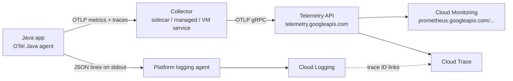
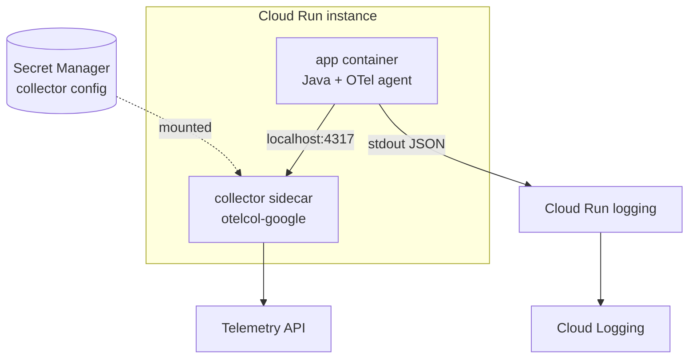
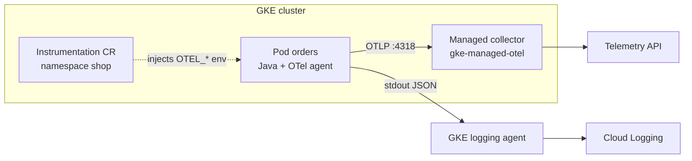
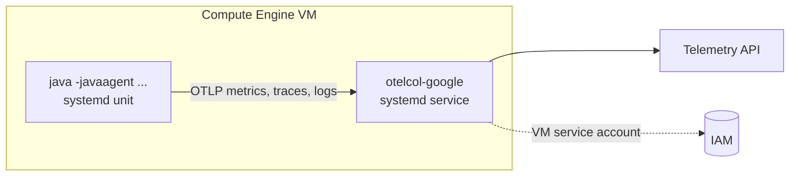

<Muted>
Written against the OpenTelemetry Java agent 2.33.1, the Google-Built OpenTelemetry Collector 0.163.1 and Google Cloud docs last updated 26 to 30 October 2026. The lab in [3.7](#im-lab) was run in this session. The Cloud Run, GKE and VM manifests in 3.3 to 3.5 come from the Google docs, but they were **not** deployed to a real project here (this session has no Google Cloud credentials).
</Muted>

<Part level={1} id="arch" title="Architecture examples" toc="Architecture">

<Block id="arch-scenario" title="1.1 The scenario and the one rule">

A Java (Spring Boot) service called `orders` runs in three places: Cloud Run, GKE and Compute Engine VMs. You want:

- **Metrics** in Cloud Monitoring: request latency, JVM memory and GC, and business counters such as "orders placed".
- **Logs** in Cloud Logging as structured JSON, with severity set correctly and each line linked to the request (trace) that produced it.
- **One image and one code base** for all three platforms. Only configuration changes.

The rule that makes this possible, from Google's Java instrumentation guide: **instrument with the vendor-neutral OpenTelemetry SDK, export OTLP to a collector, and let the collector send to Google Cloud.** The app never contains Google-specific code. The OTLP destination is the **Telemetry API** (`telemetry.googleapis.com`), which accepts logs, metrics and traces.



The three architectures below differ only in **where the collector runs** and **how logs leave the process**.

</Block>

<Block id="arch-a" title="1.2 Architecture A · Cloud Run with a collector sidecar" toc="1.2 A · Cloud Run sidecar">

Cloud Run supports several containers per instance. The Google-Built Collector runs as a **sidecar** next to the app. They share `localhost`, so the app exports to `http://localhost:4317`. The annotation `run.googleapis.com/container-dependencies: "{app:[collector]}"` starts the collector first. The collector's `health_check` extension (port 13133) is **required** on Cloud Run, because it serves the startup and liveness probes. Logs are JSON lines on stdout, which Cloud Run's built-in agent parses into `jsonPayload`.



<Fit>
<Pros title="Fits when">
- Serverless HTTP services and jobs
- You want the same collector config as on VMs
- You need collector-side filtering or extra exporters
</Pros>
<Cons title="Watch out for">
- Every instance runs its own collector, which costs extra memory and CPU
- The config lives in Secret Manager and is mounted as a volume
- The service account needs write roles (see [2.6](#th-iam))
</Cons>
</Fit>

</Block>

<Block id="arch-b" title="1.3 Architecture B · GKE with Managed OpenTelemetry" toc="1.3 B · GKE managed OTel">

**Managed OpenTelemetry for GKE** runs a Google-managed collector in the namespace `gke-managed-otel`. Workloads send to `opentelemetry-collector.gke-managed-otel.svc.cluster.local` (4318 HTTP, 4317 gRPC). An `Instrumentation` custom resource (`telemetry.googleapis.com/v1alpha1`) **injects the `OTEL_*` environment variables** into matching Pods: endpoint, protocol, export interval, sampler, and which signals are exported. The Java agent reads those standard variables, so the app needs no changes. Logs still go to stdout as JSON and are collected by GKE's logging agent.



<Fit>
<Pros title="Fits when">
- GKE 1.34.1-gke.2178000 or later
- You don't want to run, upgrade or secure a collector yourself
- Platform teams want per-namespace defaults (interval, sampling)
</Pros>
<Cons title="Watch out for">
- Pods created before the `Instrumentation` object need a restart to get the variables
- gRPC export needs GKE 1.37.1-gke.1697000 or later (HTTP is the default)
- No collector-level filtering. For that, run the Google-Built Collector yourself (see [3.4](#im-gke))
</Cons>
</Fit>

</Block>

<Block id="arch-c" title="1.4 Architecture C · Compute Engine VM with a host collector" toc="1.4 C · Compute Engine VM">

On a VM, install the **Google-Built Collector as a system package** (`otelcol-google`, apt/yum/zypper/googet). It runs as a systemd service and reads `/etc/otelcol-google/config.yaml`. The Java process on the same VM exports to `localhost:4317`. There is no platform logging agent on a VM, so logs need a path of their own. Either send them to the collector over OTLP too (simplest), or write JSON to a file and have the **Ops Agent** tail and parse it.



<Fit>
<Pros title="Fits when">
- Lift-and-shift Java apps, app servers, batch hosts
- One collector per VM serves several JVMs
- You also want the Ops Agent's host metrics
</Pros>
<Cons title="Watch out for">
- You patch and upgrade the collector package yourself
- The Ops Agent also has an OTLP receiver, also on port 4317. Pick one (see [2.5](#th-vm))
- The Ops Agent's OTLP receiver does **not** collect logs
</Cons>
</Fit>

</Block>

<Block id="arch-compare" title="1.5 Choosing between them">

| Concern | A · Cloud Run | B · GKE | C · Compute Engine |
| --- | --- | --- | --- |
| Collector | Google-Built Collector sidecar per instance | Managed collector (or self-managed Google-Built Collector) | `otelcol-google` package, systemd |
| App endpoint | `http://localhost:4317` | Injected: `...gke-managed-otel.svc.cluster.local:4318` | `http://localhost:4317` |
| How the app is configured | Env vars in `service.yaml` | Injected by `Instrumentation` CR | Env vars in the systemd unit |
| Logs path | stdout JSON → built-in agent | stdout JSON → GKE logging agent | OTLP to collector, or file + Ops Agent |
| Who runs the collector | You (as config in a Secret) | Google | You |
| Metrics land as | `prometheus.googleapis.com/<name>/<suffix>` (all three) | same | same |

<Muted>
All three converge on the same Telemetry API, so dashboards and alerts written for one platform work for the others. Use the `service.name` and `job` labels to tell them apart.
</Muted>

</Block>

</Part>

<Part level={2} id="theory" title="Theory">

<Block id="th-otel" title="2.1 OpenTelemetry for Java in one page" toc="2.1 OTel for Java">

- **Signals:** traces, metrics and logs. The API defines instruments (Counter, UpDownCounter, Histogram, Gauge). The **SDK** aggregates and exports them. **OTLP** is the wire protocol.
- **The Java agent** (`-javaagent:opentelemetry-javaagent.jar`) is "zero-code" instrumentation. It injects bytecode into supported libraries (Spring MVC, JDBC, HTTP clients and more) and installs the SDK. In the lab, with no code changes, it produced `http.server.request.duration` and 12 `jvm.*` metrics (memory, GC, threads, classes, CPU).
- **Custom metrics** use only the API (`io.opentelemetry:opentelemetry-api`). `GlobalOpenTelemetry.getMeter(...)` returns the agent's SDK at runtime.
- **Configuration is environment variables** (or `-D` system properties). The ones that matter here:

| Variable | Agent default | Set it to |
| --- | --- | --- |
| `OTEL_SERVICE_NAME` | `unknown_service:java` | Your service name. It becomes the Prometheus `job` label. |
| `OTEL_RESOURCE_ATTRIBUTES` | none | e.g. `service.namespace=shop,deployment.environment.name=prod` |
| `OTEL_EXPORTER_OTLP_ENDPOINT` | `http://localhost:4318` | Your collector |
| `OTEL_EXPORTER_OTLP_PROTOCOL` | `http/protobuf` (agent 2.x) | `grpc` for port 4317 |
| `OTEL_METRIC_EXPORT_INTERVAL` | `60000` ms | 60 s is fine in production. The lab uses 10 s. |
| `OTEL_METRICS_EXPORTER` / `OTEL_TRACES_EXPORTER` | `otlp` | keep |
| `OTEL_LOGS_EXPORTER` | **`otlp`** | **`none`** on Cloud Run and GKE if you log JSON to stdout (see [2.4](#th-logs)) |
| `OTEL_EXPORTER_OTLP_METRICS_TEMPORALITY_PREFERENCE` | `CUMULATIVE` | keep. Delta UpDownCounters are rejected by the Telemetry API. |

</Block>

<Block id="th-collector" title="2.2 Why a collector, and which one" toc="2.2 Why a collector">

Google recommends exporting through a collector "when your environment supports the use of a collector". The SDK can also export directly to the Telemetry API, but then the app needs Google credentials, and "most SDK exporters lack support for dynamic token refreshing". A collector gives you:

- **Credentials outside the app.** The `googleclientauth` extension uses the platform's service account.
- **Resource detection.** The `resourcedetection` processor with the `gcp` detector adds project, region and platform attributes. Metrics need these: a point without a `location` is **rejected** (see 2.3).
- **Batching and memory limits.** `batch` sends up to 200 items or every 5 s. `memory_limiter` drops data instead of crashing with out-of-memory.
- **A place to filter or rename** before data is billed.

The **Google-Built OpenTelemetry Collector** is Google's build of the upstream collector, from upstream components. It is SLSA level 3 from 0.134.0, uses BoringCrypto for FIPS 140-2, and is versioned in step with upstream. The current version is **0.163.1**. It ships as the image `us-docker.pkg.dev/cloud-ops-agents-artifacts/google-cloud-opentelemetry-collector/otelcol-google:0.163.1` and as Linux and Windows packages. Google publishes one recommended config, used unchanged in 3.2.

</Block>

<Block id="th-metrics" title="2.3 How OTLP metrics become Cloud Monitoring metrics" toc="2.3 Metric mapping">

The Telemetry API stores every OTLP metric as a **Managed Service for Prometheus** time series. Billing uses Managed Service for Prometheus pricing.

- **Name:** `prometheus.googleapis.com/{metric_name}/{suffix}`. Dots are kept, so `orders.placed` becomes `prometheus.googleapis.com/orders.placed/counter`. Unlike the older `googlemanagedprometheus` exporter, the Telemetry API **does not** add a unit or a `_total` suffix.
- **Suffix by point kind:**

| OTLP point | Cloud Monitoring kind | Suffix |
| --- | --- | --- |
| Gauge | GAUGE | `/gauge` |
| Sum, monotonic, cumulative (Counter) | CUMULATIVE | `/counter` |
| Sum, non-monotonic, cumulative (UpDownCounter) | GAUGE | `/gauge` |
| Sum, monotonic, delta | DELTA | `/delta` |
| Sum, non-monotonic, delta | **not supported** | — |
| Histogram / exponential histogram, cumulative | CUMULATIVE distribution | `/histogram` |
| Histogram, delta | DELTA distribution | `/histogram:delta` |

- **Monitored resource** is always `prometheus_target`. Its labels come from resource attributes, in priority order:
  - `location`: from `cloud.availability_zone`, then `cloud.region`. The point is rejected if it is empty.
  - `cluster`: from `k8s.cluster.name`, or `__run__` on Cloud Run, or `__gce__` on Compute Engine.
  - `namespace`: from `k8s.namespace.name`, or `service.namespace`.
  - `job`: from `service.namespace/service.name`.
  - `instance`: from `service.instance.id`, then pod and container name, then `host.id`. The point is rejected if it is empty.
- **Also added:** all integer points become DOUBLE. For each resource, a `target_info` metric carries the remaining resource attributes.
- **Names and labels:** metric names must match `[a-zA-Z][a-zA-Z0-9_:./-]*` and label keys `[a-zA-Z_][a-zA-Z0-9_.]*`, or the data is rejected.

<Note title="Cardinality is cost">
Every unique set of attribute values is a separate time series, and you pay per sample. Use bounded attributes such as `payment_method` and `result`. Never use unbounded ones such as `order_id` or `user_id`. Those belong in logs or traces.
</Note>

</Block>

<Block id="th-logs" title="2.4 Logs: JSON on stdout, linked to traces" toc="2.4 Logs and correlation">

Google's guidance for Java is to **write structured JSON to stdout** with Log4j2's **JSON Template Layout** and its built-in `GcpLayout.json` template. On Cloud Run and GKE, the built-in agent parses single-line JSON into `jsonPayload` and promotes these special keys:

- `severity`: becomes `LogEntry.severity`.
- `message`: the text shown in Logs Explorer.
- `time` / `timestamp`: becomes `LogEntry.timestamp`.
- `httpRequest`, and `logging.googleapis.com/labels`, `/insertId`, `/operation` and `/sourceLocation`.
- `logging.googleapis.com/trace`, `logging.googleapis.com/spanId` and `logging.googleapis.com/trace_sampled`: the **link between a log entry and its trace**.

The Java agent puts `trace_id`, `span_id` and `trace_flags` into the logging library's **MDC** (Mapped Diagnostic Context, per-thread context that the logger copies into each event) for Logback 1.0+ and Log4j 2.7+. `GcpLayout.json` copies `trace_id` into `logging.googleapis.com/trace`, so every log line written inside a request carries its trace ID. The lab output in step 2 shows this.

<Note title="The duplicate-logs trap">
Agent 2.x defaults to `OTEL_LOGS_EXPORTER=otlp`. It captures Log4j and Logback events and **also** exports them over OTLP. The lab confirmed this: with the default, the collector received the app's log records over OTLP while the same lines were printed to stdout. On Cloud Run and GKE that means **every log twice** in Cloud Logging, billed twice. Set `OTEL_LOGS_EXPORTER=none` when you log JSON to stdout. Google's own sample does the same. On a VM without a logging agent, do the opposite: keep `otlp` and let the collector ship the logs.
</Note>

<Note title="Unsure">
Cloud Logging documents `logging.googleapis.com/trace` as the trace's resource name (`projects/PROJECT_ID/traces/TRACE_ID`). Log4j's `GcpLayout.json` writes the bare 32-hex trace ID, and Google's own sample relies on that for log-to-trace links. I could not confirm in the docs how Cloud Logging handles the bare form. Test the "View trace" link in Logs Explorer before you depend on it. If it doesn't work, add a custom template field that prefixes `projects/PROJECT_ID/traces/`.
</Note>

</Block>

<Block id="th-vm" title="2.5 Compute Engine: Google-Built Collector or Ops Agent?" toc="2.5 VM: collector vs Ops Agent">

| | Google-Built Collector (`otelcol-google`) | Ops Agent OTLP receiver |
| --- | --- | --- |
| Signals over OTLP | Metrics, traces, **logs** | Metrics, traces. **No logs.** |
| Transport | gRPC 4317 and HTTP 4318 | gRPC only, `0.0.0.0:4317` by default |
| Metrics destination | Telemetry API → `prometheus.googleapis.com/...` | `metrics_mode: googlemanagedprometheus` (default) or `googlecloudmonitoring` → `workload.googleapis.com/...` |
| Also does | Whatever upstream components you configure | Host metrics, syslog, third-party app integrations |
| Minimum version | — | Ops Agent 2.37.0 |

A common VM setup combines them: the **Ops Agent** for host metrics and for tailing log files (`type: files` receiver plus the `parse_json` processor), and the **Google-Built Collector** for OTLP from the JVM. Don't enable the Ops Agent's OTLP receiver as well, because both listen on port 4317. Note that `googlemanagedprometheus` mode uses the older exporter naming (units, `_total`), so its metric names differ from the Telemetry API's (2.3).

</Block>

<Block id="th-iam" title="2.6 Identity and permissions" toc="2.6 IAM">

The collector authenticates as the platform's service account: the Cloud Run service identity, the GKE Workload Identity principal, or the VM's service account. The Google docs list the roles in three slightly different ways:

- **Telemetry API overview:** `roles/telemetry.writer` ("lets your application write log, metric, and trace data") on the project, plus `roles/serviceusage.serviceUsageConsumer` on the quota project.
- **Java guide:** `roles/logging.logWriter`, `roles/monitoring.metricWriter`, `roles/telemetry.tracesWriter`, plus Service Usage Consumer.
- **Collector-on-Cloud-Run / VM pages:** the Compute Engine default service account "usually has" `roles/monitoring.metricWriter` and `roles/logging.logWriter`.

<Tip title="Recommendation">
Use a dedicated service account per workload and grant `roles/telemetry.writer` plus `roles/serviceusage.serviceUsageConsumer`. If writes fail with permission errors, add the per-signal writer roles from the Java guide. Don't rely on the default compute service account, which often has far broader roles than it needs.
</Tip>

</Block>

<Block id="th-micrometer" title="2.8 Can OpenTelemetry replace Micrometer and your logging library?" toc="2.8 Replace Micrometer / logging?">

**Short answer:** for **metrics**, yes, OpenTelemetry can replace Micrometer, but you don't have to do it in one step. For **logging**, no: OpenTelemetry is not meant to replace SLF4J, Log4j2 or Logback. It plugs into them.

**Logging.** The OpenTelemetry docs say the Logs Bridge API "should not be called by you directly, as it is provided for logging library authors". The intended approach is to "use your preferred logging library and configure it to use a log appender (or log bridge)". So keep `log.info(...)` through SLF4J. The Java agent adds trace context to the MDC (Log4j 2.7+, Logback 1.0+) and can export log events over OTLP. What changes is **where logs go**, not how you write them. This page already works that way: SLF4J + Log4j2 for the code, stdout JSON or OTLP for transport.

**Metrics.** You have three paths:

| | 1 · Replace with the OTel API | 2 · Keep Micrometer, bridge it through the agent | 3 · Keep Micrometer, use its OTLP registry |
| --- | --- | --- | --- |
| How | New meters use `GlobalOpenTelemetry.getMeter()` (as in [3.1](#im-app)). HTTP/JVM metrics come from the agent. Remove Micrometer registries. | Agent with `OTEL_INSTRUMENTATION_MICROMETER_ENABLED=true`. The Micrometer bridge is **off by default**. | `io.micrometer:micrometer-registry-otlp`. Spring Boot auto-configures it (`management.otlp.metrics.export.url`, default `localhost:4318/v1/metrics`). |
| Code changes | Rewrite `Counter`/`Timer` calls | None | None |
| Metric names | OTel semantic conventions (`http.server.request.duration`, `jvm.memory.used` in `By`) | Micrometer names (`http.server.requests`, `jvm.memory.used` in `bytes`) **plus** the agent's own | Micrometer names only |
| Traces and log correlation | From the agent | From the agent | No. You need the agent or another tracer for those. |
| Best for | New services, or a planned dashboard migration | Moving existing services onto OTLP now, migrating meters later | Teams that want metrics over OTLP but no Java agent |

<Note title="Name collisions when bridging (seen in the lab)">
With the bridge on, a Spring Boot Actuator app sent **54 to 55 Micrometer meters** next to the agent's 12 runtime metrics. Two names exist in both, **`jvm.memory.used`** and **`jvm.memory.committed`**, with different kinds, units and labels:
- Micrometer: a Gauge in `bytes`, labels `area`/`id`.
- Agent: a non-monotonic Sum in `By`, labels `jvm.memory.type`/`jvm.memory.pool.name`.

Both map to `prometheus.googleapis.com/jvm.memory.used/gauge` (see [2.3](#th-metrics)). I couldn't confirm whether Cloud Monitoring rejects the second set or mixes them, but either outcome breaks dashboards. Keep **one** source of JVM metrics. Setting `MANAGEMENT_METRICS_ENABLE_JVM=false` (Spring's `management.metrics.enable.jvm=false`) removed all Micrometer `jvm.*` meters in the lab and kept `http.server.requests` and custom meters.
</Note>

**Also note:**
- Bridging duplicates HTTP metrics: Micrometer's `http.server.requests` and the agent's `http.server.request.duration` both describe the same requests. Choose the one your dashboards use and drop the other, either with a Micrometer `MeterFilter` or in the collector.
- The agent's Spring Boot Actuator integration (`spring-boot-actuator-autoconfigure`) is also off by default. In the source, the reason given is that it "produces a lot of metrics that are already captured - e.g. JVM memory usage".

<Tip title="Recommendation">
For an existing Spring Boot fleet, start with **path 2** and set `MANAGEMENT_METRICS_ENABLE_JVM=false`. Services move to OTLP and the Telemetry API with no code changes, and you get traces plus log-to-trace links from the agent. Then move business meters to the OTel API one service at a time (path 1), rebuilding each dashboard on the semantic-convention names as you go. Keep SLF4J for logging.
</Tip>

</Block>

<Block id="th-proscons" title="2.7 Problems solved, pros and cons" toc="2.7 Pros and cons">

**Problems this solves:** a different agent per platform, Google-specific code in the app, logs that can't be joined to requests, metric names that change by platform, and credentials spread across application config.

<Fit>
<Pros>
- One image and one instrumentation approach for Cloud Run, GKE and VMs
- Zero-code HTTP and JVM metrics, and a two-line API for business metrics
- Logs linked to traces through MDC → `logging.googleapis.com/trace`
- Vendor neutral: switching backend means changing the collector exporter only
- Metrics are queryable with PromQL in Cloud Monitoring
</Pros>
<Cons>
- The agent adds startup time and some overhead. Measure it for your app.
- Metric names follow OTLP rules (dots, no `_total`), which differ from older Prometheus dashboards
- A collector per Cloud Run instance costs resources
- Easy to double-ingest logs, or to explode cardinality
- Several parts are recent: the GKE `Instrumentation` CRD is `v1alpha1`
</Cons>
</Fit>

</Block>

</Part>

<Part level={3} id="impl" title="Implementation">

<Muted>
Files live in `otel-java-gcp/`: `app/` (the Spring Boot service), `collector/` (configs) and the platform manifests. Replace `PROJECT_ID`, `REGION` and image paths with your own.
</Muted>

<Block id="im-app" title="3.1 The Java service" toc="3.1 The Java service">

Spring Boot 3.5 with **Log4j2 instead of Logback**, the JSON Template Layout, and the OpenTelemetry **API only**. The agent supplies the SDK at runtime.

```xml title="otel-java-gcp/app/pom.xml"
<?xml version="1.0" encoding="UTF-8"?>
<project xmlns="http://maven.apache.org/POM/4.0.0"
         xmlns:xsi="http://www.w3.org/2001/XMLSchema-instance"
         xsi:schemaLocation="http://maven.apache.org/POM/4.0.0 https://maven.apache.org/xsd/maven-4.0.0.xsd">
  <modelVersion>4.0.0</modelVersion>
  <parent>
    <groupId>org.springframework.boot</groupId>
    <artifactId>spring-boot-starter-parent</artifactId>
    <version>3.5.16</version>
  </parent>
  <groupId>com.example</groupId>
  <artifactId>orders</artifactId>
  <version>1.0.0</version>
  <properties>
    <java.version>21</java.version>
  </properties>
  <dependencies>
    <dependency>
      <groupId>org.springframework.boot</groupId>
      <artifactId>spring-boot-starter-web</artifactId>
      <exclusions>
        <exclusion>
          <groupId>org.springframework.boot</groupId>
          <artifactId>spring-boot-starter-logging</artifactId>
        </exclusion>
      </exclusions>
    </dependency>
    <!-- Log4j2 + JSON Template Layout: ships GcpLayout.json for Cloud Logging -->
    <dependency>
      <groupId>org.springframework.boot</groupId>
      <artifactId>spring-boot-starter-log4j2</artifactId>
    </dependency>
    <dependency>
      <groupId>org.apache.logging.log4j</groupId>
      <artifactId>log4j-layout-template-json</artifactId>
    </dependency>
    <!-- OpenTelemetry API only: the Java agent supplies the SDK at runtime -->
    <dependency>
      <groupId>io.opentelemetry</groupId>
      <artifactId>opentelemetry-api</artifactId>
    </dependency>
  </dependencies>
  <build>
    <plugins>
      <plugin>
        <groupId>org.springframework.boot</groupId>
        <artifactId>spring-boot-maven-plugin</artifactId>
      </plugin>
    </plugins>
  </build>
</project>
```

```java title="otel-java-gcp/app/src/main/java/com/example/orders/OrdersApplication.java"
package com.example.orders;

import io.opentelemetry.api.GlobalOpenTelemetry;
import io.opentelemetry.api.common.AttributeKey;
import io.opentelemetry.api.common.Attributes;
import io.opentelemetry.api.metrics.DoubleHistogram;
import io.opentelemetry.api.metrics.LongCounter;
import io.opentelemetry.api.metrics.Meter;
import java.util.concurrent.ThreadLocalRandom;
import org.slf4j.Logger;
import org.slf4j.LoggerFactory;
import org.springframework.boot.SpringApplication;
import org.springframework.boot.autoconfigure.SpringBootApplication;
import org.springframework.web.bind.annotation.GetMapping;
import org.springframework.web.bind.annotation.RequestParam;
import org.springframework.web.bind.annotation.RestController;

@SpringBootApplication
@RestController
public class OrdersApplication {
  private static final Logger log = LoggerFactory.getLogger(OrdersApplication.class);
  private static final AttributeKey<String> PAYMENT = AttributeKey.stringKey("payment_method");
  private static final AttributeKey<String> RESULT = AttributeKey.stringKey("result");

  // The agent installs the SDK; GlobalOpenTelemetry returns it.
  private final Meter meter = GlobalOpenTelemetry.getMeter("com.example.orders");
  private final LongCounter orders = meter.counterBuilder("orders.placed")
      .setDescription("Orders placed").setUnit("{order}").build();
  private final DoubleHistogram amount = meter.histogramBuilder("orders.amount")
      .setDescription("Order value").setUnit("USD").build();

  public static void main(String[] args) {
    SpringApplication.run(OrdersApplication.class, args);
  }

  @GetMapping("/checkout")
  public String checkout(@RequestParam(defaultValue = "card") String payment) {
    double value = ThreadLocalRandom.current().nextDouble(5, 500);
    boolean declined = ThreadLocalRandom.current().nextInt(10) == 0;
    String result = declined ? "declined" : "ok";
    orders.add(1, Attributes.of(PAYMENT, payment, RESULT, result));
    if (!declined) {
      amount.record(value, Attributes.of(PAYMENT, payment));
      log.info("order placed payment={} amount={}", payment, String.format("%.2f", value));
    } else {
      log.warn("payment declined payment={}", payment);
    }
    return result + "\n";
  }
}
```

```xml title="otel-java-gcp/app/src/main/resources/log4j2.xml"
<?xml version="1.0" encoding="UTF-8"?>
<Configuration status="WARN">
  <Appenders>
    <Console name="Console" target="SYSTEM_OUT">
      <!-- One JSON object per line, with Cloud Logging's special fields
           (severity, message, logging.googleapis.com/trace, spanId, ...) -->
      <JsonTemplateLayout eventTemplateUri="classpath:GcpLayout.json"/>
    </Console>
  </Appenders>
  <Loggers>
    <Root level="info">
      <AppenderRef ref="Console"/>
    </Root>
  </Loggers>
</Configuration>
```

The image attaches the agent through `JAVA_TOOL_OPTIONS`, so turning it off is a one-variable change:

```dockerfile title="otel-java-gcp/app/Dockerfile"
FROM maven:3.9-eclipse-temurin-21 AS build
WORKDIR /src
COPY pom.xml .
RUN mvn -q -B dependency:go-offline
COPY src ./src
RUN mvn -q -B package -DskipTests

FROM eclipse-temurin:21-jre
ARG OTEL_AGENT_VERSION=2.33.1
ADD https://github.com/open-telemetry/opentelemetry-java-instrumentation/releases/download/v${OTEL_AGENT_VERSION}/opentelemetry-javaagent.jar /otel/opentelemetry-javaagent.jar
COPY --from=build /src/target/orders-1.0.0.jar /app/app.jar
# The agent is attached through the environment, so the same image runs with or without it
ENV JAVA_TOOL_OPTIONS="-javaagent:/otel/opentelemetry-javaagent.jar"
EXPOSE 8080
ENTRYPOINT ["java", "-jar", "/app/app.jar"]
```

<Muted>
In this session's sandbox, Maven could not download from inside `docker build` (network proxy), so I tested the two stages separately: `mvn package` on JDK 21 gave `orders-1.0.0.jar` (Spring Boot 3.5.16, log4j-layout-template-json 2.24.3, opentelemetry-api 1.49.0), and the runtime stage ran with the 2.33.1 agent. On a normal laptop or in Cloud Build, the Dockerfile runs as written.
</Muted>

</Block>

<Block id="im-collector" title="3.2 Collector config (Google's recommended config)" toc="3.2 Collector config">

This is Google's published configuration for the Google-Built Collector, with comments removed. Google says: "You can add to the configuration, but we strongly recommend that you don't remove elements." I validated it with `otelcol-google validate` (0.163.1). It listens on `localhost`, which suits a Cloud Run sidecar and a VM where the app runs on the same host.

```yaml title="otel-java-gcp/collector/config.yaml"
receivers:
  otlp:
    protocols:
      grpc:
        endpoint: localhost:4317
      http:
        cors:
          allowed_origins:
          - http://*
          - https://*
        endpoint: localhost:4318
processors:
  batch:
    send_batch_max_size: 200
    send_batch_size: 200
    timeout: 5s
  memory_limiter:
    check_interval: 1s
    limit_percentage: 65
    spike_limit_percentage: 20
  resourcedetection:
    detectors: [gcp]
    timeout: 10s
  resource/gcp_project_id:
    attributes:
    - action: insert
      key: gcp.project_id
      value: ${GOOGLE_CLOUD_PROJECT}
  metricstarttime:
    strategy: subtract_initial_point
  transform/collision:
    metric_statements:
    - context: datapoint
      statements:
      - set(attributes["exported_location"], attributes["location"])
      - delete_key(attributes, "location")
      - set(attributes["exported_cluster"], attributes["cluster"])
      - delete_key(attributes, "cluster")
      - set(attributes["exported_namespace"], attributes["namespace"])
      - delete_key(attributes, "namespace")
      - set(attributes["exported_job"], attributes["job"])
      - delete_key(attributes, "job")
      - set(attributes["exported_instance"], attributes["instance"])
      - delete_key(attributes, "instance")
      - set(attributes["exported_project_id"], attributes["project_id"])
      - delete_key(attributes, "project_id")
  transform/prometheus_unknown_types:
    error_mode: ignore
    metric_statements:
    - context: metric
      statements:
      - copy_metric(Concat([metric.name, "unknowncounter"], ":")) where metric.metadata["prometheus.type"] == "unknown" and not HasSuffix(metric.name, ":unknowncounter")
      - convert_gauge_to_sum("cumulative", true) where HasSuffix(metric.name, ":unknowncounter")
      - set(metric.name, Substring(metric.name, 0, Len(metric.name)-Len(":unknowncounter"))) where HasSuffix(metric.name, ":unknowncounter")
  transform/otlp_grpc/preserve_instrumentation_source_version:
    error_mode: ignore
    log_statements:
    - context: log
      statements:
      - set(attributes["instrumentation_source"], instrumentation_scope.name) where instrumentation_scope.name != ""
      - set(attributes["instrumentation_version"], instrumentation_scope.version) where instrumentation_scope.version != ""
  transform/otlp_grpc/copy_service_resource_labels:
    error_mode: ignore
    log_statements:
    - context: log
      statements:
      - set(attributes["service.name"], resource.attributes["service.name"]) where resource.attributes["service.name"] != nil
      - set(attributes["service.namespace"], resource.attributes["service.namespace"]) where resource.attributes["service.namespace"] != nil
      - set(attributes["service.instance.id"], resource.attributes["service.instance.id"]) where resource.attributes["service.instance.id"] != nil
exporters:
  otlp_grpc:
    endpoint: telemetry.googleapis.com:443
    balancer_name: pick_first
    auth:
      authenticator: googleclientauth
extensions:
  health_check:
    endpoint: 0.0.0.0:13133
  googleclientauth:
service:
  extensions:
  - health_check
  - googleclientauth
  pipelines:
    logs:
      receivers: [otlp]
      processors: [resourcedetection, resource/gcp_project_id, transform/otlp_grpc/preserve_instrumentation_source_version, transform/otlp_grpc/copy_service_resource_labels, memory_limiter, batch]
      exporters: [otlp_grpc]
    metrics/otlp:
      receivers: [otlp]
      processors: [resourcedetection, resource/gcp_project_id, transform/collision, transform/prometheus_unknown_types, metricstarttime, memory_limiter, batch]
      exporters: [otlp_grpc]
    traces:
      receivers: [otlp]
      processors: [resourcedetection, resource/gcp_project_id, memory_limiter, batch]
      exporters: [otlp_grpc]
  telemetry:
    metrics:
      readers:
        - periodic:
            exporter:
              otlp:
                protocol: grpc
                endpoint: http://localhost:4317
                insecure: true
```

<Muted>
`transform/collision` renames data-point attributes that would clash with the `prometheus_target` labels (`location`, `job`, …) to `exported_*`. The last block sends the collector's own metrics through itself, so you can monitor the collector too.
</Muted>

</Block>

<Block id="im-cloudrun" title="3.3 Cloud Run: app + collector sidecar" toc="3.3 Cloud Run">

```bash
gcloud services enable run.googleapis.com secretmanager.googleapis.com \
  logging.googleapis.com monitoring.googleapis.com cloudtrace.googleapis.com telemetry.googleapis.com
gcloud secrets create otel-collector-config --data-file=collector/config.yaml
gcloud iam service-accounts create orders-run
for r in roles/telemetry.writer roles/serviceusage.serviceUsageConsumer roles/secretmanager.secretAccessor; do
  gcloud projects add-iam-policy-binding PROJECT_ID \
    --member=serviceAccount:orders-run@PROJECT_ID.iam.gserviceaccount.com --role=$r
done
```

```yaml title="otel-java-gcp/cloudrun/service.yaml"
apiVersion: serving.knative.dev/v1
kind: Service
metadata:
  name: orders
  annotations:
    run.googleapis.com/launch-stage: ALPHA   # as in Google's sample; see note below
spec:
  template:
    metadata:
      annotations:
        run.googleapis.com/container-dependencies: "{app:[collector]}"   # collector starts first
        run.googleapis.com/secrets: 'otel-collector-config:projects/PROJECT_ID/secrets/otel-collector-config'
    spec:
      serviceAccountName: orders-run@PROJECT_ID.iam.gserviceaccount.com
      containers:
      - name: app
        image: REGION-docker.pkg.dev/PROJECT_ID/apps/orders:1.0.0
        ports:
        - containerPort: 8080
        env:
        - { name: OTEL_SERVICE_NAME,           value: orders }
        - { name: OTEL_RESOURCE_ATTRIBUTES,    value: "service.namespace=shop,deployment.environment.name=prod" }
        - { name: OTEL_EXPORTER_OTLP_ENDPOINT, value: "http://localhost:4317" }
        - { name: OTEL_EXPORTER_OTLP_PROTOCOL, value: grpc }
        - { name: OTEL_LOGS_EXPORTER,          value: none }   # logs: JSON on stdout
      - name: collector
        image: us-docker.pkg.dev/cloud-ops-agents-artifacts/google-cloud-opentelemetry-collector/otelcol-google:0.163.1
        args: ["--config=/etc/otelcol-google/config.yaml"]
        startupProbe:
          httpGet: { path: /, port: 13133 }
          timeoutSeconds: 30
          periodSeconds: 30
        livenessProbe:
          httpGet: { path: /, port: 13133 }
          timeoutSeconds: 30
          periodSeconds: 30
        volumeMounts:
        - { mountPath: /etc/otelcol-google/, name: config }
      volumes:
      - name: config
        secret:
          secretName: otel-collector-config
          items:
          - { key: latest, path: config.yaml }
```

```bash
gcloud run services replace cloudrun/service.yaml --region=REGION
gcloud run services delete orders --region=REGION   # cleanup
```

<Note title="Check before use">
I took the sidecar wiring (dependency annotation, health-check probes, secret volume) from Google's collector-on-Cloud-Run page, which uses `launch-stage: ALPHA`. Its custom-metrics tutorial uses `BETA`. Use the lowest stage that `gcloud run services replace` accepts for your project. Google's config doesn't set `GOOGLE_CLOUD_PROJECT` on the collector, so check in Metrics Explorer that `gcp.project_id` is filled in. If it isn't, add the variable to the collector container.
</Note>

<Note title="Unsure">
With request-based billing, Cloud Run limits CPU outside requests. The pages I read don't say whether this delays the 60-second periodic metric export or the collector's 5-second batch, so I can't confirm the effect. If you see gaps in low-traffic services, test with instance-based billing.
</Note>

</Block>

<Block id="im-gke" title="3.4 GKE: Managed OpenTelemetry" toc="3.4 GKE">

Enable the managed collector on the cluster (GKE 1.34.1-gke.2178000 or later, gcloud 576.0.0 or later):

```bash
gcloud services enable container.googleapis.com telemetry.googleapis.com \
  logging.googleapis.com monitoring.googleapis.com cloudtrace.googleapis.com
gcloud container clusters update CLUSTER_NAME --location=LOCATION \
  --managed-otel-scope=COLLECTION_AND_INSTRUMENTATION_COMPONENTS
```

An `Instrumentation` resource per namespace injects the `OTEL_*` variables into matching Pods. This one exports metrics and traces, and turns **off** OTLP logs, because the app logs JSON to stdout:

```yaml title="otel-java-gcp/gke/instrumentation.yaml"
apiVersion: telemetry.googleapis.com/v1alpha1
kind: Instrumentation
metadata:
  namespace: shop
  name: java-services
spec:
  selector:
    matchLabels:
      otel: enabled
  autoInstrumentationConfig:
    configInjection:
      enabled: true
  otelSDKConfig:
    tracer_provider:
      sampler:
        parent_based:
          root:
            trace_id_ratio_based:
              ratio: "0.1"          # sample 10% of new traces
    meter_provider:
      readers:
      - periodic:
          interval: 60000           # ms between metric exports
    logger_provider: null           # sets OTEL_LOGS_EXPORTER=none
```

```yaml title="otel-java-gcp/gke/deployment.yaml"
apiVersion: apps/v1
kind: Deployment
metadata:
  name: orders
  namespace: shop
spec:
  replicas: 2
  selector:
    matchLabels: { app: orders }
  template:
    metadata:
      labels: { app: orders, otel: enabled }   # matched by the Instrumentation selector
    spec:
      containers:
      - name: orders
        image: REGION-docker.pkg.dev/PROJECT_ID/apps/orders:1.0.0
        ports: [{ containerPort: 8080 }]
        env:
        - { name: OTEL_SERVICE_NAME, value: orders }
        - { name: OTEL_RESOURCE_ATTRIBUTES, value: "service.namespace=shop,deployment.environment.name=prod" }
```

```bash
kubectl create namespace shop
kubectl apply -f gke/instrumentation.yaml      # before the Pods are created
kubectl apply -f gke/deployment.yaml
kubectl -n shop get pod -l app=orders -o yaml | grep -A1 OTEL_EXPORTER_OTLP_ENDPOINT
kubectl logs -n gke-managed-otel -l app=opentelemetry-collector -c opentelemetry-collector   # troubleshooting
```

<Muted>
If the Deployment existed before the `Instrumentation` object, run `kubectl rollout restart deployment orders -n shop` so the variables get injected. Billing: metrics at Managed Service for Prometheus prices, logs at Cloud Logging prices, traces at Cloud Trace prices.
</Muted>

<Note title="Unsure">
Two things I couldn't confirm from the GKE docs. First, whether variables injected by the `Instrumentation` resource override `OTEL_*` variables already set on the container. Second, how the injected `OTEL_RESOURCE_ATTRIBUTES` (used for `k8s.pod.uid` on hostNetwork Pods) combines with your own. Check with the `kubectl get pod -o yaml` command above. The CRD is `v1alpha1`, so expect changes.
</Note>

<Tip title="Self-managed alternative">
Need filtering, extra exporters or tail sampling? Deploy the Google-Built Collector yourself with Google's kustomization: `kubectl kustomize https://github.com/GoogleCloudPlatform/otlp-k8s-ingest.git/k8s/base | envsubst | kubectl apply -f -`. Grant its Workload Identity principal (`ns/opentelemetry/sa/opentelemetry-collector`) the writer roles, then point `OTEL_EXPORTER_OTLP_ENDPOINT` at that collector's Service.
</Tip>

</Block>

<Block id="im-vm" title="3.5 Compute Engine: collector package + systemd" toc="3.5 Compute Engine">

Install the collector (Debian/Ubuntu shown; the docs also cover yum, zypper and googet):

```bash
sudo mkdir -p /etc/apt/keyrings
sudo curl -o /etc/apt/keyrings/otelcol-google.asc https://packages.cloud.google.com/apt/doc/apt-key.gpg
cat <<EOF | sudo tee /etc/apt/sources.list.d/otelcol-google.list
deb [signed-by=/etc/apt/keyrings/otelcol-google.asc] https://us-apt.pkg.dev/projects/cloud-ops-agents-artifacts google-cloud-opentelemetry-collector-apt main
EOF
sudo apt update && sudo apt install otelcol-google

sudo cp collector/config.yaml /etc/otelcol-google/config.yaml
echo 'GOOGLE_CLOUD_PROJECT=PROJECT_ID' | sudo tee -a /etc/otelcol-google/otelcol-google.conf
sudo systemctl restart otelcol-google && systemctl status otelcol-google --no-pager
```

<Muted>
The package installs the `otelcol-google` systemd unit (user `otelcol-google`). It reads `EnvironmentFile=/etc/otelcol-google/otelcol-google.conf`, which sets `OTELCOL_OPTIONS="--config=/etc/otelcol-google/config.yaml"`. Adding `GOOGLE_CLOUD_PROJECT` to that file is how I chose to fill the `${GOOGLE_CLOUD_PROJECT}` reference. It is not a step from the Google docs.
</Muted>

Run the JVM as a systemd service. On a VM the app **keeps `OTEL_LOGS_EXPORTER=otlp`** (the default), so logs travel with metrics through the collector's `logs` pipeline:

```ini title="otel-java-gcp/vm/orders.service"
[Unit]
Description=orders service
After=network-online.target otelcol-google.service

[Service]
User=orders
Environment=OTEL_SERVICE_NAME=orders
Environment=OTEL_RESOURCE_ATTRIBUTES=service.namespace=shop,deployment.environment.name=prod
Environment=OTEL_EXPORTER_OTLP_ENDPOINT=http://localhost:4317
Environment=OTEL_EXPORTER_OTLP_PROTOCOL=grpc
Environment=OTEL_LOGS_EXPORTER=otlp
ExecStart=/usr/bin/java -javaagent:/opt/otel/opentelemetry-javaagent.jar -jar /opt/orders/app.jar
Restart=on-failure

[Install]
WantedBy=multi-user.target
```

<Muted>
With OTLP logs, the stdout JSON goes only to the journal. If you'd rather keep the file-based path, write the JSON to a file and use the Ops Agent: a `type: files` receiver with `include_paths`, plus a `parse_json` processor. Then set `OTEL_LOGS_EXPORTER=none`.
</Muted>

</Block>

<Block id="im-alerts" title="3.6 Query and alert on the metrics" toc="3.6 Query and alert">

Metrics are Prometheus time series, so PromQL works in Metrics Explorer and in alerting policies. Names keep their dots, so quote them using the UTF-8 selector form:

```text
# Orders per second by result
sum by (result) (rate({"orders.placed"}[5m]))

# p95 server latency per route (histogram, seconds)
histogram_quantile(0.95, sum by (le, http_route) (rate({"http.server.request.duration_bucket"}[5m])))

# Heap used per instance
sum by (instance) ({"jvm.memory.used", "jvm.memory.type"="heap"})
```

<Note title="Unsure">
I couldn't run these queries without a Google Cloud project. Data-point attribute keys keep their dots in Cloud Monitoring (`http.route`, `jvm.memory.type`), but I couldn't confirm how PromQL in Cloud Monitoring expects you to reference them (`http_route` or `"http.route"`), or whether histogram buckets appear as `_bucket` series. Build the first query with Metrics Explorer's builder, then switch to PromQL to see the exact names it generates.
</Note>

</Block>

<Block id="im-lab" title="3.7 Lab: see exactly what the app sends" toc="3.7 Lab: local run">

The lab runs the app and the **Google-Built Collector 0.163.1** locally with Google's pipeline. The only change is a `debug` exporter instead of the Telemetry API, so you can read every metric and log record **without a Google Cloud project**. Make the local config from 3.2 like this:

```bash
cd otel-java-gcp
sed -e 's/endpoint: localhost:431/endpoint: 0.0.0.0:431/' \
    -e 's/^  otlp_grpc:$/  debug:/' -e '/endpoint: telemetry.googleapis.com:443/,/authenticator: googleclientauth/c\    verbosity: detailed' \
    -e '/^  - googleclientauth$/d' -e '/^  googleclientauth:$/d' \
    -e 's/exporters: \[otlp_grpc\]/exporters: [debug]/' \
    collector/config.yaml > collector/local-config.yaml
docker run --rm -e GOOGLE_CLOUD_PROJECT=my-project -v $PWD/collector/local-config.yaml:/c.yaml:ro \
  us-docker.pkg.dev/cloud-ops-agents-artifacts/google-cloud-opentelemetry-collector/otelcol-google:0.163.1 \
  validate --config=/c.yaml && echo valid
```

```yaml title="otel-java-gcp/docker-compose.yml"
services:
  collector:
    image: us-docker.pkg.dev/cloud-ops-agents-artifacts/google-cloud-opentelemetry-collector/otelcol-google:0.163.1
    command: ["--config=/etc/otelcol-google/config.yaml"]
    environment:
      GOOGLE_CLOUD_PROJECT: my-project        # used by resource/gcp_project_id
    volumes:
      - ./collector/local-config.yaml:/etc/otelcol-google/config.yaml:ro

  orders:
    image: orders:1.0.0
    build: ./app
    depends_on: [collector]
    ports: ["8080:8080"]
    environment:
      OTEL_SERVICE_NAME: orders
      OTEL_RESOURCE_ATTRIBUTES: service.namespace=shop,deployment.environment.name=dev
      OTEL_EXPORTER_OTLP_ENDPOINT: http://collector:4317
      OTEL_EXPORTER_OTLP_PROTOCOL: grpc
      OTEL_METRIC_EXPORT_INTERVAL: "10000"   # 10 s for the lab; default is 60 s
      OTEL_LOGS_EXPORTER: none                # logs go to stdout as JSON instead
      OTEL_TRACES_EXPORTER: otlp              # traces only to link logs <-> requests

  loadgen:
    image: curlimages/curl:8.17.0
    depends_on: [orders]
    entrypoint: ["sh", "-c", "sleep 15; while true; do for p in card card paynow; do curl -s -o /dev/null http://orders:8080/checkout?payment=$$p; done; sleep 1; done"]
```

<Steps>
<Step title="Build and start">

```bash
docker compose up -d --build
sleep 60
docker compose ps --format '{{.Name}} {{.Status}}'
```

```text output
otel-java-gcp-collector-1 Up About a minute
otel-java-gcp-loadgen-1 Up About a minute
otel-java-gcp-orders-1 Up About a minute
```

</Step>
<Step title="Logs: one JSON object per line, with trace and span IDs">

```bash
docker compose logs orders --no-log-prefix | grep '"order placed' | tail -1 | python3 -m json.tool
```

```text output
{
    "timestamp": "2026-11-01T06:45:52.568Z",
    "severity": "INFO",
    "message": "order placed payment=paynow amount=215.13",
    "logging.googleapis.com/labels": {
        "span_id": "a60376664d9e297b",
        "trace_flags": "03",
        "trace_id": "1ef0f9b33796d7183e78d12bd8d77b38"
    },
    "logging.googleapis.com/sourceLocation": {
        "function": "com.example.orders.OrdersApplication.checkout"
    },
    "logging.googleapis.com/insertId": "163",
    "logging.googleapis.com/trace": "1ef0f9b33796d7183e78d12bd8d77b38",
    "logging.googleapis.com/spanId": "a60376664d9e297b",
    "logging.googleapis.com/trace_sampled": true,
    "_exception": {
        "stackTrace": ""
    },
    "_thread": "http-nio-8080-exec-2",
    "_logger": "com.example.orders.OrdersApplication"
}
```

The agent filled the MDC, and `GcpLayout.json` mapped it to Cloud Logging's special keys. On Cloud Run or GKE this line becomes a log entry with severity `INFO`, the message as its summary, and a link to trace `1ef0…7b38`. Note that the template copies the whole MDC into `logging.googleapis.com/labels` as well, and that `trace_sampled` is hard-coded to `true` in the template.

</Step>
<Step title="Metrics: what the agent produced without code changes">

```bash
docker compose logs collector --no-log-prefix | grep -E '^\s*-> Name:' | sed 's/.*Name: //' | grep -vE '^otelcol' | sort -u
```

```text output
http.server.request.duration
jvm.class.count
jvm.class.loaded
jvm.class.unloaded
jvm.cpu.count
jvm.cpu.recent_utilization
jvm.cpu.time
jvm.gc.duration
jvm.memory.committed
jvm.memory.limit
jvm.memory.used
jvm.memory.used_after_last_gc
jvm.thread.count
orders.amount
orders.placed
otlp.exporter.exported
otlp.exporter.seen
processedSpans
queueSize
```

The `grep -v` removes the collector's own `otelcol*` metrics. `otlp.exporter.*`, `processedSpans` and `queueSize` are the agent's metrics about its own exporters. In Cloud Monitoring, `orders.placed` would become `prometheus.googleapis.com/orders.placed/counter`, and `http.server.request.duration` would become `.../histogram`.

</Step>
<Step title="Look at one custom metric and its resource">

```bash
docker compose logs collector --no-log-prefix | grep -A14 -- '-> Name: orders.placed' | tail -15
```

```text output
     -> Name: orders.placed
     -> Description: Orders placed
     -> Unit: {order}
     -> DataType: Sum
     -> IsMonotonic: true
     -> AggregationTemporality: Cumulative
NumberDataPoints #0
Data point attributes:
     -> payment_method: Str(paynow)
     -> result: Str(ok)
     -> exported_location: Empty()
     -> exported_cluster: Empty()
     -> exported_namespace: Empty()
     -> exported_job: Empty()
     -> exported_instance: Empty()
```

The same output also shows the resource attributes the agent detected, including `service.name: orders`, `service.namespace: shop`, `service.version: 1.0.0`, `service.instance.id: e3c12d22-…`, `telemetry.distro.version: 2.33.1`, and `gcp.project_id: my-project` (added by the collector). Each data point also carries **exemplars**: trace and span IDs of sample requests, which link a metric spike to example traces.

<Note title="Why this would be rejected if sent from a laptop">
There is **no `cloud.region` or `cloud.availability_zone`** in the resource here, because the `gcp` detector finds nothing off Google Cloud. The Telemetry API rejects metric points with an empty `location`. On Cloud Run, GKE and Compute Engine the detector fills it. When exporting from outside Google Cloud, add it yourself, as Google's sample collector does with a `resource` processor that upserts `location`.
</Note>

</Step>
<Step title="Show the duplicate-logs trap">

Run a second copy **without** `OTEL_LOGS_EXPORTER=none` and watch the collector receive its log records over OTLP:

```bash
docker run -d --rm --name orders-defaultlogs --network otel-java-gcp_default \
  -e OTEL_SERVICE_NAME=orders-defaultlogs -e OTEL_EXPORTER_OTLP_ENDPOINT=http://collector:4317 \
  -e OTEL_EXPORTER_OTLP_PROTOCOL=grpc orders:1.0.0
sleep 25
docker compose logs collector --no-log-prefix --since 60s | grep -A8 'LogRecord #' | grep -E 'LogRecord #|Body:' | head -4
docker rm -f orders-defaultlogs
```

```text output
LogRecord #0
Body: Str(Starting OrdersApplication v1.0.0 using Java 21.0.13 with PID 1 (/app/app.jar started by root in /))
LogRecord #1
Body: Str(No active profile set, falling back to 1 default profile: "default")
```

Those same lines also went to stdout. On Cloud Run or GKE you would store and pay for them twice. The main `orders` container, which sets `OTEL_LOGS_EXPORTER=none`, sent no log records at all during the run.

</Step>
<Step title="Optional: bridge an existing Micrometer app">

To try path 2 from [2.8](#th-micrometer), add Actuator to `pom.xml` and one Micrometer counter in `checkout()`, rebuild the image as `orders-mm:1.0.0`, then compare runs with and without the bridge:

```xml
<dependency>
  <groupId>org.springframework.boot</groupId>
  <artifactId>spring-boot-starter-actuator</artifactId>
</dependency>
```

```java
// in checkout(), next to orders.add(...)
io.micrometer.core.instrument.Metrics.counter("legacy.orders", "result", result).increment();
```

```bash
docker compose up -d collector
mm() {   # $1 = run name, rest = extra -e flags
  docker run -d --rm --name "$1" --network otel-java-gcp_default \
    -e OTEL_SERVICE_NAME="$1" -e OTEL_EXPORTER_OTLP_ENDPOINT=http://collector:4317 \
    -e OTEL_EXPORTER_OTLP_PROTOCOL=grpc -e OTEL_LOGS_EXPORTER=none -e OTEL_METRIC_EXPORT_INTERVAL=10000 \
    "${@:2}" orders-mm:1.0.0 >/dev/null
  sleep 30
  docker run --rm --network otel-java-gcp_default curlimages/curl:8.17.0 -s "http://$1:8080/checkout" >/dev/null
  sleep 25
  echo "$1: $(docker compose logs collector --no-log-prefix --since 50s | awk '
      /InstrumentationScope/ {m = /micrometer/}
      m && /-> Name:/ {print $3}' | sort -u | wc -l) Micrometer meters"
  docker rm -f "$1" >/dev/null
}
mm bridge-off
mm bridge-on -e OTEL_INSTRUMENTATION_MICROMETER_ENABLED=true
mm bridge-on-nojvm -e OTEL_INSTRUMENTATION_MICROMETER_ENABLED=true -e MANAGEMENT_METRICS_ENABLE_JVM=false
docker compose down
```

```text output
bridge-off: 0 Micrometer meters
bridge-on: 54 Micrometer meters
bridge-on-nojvm: 32 Micrometer meters
```

What the lab showed, counted per service from the collector output:

| Run | Micrometer scope (`io.opentelemetry.micrometer-1.5`) | Agent runtime metrics | Custom OTel meters |
| --- | --- | --- | --- |
| Bridge off (default, or `=false`) | none | 12 | 2 |
| Bridge on | 54 to 55 meters (varied between runs), including `http.server.requests`, `legacy.orders`, `jvm.memory.used`, `tomcat.sessions.*`, `log4j2.events` | 12 | 2 |
| Bridge on + `MANAGEMENT_METRICS_ENABLE_JVM=false` | 32 meters, no `jvm.*`. `http.server.requests` and `legacy.orders` still present. | 12 | 2 |

<Muted>
Run the containers one at a time, as the function does. Concurrent exports interleave in the collector's debug log. That happened in my first attempt and briefly made it look as if the bridge was on by default. It isn't.
</Muted>

</Step>
<Step title="Clean up">

```bash
docker compose down
docker image rm orders:1.0.0
```

</Step>
</Steps>

<Tip title='What "working" looks like'>
<Checklist>

- Every app log line on stdout is a single JSON object with `severity`, `message` and `logging.googleapis.com/trace`
- The collector receives `http.server.request.duration`, `jvm.*`, `orders.placed` and `orders.amount` every 10 s
- `orders.placed` is a cumulative monotonic Sum (it becomes `/counter`) with only bounded attributes
- No OTLP `LogRecord`s arrive from the main `orders` container (`OTEL_LOGS_EXPORTER=none`)
- On Google Cloud: Metrics Explorer → **Prometheus Target** shows `orders.placed`, and Logs Explorer entries for `orders` have a trace link

</Checklist>
</Tip>

<Muted>
The network name `otel-java-gcp_default` comes from the folder name. Outputs above are from this session's run. The lab was run from the files on this page, using an `orders:1.0.0` image built from the same sources, because of the sandbox build limit described in 3.1.
</Muted>

</Block>

<Block id="refs" title="References">

- [Google Cloud · Java instrumentation sample (OTel agent, Log4j2 GcpLayout, collector)](https://docs.cloud.google.com/stackdriver/docs/instrumentation/setup/java) and [sample repo](https://github.com/GoogleCloudPlatform/opentelemetry-samples/tree/main/java/instrumentation-quickstart)
- [Google Cloud · Google-Built OpenTelemetry Collector (versions, best practices)](https://docs.cloud.google.com/stackdriver/docs/instrumentation/google-built-otel)
- [Google Cloud · Deploy the Google-Built Collector on Cloud Run](https://docs.cloud.google.com/stackdriver/docs/instrumentation/opentelemetry-collector-cloud-run) and [Write OTLP metrics with a sidecar](https://docs.cloud.google.com/run/docs/tutorials/custom-metrics-opentelemetry-sidecar)
- [Google Cloud · Managed OpenTelemetry for GKE (concepts)](https://docs.cloud.google.com/kubernetes-engine/docs/concepts/managed-otel-gke) and [how-to](https://docs.cloud.google.com/kubernetes-engine/docs/how-to/managed-otel-gke)
- [Google Cloud · Google-Built Collector on GKE (self-managed)](https://docs.cloud.google.com/stackdriver/docs/instrumentation/opentelemetry-collector-gke)
- [Google Cloud · Google-Built Collector on Compute Engine](https://docs.cloud.google.com/stackdriver/docs/instrumentation/opentelemetry-collector-gce)
- [Google Cloud · Ops Agent OTLP receiver](https://docs.cloud.google.com/stackdriver/docs/solutions/agents/ops-agent/otlp) and [Ops Agent configuration (files, parse_json)](https://docs.cloud.google.com/stackdriver/docs/solutions/agents/ops-agent/configuration)
- [Google Cloud · Telemetry (OTLP) API overview](https://docs.cloud.google.com/stackdriver/docs/reference/telemetry/overview), [OTLP ingestion overview](https://docs.cloud.google.com/stackdriver/docs/otlp-metrics/overview), [v1.metrics mapping](https://docs.cloud.google.com/stackdriver/docs/reference/telemetry/v1.metrics)
- [Google Cloud · Structured logging (special JSON fields)](https://docs.cloud.google.com/logging/docs/structured-logging)
- [OpenTelemetry · Java agent](https://opentelemetry.io/docs/zero-code/java/agent/) and [Java SDK configuration (env vars, defaults)](https://opentelemetry.io/docs/languages/java/configuration/)
- [opentelemetry-java-instrumentation · Logger MDC instrumentation](https://github.com/open-telemetry/opentelemetry-java-instrumentation/blob/v2.33.1/docs/logger-mdc-instrumentation.md)
- [OpenTelemetry · Logs concepts (Log Appender / Bridge)](https://opentelemetry.io/docs/concepts/signals/logs/)
- [opentelemetry-java-instrumentation · Micrometer bridge settings](https://github.com/open-telemetry/opentelemetry-java-instrumentation/blob/v2.33.1/instrumentation/micrometer/micrometer-1.5/javaagent/README.md) and [supported libraries (Micrometer 1.5+, disabled by default)](https://github.com/open-telemetry/opentelemetry-java-instrumentation/blob/v2.33.1/docs/supported-libraries.md)
- [Micrometer · OTLP registry](https://docs.micrometer.io/micrometer/reference/implementations/otlp.html) and [Spring Boot 3.5 · Metrics (OTLP export, per-meter enable)](https://docs.spring.io/spring-boot/3.5/reference/actuator/metrics.html)
- [Apache Log4j · JSON Template Layout (GcpLayout.json)](https://logging.apache.org/log4j/2.x/manual/json-template-layout.html)
- [GoogleCloudPlatform/opentelemetry-operations-collector (Google-Built Collector source, systemd unit)](https://github.com/GoogleCloudPlatform/opentelemetry-operations-collector/tree/master/google-built-opentelemetry-collector)

</Block>

</Part>
