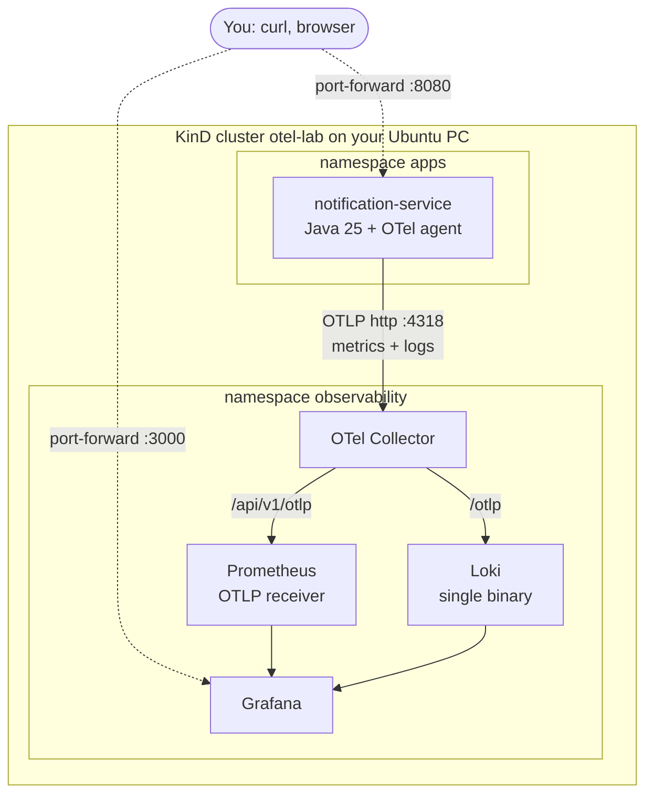

<Muted>
Versions: kind v0.33.0, kubectl v1.37.2, Helm v4.3.1, OTel Java agent 2.33.1. Charts: `open-telemetry/opentelemetry-collector` 0.178.2 (collector-contrib 0.163.2), `prometheus-community/prometheus` 29.40.3 (Prometheus v3.15.1), `grafana-community/loki` 20.2.1 (Loki 3.7.9), `grafana-community/grafana` 14.3.1 (Grafana 13.3.0). The app is your [notification-service](/practical/apps/notification-service/README.md) from the Practical Book, unchanged.
</Muted>

<Note title="What was tested, and what wasn't">
KinD **could not run** in the cloud sandbox used to write this page: its kernel uses cgroup v1, and runc there is not allowed to set `oom_score_adj` for nested containers, so the control plane never started. That is a limitation of the sandbox, not of Ubuntu (see [3.1](#im-prereqs)). Instead I:

1. rendered all four Helm charts and the app manifest with the values below, and schema-checked every resource with kubeconform (33 resources, 0 invalid);
2. ran the **same images with the configs Helm rendered** in Docker Compose, using network aliases equal to the Kubernetes DNS names, so the app and collector settings were used unchanged.

The data path worked end to end: app → collector → Prometheus and Loki → Grafana. The outputs in 3.7 come from that run. The `kind`, `kubectl` and `helm install` steps themselves were not executed. Run them on your PC and tell me if anything differs.
</Note>

<Part level={1} id="arch" title="Architecture examples" toc="Architecture">

<Block id="arch-scenario" title="1.1 The scenario">

Everything runs on one Ubuntu PC, inside one KinD (Kubernetes in Docker) cluster:

- **Namespace `apps`:** your `notification-service` (Spring Boot 4.1, Java 25), with the OpenTelemetry Java agent attached through `JAVA_TOOL_OPTIONS`. The app code and Dockerfile from the Practical Book stay as they are.
- **Namespace `observability`:** an OpenTelemetry Collector, Prometheus, Loki and Grafana, each installed with its Helm chart.
- **Data flow:** the agent pushes metrics **and** logs over OTLP to the collector in the other namespace. The collector forwards metrics to Prometheus's OTLP receiver and logs to Loki's OTLP endpoint. Grafana queries both.



</Block>

<Block id="arch-a" title="1.2 Architecture A · Push everything through the collector (this page)" toc="1.2 A · Push via collector">

The app only knows one address, the collector's. Metrics include the agent's HTTP and JVM metrics plus your Micrometer counter `notifications.sent`, sent through the agent's Micrometer bridge. Logs are Logback events, captured by the agent and sent as OTLP log records with `trace_id` and `span_id`. The collector decides where each signal goes.

<Fit>
<Pros title="Fits when">
- You want one pipeline for metrics and logs, configured in one place
- You want to swap backends later (Grafana Cloud, Google Cloud as in [Topic 04](/topics/04-otel-java-gcp)) by changing only the collector
- You want logs with trace IDs and resource labels, not raw text lines
</Pros>
<Cons title="Watch out for">
- Prometheus's docs call the OTLP receiver "not considered an efficient way of ingesting samples … not suitable for replacing the ingestion via scraping". It is fine for a local lab.
- If the collector is down, the app's telemetry is dropped after the agent's retries
- Logs leave the app over the network, so a crash loop can lose the last lines (they are still in `kubectl logs`)
</Cons>
</Fit>

</Block>

<Block id="arch-b" title="1.3 Architecture B · Prometheus scrapes, collector handles logs" toc="1.3 B · Scrape metrics">

Your app already exposes `/actuator/prometheus`. Prometheus can scrape it directly (or scrape a `prometheus` exporter on the collector), and only logs go over OTLP. This is the classic Prometheus model.

<Fit>
<Pros title="Fits when">
- You want the ingestion path Prometheus recommends
- Teams already have PromQL dashboards on Micrometer names (`http_server_requests_seconds`)
</Pros>
<Cons title="Watch out for">
- Two paths to configure and run instead of one
- Scrape config per app (annotations or ServiceMonitors)
- Metric names come from Micrometer, logs from OTel, so labels don't line up automatically
</Cons>
</Fit>

</Block>

<Block id="arch-c" title="1.4 Architecture C · A node agent tails log files (the Filebeat idea)" toc="1.4 C · Tail log files">

A DaemonSet reads every container's stdout from `/var/log/pods` on the node, the way Filebeat does. This collects logs from apps that have no OTel at all. **Filebeat itself can't be the agent for Loki:** see [2.5](#th-filebeat). The OTel Collector's own `filelog` receiver, run as a DaemonSet, does the same job and can export to Loki.

<Fit>
<Pros title="Fits when">
- Many apps can't be instrumented, or you need logs from third-party pods
- You want logs even when the app's OTel export fails
</Pros>
<Cons title="Watch out for">
- Lines are plain text: trace IDs only if the app prints them, and multi-line stack traces need parsing
- Needs host-path mounts and broader permissions
- Another component per node
</Cons>
</Fit>

</Block>

<Block id="arch-compare" title="1.5 Choosing between them">

| Concern | A · Push via collector | B · Scrape metrics | C · Tail log files |
| --- | --- | --- | --- |
| App changes | Agent + env vars | Agent for logs; metrics endpoint already there | None |
| Metric names | OTel semantic conventions + bridged Micrometer | Micrometer | n/a (logs only) |
| Logs carry `trace_id` | Yes (OTLP field) | Yes (OTLP field) | Only if printed in the line |
| Components in cluster | Collector, Prometheus, Loki, Grafana | + scrape config | + DaemonSet |
| Recommended for | **This lab**, and OTel-first teams | Prometheus-first teams | Mixed / uninstrumented workloads |

</Block>

</Part>

<Part level={2} id="theory" title="Theory">

<Block id="th-wiring" title="2.1 How the pieces find each other" toc="2.1 Wiring and DNS">

Pods reach a Service in another namespace by its DNS name `<service>.<namespace>.svc.cluster.local`. The names below come from the rendered charts:

| From | To | Address |
| --- | --- | --- |
| App (`apps`) | Collector | `http://otel-collector-opentelemetry-collector.observability.svc.cluster.local:4318` (OTLP/HTTP; 4317 is gRPC) |
| Collector | Prometheus | `http://prometheus-server.observability.svc.cluster.local:80/api/v1/otlp`. The exporter appends `/v1/metrics`, and Service port 80 forwards to Prometheus's 9090. |
| Collector | Loki | `http://loki.observability.svc.cluster.local:3100/otlp`. The exporter appends `/v1/logs`. |
| Grafana | Prometheus, Loki | The same Service names, as provisioned datasources |

The app's resource attributes come from `OTEL_RESOURCE_ATTRIBUTES`, filled with the Kubernetes downward API (`$(POD_NAMESPACE)`, `$(POD_NAME)`). The collector's `k8sattributes` processor (chart preset `kubernetesAttributes`) can add the same attributes centrally instead, at the cost of extra RBAC. This page keeps it in the manifest so you can see exactly what is sent.

</Block>

<Block id="th-metrics" title="2.2 Metrics: from Micrometer to Prometheus" toc="2.2 Metrics path">

1. The agent's **Micrometer bridge** (`OTEL_INSTRUMENTATION_MICROMETER_ENABLED=true`, off by default) turns your `notifications.sent` counter, and the other Spring meters, into OTel metrics. The agent also produces its own `http.server.request.duration` and `jvm.*` metrics.
2. `MANAGEMENT_METRICS_ENABLE_JVM=false` stops Micrometer's `jvm.*` meters, so JVM metrics come from one source only. Without it, `jvm.memory.used` would arrive twice with different units and labels (see [Topic 04 · 2.7](/topics/04-otel-java-gcp#th-micrometer)). In the test, Spring Boot 4.1 honoured it: no Micrometer `jvm_threads_*` or `jvm_buffer_*` series appeared.
3. Prometheus translates OTLP names with its default `translation_strategy: UnderscoreEscapingWithSuffixes`. Dots become underscores, and unit and `_total` suffixes are added:

| OTel metric | Prometheus series (seen in the test) |
| --- | --- |
| `notifications.sent` (Micrometer counter) | `notifications_sent_total` |
| `http.server.request.duration` (agent, seconds) | `http_server_request_duration_seconds_bucket` / `_count` / `_sum` |
| `jvm.memory.used` (agent, bytes) | `jvm_memory_used_bytes` |
| `http.server.requests` (Micrometer timer) | `http_server_requests_seconds_*` |

4. **Labels:** `job` = `service.namespace/service.name` (`shop/notification-service`), and `instance` = `service.instance.id`. Other resource attributes go into a `target_info` series unless you list them under `otlp.promote_resource_attributes`. This lab promotes `service.namespace`, `deployment.environment.name` and `k8s.namespace.name`. Prometheus's docs warn that `promote_all_resource_attributes` "may result in time series churn and lead to high memory usage".

<Note title="Two HTTP metrics for the same requests">
With the bridge on, you get both Micrometer's `http_server_requests_seconds_*` and the agent's `http_server_request_duration_seconds_*`. Pick one for dashboards. To drop the Micrometer one, set `MANAGEMENT_METRICS_ENABLE_HTTP_SERVER_REQUESTS=false`. That uses the same Spring per-meter property as the JVM one, but I did not test this one.
</Note>

</Block>

<Block id="th-logs" title="2.3 Logs: from Logback to Loki" toc="2.3 Logs path">

Your code logs through SLF4J and Logback as before. The agent's Logback instrumentation captures each event and exports it over OTLP, because `OTEL_LOGS_EXPORTER` defaults to `otlp`. The same lines still go to stdout, so `kubectl logs` keeps working. There is no double ingestion here, because nothing ships stdout to Loki.

Loki needs `allow_structured_metadata: true` to accept OTLP ("Otherwise, Loki will reject the log payload as malformed"). It is the default in Loki 3.x and is set explicitly in the values. Loki then maps each record like this:

- **Index labels** (what you select streams by): a default list of resource attributes. Dots become underscores: `service.name` becomes `service_name`.
- **Structured metadata** (stored per line, filterable): every other resource attribute, the scope, and the log record's attributes, including `trace_id`, `span_id` and `severity_text`.
- **Log line:** the record body, e.g. `Notification sent, total sent=3`.

Loki's docs say: "we no longer recommend the following as default labels: `k8s.pod.name`, `service.instance.id`" because of cardinality. The Loki values here remove both from `default_resource_attributes_as_index_labels`. The test confirmed it: the index labels were only `service_name`, `service_namespace`, `deployment_environment_name` and `k8s_namespace_name`. Before the fix, `k8s_pod_name` and `service_instance_id` were index labels too.

<Muted>
Loki's own example writes this list as `[service.name service.namespace …]`, space-separated inside brackets. YAML reads that as a single string, so the values file uses a normal YAML list.
</Muted>

</Block>

<Block id="th-stdout" title="2.4 Should you turn off stdout logging?" toc="2.4 Keep stdout?">

**No. Turn it down if you like, but keep it.** OTLP is the better *main* path: structured records with `trace_id`, `span_id` and `severity_text`, the same labels as the metrics, and one place (the collector) that decides where logs go. But OTLP is a network pipeline. stdout is the only copy that doesn't depend on the collector, Loki or the network being up.

**What the test showed.** I ran your app with stdout reduced to warnings (`LOGGING_THRESHOLD_CONSOLE=WARN`) and OTLP logs going to a collector:

```text output
stdout 'Notification sent' lines: 0
OTLP records:
Body: Str(Notification sent, total sent=1)
Body: Str(Notification sent, total sent=2)
```

Then I **stopped the collector** and sent two more notifications:

```text output
{"sent":3}
{"sent":4}
```

"Notification sent, total sent=3" and "=4" appeared **nowhere**: not on stdout, because it was turned down to WARN, and not in the collector, because it was stopped. Ten seconds later, the app's own output still showed no export warning. With stdout turned off completely, those events would leave no trace at all.

**When only stdout has the answer:**

- **The collector, Loki or the network is down.** The agent can only buffer so much before it drops records.
- **The app crashes.** Records still in the agent's in-memory batch are lost. stdout lines were written immediately.
- **The JVM fails before the agent exports anything**, for example bad configuration at startup.
- **The OTel settings themselves are wrong** (endpoint, protocol). `kubectl logs` reads stdout and is how you'd find out.

**No duplicates here.** In this lab nothing ships stdout to Loki, so keeping it doesn't put each line in Loki twice. Loki only gets the OTLP copy. The duplicate trap in [Topic 04 · 2.4](/topics/04-otel-java-gcp#th-logs) is different: there, Cloud Run and GKE ship stdout to Cloud Logging themselves, so you choose one path.

| Option | Setting | Use when |
| --- | --- | --- |
| **Keep stdout as is** (this page's default) | nothing | Local lab: easiest debugging |
| **Reduce stdout to warnings** (tested) | `LOGGING_THRESHOLD_CONSOLE=WARN` in the Deployment's `env`. This is Spring Boot's `logging.threshold.console`: "The log level threshold to use for console logging." | You want a quieter console but still want errors in `kubectl logs` |
| Turn stdout off | (not recommended) | Only if something else guarantees delivery, which nothing in this setup does |

The threshold only filters the **console**. In the test, the agent still exported the INFO records over OTLP, because it hooks into Logback's loggers, not the console appender.

<Muted>
How it was tested: the `notification-service:1.0.0-otel` image from 3.5 and a collector-contrib 0.163.2 container with only an OTLP receiver and a `debug` exporter, on a Docker network. The app had `OTEL_METRICS_EXPORTER=none` and `OTEL_TRACES_EXPORTER=none`. I sent two POSTs, ran `docker stop` on the collector, then sent two more POSTs. This was a Docker test, not run on KinD. In the cluster, `kubectl -n observability scale deploy/otel-collector-opentelemetry-collector --replicas=0` simulates the same outage.
</Muted>

</Block>

<Block id="th-filebeat" title="2.5 Why there is no Filebeat in this lab" toc="2.5 Why no Filebeat">

- **Filebeat's outputs** (Elastic's "Configure the output" page) are Elasticsearch, Logstash, Kafka and Redis. "Only a single output may be defined." There is no Loki or OTLP output.
- **Loki's "Send data" page** lists Grafana Alloy, the OpenTelemetry Collector (native OTLP), the Docker driver, Fluent Bit, Fluentd and language appenders. Filebeat isn't listed, and the old Logstash client page now only survives as a redirect alias.
- **The OTel Collector** (contrib v0.163.0) has no receiver for Filebeat's protocol. It has a `kafkareceiver`, so Filebeat → Kafka → collector → Loki is possible, but that means running Kafka just to move logs.

So the lab sends logs the same way as metrics: agent → collector → Loki over OTLP. If you later need file tailing (Architecture C), use the collector's `filelog` receiver as a DaemonSet, or Grafana Alloy.

</Block>

<Block id="th-charts" title="2.6 Where the Helm charts come from" toc="2.6 Helm chart sources">

- **Grafana:** the `grafana/grafana` chart README says "This chart has been migrated to grafana-community/helm-charts. After January 30th, 2026, updates and support for this chart will be provided in the new repository."
- **Loki:** the `grafana/loki` chart is now "for Grafana Enterprise Logs (GEL) users only". "As of March 16, 2026, the Grafana Loki Helm chart for OSS users has moved to grafana-community/helm-charts."
- **Collector:** `open-telemetry/opentelemetry-collector` needs `mode` and `image.repository` set. Its defaults also open Jaeger and Zipkin receivers. The chart renames `otlphttp` exporters to `otlp_http`, the component's current name, so the values use `otlp_http` directly.
- **Prometheus:** `prometheus-community/prometheus` with Alertmanager, kube-state-metrics, node-exporter and Pushgateway turned off, leaving only the server.

<Muted>
Loki chart 20.x rejects unknown top-level keys and expects the simple-scalable targets (`backend`, `read`, `write`) at 0 replicas in `Monolithic` mode. Without that, `helm template` fails with "You have more than zero replicas configured for both the monolithic and simple scalable targets".
</Muted>

</Block>

<Block id="th-proscons" title="2.7 Problems solved, pros and cons" toc="2.7 Pros and cons">

**Problems this lab solves:** you can watch your Java service's metrics and logs locally with the same OTel setup you'd use in a real cluster, learn the OTLP → Prometheus and OTLP → Loki mappings, and break things without a cloud bill.

<Fit>
<Pros>
- No code changes to your app: agent + environment variables only
- One collector config controls where metrics and logs go
- Logs carry `trace_id`, and Loki labels match Prometheus labels (`service_namespace`, `k8s_namespace_name`)
- Everything is Helm values, easy to recreate after `kind delete cluster`
</Pros>
<Cons>
- No persistence: Prometheus and Loki use `emptyDir`, so data is gone when their pods restart
- Prometheus's OTLP receiver is meant for low volume
- No traces backend: the collector prints spans with its `debug` exporter (Tempo would be the next step)
- About 2 GB of RAM for the stack
</Cons>
</Fit>

</Block>

</Part>

<Part level={3} id="impl" title="Implementation">

<Muted>
Put the files from 3.2 in a folder `kind-otel/` next to your clone of the repo. Commands run from `kind-otel/` unless stated.
</Muted>

<Block id="im-prereqs" title="3.1 Prerequisites on Ubuntu" toc="3.1 Prerequisites">

Docker Engine must be installed and usable without `sudo`. KinD needs cgroup v2 for current Kubernetes versions, which is what modern Ubuntu uses. Check:

```bash
stat -fc %T /sys/fs/cgroup/
```

```text output
cgroup2fs
```

`tmpfs` means cgroup v1. Current kind node images then fail with "kubelet is configured to not run on a host using cgroup v1", which is what happened in the test sandbox.

Install kind, kubectl and Helm into `~/.local/bin` (the versions used for this page):

```bash
mkdir -p ~/.local/bin && cd ~/.local/bin
curl -sSLo kind https://github.com/kubernetes-sigs/kind/releases/download/v0.33.0/kind-linux-amd64 && chmod +x kind
curl -sSLo kubectl https://dl.k8s.io/release/v1.37.2/bin/linux/amd64/kubectl && chmod +x kubectl
curl -sSL https://get.helm.sh/helm-v4.3.1-linux-amd64.tar.gz | tar xz --strip-components=1 linux-amd64/helm
cd - && kind version && kubectl version --client && helm version --short
```

```text output
kind v0.33.0 go1.26.7 linux/amd64
Client Version: v1.37.2
v4.3.1+gc0d08d0
```

For the app you also need JDK 25, or Docker to build it, as in the [notification-service README](/practical/apps/notification-service/README.md).

</Block>

<Block id="im-files" title="3.2 The files" toc="3.2 Files">

```text
kind-otel/
├── kind-config.yaml
├── image/
│   ├── Dockerfile                    # your image + the OTel agent
│   └── opentelemetry-javaagent.jar   # downloaded in 3.5
├── values/
│   ├── collector.yaml
│   ├── prometheus.yaml
│   ├── loki.yaml
│   └── grafana.yaml
└── k8s/
    └── notification-service.yaml
```

```yaml title="kind-otel/kind-config.yaml"
kind: Cluster
apiVersion: kind.x-k8s.io/v1alpha4
name: otel-lab
nodes:
  - role: control-plane
```

```yaml title="kind-otel/values/collector.yaml"
# open-telemetry/opentelemetry-collector chart
mode: deployment
image:
  repository: otel/opentelemetry-collector-contrib
replicaCount: 1
resources:
  limits:
    memory: 512Mi
config:
  receivers:
    otlp:
      protocols:
        grpc:
          endpoint: ${env:MY_POD_IP}:4317
        http:
          endpoint: ${env:MY_POD_IP}:4318
  processors:
    memory_limiter:
      check_interval: 5s
      limit_percentage: 80
      spike_limit_percentage: 25
    batch: {}
  exporters:
    otlp_http/prometheus:
      endpoint: http://prometheus-server.observability.svc.cluster.local:80/api/v1/otlp
      tls:
        insecure: true
    otlp_http/loki:
      endpoint: http://loki.observability.svc.cluster.local:3100/otlp
      tls:
        insecure: true
    debug:
      verbosity: basic
  service:
    pipelines:
      metrics:
        receivers: [otlp]
        processors: [memory_limiter, batch]
        exporters: [otlp_http/prometheus]
      logs:
        receivers: [otlp]
        processors: [memory_limiter, batch]
        exporters: [otlp_http/loki]
      traces:
        receivers: [otlp]
        processors: [memory_limiter, batch]
        exporters: [debug]
```

```yaml title="kind-otel/values/prometheus.yaml"
# prometheus-community/prometheus chart: Prometheus server only
alertmanager:
  enabled: false
kube-state-metrics:
  enabled: false
prometheus-node-exporter:
  enabled: false
prometheus-pushgateway:
  enabled: false
server:
  extraFlags:
    - web.enable-lifecycle
    - web.enable-otlp-receiver          # accept OTLP at /api/v1/otlp/v1/metrics
  persistentVolume:
    enabled: false                      # lab: data lives in an emptyDir
  retention: 2d
serverFiles:
  prometheus.yml:
    otlp:
      # copy these OTel resource attributes onto every series as labels
      promote_resource_attributes:
        - service.namespace
        - deployment.environment.name
        - k8s.namespace.name
```

```yaml title="kind-otel/values/loki.yaml"
# grafana-community/loki chart: single binary, local filesystem storage
deploymentMode: Monolithic
loki:
  auth_enabled: false
  commonConfig:
    replication_factor: 1
  storage:
    type: filesystem
  schemaConfig:
    configs:
      - from: "2024-04-01"
        store: tsdb
        object_store: filesystem
        schema: v13
        index:
          prefix: index_
          period: 24h
  limits_config:
    allow_structured_metadata: true     # required for OTLP ingestion (default in Loki 3.x)
  distributor:
    otlp_config:
      # Loki's default list minus k8s.pod.name and service.instance.id, which Loki's docs
      # no longer recommend as index labels (high cardinality). They stay as structured metadata.
      default_resource_attributes_as_index_labels:
        - service.name
        - service.namespace
        - deployment.environment
        - deployment.environment.name
        - cloud.region
        - cloud.availability_zone
        - k8s.cluster.name
        - k8s.namespace.name
        - k8s.container.name
        - container.name
        - k8s.replicaset.name
        - k8s.deployment.name
        - k8s.statefulset.name
        - k8s.daemonset.name
        - k8s.cronjob.name
        - k8s.job.name
singleBinary:
  replicas: 1
  persistence:
    enabled: false                      # lab: data lives in an emptyDir
gateway:
  enabled: false
chunksCache:
  enabled: false
resultsCache:
  enabled: false
lokiCanary:
  enabled: false
test:
  enabled: false
# Monolithic mode: zero out the simple-scalable targets (as in the chart's monolithic example)
backend:
  replicas: 0
read:
  replicas: 0
write:
  replicas: 0
```

```yaml title="kind-otel/values/grafana.yaml"
# grafana-community/grafana chart
adminUser: admin
adminPassword: admin                    # lab only
datasources:
  datasources.yaml:
    apiVersion: 1
    datasources:
      - name: Prometheus
        uid: prometheus
        type: prometheus
        url: http://prometheus-server.observability.svc.cluster.local
        isDefault: true
      - name: Loki
        uid: loki
        type: loki
        url: http://loki.observability.svc.cluster.local:3100
```

```dockerfile title="kind-otel/image/Dockerfile"
# Adds the OpenTelemetry Java agent to the notification-service image.
# Build notification-service:1.0.0 first (see the practical book), then run this from kind-otel/image/.
FROM notification-service:1.0.0
COPY opentelemetry-javaagent.jar /otel/opentelemetry-javaagent.jar
```

```yaml title="kind-otel/k8s/notification-service.yaml"
apiVersion: v1
kind: Namespace
metadata:
  name: apps
---
apiVersion: apps/v1
kind: Deployment
metadata:
  name: notification-service
  namespace: apps
spec:
  replicas: 1
  selector:
    matchLabels: { app: notification-service }
  template:
    metadata:
      labels: { app: notification-service }
    spec:
      containers:
        - name: app
          image: notification-service:1.0.0-otel
          imagePullPolicy: Never               # loaded with "kind load", not pulled
          ports:
            - containerPort: 8080
          env:
            - name: POD_NAMESPACE
              valueFrom: { fieldRef: { fieldPath: metadata.namespace } }
            - name: POD_NAME
              valueFrom: { fieldRef: { fieldPath: metadata.name } }
            # Attach the agent without changing the image's entrypoint
            - name: JAVA_TOOL_OPTIONS
              value: "-javaagent:/otel/opentelemetry-javaagent.jar"
            - name: OTEL_SERVICE_NAME
              value: notification-service
            - name: OTEL_RESOURCE_ATTRIBUTES
              value: "service.namespace=shop,deployment.environment.name=local,k8s.namespace.name=$(POD_NAMESPACE),k8s.pod.name=$(POD_NAME)"
            # Collector in the other namespace
            - name: OTEL_EXPORTER_OTLP_ENDPOINT
              value: "http://otel-collector-opentelemetry-collector.observability.svc.cluster.local:4318"
            - name: OTEL_EXPORTER_OTLP_PROTOCOL
              value: http/protobuf
            - name: OTEL_METRIC_EXPORT_INTERVAL
              value: "15000"
            # Send the app's Micrometer meters (notifications.sent) through the agent
            - name: OTEL_INSTRUMENTATION_MICROMETER_ENABLED
              value: "true"
            # ...but keep only one source of JVM metrics (the agent's)
            - name: MANAGEMENT_METRICS_ENABLE_JVM
              value: "false"
          readinessProbe:
            httpGet: { path: /actuator/health, port: 8080 }
            initialDelaySeconds: 10
          resources:
            limits: { memory: 512Mi }
---
apiVersion: v1
kind: Service
metadata:
  name: notification-service
  namespace: apps
spec:
  selector: { app: notification-service }
  ports:
    - port: 8080
      targetPort: 8080
```

<Muted>
Your image is distroless (no shell), so the agent can't be downloaded inside it. The new image copies a jar downloaded on the host, and `JAVA_TOOL_OPTIONS` attaches it. The JVM reads that variable even though the base image's entrypoint is a fixed `java -jar`. Traces are sent too, which is the agent's default. They give the logs their `trace_id`, and the collector prints them with its `debug` exporter instead of storing them.
</Muted>

</Block>

<Block id="im-cluster" title="3.3 Create the cluster" toc="3.3 Create the cluster">

```bash
kind create cluster --config kind-config.yaml
kubectl create namespace observability
kubectl get nodes
```

You should see one node, `otel-lab-control-plane`, with status `Ready`. Its Kubernetes version is whatever kind v0.33.0 uses as its default node image. `kind create cluster` also sets your `kubectl` context to `kind-otel-lab`.

</Block>

<Block id="im-stack" title="3.4 Install Prometheus, Loki, Grafana and the collector" toc="3.4 Install the stack">

```bash
helm repo add open-telemetry https://open-telemetry.github.io/opentelemetry-helm-charts
helm repo add prometheus-community https://prometheus-community.github.io/helm-charts
helm repo add grafana-community https://grafana-community.github.io/helm-charts
helm repo update

helm install prometheus prometheus-community/prometheus --version 29.40.3 -n observability -f values/prometheus.yaml
helm install loki grafana-community/loki --version 20.2.1 -n observability -f values/loki.yaml
helm install grafana grafana-community/grafana --version 14.3.1 -n observability -f values/grafana.yaml
helm install otel-collector open-telemetry/opentelemetry-collector --version 0.178.2 -n observability -f values/collector.yaml

kubectl -n observability rollout status deploy/prometheus-server
kubectl -n observability rollout status statefulset/loki
kubectl -n observability rollout status deploy/grafana
kubectl -n observability rollout status deploy/otel-collector-opentelemetry-collector
```

<Tip title="Check before installing">
`helm template <release> <chart> --version … -n observability -f values/<file>.yaml` renders the manifests without touching the cluster. That's how this page's values were checked (kubeconform: 33 resources, 0 invalid).
</Tip>

</Block>

<Block id="im-app" title="3.5 Build the app image and load it into KinD" toc="3.5 Build and load the image">

Build your jar and base image exactly as the Practical Book describes ([app README](/practical/apps/notification-service/README.md), [image README](/practical/README-Dockerbuild.md)). From `wq_practical_book/`:

```bash
(cd apps/notification-service && ./mvnw clean package)
docker build -f docker/notification-service/Dockerfile -t notification-service:1.0.0 .
```

Then add the agent and load the image into the cluster. KinD nodes can't see your local Docker images until you load them:

```bash
cd kind-otel
curl -sSLo image/opentelemetry-javaagent.jar \
  https://github.com/open-telemetry/opentelemetry-java-instrumentation/releases/download/v2.33.1/opentelemetry-javaagent.jar
docker build -t notification-service:1.0.0-otel image/
kind load docker-image notification-service:1.0.0-otel --name otel-lab
```

<Muted>
The manifest uses `imagePullPolicy: Never`, so Kubernetes uses the loaded image and never tries a registry. After rebuilding, run `kind load` again and `kubectl -n apps rollout restart deploy/notification-service`.
</Muted>

</Block>

<Block id="im-deploy" title="3.6 Deploy the app" toc="3.6 Deploy the app">

```bash
kubectl apply -f k8s/notification-service.yaml
kubectl -n apps rollout status deploy/notification-service
kubectl -n apps logs deploy/notification-service | grep -E "Picked up|VersionLogger|Started"
```

```text output
Picked up JAVA_TOOL_OPTIONS: -javaagent:/otel/opentelemetry-javaagent.jar
[otel.javaagent 2026-11-03 00:58:04:095 +0000] [main] INFO io.opentelemetry.javaagent.tooling.VersionLogger - opentelemetry-javaagent - version: 2.33.1
... Started NotificationServiceApplication in 4.391 seconds (process running for 10...)
```

These lines are from the test image. `Picked up JAVA_TOOL_OPTIONS` shows that the JVM read the variable, and `VersionLogger` shows the agent loaded.

</Block>

<Block id="im-verify" title="3.7 Send notifications and look at the results" toc="3.7 Verify">

Open three port-forwards, each in its own terminal (or add `&`):

```bash
kubectl -n apps port-forward svc/notification-service 8080:8080
kubectl -n observability port-forward svc/prometheus-server 9090:80
kubectl -n observability port-forward svc/loki 3100:3100
kubectl -n observability port-forward svc/grafana 3000:80
```

<Steps>
<Step title="Send three notifications">

```bash
for i in 1 2 3; do curl -s -X POST http://localhost:8080/notifications; echo; done
```

```text output
{"sent":1}
{"sent":2}
{"sent":3}
```

Wait about 30 s. The agent exports metrics every 15 s (`OTEL_METRIC_EXPORT_INTERVAL`).

</Step>
<Step title="Prometheus has the counter, with OTel labels">

```bash
curl -s http://localhost:9090/api/v1/query --data-urlencode 'query=notifications_sent_total' | python3 -m json.tool
```

```text output
"metric": {
    "__name__": "notifications_sent_total",
    "deployment_environment_name": "local",
    "instance": "98f36c18-b71a-4671-832c-3760501f9618",
    "job": "shop/notification-service",
    "k8s_namespace_name": "apps",
    "service_namespace": "shop"
},
"value": [ ..., "3" ]
```

(Trimmed. `instance` is the agent's random `service.instance.id`, different on every start.) Other series to try: `http_server_request_duration_seconds_count`, `jvm_memory_used_bytes`, `logback_events_total`.

</Step>
<Step title="Loki has the log lines, with trace IDs">

```bash
curl -s http://localhost:3100/loki/api/v1/labels
curl -s -G http://localhost:3100/loki/api/v1/query_range \
  --data-urlencode 'query={service_name="notification-service"} |= "Notification sent"' --data-urlencode 'limit=3'
```

```text output
{"status":"success","data":["deployment_environment_name","k8s_namespace_name","service_name","service_namespace"]}
...
"values": [["...","Notification sent, total sent=3"], ["...","Notification sent, total sent=2"], ["...","Notification sent, total sent=1"]]
```

Each line's stream also carries structured metadata, such as `trace_id`, `span_id`, `severity_text: INFO`, `scope_name: com.example.notification.NotificationService`, `k8s_pod_name` and `service_instance_id`.

</Step>
<Step title="Grafana shows both">

Open `http://localhost:3000` and log in as `admin` / `admin`. In **Explore**:

- **Prometheus** datasource: `notifications_sent_total`, or `rate(http_server_request_duration_seconds_count[5m])`.
- **Loki** datasource: `{service_name="notification-service"} |= "Notification sent"`. Expand a line to see `trace_id` and the other structured metadata.

The same checks through Grafana's API, as run in the test:

```bash
curl -s -u admin:admin http://localhost:3000/api/datasources/uid/prometheus/health
curl -s -u admin:admin http://localhost:3000/api/datasources/uid/loki/health
```

```text output
{"details":{"application":"Prometheus","features":{"rulerApiEnabled":false}},"message":"Successfully queried the Prometheus API.","status":"OK"}
{"message":"Data source successfully connected.","status":"OK"}
```

</Step>
</Steps>

<Tip title='What "working" looks like'>
<Checklist>

- `notifications_sent_total` in Prometheus equals the number of POSTs, with `job="shop/notification-service"`
- Loki's index labels are the four above, without `k8s_pod_name` and `service_instance_id`
- Each "Notification sent" line in Loki has a `trace_id`
- No Micrometer `jvm_threads_*` series in Prometheus (one JVM metric source)
- Both Grafana datasources report `OK`

</Checklist>
</Tip>

</Block>

<Block id="im-cardinality" title="3.8 See what the app sends, and send less" toc="3.8 Reduce cardinality">

Every unique combination of metric name and label values is one **series**, and series drive Prometheus memory and, on managed backends, cost. You can cut them at three levels **without changing your code**. Each level below is a ConfigMap or Helm values change.

<Note title="Where these numbers come from">
I measured each level with the topic's Docker Compose harness (the same images and Helm-rendered configs as 3.7), not on KinD. Each run sent 5 POSTs, 5 count requests, 5 health checks and one 404 to a fresh app instance. Series counts depend on traffic: more routes or status codes mean more series.
</Note>

**Look before you cut.** Start with what the app exposes itself (Micrometer), then what actually reached Prometheus:

```bash
# 1. What Micrometer exposes at /actuator/prometheus (port-forward from 3.7 still open)
curl -s http://localhost:8080/actuator/prometheus | grep -v '^#' | sed -E 's/[{ ].*//' | sort | uniq -c | sort -rn | head
curl -s http://localhost:8080/actuator/prometheus | grep -vc '^#'          # total series

# 2. What reached Prometheus for this app
curl -s http://localhost:9090/api/v1/query --data-urlencode 'query=count({job="shop/notification-service"})'
curl -s http://localhost:9090/api/v1/query --data-urlencode 'query=topk(10, count by (__name__) ({job="shop/notification-service"}))'

# 3. Which labels a metric carries
curl -s -G http://localhost:9090/api/v1/series --data-urlencode 'match[]=http_server_request_duration_seconds_count'

# 4. Prometheus' own cardinality report (whole server)
curl -s http://localhost:9090/api/v1/status/tsdb
```

In a first exploratory run, `/actuator/prometheus` listed 53 series. For the measured runs below, the baseline was **177 series in 56 metric names** in Prometheus. The single biggest metric is `http_server_request_duration_seconds_bucket`: 15 bucket series for each route (14 default boundaries plus `+Inf`). Health checks alone add a route, `/actuator/health`. If Prometheus or anything else scrapes `/actuator/prometheus`, that adds another.

| Level | Where you change it | What it can do | Series in the test |
| --- | --- | --- | --- |
| Baseline (3.6 as deployed) | — | — | **177** (56 metric names) |
| **1 · Spring Boot switches** | ConfigMap → env vars | Remove whole Micrometer meter families by name prefix | **126** (23 names) |
| **2 · Agent config file** | ConfigMap → mounted file | Drop instruments, keep only chosen attributes, change histogram buckets | **84** (with level 1) |
| **3 · Collector filter** | Collector Helm values | Drop metrics, or individual data points by label value | **105** (with level 1) |
| All three | | | **75**, with `notifications_sent_total` still correct (5) |

**Level 1: Spring Boot switches.** `management.metrics.enable.<prefix>=false` removes every Micrometer meter whose name starts with `<prefix>` (the same Spring Boot per-meter property as in 2.2). Put them in a ConfigMap and load it with `envFrom`:

```yaml title="kind-otel/k8s/metrics-config.yaml"
# Level 1: Spring Boot switches, passed to the app as environment variables
apiVersion: v1
kind: ConfigMap
metadata:
  name: notification-service-metrics
  namespace: apps
data:
  # management.metrics.enable.<prefix>=false removes every Micrometer meter whose name starts with <prefix>
  MANAGEMENT_METRICS_ENABLE_JVM: "false"          # JVM metrics come from the agent instead
  MANAGEMENT_METRICS_ENABLE_HTTP: "false"         # duplicate of the agent's http.server.request.duration
  MANAGEMENT_METRICS_ENABLE_TOMCAT: "false"
  MANAGEMENT_METRICS_ENABLE_LOGBACK: "false"
  MANAGEMENT_METRICS_ENABLE_PROCESS: "false"
  MANAGEMENT_METRICS_ENABLE_SYSTEM: "false"
  MANAGEMENT_METRICS_ENABLE_DISK: "false"
  MANAGEMENT_METRICS_ENABLE_EXECUTOR: "false"
  MANAGEMENT_METRICS_ENABLE_APPLICATION: "false"
---
# Level 2: OpenTelemetry Java agent declarative configuration, mounted as a file
apiVersion: v1
kind: ConfigMap
metadata:
  name: otel-agent-config
  namespace: apps
data:
  otel-config.yaml: |
    # OpenTelemetry Java agent declarative configuration (agent 2.26.0+; agent support is experimental)
    file_format: "1.2"
    resource:
      attributes_list: ${OTEL_RESOURCE_ATTRIBUTES}
      attributes:
        - name: service.name
          value: ${OTEL_SERVICE_NAME}
    propagator:
      composite:
        - tracecontext:
        - baggage:
    tracer_provider:
      processors:
        - batch:
            exporter:
              otlp_http:
                endpoint: ${OTEL_EXPORTER_OTLP_ENDPOINT}/v1/traces
    meter_provider:
      readers:
        - periodic:
            interval: 15000
            exporter:
              otlp_http:
                endpoint: ${OTEL_EXPORTER_OTLP_ENDPOINT}/v1/metrics
      views:
        # 1. Fewer histogram buckets, and keep only the attributes you query by.
        #    Use "included" (an allow-list), not "excluded" (see the note in 3.8).
        - selector:
            instrument_name: http.server.request.duration
          stream:
            aggregation:
              explicit_bucket_histogram:
                boundaries: [0.005, 0.025, 0.1, 0.5, 2.5]
            attribute_keys:
              included: [http.request.method, http.route, http.response.status_code]
        # 2. Drop metrics nobody looks at
        - selector:
            instrument_name: jvm.class.*
          stream:
            aggregation:
              drop:
    logger_provider:
      processors:
        - batch:
            exporter:
              otlp_http:
                endpoint: ${OTEL_EXPORTER_OTLP_ENDPOINT}/v1/logs
    distribution:
      javaagent:
        instrumentation:
          enabled:
            - micrometer          # same as OTEL_INSTRUMENTATION_MICROMETER_ENABLED=true
```

```yaml title="kind-otel/k8s/deployment-patch.yaml"
# Strategic-merge patch for the Deployment in k8s/notification-service.yaml
spec:
  template:
    spec:
      containers:
        - name: app
          envFrom:
            - configMapRef:
                name: notification-service-metrics
          env:
            # With a config file, the agent ignores other OTEL_* variables
            # unless the file references them, as otel-config.yaml does with ${...}
            - name: OTEL_CONFIG_FILE
              value: /etc/otel/otel-config.yaml
          volumeMounts:
            - name: otel-agent-config
              mountPath: /etc/otel
              readOnly: true
      volumes:
        - name: otel-agent-config
          configMap:
            name: otel-agent-config
```

```bash
kubectl apply -f k8s/metrics-config.yaml
kubectl -n apps patch deployment notification-service --patch-file k8s/deployment-patch.yaml
kubectl -n apps rollout status deploy/notification-service
```

The file holds both ConfigMaps, and the patch applies levels 1 and 2 together. For level 1 alone, leave out the `OTEL_CONFIG_FILE` variable and the volume. A ConfigMap change only takes effect after `kubectl -n apps rollout restart deploy/notification-service`, because environment variables and the agent config are read at startup. `MANAGEMENT_METRICS_ENABLE_HTTP=false` also removes Micrometer's duplicate HTTP timer (2.2). In the test, that variable together with the others left 23 metric names, and the agent's HTTP and JVM metrics plus `notifications_sent_total` remained.

**Level 2: OpenTelemetry views in the agent config file.** Views run inside the SDK, *before* aggregation. They can rename, drop or re-bucket an instrument and choose which attributes it keeps. Agent 2.26.0+ reads a declarative config file from `OTEL_CONFIG_FILE`. The OTel docs say: "Java agent support for declarative configuration is still experimental". The `otel-config.yaml` key in the ConfigMap above, tested with agent 2.33.1, does two things:

- `http.server.request.duration`: 5 bucket boundaries instead of the default 14, and only `http.request.method`, `http.route` and `http.response.status_code` as attributes. In the test, that gave 6 bucket series per route instead of 15.
- `jvm.class.*`: `aggregation: drop`, so it's never exported.

<Note title="Two traps found while testing">
1. **Use `included`, not `excluded`.** With `attribute_keys.excluded: [url.scheme, network.protocol.version]`, the HTTP metric gained labels it doesn't normally have: `client_address`, `network_peer_address`, `network_peer_port`, `server_address`, `server_port`, `url_path` and `user_agent_original`. Its series count rose instead of falling, to 30 bucket series for `/notifications` alone. It looks as if setting `attribute_keys` replaces the instrumentation's own list of recommended attributes, so an exclude-list lets everything else through. I couldn't confirm this in the docs, so treat it as observed behaviour and always use an allow-list.
2. **The file replaces your environment variables.** The docs: "All environment variables are ignored unless you explicitly add them to the" configuration file. That's why the file has to repeat the endpoint, resource attributes, export interval and `micrometer` instrumentation, using `${…}` substitution. With `file_format: "1.0"` the agent warned "does not exactly match expected version '1.2'". With `"1.2"` it ran without warnings. The agent then also exported three `otel_sdk_metric_reader_collection_duration_seconds_*` series about itself.
</Note>

**Level 3: filter in the collector.** The filter processor drops metrics by name, or individual data points by label value. A view can't drop by value, so this is how to remove the `/actuator/*` routes. Add this values file to the collector release:

```yaml title="kind-otel/values/collector-cardinality.yaml"
# Level 3: extra values for the collector chart, used together with values/collector.yaml
config:
  processors:
    filter/cardinality:
      error_mode: ignore
      metric_conditions:
        # drop whole metrics by name
        - metric.name == "jvm.cpu.count" or IsMatch(metric.name, "^jvm\\.class\\.")
        # drop data points for health checks and scrapes
        - IsMatch(datapoint.attributes["http.route"], "^/actuator")
  service:
    pipelines:
      metrics:
        processors: [memory_limiter, filter/cardinality, batch]
```

```bash
helm upgrade otel-collector open-telemetry/opentelemetry-collector --version 0.178.2 -n observability \
  -f values/collector.yaml -f values/collector-cardinality.yaml
```

The rendered config passed `otelcol validate` (collector-contrib 0.163.2). In the test, the app's `http_route` values in Prometheus went from `/**`, `/actuator/health`, `/notifications`, `/notifications/count` to the same list without `/actuator/health`. The filter README: "If all datapoints for a metric are dropped, the metric will also be dropped."

<Tip title="Which level to use">
Cut as early as possible. Level 1 and level 2 stop the data inside the JVM, so it costs no CPU to export and no network. Level 3 is central, and suits rules for many services at once, or dropping by label value. Removing a label at level 3 (instead of a whole data point) needs an aggregation step, such as `metricstransform` `aggregate_labels`. Otherwise two series that differed only by that label collide. I didn't test that here.
</Tip>

**Changing code isn't required, but it's the most direct fix** when the cardinality comes from your own metric: for example, a Micrometer tag or OTel attribute holding a user ID or an order ID. Your `notifications.sent` counter has no tags, so it's always one series.

</Block>

<Block id="im-troubleshoot" title="3.9 Troubleshooting" toc="3.9 Troubleshooting">

| Symptom | Check |
| --- | --- |
| Pod `ErrImageNeverPull` | The image wasn't loaded: `kind load docker-image notification-service:1.0.0-otel --name otel-lab` |
| No metrics or logs at all | `kubectl -n observability logs deploy/otel-collector-opentelemetry-collector`. Export errors name the failing backend. |
| Collector gets data but Prometheus doesn't | Prometheus must run with `--web.enable-otlp-receiver`: `kubectl -n observability get deploy prometheus-server -o yaml \| grep otlp` |
| Loki rejects logs as malformed | `allow_structured_metadata` must be true (Loki docs) |
| `helm template` fails for Loki | Unknown top-level key (20.x schema), or simple-scalable replicas not 0 (see 2.6) |
| To see what the app sends | Temporarily add `debug` to the `metrics` or `logs` exporters in `values/collector.yaml` and run `helm upgrade otel-collector … -f values/collector.yaml` |

</Block>

<Block id="im-cleanup" title="3.10 Clean up" toc="3.10 Clean up">

```bash
kind delete cluster --name otel-lab
```

This removes everything: the cluster, the loaded images inside it, and all Prometheus and Loki data. Your local Docker images `notification-service:1.0.0` and `1.0.0-otel` stay. Remove them with `docker image rm` if you want.

</Block>

<Block id="refs" title="References">

- [kind · Quick start](https://kind.sigs.k8s.io/docs/user/quick-start/) and [releases](https://github.com/kubernetes-sigs/kind/releases)
- [OpenTelemetry Collector Helm chart](https://github.com/open-telemetry/opentelemetry-helm-charts/tree/main/charts/opentelemetry-collector)
- [OpenTelemetry Java agent](https://opentelemetry.io/docs/zero-code/java/agent/) and [Micrometer bridge settings](https://github.com/open-telemetry/opentelemetry-java-instrumentation/blob/v2.33.1/instrumentation/micrometer/micrometer-1.5/javaagent/README.md)
- [Prometheus · OTLP receiver (HTTP API)](https://prometheus.io/docs/prometheus/latest/querying/api/#otlp-receiver), [configuration `otlp` block](https://prometheus.io/docs/prometheus/latest/configuration/configuration/) and [prometheus-community/prometheus chart](https://github.com/prometheus-community/helm-charts/tree/main/charts/prometheus)
- [Loki · Ingesting logs with the OpenTelemetry Collector](https://grafana.com/docs/loki/latest/send-data/otel/), [Modify default OpenTelemetry labels](https://grafana.com/docs/loki/latest/get-started/labels/modify-default-labels/), [Send data (clients)](https://grafana.com/docs/loki/latest/send-data/)
- [grafana-community/helm-charts (Loki and Grafana charts)](https://github.com/grafana-community/helm-charts) and [grafana/helm-charts migration notice](https://github.com/grafana/helm-charts/blob/main/charts/grafana/README.md)
- [OpenTelemetry · Java agent declarative configuration](https://opentelemetry.io/docs/zero-code/java/agent/declarative-configuration/), [SDK declarative configuration](https://opentelemetry.io/docs/languages/sdk-configuration/declarative-configuration/) and [configuration schema (views)](https://github.com/open-telemetry/opentelemetry-configuration)
- [Collector filter processor (v0.163.0)](https://github.com/open-telemetry/opentelemetry-collector-contrib/blob/v0.163.0/processor/filterprocessor/README.md)
- [Prometheus · HTTP API (series, TSDB stats)](https://prometheus.io/docs/prometheus/latest/querying/api/)
- [Spring Boot · Logging (`logging.threshold.console`)](https://docs.spring.io/spring-boot/reference/features/logging.html)
- [Elastic · Filebeat outputs](https://www.elastic.co/docs/reference/beats/filebeat/configuring-output)
- [notification-service (Practical Book)](/practical/apps/notification-service/README.md) and [its Docker image](/practical/README-Dockerbuild.md)

</Block>

</Part>
