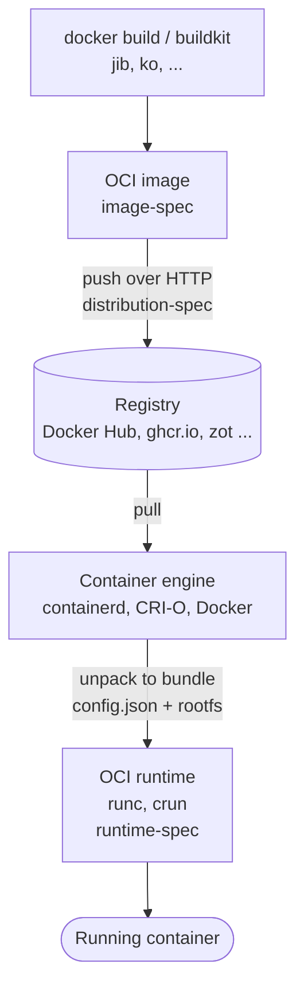
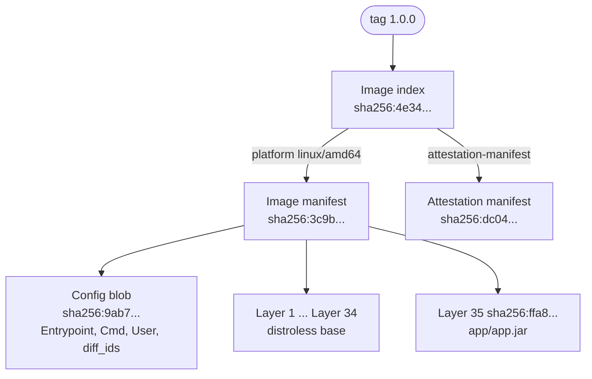
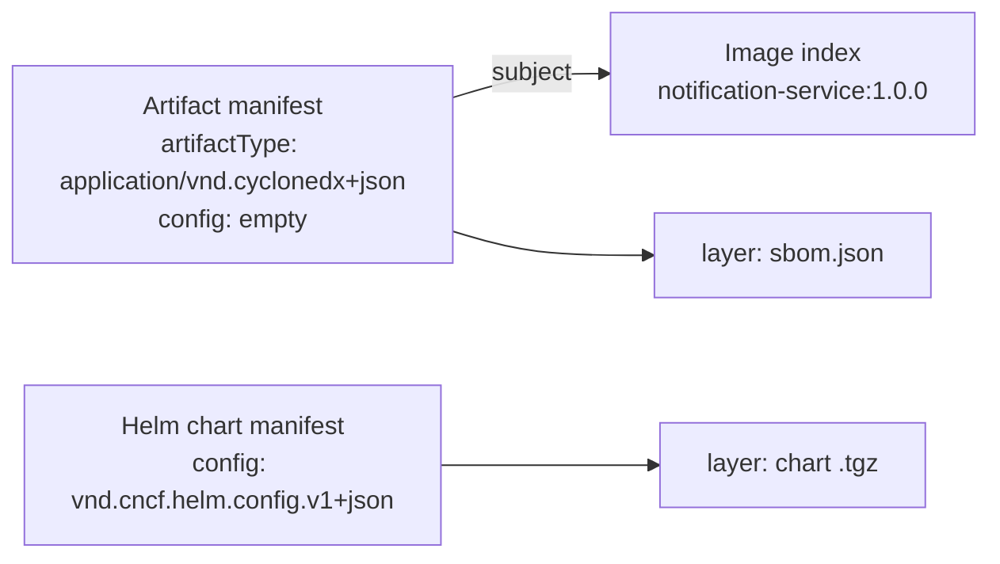
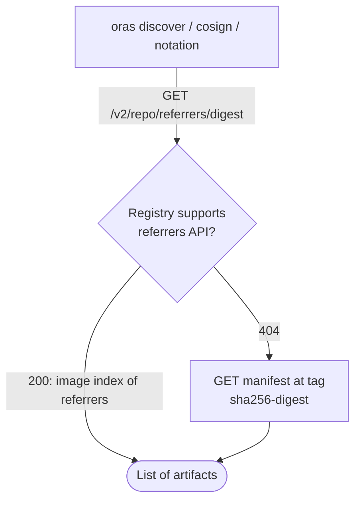

<Muted>
Written against image-spec v1.1.1, distribution-spec v1.1.1 and runtime-spec v1.3.0 (the latest releases of each). Lab tools: Docker Engine 29.9.2, `registry:3` (distribution v3.1.2), zot v2.1.23, crane v0.22.1, ORAS v1.3.6, Helm v4.3.1. Every output block in Part 3 is from a run in this session, using your [notification-service](/practical/README-Dockerbuild.md) image.
</Muted>

<Part level={1} id="arch" title="Architecture examples" toc="Architecture">

<Block id="arch-specs" title="1.1 Three specs, one pipeline" toc="1.1 Three specs">

The OCI was "launched on June 22nd 2015 by Docker, CoreOS and other leaders in the container industry" under the Linux Foundation, "for the express purpose of creating open industry standards around container formats and runtimes". It has three specifications, and each covers one stage:



- **image-spec:** what an image *is*: an index, manifests, a config and filesystem layers, all linked by content digests.
- **distribution-spec:** how a registry *serves* it: an HTTP API under `/v2/`, based on the Docker Registry HTTP API V2. It "is designed to be agnostic of content types", which is why it also carries Helm charts and SBOMs.
- **runtime-spec:** how a container *runs*: a "filesystem bundle" with a `config.json` and a root filesystem, executed by a runtime. Docker donated `runc` "to serve as the cornerstone" of OCI.

Because the formats are standard, any builder's image works with any registry and any runtime.

</Block>

<Block id="arch-image" title="1.2 Architecture A · A container image as a graph of digests" toc="1.2 A · Image graph">

A tag points at a manifest. For multi-platform images, or images built with attestations, that manifest is an **image index** that points at one **image manifest** per platform. Each manifest points at one **config** blob and an ordered list of **layer** blobs. Every arrow is a *descriptor*: media type, digest and size.



<Fit>
<Pros title="Fits when">
- You ship to several CPU architectures (one tag, one index, many manifests)
- You want immutable references: a digest always means the same bytes
- You want registries to de-duplicate shared base layers
</Pros>
<Cons title="Watch out for">
- Tags are mutable pointers. `1.0.0` can be re-pushed, a digest can't.
- Older tools and registries may expect Docker's media types or a single manifest
- Many small layers mean many HTTP requests on pull. Your image has 35.
</Cons>
</Fit>

</Block>

<Block id="arch-artifacts" title="1.3 Architecture B · Artifacts: the same manifest, other content" toc="1.3 B · Artifacts">

The image manifest isn't limited to containers. The image-spec allows "content other than OCI container images" to be packaged with it, in two ways:

- **Typed config:** `config.mediaType` names the artifact type. Helm does this: `application/vnd.cncf.helm.config.v1+json`, with the chart as one layer.
- **Empty config plus `artifactType`:** the config is the empty descriptor `{}`, and the manifest's `artifactType` names the type. ORAS uses this for files like an SBOM. Add a `subject`, and the artifact *refers to* another manifest (signatures, SBOMs, scan results).



<Fit>
<Pros title="Fits when">
- You want one registry, one auth model and one replication setup for images, charts and supply-chain metadata
- You need to attach SBOMs or signatures to an image without changing its digest
</Pros>
<Cons title="Watch out for">
- Some registries don't implement the referrers API, so clients fall back to a tag (see 1.4)
- Generic UIs may show artifacts as broken "images"
</Cons>
</Fit>

</Block>

<Block id="arch-referrers" title="1.4 Architecture C · Finding attached artifacts: referrers API or fallback tag" toc="1.4 C · Referrers">



| | Referrers API (zot v2.1.23 in the lab) | Fallback tag schema (`registry:3` in the lab) |
| --- | --- | --- |
| How clients find artifacts | `GET /v2/<name>/referrers/<digest>` returns 200 | The API returns 404. Clients read the index at tag `sha256-<digest>`. |
| Who maintains the list | The registry | Each pushing client updates the tag |
| Extra tags in the repo | None | One per image that has referrers |
| Race conditions | Handled by the registry | The spec warns that concurrent clients can cause "race conditions and data loss" |

</Block>

<Block id="arch-compare" title="1.5 Choosing tools and registries" toc="1.5 Choosing">

| Need | Use | Why |
| --- | --- | --- |
| Inspect or copy images without a Docker daemon | `crane` (go-containerregistry) | Talks to the registry API directly. `crane copy` is server-to-server and keeps digests. |
| Push or pull arbitrary files and attach artifacts | `oras` | Built for artifacts, `subject` and referrers |
| Charts in a registry | `helm push oci://…` | Native in Helm. No separate chart repository server. |
| Local registry for labs | `registry:3` or zot | Both are listed by Helm's docs as OCI registries for development. zot implements the referrers API. |
| Learn what's on the wire | `curl` against `/v2/` | Every tool above uses these endpoints |

</Block>

</Part>

<Part level={2} id="theory" title="Theory">

<Block id="th-digest" title="2.1 Content addressing: descriptors and digests" toc="2.1 Descriptors and digests">

Everything in OCI is referenced by a **descriptor** with three required fields:

- **`mediaType`:** what the content is.
- **`digest`:** e.g. `sha256:…` of the raw bytes. "Retrieved content SHOULD be verified against this digest."
- **`size`:** in bytes. "If the length of the retrieved content does not match the specified length, the content SHOULD NOT be trusted."

Optional fields are `annotations`, `urls`, `data` (inline base64) and `artifactType`.

Consequences you saw in the lab:

1. **A digest is the same everywhere.** After `crane copy` to another tag, and to a different registry (zot), the image index digest stayed `sha256:4e3499b5…`. With Docker's containerd image store, the local image ID *is* that digest.
2. **Compressed vs. uncompressed.** A layer's digest in the manifest is the sha256 of the **gzip blob**. The config's `rootfs.diff_ids` holds the sha256 of the **uncompressed tar**. For your app layer: `sha256:ffa82db3…` (blob) vs `sha256:a88d144e…` (diff_id).
3. **Tags are pointers, digests are facts.** A tag can be moved to new content, a digest can't. Pin production deployments by digest (`image@sha256:…`).

</Block>

<Block id="th-image" title="2.2 The image-spec objects" toc="2.2 Image-spec objects">

| Object | Media type | Contains |
| --- | --- | --- |
| Image index | `application/vnd.oci.image.index.v1+json` | `manifests[]`: descriptors with `platform` (os, architecture) |
| Image manifest | `application/vnd.oci.image.manifest.v1+json` | `config` descriptor, ordered `layers[]`, optional `artifactType`, `subject`, `annotations`. `schemaVersion` "MUST be `2`". |
| Image config | `application/vnd.oci.image.config.v1+json` | `architecture`, `os`, `config` (`User`, `Entrypoint`, `Cmd`, `Env`, `WorkingDir`, `ExposedPorts`), `rootfs.diff_ids`, `history` |
| Layer | `application/vnd.oci.image.layer.v1.tar`, `…tar+gzip`, `…tar+zstd` | A tar changeset. Additions and modifications are files; removals are "whiteout" entries. |
| Empty | `application/vnd.oci.empty.v1+json` | `{}`, size 2, digest `sha256:44136fa3…`, for artifacts with no config |

- **Layers are changesets, applied in order.** Each tar adds or changes files, and whiteout entries delete files from lower layers. The runtime gets the union.
- **`history`** in the config records how the image was built. In the lab, the last entries were `COPY notification-service/target/notification-service-1.0.0.jar /app/app.jar`, then `EXPOSE` and `CMD` marked `"empty_layer": true`. Instructions that only change config add no layer.
- **Image layout** (`oci-layout`, `index.json`, `blobs/sha256/…`) is the same graph stored as files on disk. It's useful for air-gapped transfer and for tools like crane and skopeo.

<Note title="Docker's own media types">
Docker Engine 29.0+ uses the containerd image store by default "on fresh installations", and it pushed an OCI index with an attestation manifest in the lab. Docker's docs say an upgraded engine may still use the classic store, which can't hold image indexes. I didn't test that setup. Expect `application/vnd.docker.distribution.manifest.v2+json` there instead, which registries also accept.
</Note>

</Block>

<Block id="th-dist" title="2.3 The distribution-spec: a registry is an HTTP API" toc="2.3 Distribution API">

The core endpoints (from the spec's endpoint table):

| ID | Method | Path | Used for |
| --- | --- | --- | --- |
| end-1 | `GET` | `/v2/` | "Is this a registry?" (200, or 401 when auth is needed) |
| end-3 | `GET` / `HEAD` | `/v2/<name>/manifests/<reference>` | Fetch a manifest by tag or digest |
| end-2 | `GET` / `HEAD` | `/v2/<name>/blobs/<digest>` | Fetch config and layers |
| end-4a, 5, 6 | `POST`, `PATCH`, `PUT` | `/v2/<name>/blobs/uploads/…` | Upload a blob (monolithic or chunked) |
| end-11 | `POST` | `…/blobs/uploads/?mount=<digest>&from=<other>` | Cross-repo mount: reuse a blob without uploading it |
| end-7 | `PUT` | `/v2/<name>/manifests/<reference>` | Publish a manifest, which creates or moves a tag |
| end-8a | `GET` | `/v2/<name>/tags/list` | List tags |
| end-12a | `GET` | `/v2/<name>/referrers/<digest>` | List artifacts whose `subject` is this digest |
| end-9, 10 | `DELETE` | manifests, blobs | Content management |

- **Pull** means GET the manifest, then GET each blob it references. It's the only category "all registries … MUST support". Push, content discovery and content management are SHOULD.
- **Push** means upload the blobs first, then PUT the manifest. A registry only accepts a manifest whose blobs exist, and existing blobs are skipped (`HEAD` returns 200). That's why the second push of an image is nearly instant.
- **Legacy headers:** responses may carry `Docker-Content-Digest` and `Docker-Distribution-Api-Version`, which came from the Docker protocol. Clients "SHOULD NOT depend on them".
- **`/v2/_catalog`** (list all repositories) is a Docker Registry extension, **not** part of the OCI spec, so it isn't used here.

</Block>

<Block id="th-artifacts" title="2.4 Artifacts, subject and referrers" toc="2.4 Artifacts and referrers">

From the image-spec's "Guidelines for Artifact Usage":

- Content other than images "MAY be packaged using the image manifest".
- `config.mediaType` MUST be "a value specific to the artifact type or the empty value". With the empty value, `artifactType` MUST be set.
- If the artifact needs no layers, "a single layer SHOULD be included with a non-zero size". The suggested content is the empty descriptor.

The **`subject`** field links an artifact to another manifest. Registries that implement the **referrers API** (end-12a) return an image index of everything that refers to a digest, optionally filtered by `?artifactType=`. When the API returns **404**, the spec requires clients to fall back to the **referrers tag schema**, a tag named `<alg>-<ref>` (e.g. `sha256-4e3499b5…`) holding the same index. In the lab, `registry:3` returned 404 and ORAS created that tag. zot returned 200 and needed no tag.

Attaching an artifact **doesn't change the image's digest**, because the link points from the artifact to the image. This is how signatures and SBOMs are added after a build.

</Block>

<Block id="th-runtime" title="2.5 The runtime-spec in one paragraph" toc="2.5 Runtime-spec">

A runtime receives a **filesystem bundle**: a directory with `config.json` ("This REQUIRED file MUST reside in the root of the bundle directory") and a root filesystem at `root.path`. The engine (containerd, CRI-O) builds the bundle by unpacking the image's layers into a rootfs, and translates the image config (`Entrypoint`, `Cmd`, `Env`, `User`) into `config.json`. Then it calls an OCI runtime such as `runc` (v1.5.2 at the time of writing) to create namespaces and cgroups and start the process. Runtime-spec v1.3.0 defines platforms `linux`, `windows`, `freebsd`, `solaris`, `vm` and `zos`.

</Block>

<Block id="th-proscons" title="2.6 Problems solved, pros and cons" toc="2.6 Pros and cons">

**Problems OCI solves:** builder lock-in (any builder → any registry → any runtime), unverifiable downloads (every byte is checked against its digest), duplicate storage and transfer (shared layers are stored and sent once), and a separate distribution system for each kind of artifact.

<Fit>
<Pros>
- Content addressing: integrity checks and immutable references for free
- One registry protocol for images, Helm charts, SBOMs and signatures
- Multi-platform images behind one tag
- Easy to inspect: it's JSON and tar over HTTP
</Pros>
<Cons>
- Optional features vary by registry (referrers API, deletes, `_catalog`)
- Mutable tags are still the default way people reference images
- Docker-era media types and headers still appear alongside OCI ones
- Layer count and order affect pull speed and cache reuse
</Cons>
</Fit>

</Block>

</Part>

<Part level={3} id="impl" title="Implementation">

<Muted>
Needs Docker on Ubuntu and your `notification-service:1.0.0` image (built as in the [image README](/practical/README-Dockerbuild.md)). Digests in your run will differ, except for content that is byte-identical, such as the empty descriptor `sha256:44136fa3…`.
</Muted>

<Block id="im-tools" title="3.1 Install the tools" toc="3.1 Tools">

```bash
mkdir -p ~/.local/bin && cd ~/.local/bin
curl -sSL https://github.com/google/go-containerregistry/releases/download/v0.22.1/go-containerregistry_Linux_x86_64.tar.gz | tar xz crane
curl -sSL https://github.com/oras-project/oras/releases/download/v1.3.6/oras_1.3.6_linux_amd64.tar.gz | tar xz oras
curl -sSL https://get.helm.sh/helm-v4.3.1-linux-amd64.tar.gz | tar xz --strip-components=1 linux-amd64/helm
cd - && crane version && oras version | head -1 && helm version --short
```

```text output
0.22.1
Version:        1.3.6
v4.3.1+gc0d08d0
```

</Block>

<Block id="im-registry" title="3.2 Start a local registry and push the image" toc="3.2 Registry and push">

```bash
docker run -d --name registry -p 5000:5000 registry:3
curl -s -i http://localhost:5000/v2/ | head -4
docker tag notification-service:1.0.0 localhost:5000/notification-service:1.0.0
docker push localhost:5000/notification-service:1.0.0
curl -s http://localhost:5000/v2/notification-service/tags/list
```

```text output
HTTP/1.1 200 OK
Content-Length: 2
Content-Type: application/json
Docker-Distribution-Api-Version: registry/2.0
...
1.0.0: digest: sha256:4e3499b5ce2870ae0ba1f01e2b513ad17e1bbd6aa986c05d734b7d869a6530d9 size: 856
{"name":"notification-service","tags":["1.0.0"]}
```

<Muted>
Docker allows plain HTTP to `localhost` registries without extra configuration. For any other host you'd need TLS, or an `insecure-registries` entry in Docker's config.
</Muted>

</Block>

<Block id="im-walk" title="3.3 Walk the graph with curl: index → manifest → config → layer" toc="3.3 Walk the graph">

```bash
R=http://localhost:5000/v2/notification-service
A='Accept: application/vnd.oci.image.index.v1+json, application/vnd.oci.image.manifest.v1+json'
curl -s -I -H "$A" $R/manifests/1.0.0 | grep -iE 'content-type|digest'
curl -s -H "$A" $R/manifests/1.0.0 | python3 -m json.tool
```

```text output
Content-Type: application/vnd.oci.image.index.v1+json
Docker-Content-Digest: sha256:4e3499b5ce2870ae0ba1f01e2b513ad17e1bbd6aa986c05d734b7d869a6530d9
{
    "schemaVersion": 2,
    "mediaType": "application/vnd.oci.image.index.v1+json",
    "manifests": [
        {
            "mediaType": "application/vnd.oci.image.manifest.v1+json",
            "digest": "sha256:3c9b2bb7a8d31c09032f4b3d35b61c5ae4ec1e0bd2302c4eb22999e60dece8dd",
            "size": 6946,
            "platform": { "architecture": "amd64", "os": "linux" }
        },
        {
            "mediaType": "application/vnd.oci.image.manifest.v1+json",
            "digest": "sha256:dc0419ded6bff88babdd17ea785dd8c76c61d20765bc6e1dfde4c8eec2dce537",
            "size": 837,
            "annotations": {
                "vnd.docker.reference.digest": "sha256:3c9b2bb7a8d31c09032f4b3d35b61c5ae4ec1e0bd2302c4eb22999e60dece8dd",
                "vnd.docker.reference.type": "attestation-manifest"
            },
            "platform": { "architecture": "unknown", "os": "unknown" }
        }
    ]
}
```

The second entry is Docker BuildKit's attestation manifest (build provenance), stored as `unknown/unknown` so runtimes skip it. Now follow the amd64 manifest:

```bash
curl -s -H "$A" $R/manifests/sha256:3c9b2bb7a8d31c09032f4b3d35b61c5ae4ec1e0bd2302c4eb22999e60dece8dd | python3 -m json.tool
```

```text output
{
    "schemaVersion": 2,
    "mediaType": "application/vnd.oci.image.manifest.v1+json",
    "config": {
        "mediaType": "application/vnd.oci.image.config.v1+json",
        "digest": "sha256:9ab77dd0058313b543a2d9810c8c9bd5cedc79856176177f43ef7a4bb7ce9e21",
        "size": 6888
    },
    "layers": [
        {
            "mediaType": "application/vnd.oci.image.layer.v1.tar+gzip",
            "digest": "sha256:2cc7ee286bf3a9e6af5f71756d7fc8e22e23ce65fec9047d774511ffcef79fa8",
            "size": 124525
        },
        ... 33 more distroless layers ...
        {
            "mediaType": "application/vnd.oci.image.layer.v1.tar+gzip",
            "digest": "sha256:ffa82db394d8946ed459ab5f2e1e9df1fbc9c67852d7e4649d605f50455619c9",
            "size": 22100036
        }
    ]
}
```

Fetch the config blob and read what `docker run` will do:

```bash
curl -s -o config.json $R/blobs/sha256:9ab77dd0058313b543a2d9810c8c9bd5cedc79856176177f43ef7a4bb7ce9e21
python3 -c "import json; c=json.load(open('config.json')); print(json.dumps({k: c['config'][k] for k in ('User','Entrypoint','Cmd','WorkingDir')})); print(len(c['rootfs']['diff_ids']), 'layers;', c['history'][-3]['created_by'])"
```

```text output
{"User": "65532", "Entrypoint": ["/usr/bin/java", "-jar"], "Cmd": ["/app/app.jar"], "WorkingDir": "/home/nonroot"}
35 layers; COPY notification-service/target/notification-service-1.0.0.jar /app/app.jar # buildkit
```

`Entrypoint` comes from the distroless base, and `Cmd` from your Dockerfile. Together they make `java -jar /app/app.jar`, running as UID 65532.

</Block>

<Block id="im-verify" title="3.4 Verify digests yourself" toc="3.4 Verify digests">

```bash
sha256sum config.json
curl -s -o app-layer.tgz $R/blobs/sha256:ffa82db394d8946ed459ab5f2e1e9df1fbc9c67852d7e4649d605f50455619c9
sha256sum app-layer.tgz
tar tzvf app-layer.tgz
gunzip -c app-layer.tgz | sha256sum
python3 -c "import json; print(json.load(open('config.json'))['rootfs']['diff_ids'][-1])"
curl -s -o /dev/null -w '%{http_code}\n' $R/blobs/sha256:0000000000000000000000000000000000000000000000000000000000000000
```

```text output
9ab77dd0058313b543a2d9810c8c9bd5cedc79856176177f43ef7a4bb7ce9e21  config.json
ffa82db394d8946ed459ab5f2e1e9df1fbc9c67852d7e4649d605f50455619c9  app-layer.tgz
drwxr-xr-x 0/0               0 2026-11-03 00:48 app/
-rw-r--r-- 0/0        24491250 2026-11-03 00:47 app/app.jar
a88d144e480b236194d4f95e8bb2a364309f26e7fcbb6b6d8bc2a5e672617cdb  -
sha256:a88d144e480b236194d4f95e8bb2a364309f26e7fcbb6b6d8bc2a5e672617cdb
404
```

- The config's sha256 equals its digest.
- The **compressed** layer's sha256 equals the manifest digest.
- The **uncompressed** tar's sha256 equals the last `diff_id`.
- The layer is just `app/app.jar`.
- A digest that doesn't exist returns 404.

</Block>

<Block id="im-crane" title="3.5 crane: inspect, copy and save as an OCI layout" toc="3.5 crane">

```bash
crane digest localhost:5000/notification-service:1.0.0 --insecure
crane config localhost:5000/notification-service:1.0.0 --insecure --platform linux/amd64 | python3 -c "import json,sys; print(json.load(sys.stdin)['config']['Cmd'])"
crane copy localhost:5000/notification-service:1.0.0 localhost:5000/notification-service:stable --insecure
crane ls localhost:5000/notification-service --insecure
crane pull --format oci --platform linux/amd64 localhost:5000/notification-service:1.0.0 layout --insecure
ls layout && cat layout/oci-layout && ls layout/blobs/sha256 | wc -l
```

```text output
sha256:4e3499b5ce2870ae0ba1f01e2b513ad17e1bbd6aa986c05d734b7d869a6530d9
['/app/app.jar']
... localhost:5000/notification-service:stable: digest: sha256:4e3499b5ce2870ae0ba1f01e2b513ad17e1bbd6aa986c05d734b7d869a6530d9 size: 856
1.0.0
stable
blobs
index.json
oci-layout
{
    "imageLayoutVersion": "1.0.0"
}
37
```

`stable` has the same digest as `1.0.0`: a tag is just another name. The layout on disk holds 37 blobs, which is 1 manifest + 1 config + 35 layers, plus an `index.json` pointing at the amd64 manifest.

</Block>

<Block id="im-oras" title="3.6 ORAS: attach an SBOM and find it again" toc="3.6 ORAS and referrers">

```bash
cat > sbom.json <<'EOF'
{"bomFormat":"CycloneDX","specVersion":"1.6","components":[{"type":"application","name":"notification-service","version":"1.0.0"}]}
EOF
oras attach --plain-http localhost:5000/notification-service:1.0.0 \
  --artifact-type application/vnd.cyclonedx+json sbom.json:application/vnd.cyclonedx+json
oras discover --plain-http localhost:5000/notification-service:1.0.0
```

```text output
Attached to [registry] localhost:5000/notification-service@sha256:4e3499b5ce2870ae0ba1f01e2b513ad17e1bbd6aa986c05d734b7d869a6530d9
Digest: sha256:bcd1a430a7045367e733050782cdfa816539ae4dbff74fdefc8f2da7ebe6669d
localhost:5000/notification-service@sha256:4e3499b5ce2870ae0ba1f01e2b513ad17e1bbd6aa986c05d734b7d869a6530d9
└── application/vnd.cyclonedx+json
    └── sha256:bcd1a430a7045367e733050782cdfa816539ae4dbff74fdefc8f2da7ebe6669d
        └── [annotations]
            └── org.opencontainers.image.created: "2026-11-03T03:04:16Z"
```

Look at what ORAS pushed, and how `registry:3` stores the link:

```bash
curl -s -H 'Accept: application/vnd.oci.image.manifest.v1+json' $R/manifests/sha256:bcd1a430a7045367e733050782cdfa816539ae4dbff74fdefc8f2da7ebe6669d | python3 -m json.tool
curl -s -o /dev/null -w 'referrers API: %{http_code}\n' $R/referrers/sha256:4e3499b5ce2870ae0ba1f01e2b513ad17e1bbd6aa986c05d734b7d869a6530d9
curl -s $R/tags/list
```

```text output
{
    "schemaVersion": 2,
    "mediaType": "application/vnd.oci.image.manifest.v1+json",
    "artifactType": "application/vnd.cyclonedx+json",
    "config": {
        "mediaType": "application/vnd.oci.empty.v1+json",
        "digest": "sha256:44136fa355b3678a1146ad16f7e8649e94fb4fc21fe77e8310c060f61caaff8a",
        "size": 2,
        "data": "e30="
    },
    "layers": [
        {
            "mediaType": "application/vnd.cyclonedx+json",
            "digest": "sha256:bec42dc8ff1828043db730628136570ac941e122126d4762ac371a420ffca343",
            "size": 132,
            "annotations": { "org.opencontainers.image.title": "sbom.json" }
        }
    ],
    "subject": {
        "mediaType": "application/vnd.oci.image.index.v1+json",
        "digest": "sha256:4e3499b5ce2870ae0ba1f01e2b513ad17e1bbd6aa986c05d734b7d869a6530d9",
        "size": 856
    },
    "annotations": { "org.opencontainers.image.created": "2026-11-03T03:04:16Z" }
}
referrers API: 404
{"name":"notification-service","tags":["1.0.0","sha256-4e3499b5ce2870ae0ba1f01e2b513ad17e1bbd6aa986c05d734b7d869a6530d9","stable"]}
```

- The artifact is exactly the spec's pattern: empty config, `artifactType` set, one layer, and `subject` pointing at the image.
- `registry:3` (distribution v3.1.2) returned **404** for the referrers API, so ORAS used the fallback tag `sha256-4e34…`.

Repeat against zot, which implements the referrers API:

```bash
docker run -d --name zot -p 5001:5000 ghcr.io/project-zot/zot-linux-amd64:v2.1.23
crane copy localhost:5000/notification-service:1.0.0 localhost:5001/notification-service:1.0.0 --insecure
oras attach --plain-http localhost:5001/notification-service:1.0.0 \
  --artifact-type application/vnd.cyclonedx+json sbom.json:application/vnd.cyclonedx+json
curl -s -o /dev/null -w 'referrers API: %{http_code}\n' http://localhost:5001/v2/notification-service/referrers/sha256:4e3499b5ce2870ae0ba1f01e2b513ad17e1bbd6aa986c05d734b7d869a6530d9
curl -s http://localhost:5001/v2/notification-service/tags/list
```

```text output
... localhost:5001/notification-service:1.0.0: digest: sha256:4e3499b5ce2870ae0ba1f01e2b513ad17e1bbd6aa986c05d734b7d869a6530d9 size: 856
Digest: sha256:94cadc447addc2ed73e4e86cb262090d590d897b684933f12a4970fd3457e55d
referrers API: 200
{"name":"notification-service","tags":["1.0.0"]}
```

The image keeps the same digest in the second registry. zot returns the referrers list from the API, and no extra tag appears. The artifact's digest differs from the first run only because its `created` annotation has a different timestamp.

</Block>

<Block id="im-helm" title="3.7 A Helm chart as an OCI artifact" toc="3.7 Helm chart">

```bash
helm create notification-service && helm package notification-service
helm push notification-service-0.1.0.tgz oci://localhost:5000/charts --plain-http
curl -s -H 'Accept: application/vnd.oci.image.manifest.v1+json' \
  http://localhost:5000/v2/charts/notification-service/manifests/0.1.0 | python3 -m json.tool
```

```text output
Pushed: localhost:5000/charts/notification-service:0.1.0
Digest: sha256:81b99f9ec100e1d9da2dfb85ca38eaf3f9b29116eccd6a060294562d121c39f1
{
    "schemaVersion": 2,
    "config": {
        "mediaType": "application/vnd.cncf.helm.config.v1+json",
        "digest": "sha256:8d612a3260698cc001eaf7b8a523b3ef9aa8a9a6228ce4cd6b97806a06b14f26",
        "size": 154
    },
    "layers": [
        {
            "mediaType": "application/vnd.cncf.helm.chart.content.v1.tar+gzip",
            "digest": "sha256:21a7c994fb40019d4cdd97a87f4e68b9ee2179fd63da248783810de8f20bce34",
            "size": 5043
        }
    ],
    "annotations": {
        "org.opencontainers.image.created": "2026-11-03T03:04:56Z",
        "org.opencontainers.image.description": "A Helm chart for Kubernetes",
        "org.opencontainers.image.title": "notification-service",
        "org.opencontainers.image.version": "0.1.0"
    }
}
```

Helm uses the **typed config** pattern: the config media type names the artifact, and there's no `artifactType`. Helm also leaves out the manifest's top-level `mediaType`, which the spec only says SHOULD be set. `helm install` and `helm show chart` read it back with `oci://localhost:5000/charts/notification-service --version 0.1.0 --plain-http`. Topic 05 installs charts the same way from ghcr.io.

</Block>

<Block id="im-cleanup" title="3.8 Clean up" toc="3.8 Clean up">

```bash
docker rm -f registry zot
docker image rm localhost:5000/notification-service:1.0.0
rm -rf layout config.json app-layer.tgz sbom.json notification-service notification-service-0.1.0.tgz
```

The registries stored data inside their containers, so removing the containers deletes it. Your `notification-service:1.0.0` image is untouched.

</Block>

<Block id="refs" title="References">

- [OCI · About / overview](https://opencontainers.org/about/overview/)
- [image-spec v1.1.1](https://github.com/opencontainers/image-spec/blob/v1.1.1/spec.md): [descriptor](https://github.com/opencontainers/image-spec/blob/v1.1.1/descriptor.md), [manifest (incl. artifact guidelines)](https://github.com/opencontainers/image-spec/blob/v1.1.1/manifest.md), [image index](https://github.com/opencontainers/image-spec/blob/v1.1.1/image-index.md), [config](https://github.com/opencontainers/image-spec/blob/v1.1.1/config.md), [layer](https://github.com/opencontainers/image-spec/blob/v1.1.1/layer.md), [image layout](https://github.com/opencontainers/image-spec/blob/v1.1.1/image-layout.md), [media types](https://github.com/opencontainers/image-spec/blob/v1.1.1/media-types.md)
- [distribution-spec v1.1.1](https://github.com/opencontainers/distribution-spec/blob/v1.1.1/spec.md) (endpoints, referrers, backwards compatibility)
- [runtime-spec v1.3.0](https://github.com/opencontainers/runtime-spec/blob/v1.3.0/spec.md) and [filesystem bundle](https://github.com/opencontainers/runtime-spec/blob/v1.3.0/bundle.md)
- [Docker · containerd image store](https://docs.docker.com/engine/storage/containerd/)
- [Helm · Use OCI-based registries](https://helm.sh/docs/topics/registries/)
- [crane (go-containerregistry)](https://github.com/google/go-containerregistry/tree/main/cmd/crane), [ORAS](https://oras.land/), [CNCF Distribution registry](https://github.com/distribution/distribution), [zot](https://zotregistry.dev/)

</Block>

</Part>
