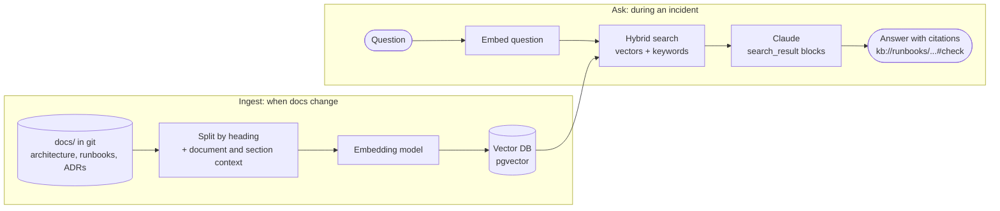
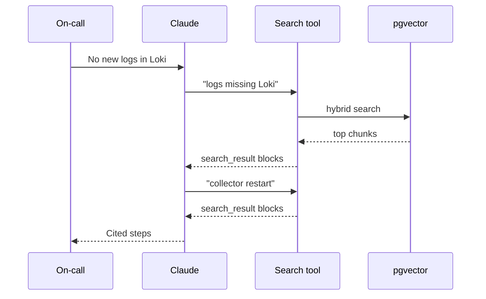
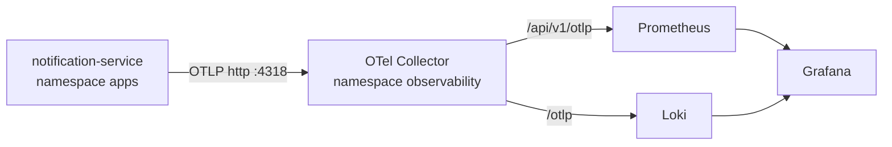

<Muted>
Written against pgvector 0.8.7 (`pgvector/pgvector:0.8.7-pg18`), sentence-transformers 6.3.0, the Anthropic Python SDK 2.8.0, and Anthropic's docs on Embeddings, Search results and Contextual Retrieval. The ingest, search and eval steps in Part 3 ran in this session, and their outputs are copied from that run.
</Muted>

<Note title="What was not run">
The last step, Claude answering with citations (`ask.py`, 3.6), was **not executed**. This session had no Anthropic API key, and the request stopped at `401 authentication_error`. The code follows Anthropic's Search results docs and the SDK's types, but the answer shown in 3.6 describes the documented response shape, not real output.
</Note>

<Part level={1} id="arch" title="Architecture examples" toc="Architecture">

<Block id="arch-goal" title="1.1 The goal and the pattern" toc="1.1 The goal">

You want an AI assistant that, when something breaks, finds the **right part of your own documentation**: the runbook for "logs stopped arriving", the decision record that says why stdout stays on, the architecture page with the service's dependencies. It should then answer from that context, and say where each claim came from.

That pattern is **retrieval-augmented generation (RAG)**. Anthropic's Contextual Retrieval post describes it in four steps:

1. Break the knowledge base into chunks, "usually no more than a few hundred tokens".
2. Use an embedding model to turn each chunk into a vector.
3. Store the vectors in a vector database.
4. At question time, find the most similar chunks and add them to the prompt.



</Block>

<Block id="arch-a" title="1.2 Architecture A · No vector database: put everything in the prompt" toc="1.2 A · Whole KB in prompt">

Anthropic's post starts here: "If your knowledge base is smaller than 200,000 tokens (about 500 pages of material), you can just include the entire knowledge base in the prompt that you give the model, with no need for RAG or similar methods." With prompt caching, that is cheaper than it sounds. The same post cites "reducing latency by > 2x and costs by up to 90%".

<Fit>
<Pros title="Fits when">
- One project, tens of documents: the lab's 5 documents are 533 words
- You want the simplest thing that works
- Every answer should see every document
</Pros>
<Cons title="Watch out for">
- Stops working once docs outgrow the context, or many projects share one assistant
- Every question pays for the whole corpus (cached reads are cheaper, not free)
- No ranking: nothing tells the model which section matters most
</Cons>
</Fit>

</Block>

<Block id="arch-b" title="1.3 Architecture B · RAG on Postgres + pgvector (this page's lab)" toc="1.3 B · pgvector RAG">

Chunks, their vectors and a full-text index live in one Postgres table. A single SQL query runs vector similarity and keyword search, and fuses the two rankings. The top chunks go to Claude as `search_result` blocks, so the answer cites `kb://runbooks/collector-down.md#check`.

<Fit>
<Pros title="Fits when">
- Docs grow past what fits in one prompt, or many teams share the store
- You already run Postgres: backups, access control and SQL filters (team, service, doc type) come for free
- You need exact identifiers to match, as well as meaning (hybrid search, 2.3)
</Pros>
<Cons title="Watch out for">
- Another pipeline to keep fresh (re-ingest on every docs change)
- Chunking and embedding choices decide quality. Measure them (3.5).
- pgvector's `vector` type indexes at most 2,000 dimensions (`halfvec` 4,000)
</Cons>
</Fit>

</Block>

<Block id="arch-c" title="1.4 Architecture C · Agentic retrieval: search as a tool" toc="1.4 C · Search as a tool">

Instead of your code retrieving once, you give Claude a `search_knowledge_base` tool and return `search_result` blocks as the tool result. Anthropic's docs call this "Method 1". Claude can then search several times, for example the symptom first, then the component it found. The same search function from B serves both.



<Fit>
<Pros title="Fits when">
- Questions need more than one lookup
- You'll later add other tools (logs, metrics, kubectl) to the same assistant
</Pros>
<Cons title="Watch out for">
- More model calls, more latency, more cost per question
- On `claude-opus-5-5`, forcing the tool with `tool_choice: {"type": "tool"}` returns a 400. Use `auto` and say in the prompt when to search. Anthropic's Search results example forces it, but on `claude-opus-5`.
</Cons>
</Fit>

</Block>

<Block id="arch-compare" title="1.5 Choosing between them">

| Concern | A · Whole KB in prompt | B · pgvector RAG | C · Search as a tool |
| --- | --- | --- | --- |
| Corpus size | Under ~200K tokens (Anthropic's guidance) | Any | Any |
| Moving parts | Prompt + cache | Postgres, embedding model, ingest job | B + a tool loop |
| Exact identifiers (`otel-agent-config`) | Model reads everything | Full-text side of hybrid search | Same as B |
| Citations | Yes, as documents | Yes, `search_result` blocks | Yes, `search_result` in tool results |
| Calls per question | 1 | 1 search + 1 model | Several |
| Start with | **Your first version**, while docs are small | When A gets expensive or too big | When questions need follow-up lookups |

<Muted>
Dedicated vector databases (Qdrant, Weaviate, Milvus and others) and managed options fit Architecture B the same way: the store changes, the pattern doesn't. I didn't test them here. pgvector was chosen because it's one container and plain SQL.
</Muted>

</Block>

</Part>

<Part level={2} id="theory" title="Theory">

<Block id="th-embeddings" title="2.1 Embeddings and similarity" toc="2.1 Embeddings">

An **embedding** turns text into a vector of numbers so that texts with similar meaning end up close together. Anthropic's Embeddings page: "Text embeddings are numerical representations of text that let you measure semantic similarity." Search then becomes "find the stored vectors nearest to the question's vector". The lab uses cosine distance, pgvector's `<=>` operator.

**Anthropic doesn't make an embedding model.** Its docs: "Anthropic does not offer its own embedding model. One embeddings provider with a wide variety of models and capabilities is Voyage AI by MongoDB." The page also says to "assess a variety of embeddings vendors". Options from that page:

| Model | Where it runs | Dimensions | Notes |
| --- | --- | --- | --- |
| `voyage-4` | Voyage API (`VOYAGE_API_KEY`) | 1024 default; 256, 512, 2048 | "Balances quality and efficiency" |
| `voyage-4-large` / `voyage-4-lite` | Voyage API | same | best quality / lowest latency and cost |
| `voyage-4-nano` | Your machine (open weights, Apache 2.0, ~693 MB) | 2048 default; 256, 512, 1024 | Same embedding space as `voyage-4`, so you can switch later without re-indexing (its model card) |
| `voyage-multimodal-3.5` | Voyage API | 1024 default | Text, images and video in one space, for diagrams as images |

The lab uses **`sentence-transformers/multi-qa-MiniLM-L6-cos-v1`** (384 dimensions, 88 MB, "designed for semantic search"). It's the model in pgvector's own hybrid-search example, and it runs on CPU with no API key. Set `KB_EMBEDDER=voyage` to use `voyage-4` instead (3.2).

<Note title="Why not voyage-4-nano in the lab">
Its model card loads it with `trust_remote_code=True`, which executes Python code from the model's repository. The sandbox this page was written in blocked that, so the lab didn't run it. If you use it, pin the repository revision (`revision=` in `SentenceTransformer`) and read that code first.
</Note>

**One rule matters more than which model you pick:** documents and questions must be embedded by the *same* model at the same dimension. Changing models means re-embedding everything. The lab's `DIM` setting and the `vector(…)` column size must agree.

</Block>

<Block id="th-chunking" title="2.2 Chunking, and why chunks need context" toc="2.2 Chunking with context">

Long documents are split, because a whole runbook is one blurry vector, and because only the relevant part should reach the model. But a chunk on its own can lose its meaning. Anthropic's example: "The company's revenue grew by 3% over the previous quarter." Which company? Which quarter? A runbook section titled "Fix" has the same problem.

- **The lab's approach (cheap, deterministic):** split Markdown at `## ` headings, never inside a code fence, and put `Document: <title>` and `Section: <heading>` in front of each chunk before embedding and indexing. So "Fix" becomes "Runbook: OTel Collector down… · Fix".
- **Contextual Retrieval (Anthropic's approach):** ask Claude to write "a short succinct context to situate this chunk within the overall document", and put that in front instead. In Anthropic's tests:
  - it cut the top-20 retrieval failure rate by **35%** (5.7% → 3.7%) for embeddings;
  - by **49%** (→ 2.9%) combined with contextual BM25;
  - by **67%** (→ 1.9%) with reranking added.

  Prompt caching keeps the cost down, because every chunk of a document reuses the same cached document.
- **Diagrams:** keep them as text where you can. A Mermaid block is embedded and cited like any other text, as in the lab's `architecture.md`. For images, use a multimodal embedding model, or store a text description next to the image. Anthropic's `search_result` blocks carry text only.

</Block>

<Block id="th-hybrid" title="2.3 Hybrid search: meaning plus exact words" toc="2.3 Hybrid search">

Anthropic's post: embedding models "can miss crucial exact matches", for example an error code like "TS-999". BM25 and other keyword methods catch those. pgvector's README recommends "Postgres full-text search for hybrid search", combined with **Reciprocal Rank Fusion (RRF)**. RRF sums `1 / (k + rank)` from each list (`k = 60` in pgvector's example), so a chunk ranked well by both methods wins.

The lab measured this on 8 incident-style questions (3.5):

| Search | hit@1 | hit@3 |
| --- | --- | --- |
| Hybrid (vector + full-text, RRF) | **8/8** | 8/8 |
| Vector only | 7/8 | 8/8 |

The one difference was the query **`otel-agent-config`**, the name of a ConfigMap. Vectors ranked `architecture.md` first. Full-text matched the exact name in the cardinality runbook and moved it to the top. Natural-language questions such as "prometheus memory keeps growing" got no full-text match, because `websearch_to_tsquery` requires every word, so the vector side carried them. Use both.

<Muted>
Postgres's `ts_rank_cd` is not BM25, but it plays the same keyword role in this lab. A reranker (Voyage's `rerank-3`, or a cross-encoder as in pgvector's other example) is the next step, after you've measured.
</Muted>

</Block>

<Block id="th-citations" title="2.4 Grounded answers: search_result blocks and citations" toc="2.4 Citations">

Anthropic's **Search results** feature exists for RAG. You pass each retrieved chunk as a content block:

```json
{
  "type": "search_result",
  "source": "kb://runbooks/collector-down.md#check",
  "title": "Runbook: OTel Collector down, logs and metrics stop arriving · Check",
  "content": [{ "type": "text", "text": "1. kubectl -n observability get pods ..." }],
  "citations": { "enabled": true }
}
```

- **`source` can be any stable string.** The docs: "a URL, or an internal identifier such as `kb://article-1234`". The lab uses `kb://<file>#<section>`, so a citation points at the exact runbook section.
- **Citations are off by default.** "Every example on this page sets `"enabled": true` explicitly", and all search results in a request must use the same setting.
- **What comes back:** text blocks whose `citations` hold `search_result_location` entries with `source`, `title`, `cited_text` and `search_result_index`. `cited_text` is "not counted toward output tokens". Claude cites whole text blocks, so split long content into several blocks for finer citations.
- **Two ways to send them:** directly in the user message ("Method 2", used in 3.6), or as a tool result ("Method 1", Architecture C). Search results hold **text only**.

</Block>

<Block id="th-ops" title="2.5 Keeping it useful: freshness, trust and measurement" toc="2.5 Freshness, trust, evals">

<Grid>
<InfoCard title="Docs live in git, the vector DB is a cache">
Write runbooks and ADRs as Markdown next to the code. The database can always be rebuilt from them. The lab's ingest re-embeds only files whose sha256 changed, and deletes chunks of removed files. Run it in CI on every merge to `main`.
</InfoCard>
<InfoCard title="Stale runbooks give confident wrong answers">
The model will follow an outdated runbook faithfully. Give each document an owner and a review date, and store them as columns so you can filter or warn on old content.
</InfoCard>
<InfoCard title="Retrieved text is data, not instructions">
Anything in the knowledge base reaches the model. Keep write access to `docs/` reviewed like code. The system prompt tells Claude to answer *from* the results and to say when they don't contain the answer.
</InfoCard>
<InfoCard title="Access control">
If teams have docs others mustn't see, filter by a `team` or `visibility` column in the SQL before results reach the model. pgvector filters work with HNSW, but its README notes that filtering is applied after the index scan, so see "iterative index scans" for selective filters.
</InfoCard>
<InfoCard title="Measure retrieval">
Keep a list of real questions and the document that should answer each (`eval.py`). Re-run it when you change chunking, the embedding model or the search SQL. If retrieval is wrong, no prompt fixes the answer.
</InfoCard>
<InfoCard title="Embedding model changes are migrations">
Vectors from different models (or dimensions) can't be compared. Re-embed everything in a new column or table, run the eval, then switch.
</InfoCard>
</Grid>

</Block>

<Block id="th-proscons" title="2.6 Problems solved, pros and cons" toc="2.6 Pros and cons">

**Problems this solves:** knowledge stuck in people's heads during incidents, assistants that guess instead of reading your runbooks, answers nobody can verify, and context limits once documentation grows.

<Fit>
<Pros>
- Answers grounded in your own docs, with a citation to the exact section
- Finds the right runbook from a symptom, even with different wording
- Hybrid search also finds exact names (ConfigMaps, error codes, env vars)
- Postgres + pgvector: one familiar database, SQL filters, standard backups
</Pros>
<Cons>
- Only as good as the docs: stale runbooks mean confident wrong answers
- Another pipeline (ingest) and another dependency (embedding model) to run
- Small knowledge bases don't need it yet (Architecture A)
- Images need extra work (multimodal embeddings or text descriptions)
</Cons>
</Fit>

</Block>

</Part>

<Part level={3} id="impl" title="Implementation">

<Muted>
Needs Docker and Python 3.10+ on Ubuntu. Everything except `ask.py` runs offline after the first model download, with no API key. Put the files in a folder `project-kb/`.
</Muted>

<Block id="im-files" title="3.1 Files and sample knowledge base" toc="3.1 Files">

```text
project-kb/
├── docker-compose.yml
├── requirements.txt
├── kb_common.py      # settings, embeddings, chunking
├── ingest.py         # docs/ -> pgvector (incremental)
├── search.py         # hybrid search
├── ask.py            # Claude answer with citations
├── eval.py           # retrieval check
└── docs/
    ├── architecture.md
    ├── adr/0001-keep-stdout-logging.md
    └── runbooks/{collector-down,high-cardinality,pod-not-starting}.md
```

The sample docs are written for your notification-service, using what topics 05 and 06 established. Replace them with your own.

````markdown title="project-kb/docs/architecture.md"
# notification-service architecture

notification-service is a Spring Boot 4.1 app on Java 25. `POST /notifications` adds 1 to an in-memory counter and logs "Notification sent". The count resets when the pod restarts.

## Runtime on KinD

The app runs in namespace `apps` on the KinD cluster `otel-lab`. The OpenTelemetry Java agent is attached with `JAVA_TOOL_OPTIONS=-javaagent:/otel/opentelemetry-javaagent.jar`.



## Telemetry paths

Metrics and logs both leave the app over OTLP to `otel-collector-opentelemetry-collector.observability.svc.cluster.local:4318`. The collector forwards metrics to Prometheus and logs to Loki. Logs are also written to stdout, so `kubectl -n apps logs deploy/notification-service` works when the collector is down.

## Owners and dashboards

Team: platform. Dashboards: Grafana Explore, datasources Prometheus and Loki. The key metric is `notifications_sent_total` with `job="shop/notification-service"`.
````

```markdown title="project-kb/docs/runbooks/collector-down.md"
# Runbook: OTel Collector down, logs and metrics stop arriving

## Symptoms

New "Notification sent" lines stop appearing in Loki, and `notifications_sent_total` stops increasing in Prometheus, while the app still answers `POST /notifications` with HTTP 200. The app does not print an export warning right away.

## Check

1. `kubectl -n observability get pods -l app.kubernetes.io/name=opentelemetry-collector` shows whether the collector pod is running.
2. `kubectl -n observability logs deploy/otel-collector-opentelemetry-collector` shows export errors and the backend that failed.
3. `kubectl -n apps logs deploy/notification-service` still has the stdout copy of every log line written while OTLP export was failing.

## Fix

Restart the collector with `kubectl -n observability rollout restart deploy/otel-collector-opentelemetry-collector`. Events from the outage are not replayed into Loki; read them from `kubectl logs` instead. Do not turn off stdout logging: it is the only copy during a collector outage.

## Escalation

If the collector restarts more than 3 times in 10 minutes, page the platform team.
```

```markdown title="project-kb/docs/runbooks/high-cardinality.md"
# Runbook: Prometheus series count too high for notification-service

## Symptoms

Prometheus memory grows, or `count({job="shop/notification-service"})` is far above the usual 75 to 180 series.

## Check

Run `topk(10, count by (__name__) ({job="shop/notification-service"}))`. The usual top metric is `http_server_request_duration_seconds_bucket`, with 15 buckets per route. Health checks on `/actuator/health` add a route of their own.

## Fix

No code change is needed. Turn off unused Micrometer families with the ConfigMap `notification-service-metrics` (for example `MANAGEMENT_METRICS_ENABLE_TOMCAT=false`), reduce buckets and attributes with views in the agent config `otel-agent-config`, and drop `/actuator` data points with the collector's `filter/cardinality` processor. In views, use `attribute_keys.included`, never `excluded`: an exclude-list added labels such as `user_agent_original`.
```

```markdown title="project-kb/docs/runbooks/pod-not-starting.md"
# Runbook: notification-service pod does not start on KinD

## Symptoms

`kubectl -n apps get pods` shows `ErrImageNeverPull` for notification-service.

## Cause

The Deployment uses `imagePullPolicy: Never`, so the image must be loaded into the KinD node. After a rebuild the node still has the old image or none.

## Fix

Run `kind load docker-image notification-service:1.0.0-otel --name otel-lab`, then `kubectl -n apps rollout restart deploy/notification-service`.
```

```markdown title="project-kb/docs/adr/0001-keep-stdout-logging.md"
# ADR 0001: keep stdout logging next to OTLP logs

## Decision

notification-service sends logs over OTLP to the collector and also keeps writing them to stdout. Stdout may be reduced with `LOGGING_THRESHOLD_CONSOLE=WARN`, but not turned off.

## Reason

In a test with the collector stopped, notifications 3 and 4 left no log line anywhere when stdout was reduced to WARN. OTLP export depends on the collector, Loki and the network; stdout does not.
```

<Muted>
`collector-down.md` above already includes the `## Escalation` section, which the lab adds in 3.4 to show an incremental re-ingest. Start without it to reproduce that step.
</Muted>

</Block>

<Block id="im-setup" title="3.2 Database, Python environment and code" toc="3.2 Setup and code">

```yaml title="project-kb/docker-compose.yml"
services:
  db:
    image: pgvector/pgvector:0.8.7-pg18
    environment:
      POSTGRES_USER: kb
      POSTGRES_PASSWORD: kb          # lab only
      POSTGRES_DB: kb
    ports: ["5432:5432"]
    volumes: ["kb-data:/var/lib/postgresql"]
volumes:
  kb-data:
```

```text title="project-kb/requirements.txt"
sentence-transformers==6.3.0
# voyageai          # only for KB_EMBEDDER=voyage
psycopg[binary]==3.3.8
pgvector==0.5.1
anthropic==2.8.0
```

```bash
cd project-kb
docker compose up -d
python3 -m venv .venv && . .venv/bin/activate
pip install torch --index-url https://download.pytorch.org/whl/cpu   # CPU-only PyTorch, smaller download
pip install -r requirements.txt
```

```python title="project-kb/kb_common.py"
"""Shared settings: database connection, embedding model, chunking."""
import hashlib
import os
import re
from pathlib import Path

import psycopg
from pgvector.psycopg import register_vector

DSN = os.environ.get("KB_DSN", "postgresql://kb:kb@localhost:5432/kb")
DOCS = Path(os.environ.get("KB_DOCS", "docs"))
# Embedding backend: "local" (default) runs a small open model on your CPU;
# "voyage" calls Voyage AI's API (needs VOYAGE_API_KEY and `pip install voyageai`).
EMBEDDER = os.environ.get("KB_EMBEDDER", "local")
LOCAL_MODEL = "sentence-transformers/multi-qa-MiniLM-L6-cos-v1"
LOCAL_REVISION = "b207367332321f8e44f96e224ef15bc607f4dbf0"
DIM = 384 if EMBEDDER == "local" else 1024  # voyage-4 returns 1024 dimensions by default

_model = None


def _local():
    global _model
    if _model is None:
        from sentence_transformers import SentenceTransformer

        _model = SentenceTransformer(LOCAL_MODEL, revision=LOCAL_REVISION)
    return _model


def embed_documents(texts):
    if EMBEDDER == "voyage":
        import voyageai

        return voyageai.Client().embed(texts, model="voyage-4", input_type="document").embeddings
    return _local().encode(texts, normalize_embeddings=True)


def embed_query(text):
    if EMBEDDER == "voyage":
        import voyageai

        return voyageai.Client().embed([text], model="voyage-4", input_type="query").embeddings[0]
    return _local().encode(text, normalize_embeddings=True)


def connect():
    conn = psycopg.connect(DSN, autocommit=True)
    conn.execute("CREATE EXTENSION IF NOT EXISTS vector")
    register_vector(conn)
    return conn


def chunks(path: Path):
    """Split a Markdown file at '## ' headings (outside code fences).

    Each chunk keeps the document title and section name as context, because a
    section such as "## Fix" means nothing on its own."""
    title, section, buf, out, fence = path.stem, "Overview", [], [], False
    for line in path.read_text().splitlines():
        if line.startswith("```"):
            fence = not fence
        if not fence and line.startswith("# "):
            title = line[2:].strip()
            continue
        if not fence and line.startswith("## "):
            if "".join(buf).strip():
                out.append((section, "\n".join(buf).strip()))
            section, buf = line[3:].strip(), []
            continue
        buf.append(line)
    if "".join(buf).strip():
        out.append((section, "\n".join(buf).strip()))
    rel = path.relative_to(DOCS).as_posix()
    for section, text in out:
        slug = re.sub(r"[^a-z0-9]+", "-", section.lower()).strip("-")
        yield {
            "source": f"kb://{rel}#{slug}",
            "file": rel,
            "title": f"{title} · {section}",
            "content": text,
            "contextual": f"Document: {title}\nSection: {section}\n\n{text}",
        }


def file_hash(path: Path) -> str:
    return hashlib.sha256(path.read_bytes()).hexdigest()
```

```python title="project-kb/ingest.py"
"""Load docs/ into pgvector. Re-run after editing docs: unchanged files are skipped."""
from kb_common import DIM, DOCS, chunks, connect, embed_documents, file_hash

SCHEMA = f"""
CREATE TABLE IF NOT EXISTS chunks (
  id         bigserial PRIMARY KEY,
  file       text NOT NULL,
  file_hash  text NOT NULL,
  source     text NOT NULL UNIQUE,
  title      text NOT NULL,
  content    text NOT NULL,
  contextual text NOT NULL,
  embedding  vector({DIM}) NOT NULL,
  tsv        tsvector GENERATED ALWAYS AS (to_tsvector('english', contextual)) STORED
);
CREATE INDEX IF NOT EXISTS chunks_embedding ON chunks USING hnsw (embedding vector_cosine_ops);
CREATE INDEX IF NOT EXISTS chunks_tsv ON chunks USING gin (tsv);
"""


def main():
    conn = connect()
    conn.execute(SCHEMA)
    seen = set()
    for path in sorted(DOCS.rglob("*.md")):
        rel, digest = path.relative_to(DOCS).as_posix(), file_hash(path)
        seen.add(rel)
        if conn.execute("SELECT 1 FROM chunks WHERE file = %s AND file_hash = %s LIMIT 1", (rel, digest)).fetchone():
            print(f"unchanged  {rel}")
            continue
        parts = list(chunks(path))
        vectors = embed_documents([p["contextual"] for p in parts])
        with conn.transaction():
            conn.execute("DELETE FROM chunks WHERE file = %s", (rel,))
            for p, v in zip(parts, vectors):
                conn.execute(
                    "INSERT INTO chunks (file, file_hash, source, title, content, contextual, embedding) "
                    "VALUES (%s, %s, %s, %s, %s, %s, %s)",
                    (rel, digest, p["source"], p["title"], p["content"], p["contextual"], v),
                )
        print(f"indexed    {rel}: {len(parts)} chunks")
    for (rel,) in conn.execute("SELECT DISTINCT file FROM chunks").fetchall():
        if rel not in seen:
            conn.execute("DELETE FROM chunks WHERE file = %s", (rel,))
            print(f"removed    {rel}")
    total = conn.execute("SELECT count(*) FROM chunks").fetchone()[0]
    print(f"total chunks: {total}")


if __name__ == "__main__":
    main()
```

```python title="project-kb/search.py"
"""Hybrid search: vector similarity + full-text, combined with Reciprocal Rank Fusion."""
import sys

from kb_common import connect, embed_query

SQL = """
WITH semantic AS (
  SELECT id, RANK() OVER (ORDER BY embedding <=> %(emb)s) AS rank
  FROM chunks ORDER BY embedding <=> %(emb)s LIMIT 20
),
keyword AS (
  SELECT id, RANK() OVER (ORDER BY ts_rank_cd(tsv, q) DESC) AS rank
  FROM chunks, websearch_to_tsquery('english', %(q)s) q
  WHERE tsv @@ q ORDER BY ts_rank_cd(tsv, q) DESC LIMIT 20
)
SELECT c.source, c.title, c.content,
       COALESCE(1.0 / (%(k)s + s.rank), 0) + COALESCE(1.0 / (%(k)s + kw.rank), 0) AS score,
       s.rank AS semantic_rank, kw.rank AS keyword_rank
FROM semantic s
FULL OUTER JOIN keyword kw ON s.id = kw.id
JOIN chunks c ON c.id = COALESCE(s.id, kw.id)
ORDER BY score DESC
LIMIT %(limit)s
"""


def search(query: str, limit: int = 4, k: int = 60):
    conn = connect()
    emb = embed_query(query)
    rows = conn.execute(SQL, {"emb": emb, "q": query, "k": k, "limit": limit}).fetchall()
    return [
        {"source": r[0], "title": r[1], "content": r[2], "score": float(r[3]), "semantic_rank": r[4], "keyword_rank": r[5]}
        for r in rows
    ]


if __name__ == "__main__":
    for hit in search(" ".join(sys.argv[1:])):
        print(f"{hit['score']:.4f}  sem={hit['semantic_rank']}  kw={hit['keyword_rank']}  {hit['source']}")
```

<Muted>
The SQL is pgvector's Reciprocal Rank Fusion example (`pgvector-python/examples/hybrid_search/rrf.py`), with two changes: it uses a stored `tsvector` column with a GIN index instead of computing `to_tsvector` per row, and `websearch_to_tsquery` instead of `plainto_tsquery`, so users can type `"exact phrase"` or `-exclude`.
</Muted>

</Block>

<Block id="im-ingest" title="3.3 Ingest the docs" toc="3.3 Ingest">

```bash
python ingest.py
```

```text output
indexed    adr/0001-keep-stdout-logging.md: 2 chunks
indexed    architecture.md: 4 chunks
indexed    runbooks/collector-down.md: 3 chunks
indexed    runbooks/high-cardinality.md: 3 chunks
indexed    runbooks/pod-not-starting.md: 3 chunks
total chunks: 15
```

The first run downloads the embedding model (88 MB) into the Hugging Face cache. Each `## ` section became one chunk, with the document title and section name in front of it.

</Block>

<Block id="im-search" title="3.4 Search like an on-call engineer" toc="3.4 Search">

```bash
python search.py "logs stopped showing up in Loki but the app still returns 200"
python search.py "otel-agent-config"
```

```text output
0.0164  sem=1  kw=None  kb://runbooks/collector-down.md#check
0.0161  sem=2  kw=None  kb://runbooks/collector-down.md#symptoms
0.0159  sem=3  kw=None  kb://runbooks/collector-down.md#fix
0.0156  sem=4  kw=None  kb://architecture.md#telemetry-paths

0.0325  sem=2  kw=1  kb://runbooks/high-cardinality.md#fix
0.0164  sem=1  kw=None  kb://architecture.md#runtime-on-kind
0.0159  sem=3  kw=None  kb://runbooks/collector-down.md#symptoms
```

- **The first query shares no exact words with the runbook's heading.** Vector search found all three sections of `collector-down.md`, and the full-text side found nothing (`kw=None`).
- **The second query is an exact name.** Vectors alone ranked `architecture.md` first (`sem=1`). The full-text match (`kw=1`) moved the cardinality runbook's Fix section to the top.

**Edit a doc and re-ingest.** Only the changed file is re-embedded:

```bash
printf '
## Escalation

If the collector restarts more than 3 times in 10 minutes, page the platform team.
' >> docs/runbooks/collector-down.md
python ingest.py
```

```text output
unchanged  adr/0001-keep-stdout-logging.md
unchanged  architecture.md
indexed    runbooks/collector-down.md: 4 chunks
unchanged  runbooks/high-cardinality.md
unchanged  runbooks/pod-not-starting.md
total chunks: 16
```

</Block>

<Block id="im-eval" title="3.5 Measure retrieval" toc="3.5 Retrieval eval">

```python title="project-kb/eval.py"
"""Retrieval check: does the right document come back for known questions?"""
from kb_common import connect, embed_query
from search import search

CASES = [
    ("logs stopped showing up in Loki but the app still returns 200", "runbooks/collector-down.md"),
    ("ErrImageNeverPull", "runbooks/pod-not-starting.md"),
    ("prometheus memory keeps growing", "runbooks/high-cardinality.md"),
    ("can we switch off console output to save money", "adr/0001-keep-stdout-logging.md"),
    ("otel-agent-config", "runbooks/high-cardinality.md"),
    ("who owns the service and which dashboard do I open", "architecture.md"),
    ("pod keeps restarting after I rebuilt the image", "runbooks/pod-not-starting.md"),
    ("the collector keeps crashing, who do I call", "runbooks/collector-down.md"),
]


def vector_only(query, limit=4):
    rows = connect().execute(
        "SELECT source FROM chunks ORDER BY embedding <=> %s LIMIT %s", (embed_query(query), limit)
    ).fetchall()
    return [r[0] for r in rows]


def file_of(source):
    return source.removeprefix("kb://").split("#")[0]


for name, fn in [("hybrid", lambda q: [h["source"] for h in search(q)]), ("vector-only", vector_only)]:
    top1 = top3 = 0
    for question, expected in CASES:
        files = [file_of(s) for s in fn(question)]
        top1 += files[0] == expected
        top3 += expected in files[:3]
        if files[0] != expected:
            print(f"  {name}: {question!r} -> {files[0]} (expected {expected})")
    print(f"{name:12} hit@1 {top1}/{len(CASES)}  hit@3 {top3}/{len(CASES)}")
```

```bash
python eval.py
```

```text output
hybrid       hit@1 8/8  hit@3 8/8
  vector-only: 'otel-agent-config' -> architecture.md (expected runbooks/high-cardinality.md)
vector-only  hit@1 7/8  hit@3 8/8
```

Grow `CASES` from real incidents: every time someone asks something the assistant got wrong, add the question and the document that should have answered it.

</Block>

<Block id="im-ask" title="3.6 Ask Claude, with citations (not run here)" toc="3.6 Ask Claude">

```python title="project-kb/ask.py"
"""Ask Claude a question, grounded in the knowledge base, with citations."""
import sys

import anthropic
from anthropic.types import SearchResultBlockParam, TextBlockParam

from search import search

SYSTEM = (
    "You help on-call engineers for notification-service. Answer from the provided "
    "search results. If they don't contain the answer, say so instead of guessing."
)


def ask(question: str):
    hits = search(question)
    results = [
        SearchResultBlockParam(
            type="search_result",
            source=h["source"],
            title=h["title"],
            content=[TextBlockParam(type="text", text=h["content"])],
            citations={"enabled": True},
        )
        for h in hits
    ]
    client = anthropic.Anthropic()  # reads ANTHROPIC_API_KEY (or an `ant auth login` profile)
    response = client.beta.messages.create(
        model="claude-opus-5-5",
        max_tokens=16000,
        output_config={"effort": "medium"},
        betas=["server-side-fallback-2026-07-01"],
        fallbacks="default",  # if Claude Opus 5.5 declines, the API retries on a fallback model
        system=SYSTEM,
        messages=[{"role": "user", "content": [*results, TextBlockParam(type="text", text=question)]}],
    )
    if response.stop_reason == "refusal":
        print("Claude declined:", response.stop_details)
        return
    for block in response.content:
        if block.type == "text":
            print(block.text, end="")
            for c in block.citations or []:
                if c.type == "search_result_location":
                    print(f" [{c.source}]", end="")
    print()


if __name__ == "__main__":
    ask(" ".join(sys.argv[1:]))
```

```bash
export ANTHROPIC_API_KEY=...        # or `ant auth login`
python ask.py "logs stopped showing up in Loki, what do I check?"
```

The code follows Anthropic's docs and the defaults of the `claude-api` skill:

- **`claude-opus-5-5`**, with effort set explicitly to `medium` (its default).
- **Server-side `fallbacks="default"`** with the `server-side-fallback-2026-07-01` beta. If the model declines for safety reasons, the API re-runs the request on a fallback model within the same call. Remove both lines if you don't want that.
- **A refusal check:** `stop_reason == "refusal"` is handled before reading the answer.

Per the Search results docs, the answer comes back as text blocks, and the cited ones carry `search_result_location` citations naming the `source`. The script prints them inline, for example `… [kb://runbooks/collector-down.md#check]`.

<Note title="Unsure">
In this session the request only reached `401 authentication_error` (no key), so I haven't verified two things: that the beta endpoint accepts the non-beta `SearchResultBlockParam` type together with `fallbacks="default"`, and the exact wording of the answer. If the call fails with `fallbacks`, drop the `betas` and `fallbacks` lines and use `client.messages.create`, which is the documented Search results example.
</Note>

</Block>

<Block id="im-next" title="3.7 Next steps" toc="3.7 Next steps">

1. **Use your real docs.** Point `KB_DOCS` at the repository folder holding your runbooks, and run `ingest.py` in CI on merge.
2. **Make it a tool** (Architecture C). Wrap `search()` as a `search_knowledge_base` tool that returns `search_result` blocks, or expose it to Claude Code as an MCP server. Then Claude can search during an incident alongside other tools.
3. **Try Contextual Retrieval.** Generate the context with Claude, using Anthropic's prompt, instead of the title and heading, then compare with `eval.py`.
4. **Switch embedding models deliberately.** Re-embed into a new column, run the eval, then switch.

</Block>

<Block id="im-cleanup" title="3.8 Clean up" toc="3.8 Clean up">

```bash
docker compose down -v      # removes the database and its volume
deactivate && rm -rf .venv
```

The embedding model stays in `~/.cache/huggingface` until you delete it.

</Block>

<Block id="refs" title="References">

- [Anthropic · Embeddings (Voyage AI models)](https://platform.claude.com/docs/en/build-with-claude/embeddings)
- [Anthropic · Search results (citations for RAG)](https://platform.claude.com/docs/en/build-with-claude/search-results) and [Citations](https://platform.claude.com/docs/en/build-with-claude/citations)
- [Anthropic · Introducing Contextual Retrieval](https://www.anthropic.com/news/contextual-retrieval)
- [pgvector v0.8.7 README (HNSW, limits, filtering, hybrid search)](https://github.com/pgvector/pgvector/blob/v0.8.7/README.md) and [pgvector-python RRF example](https://github.com/pgvector/pgvector-python/blob/master/examples/hybrid_search/rrf.py)
- [PostgreSQL · Full text search](https://www.postgresql.org/docs/current/textsearch-intro.html)
- [sentence-transformers/multi-qa-MiniLM-L6-cos-v1](https://huggingface.co/sentence-transformers/multi-qa-MiniLM-L6-cos-v1) and [voyageai/voyage-4-nano](https://huggingface.co/voyageai/voyage-4-nano)

</Block>

</Part>
