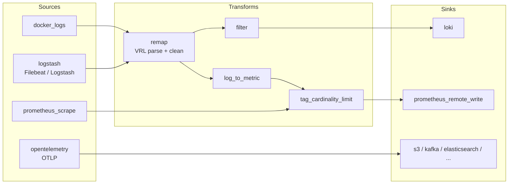
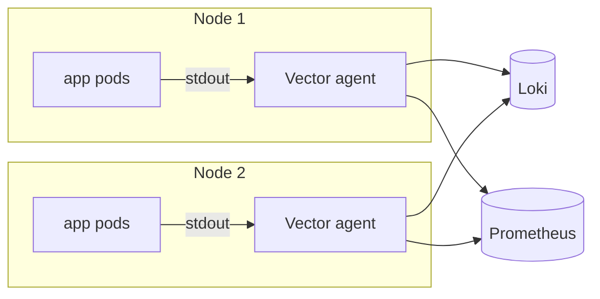
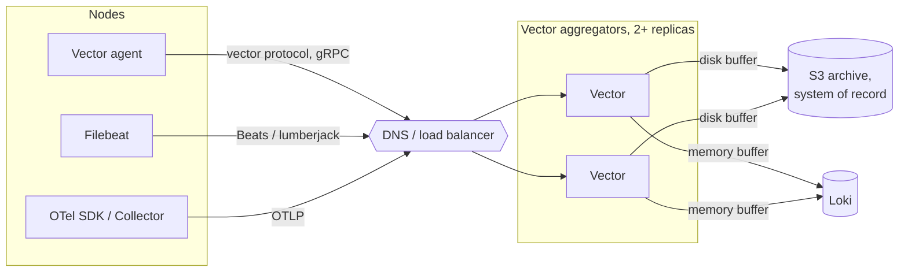
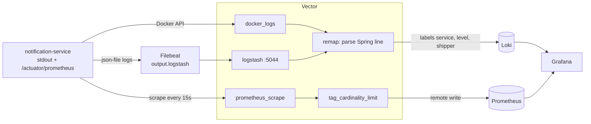

<Muted>
Written against Vector v0.61.0 (`timberio/vector:0.61.0-debian`), with docs read from the `v0.61.0` tag of [vectordotdev/vector](https://github.com/vectordotdev/vector/tree/v0.61.0). Other images: Loki 3.7.9, Prometheus v3.15.1, Grafana 13.3.0, Filebeat 9.5.6, the same backend versions as [topic 05](/topics/05-otel-java-kind). Every command in Part 3 ran in this session, and the outputs are copied from that run.
</Muted>

<Note title="Vector here is not a vector database">
"Vector" here is the observability tool from [vector.dev](https://vector.dev). It has nothing to do with the embeddings and vector databases in [topic 07](/topics/07-vector-db-project-knowledge).
</Note>

<Part level={1} id="arch" title="Architecture examples" toc="Architecture">

<Block id="arch-scenario" title="1.1 What Vector does, in one picture" toc="1.1 The idea">

Vector's README describes it as "a high-performance, end-to-end (agent & aggregator) observability data pipeline". You **collect** data with *sources*, **transform** it with *transforms*, and **route** it to *sinks*. You describe the pipeline in one YAML (or TOML/JSON) file, and Vector runs it as a graph:



The architectures below differ in *where* Vector runs. Vector's docs name three deployment roles: **agent**, **sidecar** and **aggregator**. You combine them into topologies.

</Block>

<Block id="arch-a" title="1.2 Architecture A · Vector as the node agent" toc="1.2 A · Agent">

One Vector runs on each node: a DaemonSet on Kubernetes, or a service on a VM or laptop. It reads local data itself (container logs, files, journald, host metrics), processes it, and sends it straight to the backends.



<Fit>
<Pros title="Fits when">

- You have few nodes and one or two backends.
- You want to replace a plain "tail and forward" agent (Filebeat, Fluent Bit) with one binary that also parses.
- There is no extra tier to run.

</Pros>
<Cons title="Watch out for">

- Every node holds the full pipeline config, its CPU cost and its backend credentials.
- Buffers live on each node. If a node dies, so does whatever it buffered in memory.
- A config change means rolling out every agent.

</Cons>
</Fit>

</Block>

<Block id="arch-b" title="1.3 Architecture B · Thin agents, Vector aggregators" toc="1.3 B · Agent + aggregator">

Agents on the nodes only collect and forward. They can be Vector or anything else. A small pool of **Vector aggregators** inside the cluster or VPC does the parsing, filtering, cardinality control and routing. Each sink gets its own buffer.



Vector's "Architecting your deployment" guide recommends this layout and sets out three guidelines:

1. Use the best tool for the job.
2. Minimize agent responsibilities: "Agents should be simple data forwarders".
3. Deploy Vector close to your data, within your network boundaries.

It also warns: "Avoid deploying a single monolith aggregator since it introduces a single point of failure." Run several replicas that share one config instead.

<Fit>
<Pros title="Fits when">

- You run many nodes, several teams or several backends.
- You want one place to change parsing and routing rules.
- You need durable buffering in front of a backend that sometimes slows down. The guide's own example puts disk buffers in front of the system of record and memory buffers in front of the system of analysis.

</Pros>
<Cons title="Watch out for">

- You now run a tier of its own: sizing, load balancing and high availability.
- The aggregators sit on the critical path for all telemetry.
- Disk buffers need free-space monitoring (the docs flag this explicitly).

</Cons>
</Fit>

</Block>

<Block id="arch-c" title="1.4 Architecture C · Vector behind the agents you already run (this lab)" toc="1.4 C · Behind existing agents">

Keep the agents you have and put Vector between them and the backends. This is how Vector fixes the gap in [topic 05 §2.5](/topics/05-otel-java-kind#th-filebeat): Filebeat has no Loki output, but its `output.logstash` can point at Vector's `logstash` source, and Vector has a `loki` sink.



The lab runs both log paths side by side. Vector reads stdout itself, and Filebeat ships the same lines through Vector. A `shipper` label shows which path each line took.

<Fit>
<Pros title="Fits when">

- You are migrating: agents stay, and backends or formats change behind Vector.
- Vector's guide says to *integrate* agents that produce data Vector can't (its example is the Datadog Agent) and to *replace* plain forwarders (it lists Filebeat, Fluent Bit and Fluentd).

</Pros>
<Cons title="Watch out for">

- One more hop and one more component to operate.
- Ack semantics are only as strong as the weakest link. Vector's `logstash` source acknowledges once the event reaches the *next component*, not the sink (see [2.5](#th-acks)).

</Cons>
</Fit>

</Block>

<Block id="arch-compare" title="1.5 Choosing between them">

| | A · Agent | B · Agent + aggregator | C · Behind existing agents |
| --- | --- | --- | --- |
| Where the processing runs | Every node | Aggregator pool | Vector (agent or aggregator) |
| Components to run | Vector only | Agents + aggregator tier | Existing agents + Vector |
| Durable buffering | Per node, local disk | Central, per sink, on dedicated nodes | Wherever Vector runs |
| Config changes | Roll out every node | Change the aggregators | Change Vector, leave agents as they are |
| Best for | Small fleets, laptops, single backend | Many nodes, many backends, strict delivery | Migrations; agents you must keep |

A common path is C (put Vector in front of what exists), then B as the fleet grows. Each node's agent is either Vector or whatever agent you have to keep.

</Block>

</Part>

<Part level={2} id="theory" title="Theory">

<Block id="th-what" title="2.1 What Vector is, and who maintains it" toc="2.1 What it is">

- **Written in Rust.** The README lists reliability as its "primary design goal".
- **Open source** under the Mozilla Public License 2.0 (the `LICENSE` file in the repo).
- **Maintained by Datadog**: "Vector is maintained by Datadog's Community Open Source Engineering team" (README). It ships to Datadog, but also to Loki, Prometheus, Elasticsearch, Kafka, S3 and many other sinks.
- **One tool for logs and metrics.** The data model docs define two event types, `log` and `metric`. Metrics are marked beta in the README, and the `opentelemetry` source also emits trace events. A log event can hold any fields; there is no fixed schema.
- **Shared-nothing.** There is no leader node to coordinate. You scale by running more instances with the same config.

<Note title="Unsure: performance claims">
The README calls Vector "up to 10x faster than every alternative in the space". That comes from the vendor. I did not benchmark it, and I didn't find an independent, current comparison I could verify. Measure with your own data before you rely on it.
</Note>

</Block>

<Block id="th-model" title="2.2 Pipeline model: sources, transforms, sinks" toc="2.2 Pipeline model">

<Grid>
<InfoCard title="Source">

Where events come from:

- container logs: `docker_logs`, `kubernetes_logs`
- files: `file`
- receivers: `logstash` (Beats), `opentelemetry` (OTLP gRPC 4317 / HTTP 4318), `http_server`, `syslog`
- pull: `prometheus_scrape`, `kafka`
- itself: `internal_metrics`

</InfoCard>
<InfoCard title="Transform">

What changes events:

- `remap` runs VRL code.
- `filter` and `route` drop or split events.
- `log_to_metric`, `aggregate` and `reduce` reshape them.
- `tag_cardinality_limit` caps metric labels.
- `dedupe`, `sample` and `throttle` cut volume.

</InfoCard>
<InfoCard title="Sink">

Where events go: `loki`, `prometheus_remote_write`, `prometheus_exporter`, `elasticsearch`, `kafka`, `aws_s3`, `opentelemetry`, `datadog_*`, `console` and more. Each sink owns its **buffer**, batching and retries.

</InfoCard>
<InfoCard title="inputs: wires the graph">

Each transform and sink lists `inputs`, which are the IDs of upstream components. Fan-in and fan-out are both just lists. In the lab, `parse_spring` reads from two sources, and two filters read from `parse_spring`.

</InfoCard>
</Grid>

Tooling that ships in the same binary:

- `vector validate` checks the config, including compiling every VRL program.
- `vector test` runs unit tests written in YAML against single transforms.
- `vector top` shows live per-component throughput.
- `vector tap` prints the events flowing out of a component.
- `vector top` and `vector tap` need the `api` block enabled.

</Block>

<Block id="th-vrl" title="2.3 VRL: transforms that fail at compile time, not at 3 a.m." toc="2.3 VRL">

The `remap` transform runs **Vector Remap Language** (VRL), a small expression language built for event data. Its main feature: any function that can fail (parsing, type conversion) has to be handled **before Vector starts**. If you forget, `vector validate` refuses the config. Here is the real output for a two-line program that doesn't handle errors:

```text output
error[E103]: unhandled fallible assignment
  ┌─ :1:10
  │
1 │ parsed = parse_regex(.message, r'(?P<level>[A-Z]+)')
  │ -------- ^^^^^^^^^^^^^^^^^^^^^^^^^^^^^^^^^^^^^^^^^^^
  │ │        │
  │ │        this expression is fallible because at least one argument's type cannot be verified to be valid
  │ │        update the expression to be infallible by adding a `!`: `parse_regex!(.message, (?P<level>[A-Z]+))`
  │ │        `.message` argument type is `any` and this function expected a parameter `value` of type `string`
  │ or change this to an infallible assignment:
  │ parsed, err = parse_regex(.message, (?P<level>[A-Z]+))
```

You have three ways to fix it:

| Form | Meaning | Used in the lab for |
| --- | --- | --- |
| `x, err = f(...)` | Capture the error and branch on it | `parse_regex`: unparsed lines are kept as `level: unknown` |
| `f(...) ?? default` | Use a fallback value on error | `string(.message) ?? ""` |
| `f!(...)` | Raise a runtime error. The event then passes on *unchanged* (VRL applies changes only if the program completes), or is dropped or sent to `<id>.dropped` with `drop_on_error` / `reroute_dropped` | Not used: a failed parse would silently skip the remap |

The parsing logic lives in config, and `vector test` gives it real unit tests ([3.3](#im-test)).

</Block>

<Block id="th-buffers" title="2.4 Buffers and backpressure" toc="2.4 Buffers">

From Vector's "Buffering model" page:

- **Backpressure:** when a sink can't keep up, the signal "can travel all the way from a sink, up through any transforms, back to the source, and ultimately, even to clients such as applications sending logs over HTTP."
- **Between components:** each component has a small in-memory channel, "typically 100 events".
- **At sinks:** each sink has a configurable buffer:

| Setting | Options | Default |
| --- | --- | --- |
| `buffer.type` | `memory` (fast, lost on crash) · `disk` (write-ahead log on disk, synced every 500 ms) | `memory` |
| `buffer.max_events` | count, memory buffers only | `500` |
| `buffer.max_size` | bytes; disk buffers need at least 268435488 (~256 MiB) | none |
| `buffer.when_full` | `block` (push back upstream, no loss) · `drop_newest` (drop, keep latency) | `block` |

How to choose:

- **`block`** keeps every event, but it slows sources down. For a tailing source that means the agent falls behind. For an HTTP source it means callers get slow or failed responses.
- **`drop_newest`** protects the sender and loses data instead.
- **Disk buffers** survive a Vector restart and ride out a backend outage. [3.7](#im-outage) shows both. They cost disk I/O, and the docs say they need free-space monitoring.

The architecting guide says Vector's built-in buffers mean you don't need "complex external buffers like Kafka". That is the vendor's view. A Kafka tier still gives you replay and many consumers, which a sink buffer does not (see [topic 03](/topics/03-kafka-ha-durability)).

</Block>

<Block id="th-acks" title="2.5 End-to-end acknowledgements" toc="2.5 Acknowledgements">

Buffers protect events once Vector has them. **End-to-end acknowledgements** cover the step before that: a source tells its sender "got it" only after the sink has delivered.

How it works, per the docs:

- The source attaches a *batch notifier* to events.
- The sink reports the downstream response.
- The source then replies to its sender, for example with an HTTP 200 or 500, or by committing a Kafka offset or deleting an SQS message.
- Events dropped by a `filter` still settle their notifier.
- With fan-out, an event counts as delivered only when **every** sink succeeded. One failed sink makes it fail, so it can be sent again.

You turn it on per sink (`acknowledgements.enabled: true`) or globally. It only means something if the source supports it. In v0.61.0's component reference:

| Source | Supports acks? | Note |
| --- | --- | --- |
| `kafka`, `aws_sqs`, `http_server` | Yes | Commit, delete or reply after the sink delivers |
| `logstash` (Beats) | Partly | "Currently, this source will acknowledge events to the sender once the event has been sent to the next component in the topology." Not end to end yet. |
| `docker_logs` | No | Data at rest in Docker's log files; Vector tracks its position instead |

<Note title="Check before use">
The ack support of each source and sink changes between releases. Read the "Acknowledgement support" section on the component's page for your version before you count on it.
</Note>

</Block>

<Block id="th-otel" title="2.6 Vector or the OpenTelemetry Collector?" toc="2.6 Vector vs OTel Collector">

Both are vendor-neutral pipelines with receivers or sources, processors or transforms, and exporters or sinks. This is what I could check against each project's docs:

| | Vector 0.61 | OpenTelemetry Collector (topic 05) |
| --- | --- | --- |
| Language | Rust, one binary | Go; "core" and "contrib" distributions, or build your own |
| Signals | Logs, metrics (beta); traces through the `opentelemetry` source | Traces, metrics, logs (OTLP is the native format) |
| OTLP | `opentelemetry` source (gRPC 4317, HTTP 4318) and `opentelemetry` sink | Native |
| Transform language | VRL, compile-time checked, unit-testable with `vector test` | OTTL in the transform and filter processors |
| Beats/Logstash input | `logstash` source | No Beats receiver (topic 05 §2.5) |
| Disk buffering | Built into every sink | Exporter persistent queue (`sending_queue.storage`, usually the `file_storage` extension) |
| Governance | Datadog-maintained, MPL-2.0 | CNCF project, Apache-2.0 |

Rules of thumb:

- If your apps already use the **OTel SDK or Java agent**, and traces matter, keep the OTel Collector as the OTLP hub (topic 05).
- **Vector** suits you best in these cases:
  - you handle mostly logs, from many agents and formats;
  - you need heavy parsing that should be tested;
  - you want Beats or Logstash input;
  - you want per-sink disk buffers without extra parts.
- The two can be chained: OTLP into Vector's `opentelemetry` source, or Vector's `opentelemetry` sink into a collector.

<Note title="Unsure">
- Vector's own architecting guide (v0.61.0 tag) still says "Vector's built-in OTel support is forthcoming". The same release ships `opentelemetry` source and sink components, so that page looks out of date.
- I didn't test how complete trace handling is end to end, or OTLP metric fidelity through Vector.
- I didn't run a performance comparison between the two.
</Note>

</Block>

<Block id="th-proscons" title="2.7 Problems solved, pros and cons" toc="2.7 Pros and cons">

Problems it solves:

- **Agent sprawl.** One binary can replace separate log shippers and metric forwarders.
- **Vendor lock-in.** Change or add a backend by adding a sink. Apps and agents stay as they are.
- **Cost control at the edge.** Drop debug lines, sample, dedupe, and cap metric cardinality before the backend bills you.
- **Fragile parsing.** VRL parsing is checked at compile time and covered by unit tests.

<Fit>
<Pros>

- Fast, small footprint, no runtime dependencies.
- Many sources and sinks, including Beats in and Loki out.
- Per-sink buffers with an explicit choice between dropping and blocking.
- Built-in debugging (`top`, `tap`) and its own metrics (`internal_metrics`).

</Pros>
<Cons>

- Another language to learn (VRL).
- Traces and OTel support are less mature than the OTel Collector's.
- Single-vendor stewardship (Datadog) rather than a foundation.
- Ack semantics differ per source. You have to check each one.
- Disk buffers need disk-space monitoring.

</Cons>
</Fit>

</Block>

</Part>

<Part level={3} id="impl" title="Implementation">

<Block id="im-prereqs" title="3.1 Prerequisites" toc="3.1 Prerequisites">

- Docker Engine with the Compose plugin, on Ubuntu or any Linux PC. The `docker_logs` source and Filebeat read the Docker socket and `/var/lib/docker/containers`, so Docker Desktop on macOS or Windows may behave differently. That was not tested.
- About 2 GB of free RAM and 1 GB of free disk. The disk buffer reserves up to 256 MiB.
- The `notification-service:1.0.0` image from the Practical Book ([app README](/practical/apps/notification-service/README.md), [image README](/practical/README-Dockerbuild.md)). Build it from `wq_practical_book/`:

```bash
(cd apps/notification-service && ./mvnw clean package)
docker build -f docker/notification-service/Dockerfile -t notification-service:1.0.0 .
```

The app runs unchanged, with no OTel agent. It logs Spring Boot's default console format to stdout and exposes Micrometer metrics at `/actuator/prometheus`.

</Block>

<Block id="im-files" title="3.2 The files" toc="3.2 Files">

Create a folder `vector-lab/` with this layout:

```text
vector-lab/
├── docker-compose.yml
├── vector/
│   ├── vector.yaml
│   └── tests.yaml
├── filebeat/filebeat.yml
├── prometheus/prometheus.yml
└── grafana/datasources.yaml
```

```yaml title="docker-compose.yml"
services:
  notification-service:
    image: notification-service:1.0.0      # from the Practical Book, no OTel agent
    container_name: notification-service
    ports: ["8080:8080"]

  vector:
    image: timberio/vector:0.61.0-debian
    command: ["--config", "/etc/vector/vector.yaml"]
    volumes:
      - ./vector:/etc/vector:ro
      - vector-data:/var/lib/vector                     # disk buffer survives container restarts
      - /var/run/docker.sock:/var/run/docker.sock:ro   # docker_logs source reads container logs via the Docker API
    ports:
      - "8686:8686"     # Vector API (vector top / vector tap)
      - "9598:9598"     # Vector's own metrics
    depends_on: [loki, prometheus]

  filebeat:
    image: docker.elastic.co/beats/filebeat:9.5.6
    profiles: [filebeat]
    user: root
    command: ["-e", "--strict.perms=false"]
    volumes:
      - ./filebeat/filebeat.yml:/usr/share/filebeat/filebeat.yml:ro
      - /var/lib/docker/containers:/var/lib/docker/containers:ro
      - /var/run/docker.sock:/var/run/docker.sock:ro
    depends_on: [vector]

  loki:
    image: grafana/loki:3.7.9               # default config: single binary, filesystem storage
    ports: ["3100:3100"]

  prometheus:
    image: quay.io/prometheus/prometheus:v3.15.1
    command: ["--config.file=/etc/prometheus/prometheus.yml", "--web.enable-remote-write-receiver"]
    volumes: ["./prometheus/prometheus.yml:/etc/prometheus/prometheus.yml:ro"]
    ports: ["9090:9090"]

  grafana:
    image: grafana/grafana:13.3.0-distroless
    environment: { GF_SECURITY_ADMIN_USER: admin, GF_SECURITY_ADMIN_PASSWORD: admin }
    volumes: ["./grafana/datasources.yaml:/etc/grafana/provisioning/datasources/datasources.yaml:ro"]
    ports: ["3000:3000"]

volumes:
  vector-data:
```

The pipeline. Each component's comment says what it does:

```yaml title="vector/vector.yaml"
# Vector 0.61: one pipeline config = sources -> transforms -> sinks
data_dir: /var/lib/vector           # where disk buffers live (a volume in docker-compose.yml)
api:
  enabled: true
  address: 0.0.0.0:8686

sources:
  app_docker_logs:                 # 1. container stdout, read through the Docker API
    type: docker_logs
    include_containers: [notification-service]

  beats:                           # 2. Filebeat (output.logstash) -> Vector
    type: logstash
    address: 0.0.0.0:5044

  app_metrics:                     # 3. scrape Spring Boot's Micrometer endpoint
    type: prometheus_scrape
    endpoints: [http://notification-service:8080/actuator/prometheus]
    scrape_interval_secs: 15
    instance_tag: instance

  vector_metrics:                  # Vector's own health
    type: internal_metrics

transforms:
  beats_app_only:                  # Filebeat ships every container; keep the app's lines
    type: filter
    inputs: [beats]
    condition: '.container.name == "notification-service"'

  parse_spring:                    # Spring Boot's default console line -> structured fields
    type: remap
    inputs: [app_docker_logs, beats_app_only]   # same parsing, whichever shipper delivered the line
    source: |
      line = strip_whitespace(string(.message) ?? "")   # Filebeat keeps the trailing newline
      parsed, err = parse_regex(line, r'^(?P<ts>\S+)\s+(?P<level>[A-Z]+)\s+(?P<pid>\d+)\s+---\s+\[(?P<app>[^\]]*)\]\s+\[\s*(?P<thread>[^\]]*)\]\s+(?P<logger>\S+)\s+:\s+(?P<msg>.*)$')
      if err == null {
        # VRL makes you handle "might be missing": string(...) ?? fallback
        .level = downcase(string(parsed.level) ?? "unknown")
        .logger = parsed.logger
        .thread = parsed.thread
        .message = parsed.msg
      } else {
        .level = "unknown"            # keep the line, mark it unparsed
      }
      .service = "notification-service"
      .shipper = if .source_type == "logstash" { "filebeat" } else { "vector" }
      del(.label)                       # docker_logs: container labels, noise in every line
      del(.container.labels)            # Filebeat: the same labels
      del(.agent)                       # Filebeat: its own identity
      del(."@metadata")

  drop_debug:                      # keep the noise out of Loki
    type: filter
    inputs: [parse_spring]
    condition: '.level != "debug" && .level != "trace"'

  only_notifications:
    type: filter
    inputs: [parse_spring]
    # count each notification once: the Filebeat copy of the same line is skipped
    condition: '.shipper == "vector" && contains(string(.message) ?? "", "Notification sent")'

  notifications_counted:           # derive a metric from log lines
    type: log_to_metric
    inputs: [only_notifications]
    metrics:
      - type: counter
        field: message
        name: notification_log_lines_total
        tags:
          service: "{{ service }}"

  limit_cardinality:               # guard Prometheus against label explosions
    type: tag_cardinality_limit
    inputs: [app_metrics, notifications_counted]
    mode: exact
    value_limit: 50
    limit_exceeded_action: drop_tag

sinks:
  loki:
    type: loki
    inputs: [drop_debug]
    endpoint: http://loki:3100
    encoding:
      codec: json
    labels:
      service: "{{ service }}"
      level: "{{ level }}"
      shipper: "{{ shipper }}"
    buffer:                        # survive a Loki outage or a Vector restart
      type: disk
      max_size: 268435488          # the minimum for a disk buffer (~256 MiB)
      when_full: block             # the default: push back instead of dropping

  prometheus:
    type: prometheus_remote_write
    inputs: [limit_cardinality]
    endpoint: http://prometheus:9090/api/v1/write

  vector_self:
    type: prometheus_exporter
    inputs: [vector_metrics]
    address: 0.0.0.0:9598
```

Unit tests for the transforms:

```yaml title="vector/tests.yaml"
# Unit tests for the VRL transform: run with `vector test /etc/vector/vector.yaml /etc/vector/tests.yaml`
tests:
  - name: parses a Spring Boot INFO line
    inputs:
      - insert_at: parse_spring
        type: log
        log_fields:
          message: "2026-11-03T00:47:39.561Z  INFO 1 --- [notification-service] [nio-8080-exec-6] c.e.notification.NotificationService     : Notification sent, total sent=1"
    outputs:
      - extract_from: parse_spring
        conditions:
          - type: vrl
            source: |
              assert_eq!(.level, "info")
              assert_eq!(.logger, "c.e.notification.NotificationService")
              assert_eq!(.message, "Notification sent, total sent=1")
              assert_eq!(.shipper, "vector")

  - name: parses a line that ends in a newline (as Filebeat sends it)
    inputs:
      - insert_at: parse_spring
        type: log
        log_fields:
          message: "2026-11-03T00:47:39.561Z  INFO 1 --- [notification-service] [nio-8080-exec-6] c.e.notification.NotificationService     : Notification sent, total sent=1\n"
          source_type: logstash
    outputs:
      - extract_from: parse_spring
        conditions:
          - type: vrl
            source: |
              assert_eq!(.level, "info")
              assert_eq!(.shipper, "filebeat")

  - name: keeps lines it cannot parse, marked unknown
    inputs:
      - insert_at: parse_spring
        type: log
        log_fields:
          message: "  .   ____          _            __ _ _"
    outputs:
      - extract_from: parse_spring
        conditions:
          - type: vrl
            source: assert_eq!(.level, "unknown")

  - name: counts only notification lines
    inputs:
      - insert_at: only_notifications
        type: log
        log_fields:
          message: "Started NotificationServiceApplication in 1.359 seconds"
    no_outputs_from: [only_notifications]

  - name: drops debug lines
    inputs:
      - insert_at: drop_debug
        type: log
        log_fields:
          message: "x"
          level: "debug"
    no_outputs_from: [drop_debug]
```

```yaml title="filebeat/filebeat.yml"
filebeat.inputs:
  - type: filestream
    id: docker-containers
    paths: [/var/lib/docker/containers/*/*.log]
    parsers:
      - container: ~              # unwrap Docker's JSON log format
processors:
  - add_docker_metadata: ~        # adds container.name, needs the Docker socket
output.logstash:
  hosts: ["vector:5044"]          # Vector's logstash source
```

```yaml title="prometheus/prometheus.yml"
global:
  scrape_interval: 15s
scrape_configs: []            # Vector pushes with remote write; Prometheus scrapes nothing itself
```

```yaml title="grafana/datasources.yaml"
apiVersion: 1
datasources:
  - { name: Prometheus, uid: prometheus, type: prometheus, url: http://prometheus:9090, isDefault: true }
  - { name: Loki, uid: loki, type: loki, url: http://loki:3100 }
```

Notes on choices in `vector.yaml`:

- **Loki labels are few and bounded:** `service`, `level` and `shipper`. Thread, logger and container ID stay in the JSON body, which keeps Loki's index small. This is the same idea as topic 05's label demotion.
- **`only_notifications` filters on `shipper == "vector"`.** With Filebeat on, each line arrives twice, once per shipper. Without the filter, `log_to_metric` would count every notification twice.
- **`tag_cardinality_limit`** keeps at most 50 values per tag. After that it drops the tag (`drop_tag`) rather than the metric. `mode: exact` stores every value it has seen; `probabilistic` uses a bloom filter and less memory.

</Block>

<Block id="im-test" title="3.3 Validate and unit-test the config before starting anything" toc="3.3 Validate and test">

From `vector-lab/`:

```bash
docker run --rm -v $PWD/vector:/etc/vector:ro timberio/vector:0.61.0-debian \
  validate --no-environment /etc/vector/vector.yaml
docker run --rm -v $PWD/vector:/etc/vector:ro timberio/vector:0.61.0-debian \
  test /etc/vector/vector.yaml /etc/vector/tests.yaml
```

`--no-environment` skips checks that need the network, such as whether Loki is reachable, so the config can be checked anywhere.

```text output
                           Validated
Running tests
test parses a Spring Boot INFO line ... passed
test parses a line that ends in a newline (as Filebeat sends it) ... passed
test keeps lines it cannot parse, marked unknown ... passed
test counts only notification lines ... passed
test drops debug lines ... passed
```

<Tip title="Why the second test exists">
When this lab was first built, every Filebeat line arrived as `level: unknown`. Filebeat keeps the trailing `\n` in `message`, so the regex's `$` didn't match. The fix was `strip_whitespace(...)`, and a test now pins it.
</Tip>

</Block>

<Block id="im-run" title="3.4 Start the stack and send notifications" toc="3.4 Start and send">

```bash
docker compose up -d
sleep 40     # let Loki and the app finish starting
for i in 1 2 3 4 5; do curl -s -o /dev/null -X POST http://localhost:8080/notifications; done
```

<Note title="Expected noise in the first seconds">
`docker compose logs vector` may show `Retrying after error` warnings for the `loki` sink, and DNS or connection errors from `prometheus_scrape`, while Loki and the app are still starting. The sink retries, and the disk buffer holds events in the meantime. The warnings stop once everything is up.
</Note>

</Block>

<Block id="im-verify" title="3.5 Look at the results" toc="3.5 Verify">

**Loki: which labels exist, and the notification lines:**

```bash
curl -s http://localhost:3100/loki/api/v1/labels; echo
curl -s -G http://localhost:3100/loki/api/v1/query_range \
  --data-urlencode 'query={shipper="vector"} |= "Notification sent"' \
  --data-urlencode 'limit=1' | python3 -m json.tool
```

```text output
{"status":"success","data":["level","service","service_name","shipper"]}

stream: {'detected_level': 'info', 'level': 'info', 'service': 'notification-service', 'service_name': 'notification-service', 'shipper': 'vector'}
line:   {"container_created_at":"2026-11-12T00:34:07.421300828Z","container_id":"58de566b1cef…","container_name":"notification-service","host":"75a2c54fe0c0","image":"notification-service:1.0.0","level":"info","logger":"c.e.notification.NotificationService","message":"Notification sent, total sent=7","service":"notification-service","shipper":"vector","source_type":"docker_logs","stream":"stdout","thread":"nio-8080-exec-8"}
```

(Output shortened: the stream labels and one line from the JSON.) Loki adds `service_name` and `detected_level` itself.

**Prometheus: the app's own counter (scraped by Vector) and the counter Vector derived from logs:**

```bash
curl -s http://localhost:9090/api/v1/query --data-urlencode 'query=notifications_sent_total' | python3 -m json.tool
curl -s http://localhost:9090/api/v1/query --data-urlencode 'query=notification_log_lines_total' | python3 -m json.tool
```

```text output
notifications_sent_total      {instance="notification-service:8080"}   5
notification_log_lines_total  {service="notification-service"}         5
```

The two counters agree: the app counted 5 notifications, and Vector counted 5 "Notification sent" log lines.

**Grafana:** open http://localhost:3000 (admin / admin), then Explore → Loki → `{service="notification-service"}`. Both data sources pass their health check:

```bash
curl -s -u admin:admin http://localhost:3000/api/datasources/uid/loki/health; echo
```

```text output
{"message":"Data source successfully connected.","status":"OK"}
```

**Vector's view of itself:**

```bash
docker compose exec vector vector top                       # live per-component TUI; q to quit
docker compose exec vector vector tap --limit 2 --format json 'parse_spring'
curl -s http://localhost:9598/metrics | grep -E '^vector_component_(received|sent)_events_total' | grep -E 'loki|parse_spring'
```

```text output
vector_component_received_events_total{component_id="parse_spring",component_kind="transform",component_type="remap",…} 55
vector_component_sent_events_total{component_id="parse_spring",component_kind="transform",component_type="remap",…,output="_default"} 55
vector_component_received_events_total{component_id="loki",component_kind="sink",component_type="loki",…} 55
vector_component_sent_events_total{component_id="loki",component_kind="sink",component_type="loki",…} 55
```

Scrape `:9598` from Prometheus in a real setup, and alert when the sent and received counts drift apart or when buffer sizes grow.

</Block>

<Block id="im-filebeat" title="3.6 Add the Filebeat path (Filebeat → Vector → Loki)" toc="3.6 Filebeat path">

Filebeat is behind a Compose profile. Start it and send more notifications:

```bash
docker compose --profile filebeat up -d
sleep 20
for i in 1 2 3 4 5; do curl -s -o /dev/null -X POST http://localhost:8080/notifications; done
sleep 30
curl -s -G http://localhost:3100/loki/api/v1/query_range \
  --data-urlencode 'query={shipper="filebeat"} |= "Notification sent"' \
  --data-urlencode 'limit=10' | python3 -m json.tool
```

On a fresh stack with `--profile filebeat` from the start, each shipper delivered the same five lines, with the same parsed labels:

```text output
vector:   {level="info", service="notification-service", shipper="vector"}    5 lines
filebeat: {level="info", service="notification-service", shipper="filebeat"}  5 lines
notification_log_lines_total {service="notification-service"} 5     # not 10: only_notifications counts the vector copy
```

`vector tap` on `parse_spring` shows a Filebeat event after the remap. The ECS fields from Filebeat stay; the Docker labels and `agent` are removed:

```text output
{"log":{"@timestamp":"2026-11-12T00:37:46.433Z","container":{"id":"58de566b…","image":{"name":"notification-service:1.0.0"},"name":"notification-service"},"ecs":{"version":"8.0.0"},"host":{"name":"921fe467387e"},"input":{"type":"filestream"},"level":"info","log":{"file":{…},"offset":5117},"logger":"c.e.notification.NotificationService","message":"Notification sent, total sent=6","service":"notification-service","shipper":"filebeat","source_type":"logstash","stream":"stdout","thread":"nio-8080-exec-4","timestamp":"2026-11-12T00:37:46.433Z"}}
```

In a real setup you would run **one** of the two shippers, not both. With Vector as the agent you don't need Filebeat. With Filebeat kept, drop the `docker_logs` source and the `shipper == "vector"` condition.

</Block>

<Block id="im-outage" title="3.7 Break Loki and watch the disk buffer" toc="3.7 Outage test">

Stop Loki, send notifications, and restart **Vector** while Loki is down:

```bash
docker compose stop loki
for i in 1 2 3 4; do curl -s -o /dev/null -X POST http://localhost:8080/notifications; done
sleep 12
curl -s http://localhost:9598/metrics | grep '^vector_buffer_size_events{' | grep loki
docker compose restart vector
sleep 8
curl -s http://localhost:9598/metrics | grep '^vector_buffer_size_events{' | grep loki
docker compose start loki
sleep 30
curl -s http://localhost:9598/metrics | grep '^vector_buffer_size_events{' | grep loki
```

```text output
vector_buffer_size_events{buffer_id="loki",buffer_type="disk",component_id="loki",…} 4    # Loki down: 4 lines waiting
vector_buffer_size_events{buffer_id="loki",buffer_type="disk",component_id="loki",…} 4    # still 4 after restarting Vector
vector_buffer_size_events{buffer_id="loki",buffer_type="disk",component_id="loki",…} 0    # Loki back: buffer drained
```

Loki then held every notification line (11 in that run: 7 from before plus these 4). None were lost, through both the backend outage and the Vector restart. With `type: memory`, the restart would have lost the 4 buffered lines (per the buffer docs; I didn't run that case).

</Block>

<Block id="im-troubleshoot" title="3.8 Troubleshooting" toc="3.8 Troubleshooting">

| Symptom | Cause | Fix |
| --- | --- | --- |
| `error[E103]: unhandled fallible assignment` on start | VRL function that can fail is not handled | Use `x, err = …`, `?? default`, or `!` ([2.3](#th-vrl)) |
| Every line has `level: unknown` | Regex doesn't match: trailing newline, or a different log pattern | `vector tap` the transform's input; `strip_whitespace`; add a unit test |
| `notification_log_lines_total` is double the app's counter | Both shippers deliver the line | Count one shipper only (`only_notifications`) |
| `docker_logs` sees nothing | Docker socket not mounted, or the container name doesn't match `include_containers` | Check the volume and `docker ps --format '{{.Names}}'` |
| Filebeat events have no `container.name` | `add_docker_metadata` can't reach the socket | Mount `/var/run/docker.sock` into Filebeat |
| Prometheus rejects writes (`404`/`405` on `/api/v1/write`) | Remote-write receiver is off | Start Prometheus with `--web.enable-remote-write-receiver` |
| `vector tap` / `vector top` can't connect | API disabled | `api.enabled: true` (and it listens on 8686) |

</Block>

<Block id="im-cleanup" title="3.9 Clean up" toc="3.9 Clean up">

```bash
docker compose --profile filebeat down -v     # -v also removes the vector-data buffer volume
```

`docker image rm timberio/vector:0.61.0-debian grafana/loki:3.7.9 …` removes the images if you don't need them for topic 05.

</Block>

<Block id="refs" title="References">

- [vectordotdev/vector (v0.61.0)](https://github.com/vectordotdev/vector/tree/v0.61.0): README and [LICENSE (MPL-2.0)](https://github.com/vectordotdev/vector/blob/v0.61.0/LICENSE)
- [Vector docs](https://vector.dev/docs/): [Concepts](https://vector.dev/docs/introduction/concepts/), [Data model](https://vector.dev/docs/architecture/data-model/), [Pipeline model](https://vector.dev/docs/architecture/pipeline-model/)
- [Deployment roles](https://vector.dev/docs/setup/deployment/roles/), [Topologies](https://vector.dev/docs/setup/deployment/topologies/), [Architecting your deployment](https://vector.dev/docs/setup/going-to-prod/architecting/)
- [Buffering model](https://vector.dev/docs/architecture/buffering-model/) and [End-to-end acknowledgements](https://vector.dev/docs/architecture/end-to-end-acknowledgements/)
- [VRL reference](https://vector.dev/docs/reference/vrl/), [VRL error handling](https://errors.vrl.dev/#handling), [error 103](https://errors.vrl.dev/103)
- [Unit testing configs](https://vector.dev/docs/reference/configuration/unit-tests/), [CLI (validate, test, top, tap)](https://vector.dev/docs/reference/cli/), [Monitoring Vector](https://vector.dev/docs/administration/monitoring/)
- Components: [docker_logs](https://vector.dev/docs/reference/configuration/sources/docker_logs/), [logstash](https://vector.dev/docs/reference/configuration/sources/logstash/), [prometheus_scrape](https://vector.dev/docs/reference/configuration/sources/prometheus_scrape/), [opentelemetry source](https://vector.dev/docs/reference/configuration/sources/opentelemetry/), [remap](https://vector.dev/docs/reference/configuration/transforms/remap/), [log_to_metric](https://vector.dev/docs/reference/configuration/transforms/log_to_metric/), [tag_cardinality_limit](https://vector.dev/docs/reference/configuration/transforms/tag_cardinality_limit/), [loki sink](https://vector.dev/docs/reference/configuration/sinks/loki/), [prometheus_remote_write](https://vector.dev/docs/reference/configuration/sinks/prometheus_remote_write/)
- [Elastic · Filebeat Logstash output](https://www.elastic.co/docs/reference/beats/filebeat/logstash-output) and [filestream container parser](https://www.elastic.co/docs/reference/beats/filebeat/filebeat-input-filestream)
- [Prometheus · remote-write receiver flag](https://prometheus.io/docs/prometheus/latest/command-line/prometheus/)
- [OpenTelemetry Collector](https://opentelemetry.io/docs/collector/), [exporterhelper persistent queue](https://github.com/open-telemetry/opentelemetry-collector/blob/main/exporter/exporterhelper/README.md) and [transform processor (OTTL)](https://github.com/open-telemetry/opentelemetry-collector-contrib/blob/main/processor/transformprocessor/README.md), for the comparison in 2.6
- Related pages: [topic 05 · OTel on KinD](/topics/05-otel-java-kind), [topic 03 · Kafka](/topics/03-kafka-ha-durability)

</Block>

</Part>
