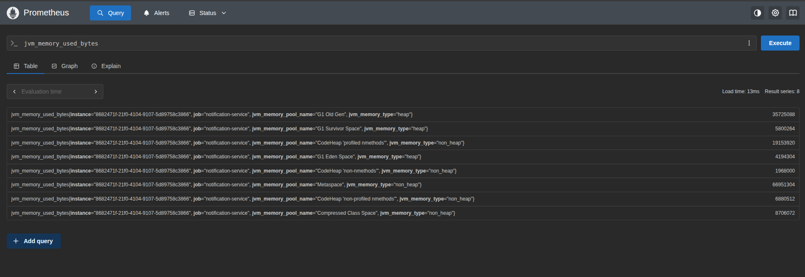

# Lab 5 · Set up OpenTelemetry metrics

## Prerequisites

The kind cluster is up, and notification-service is reachable through cloud-provider-kind:

```bash
$ curl http://notification-service.internal.kind.test/actuator/health
{"groups":["liveness","readiness"],"status":"UP"}
```

Create the namespace for the observability stack:

```bash
kubectl create ns observability
```

## 1. Two ways to expose OTel metrics from a Java app

| Way | How | What you gain |
| --- | --- | --- |
| **1. Java agent** (this lab) | The JVM loads `opentelemetry-javaagent.jar` on startup. Bake the jar into the image and configure it with env vars. | No code changes |
| **2. SDK in code** | Add `opentelemetry-api`, `opentelemetry-sdk` and `opentelemetry-exporter-otlp` to `pom.xml`. | Full control over what's recorded |

## 2. Patch the Dockerfile (Java agent)

```dockerfile
ARG OTEL_AGENT_VERSION=2.33.1
ADD --chmod=644 https://github.com/open-telemetry/opentelemetry-java-instrumentation/releases/download/v${OTEL_AGENT_VERSION}/opentelemetry-javaagent.jar /app/opentelemetry-javaagent.jar
ENV JAVA_TOOL_OPTIONS="-javaagent:/app/opentelemetry-javaagent.jar"
ENV OTEL_SERVICE_NAME="notification-service"
```

Let CI build the image and load it into kind, then check that it's there:

```bash
$ docker exec -it kind-control-plane crictl images
docker.io/library/notification-service          1.0.1                                   fcf9a478391f4       279MB
```

## 3. Deploy the app

```bash
helm upgrade --install notification-service helm/notification-service \
  -f helm/notification-service/values.yaml -n dev
```

### Error: no OTel endpoint set

```text
[otel.javaagent 2026-11-15 11:10:16:531 +0000] [OkHttp http://localhost:4318/...] ERROR io.opentelemetry.exporter.otlp.internal.HttpExporter - Failed to export 2 spans. Th
java.net.ConnectException: Failed to connect to localhost/[0:0:0:0:0:0:0:1]:4318
    at okhttp3.internal.connection.ConnectPlan.connectSocket(ConnectPlan.kt:285)
    at okhttp3.internal.connection.ConnectPlan.connectTcp(ConnectPlan.kt:144)
    at okhttp3.internal.connection.FastFallbackExchangeFinder$launchTcpConnect$1.runOnce(FastFallbackExchangeFinder.kt:147)
    at okhttp3.internal.concurrent.TaskRunner$runnable$1.run(TaskRunner.kt:81)
    at java.base/java.util.concurrent.ThreadPoolExecutor.runWorker(Unknown Source)
    at java.base/java.util.concurrent.ThreadPoolExecutor$Worker.run(Unknown Source)
    at java.base/java.lang.Thread.run(Unknown Source)
    Suppressed: java.net.ConnectException: Failed to connect to localhost/127.0.0.1:4318
        ... 7 more
    Caused by: java.net.ConnectException: Connection refused (connect failed)
        at java.base/sun.nio.ch.Net.pollConnect(Native Method)
        at java.base/sun.nio.ch.Net.pollConnectNow(Unknown Source)
        at java.base/sun.nio.ch.NioSocketImpl.timedFinishConnect(Unknown Source)
        at java.base/sun.nio.ch.NioSocketImpl.connect(Unknown Source)
        at java.base/java.net.SocksSocketImpl.connect(Unknown Source)
        at java.base/java.net.Socket.connect(Unknown Source)
        at okhttp3.internal.platform.Platform.connectSocket(Platform.kt:173)
        at okhttp3.internal.connection.ConnectPlan.connectSocket(ConnectPlan.kt:283)
        ... 6 more
```

### Resolution

With no endpoint set, the agent falls back to `localhost:4318`. Inside the pod nothing listens there. The fix is to set the agent's env vars, mainly the destination for the data:

| Variable | Purpose |
| --- | --- |
| `OTEL_SERVICE_NAME` | Service name. Already set in the image, so set it here only to override it. |
| `OTEL_EXPORTER_OTLP_ENDPOINT` | Base URL of the OTel Collector |
| `OTEL_EXPORTER_OTLP_PROTOCOL` | `http/protobuf` (port 4318, the default) or `grpc` (port 4317) |
| `OTEL_TRACES_EXPORTER` | `none` to turn off traces |
| `OTEL_LOGS_EXPORTER` | `none` to turn off logs |

Set these in the Helm values file. The chart's Deployment template had no `env` block, so I patched it to accept one.

## 4. Install the OTel Collector

Source: https://opentelemetry.io/docs/platforms/kubernetes/helm/collector/#installing-the-chart

```bash
helm repo add open-telemetry https://open-telemetry.github.io/opentelemetry-helm-charts
helm pull open-telemetry/opentelemetry-collector
tar -zxvf opentelemetry-collector-0.178.3.tgz
```

### Choosing `mode`

The chart requires `mode` to be set: `daemonset`, `deployment` or `statefulset`. Each maps to a pattern from the OpenTelemetry docs:

| Mode | Pattern | Use it when |
| --- | --- | --- |
| `deployment` | **Gateway**: a central pool behind one Service | Apps push OTLP to one address, and the Collector routes it to backends. **This lab.** |
| `daemonset` | **Agent**: one Collector per node | You need things only a node can see: tailing `/var/log/pods` (`filelog`), kubelet/node metrics (`kubeletstats`, `hostmetrics`), or keeping app → Collector traffic on the same node |
| `statefulset` | **Gateway with stable identity** | Sharded Prometheus scraping, or a persistent queue tied to one pod's volume |

`deployment` fits here because the app pushes OTLP to one Service DNS name and nothing needs node-level access. On a single-node kind cluster, a DaemonSet would also give you one pod, just with node-local plumbing you don't need.

Updated the values files in 
`wq_practical_book/Lab/5.otel-metrics/opentelemetry-collector-values.yaml`

To deploy the collector
```
helm upgrade --install opentelemetry-collector open-telemetry/opentelemetry-collector --version 0.178.3 -n observability -f opentelemetry-collector-values.yaml
```

After deploy back to setting the variables

| Variable | Purpose |
| --- | --- |
| `OTEL_SERVICE_NAME` | `notification-service` |
| `OTEL_EXPORTER_OTLP_ENDPOINT` | `http://opentelemetry-collector.observability.svc.cluster.local:4318` |
| `OTEL_EXPORTER_OTLP_PROTOCOL` | `http/protobuf` (port 4318, the default) or `grpc` (port 4317) |
| `OTEL_TRACES_EXPORTER` | `none` to turn off traces |
| `OTEL_LOGS_EXPORTER` | `none` to turn off logs |

### `http/protobuf` vs `grpc`

Both are OTLP with the same protobuf-encoded data. Only the transport underneath differs.

| | `http/protobuf` | `grpc` |
| --- | --- | --- |
| Transport | Plain HTTP `POST` (HTTP/1.1 or HTTP/2) | gRPC, always on HTTP/2 |
| Default port | 4318 | 4317 |
| Endpoint | One path per signal (`/v1/traces`, `/v1/metrics`, `/v1/logs`), appended to the base URL by the SDK | gRPC service methods: just `host:port`, no paths |
| Proxies, ingress, firewalls | Works through anything that handles HTTP | Needs HTTP/2 end to end, which some proxies and load balancers don't pass cleanly |
| Debugging | An HTTP request with a status code | Needs gRPC tooling (`grpcurl`) |
| Efficiency | Fine for most workloads | A bit more efficient: one long-lived connection multiplexes many requests |

- **Kubernetes gotcha with gRPC:** a ClusterIP Service balances per *connection*, not per request. Because gRPC holds one long-lived connection, each app pod sticks to one Collector replica. This only matters once you run more than one replica.
- **This lab uses `http/protobuf`.** It's the Java agent's default (since 2.0) and easier to debug. If you switch to `grpc`, change the port to 4317 too. A protocol/port mismatch just shows up as failed exports.
- **`http/json`** also exists: same paths, with a JSON body. It's handy for a hand-written `curl` test, but too large and slow for real traffic.


Once updated the env variables in the values.yaml for notification service, redeploy it.
`helm upgrade --install notification-service helm/notification-service -f helm/notification-service/values.yaml -n dev`
### Error: protocol and port don't match

```text
[otel.javaagent 2026-11-15 11:58:17:308 +0000] [OkHttp http://opentelemetry-collector.observability.svc.cluster.local:4317/...] ERROR io.opentelemetry.exporter.otlp.internal.HttpExporter - Failed to export 15 metrics. The request could not be executed.
java.net.SocketException: Connection reset
    at java.base/sun.nio.ch.NioSocketImpl.implRead(Unknown Source)
    ...
    at okhttp3.internal.http1.Http1ExchangeCodec.readResponseHeaders(Http1ExchangeCodec.kt:215)
    ...
[otel.javaagent 2026-11-15 11:58:17:309 +0000] [OkHttp http://opentelemetry-collector.observability.svc.cluster.local:4317/...] WARN io.opentelemetry.sdk.metrics.export.PeriodicMetricReader - Exporter failed
```

### Resolution

`HttpExporter` and `Http1ExchangeCodec` show the agent speaking plain HTTP/1.1 (`http/protobuf`), but `:4317` is the Collector's gRPC port. The gRPC server can't parse the request and resets the connection. The protocol and port must match:

```yaml
OTEL_EXPORTER_OTLP_ENDPOINT: http://opentelemetry-collector.observability.svc.cluster.local:4318
OTEL_EXPORTER_OTLP_PROTOCOL: http/protobuf
```

Compare the two errors: `Connection refused` means nothing is listening at that address. `Connection reset` means something is listening but doesn't understand what was sent.

# Install prometheus to receive the metric from Otel collecto

```bash
helm repo add prometheus-community https://prometheus-community.github.io/helm-charts
helm repo update
helm pull prometheus-community/prometheus
# update the wq_practical_book/Lab/5.otel-metrics/prometheus-values.yaml
helm upgrade --install prometheus prometheus-community/prometheus --version 29.47.2 -f Lab/5.otel-metrics/prometheus-values.yaml -n observability
```

Add prometheus.internal.kind.test into /etc/hosts
```bash
vim /etc/hosts
172.18.128.0 prometheus.internal.kind.test
```

### Error: `prometheus.internal.kind.test` returns 404, notification-service times out

The HTTPRoute looked healthy (`Accepted`, `ResolvedRefs`, Gateway listener `attachedRoutes: 2`), but:

```text
$ curl -i http://prometheus.internal.kind.test/
HTTP/1.1 404 Not Found
server: envoy
```

`server: envoy` means the request reached the Gateway's proxy and **no route matched**. Envoy's log showed it had lost its controller hours earlier:

```text
$ docker logs kindccm-gw-d59c713eff5c 2>&1 | grep xds_cluster | tail -1
... StreamAggregatedResources gRPC config stream to xds_cluster closed since 14959s ago: ... Connection refused
```

### Resolution

cloud-provider-kind runs in two parts:

| Container | Role | Job |
| --- | --- | --- |
| `cloud-provider-kind` | Control plane | Watches Gateways/HTTPRoutes and pushes routes to Envoy over xDS (gRPC) |
| `kindccm-gw-…` (Envoy) | Data plane | Serves the traffic with the last routes it received |

Envoy is started with the controller's xDS address and port baked in. The `cloud-provider-kind` container restarted 20 s after it had created Envoy, and the new process served xDS on a different port. Envoy kept dialling the old port and **kept serving its last routes** ("fail static"). Those routes had no Prometheus host (→ 404) and still pointed at the Service from before the chart rename (→ timeout). The controller still marked new routes `Accepted`, because it saw them. It just couldn't deliver them.

Fix: delete the Envoy container. The controller recreates it within a minute, with the current xDS port and current routes:

```bash
docker rm -f kindccm-gw-d59c713eff5c
docker ps --format '{{.Names}}\t{{.Status}}' | grep kindccm-gw   # new container, "Up N seconds"
curl -I http://prometheus.internal.kind.test/                    # 302, Location: /query
```

> **After restarting cloud-provider-kind, delete the `kindccm-gw-*` containers.** If the new Envoy gets a different IP, update `/etc/hosts`.

Takeaway: `Accepted` on an HTTPRoute means the *controller* accepted it, not that the proxy has it. When the status looks fine but traffic doesn't match, check the proxy itself: its log, or Envoy's admin `config_dump` (port 10000), where `last_updated` showed the routes were 4 hours old.

# Last step: Connect the OTEL collector to Prometheus

Update the opentelemetry collector to export OTLP logs to prometheus

```
config:
  exporters:
    debug:
      verbosity: "basic"
      # Uncomment below to see OTEL collector logs
      # verbosity: detailed
    otlp_http/prometheus:
      # https://prometheus.io/docs/prometheus/latest/querying/api/#otlp-receiver
      endpoint: "http://prometheus-server.observability.svc.cluster.local:80/api/v1/otlp"
  service:
    pipelines:
      metrics:
        exporters: [debug, otlp_http/prometheus]

```


# Add in custom metrics covered by Micrometer

How to view notifications count?

1. Only metrics created with micrometer will be logged
```
    public NotificationService(MeterRegistry registry) {
        this.sentCounter = Counter.builder("notifications.sent")
                .description("Number of notifications sent")
                .register(registry);
    }
```
2. Set the environment variable `OTEL_INSTRUMENTATION_MICROMETER_ENABLED: "true"`
3. Trigger some post call to see if metrics is collected
```
for i in 1 2 3; do curl -X POST http://notification-service.internal.kind.test/notifications\;
done
```
4. Query with `> notifications_sent_total` and see the results.

# Managing duplicate metrics to reduce cardinality 

With both the agent and the Micrometer bridge on, the same JVM and HTTP data arrives from **two sources**. That doubles the series count and makes some queries wrong. Pick one owner per metric family.

Spring Boot registers Micrometer `jvm.*` meters by default. The bridge exports *everything* in Micrometer's registry, not just custom meters, so those meters travel next to the agent's own JVM metrics:

```text
Micrometer registry ── notifications.sent ─┐
                    ── jvm.* (Spring)  ────┼─ bridge ─▶ agent ─OTLP─▶ Collector ─▶ Prometheus
agent's own         ── jvm.* (OTel) ───────┘                         (jvm.* arrives twice)
```

## Kind 1: same name, two label schemes

```promql
jvm_memory_used_bytes
```

| Source | OTel name and unit | Labels |
| --- | --- | --- |
| Agent (OTel runtime metrics) | `jvm.memory.used`, unit `By` | `jvm_memory_type`, `jvm_memory_pool_name` |
| Micrometer, through the bridge | `jvm.memory.used`, unit `bytes` | `area`, `id` |

Both become `jvm_memory_used_bytes`. `sum(jvm_memory_used_bytes)` returns about **2×** the real memory use, because every byte is counted once per source. Dashboards built on it are silently wrong.

## Kind 2: same data, different names

```promql
{__name__=~"http_server_request.*_count"}
```

The agent's `http_server_request_duration_seconds_count` and Micrometer's `http_server_requests_seconds_count` count the same requests. The same happens for JVM metrics, for example Micrometer's `jvm_threads_live_threads` against the agent's `jvm_thread_count`.

## Fix: one owner per family

| Family | Owner | How |
| --- | --- | --- |
| JVM (`jvm.*`) | Agent | `MANAGEMENT_METRICS_ENABLE_JVM: "false"` in the app's `env` |
| HTTP | Agent (`http.server.request.duration`, OTel semantic conventions) | `MANAGEMENT_METRICS_ENABLE_HTTP: "false"`. Verified: `http_server_requests_seconds_count` is gone. This also turns off Micrometer's `http.client.requests`, which the agent covers as `http.client.request.duration`. |
| Custom (`notifications.sent`) | Micrometer, via the bridge | Keep `OTEL_INSTRUMENTATION_MICROMETER_ENABLED: "true"` |

`MANAGEMENT_METRICS_ENABLE_JVM` is the Spring Boot property `management.metrics.enable.jvm`. It switches **off** every Micrometer meter whose name starts with `jvm.`. It's on by default, so set it to `"false"`, not `"true"`. Custom and HTTP meters are not affected.

After `helm upgrade`, `jvm_memory_used_bytes` only has series with `jvm_memory_type` and `jvm_memory_pool_name`. The old Micrometer series disappear from queries after about 5 minutes (Prometheus's staleness window).
