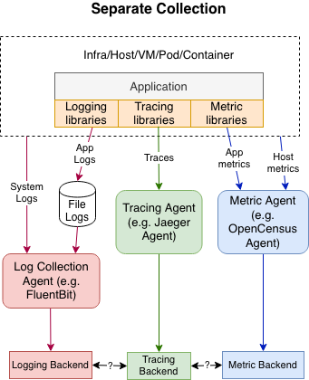

# Setup logging via otlp.

This guide should only be done after README-Setup-Metrics.md

## Install Loki

Guide/Documentation: https://grafana.com/docs/loki/latest/setup/install/helm/install-monolithic/

```
helm search repo grafana-community/loki

NAME                    CHART VERSION   APP VERSION     DESCRIPTION                                       
grafana-community/loki  21.2.3          3.7.10          Helm chart for Grafana Loki supporting monolith...

helm pull grafana-community/loki

tar -zxvf loki.tar.gz

```

Loki has 3 deployment modes.
Monolithic Mode - Ideal for getting started, testing, or smaller log volumes (typically under 20 GB to 100 GB per day).

Simple Scalable Mode - Designed for mid-sized environments handling up to roughly 1 TB of logs per day

Microservices (Distributed) Mode - Best for very large-scale, high-volume production environments processing over 1 TB of logs per day

so for this PoC we will go with Monolithic Mode
# Learnings

## Why `trace_id` is not a Loki label

Loki indexes **only labels**, never the log text. Each unique combination of label values is a **stream**, stored as its own compressed chunks. A query has two stages:

```text
{service_name="notification-service"}      ← 1. index lookup: which streams?  (fast, small index)
  | trace_id="4bf92f…"                     ← 2. scan those streams' lines     (structured metadata filter)
```

If `trace_id` were a label, every request would create a **new stream** with one or two lines in it:

- **The index explodes.** It grows with the number of requests, not the number of services.
- **Chunks become tiny.** Compression and storage efficiency fall apart. Loki is built for a few long streams.
- **Loki rejects writes.** Active streams per tenant are capped (`max_global_streams_per_user`), so a busy service hits the cap and Loki refuses its logs.

So per-request values (`trace_id`, `span_id`) go in **structured metadata**: stored per line and filterable, just not indexed. Labels are for low-cardinality "which source" values: service, namespace, environment. It's the same rule as Prometheus labels and Micrometer tags.

# Helm upgrade

```bash


helm upgrade --install loki grafana-community/loki --version 21.2.3 -f monolithic-values.yaml -n observability
```
Loki should be deployed now!
To verify

```bash
kubectl -n observability port-forward svc/loki 3100:3100
http://localhost:3100/memberlist
http://localhost:3100/ring
http://localhost:3100/ready
```

# 2 methods to ingest logs

# Forward logs from Otel Collector to Loki

Setup App to send logs out to Otel collector
Update application helm chart env variables and helm deploy the app
```yaml
OTEL_LOGS_EXPORTER: otlp
```

Configure Otel collector to send logs to Loki
```yaml
config:
  exporters:
    debug:
      verbosity: "basic"
      # Uncomment below to see OTEL collector logs
      # verbosity: detailed
    otlp_http/prometheus:
      # https://prometheus.io/docs/prometheus/latest/querying/api/#otlp-receiver
      endpoint: "http://prometheus-server.observability.svc.cluster.local:80/api/v1/otlp"
    # Add this as a exporter to send logs to Loki via OTLP HTTP
    otlp_http/loki:
      endpoint: "http://loki.observability.svc.cluster.local:3100/otlp"
  service:
    pipelines:
      metrics:
        exporters: [debug, otlp_http/prometheus]
      logs:
        exporters: [debug, otlp_http/loki]
```

Verify if endpoint is correct
```bash
kubectl -n observability port-forward svc/loki 3100:3100
curl -i -X POST http://localhost:3100/otlp/v1/logs \
  -H 'Content-Type: application/json' \
  -d '{"resourceLogs":[{"resource":{"attributes":[{"key":"service.name","value":{"stringValue":"curl-test"}}]},
       "scopeLogs":[{"logRecords":[{"timeUnixNano":"'"$(date +%s%N)"'","severityText":"INFO","body":{"stringValue":"hello loki"}}]}]}]}'

> HTTP/1.1 204 No Content
> Date: Wed, 18 Nov 2026 13:35:23 GMT

curl -sG http://localhost:3100/loki/api/v1/query_range \
  --data-urlencode 'query={service_name="curl-test"}' | jq '.data.result'
> Gets a JSON response back
```

Verify if application is in loki
```bash
kubectl -n observability port-forward svc/loki 3100:3100
curl -s http://localhost:3100/loki/api/v1/label/service_name/values

> {"status":"success","data":["notification-service","unknown_service"]}
```

# Forward logs from kubernetes stdout to Loki
The idea is to deploy another otel-collector, otel-agent, daemonset mode and send all logs directly to Loki
https://opentelemetry.io/docs/specs/otel/logs/

```
every pod ─stdout─▶ /var/log/pods (on each node)
                        │
                        ▼
              otel-agent  (DaemonSet, one per node)
              reads files, adds k8s metadata
                        │ otlp_http/loki
                        ▼
                      Loki
```
```bash
# run from wq_practical_book/
helm upgrade --install otel-agent open-telemetry/opentelemetry-collector --version 0.178.3 -n observability -f Lab/otel-java-kind/02-logs/logs-opentelemetry-collector-values.yaml
```


Verify if kube logs are going in
```bash
kubectl -n observability port-forward svc/loki 3100:3100

curl -s http://localhost:3100/loki/api/v1/label/service_name/values | jq
{
  "status": "success",
  "data": [
    "curl-test",
    "etcd",
    "kindnet",
    "kube-apiserver",
    "loki",
    "notification-service",
    "unknown_service"
  ]
}

curl -s http://localhost:3100/loki/api/v1/labels | jq 
{
  "status": "success",
  "data": [
    "k8s_container_name",
    "k8s_daemonset_name",
    "k8s_deployment_name",
    "k8s_namespace_name",
    "k8s_pod_name",
    "k8s_replicaset_name",
    "k8s_statefulset_name",
    "pod",
    "service_instance_id",
    "service_name",
    "service_namespace",
    "stream"
  ]
}

curl -sG http://localhost:3100/loki/api/v1/query_range \
  --data-urlencode 'query={service_name="notification-service", k8s_namespace_name="dev"}' \
  --data-urlencode 'limit=3' | jq '.data.result[] | {stream, lines: [.values[][1]]}'
> Logs output
```