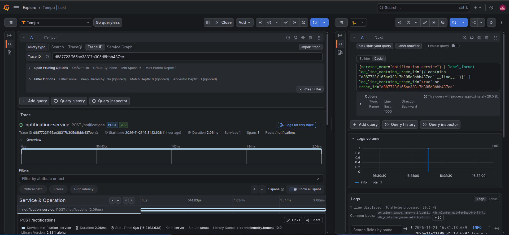
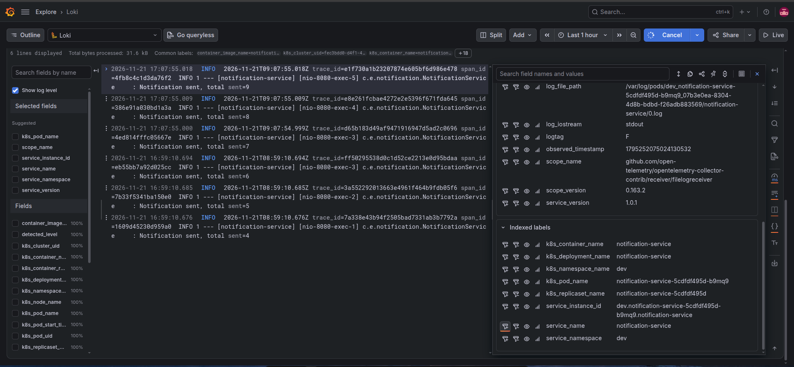

# Lab 04 · Traces with Tempo

This comes after [01-metrics](../01-metrics/README-Setup-Metrics.md), [02-logs](../02-logs/README-Setup-Logs.md) and [03-grafana](../03-grafana/README-Grafana.md).

```text
Java agent ──OTLP──▶ gateway Collector (opentelemetry-collector, :4318)
                        │
                        ├─ metrics pipeline ─▶ otlp_http/prometheus ─▶ Prometheus  /api/v1/otlp
                        └─ traces pipeline  ─▶ otlp_http/tempo      ─▶ Tempo :4318 /v1/traces   (new)

Tempo metrics-generator ──remote write──▶ Prometheus /api/v1/write   (span metrics, service graph)

Logs: app stdout ─▶ otel-agent DaemonSet (file_log) ─▶ Loki   (Lab 02 path, no gateway hop)
```

## 1. Install Tempo

Check the rendered config first:

```bash
# run from wq_practical_book/
helm template tempo grafana-community/tempo --version 3.2.1 -n observability \
  -f Lab/otel-java-kind/04-traces/tempo-values.yaml | grep -A6 'metrics_generator\|stream_over'
```

Expect `stream_over_http_enabled: true`, the `processors` list under `overrides`, and a `metrics_generator` block with `path: "/var/tempo/metrics"` and the `remote_write` URL.

Then install:

```bash
helm upgrade --install tempo grafana-community/tempo --version 3.2.1 \
  -n observability -f Lab/otel-java-kind/04-traces/tempo-values.yaml
```

### Why these values

[tempo-values.yaml](tempo-values.yaml) only holds the values that differ from the chart defaults. To see all defaults:

```bash
helm show values grafana-community/tempo --version 3.2.1
```

| Value | Set to | Why |
| --- | --- | --- |
| `tempo.streamOverHttpEnabled` | `true` | Lets Grafana's Tempo data source stream search results as they arrive. Tempo only allows streaming when this is on. |
| `tempo.reportingEnabled` | `false` | The chart default is `true`: Tempo sends an anonymous usage report to Grafana Labs. Not wanted for a lab. |
| `tempo.metricsGenerator.enabled` | `true` | Turns on the metrics-generator, which reads every span and builds Prometheus metrics from it. Without it, the whole `metrics_generator` block is left out of Tempo's config. |
| `tempo.metricsGenerator.remoteWriteUrl` | `http://prometheus-server.observability.svc.cluster.local:80/api/v1/write` | Where the generator pushes those metrics. Tempo isn't a metrics database, so it sends them to Prometheus with remote write. The default `prometheus.monitoring:9090` doesn't exist here. Found the Service with `kubectl -n observability get svc \| grep prometheus`. |
| `tempo.metricsGenerator.storage.path` | `/var/tempo/metrics` | The generator's own working folder (its WAL). Kept apart from the traces (`/var/tempo/traces`) and the trace WAL (`/var/tempo/wal`). |
| `tempo.overrides.defaults.metrics_generator.processors` | `service-graphs`, `span-metrics` | **Which** processors run. `enabled: true` alone makes no metrics. `defaults` applies to every tenant, and there is only one (multitenancy is off). |

### What the two processors produce

- **span-metrics:** RED metrics (rate, errors, duration) for each span name, such as `traces_spanmetrics_calls_total` and `traces_spanmetrics_latency_bucket`. You get them without writing metrics code in the app.
- **service-graphs:** `traces_service_graph_request_total` with `client` and `server` labels, meaning "who calls whom". Grafana draws the service map from it, for example `notification-service → postgres`.

### Things I learned from the values file

- **`processor` vs `processors`.** `tempo.metricsGenerator.processor` (underscores: `service_graphs`) only **tunes** a processor (`wait`, `max_items`). `tempo.overrides.defaults.metrics_generator.processors` (hyphens: `service-graphs`) decides **which** processors run. Setting only the first one does nothing.
- **Prometheus has to accept remote write.** It rejects pushes to `/api/v1/write` unless it runs with `--web.enable-remote-write-receiver` (see step 2 below). Without it the service graph stays empty and Tempo's log shows remote-write errors.
- **Commenting out a key doesn't remove it.** Helm merges my file on top of the chart defaults, so a key I leave out keeps its default. Deleting a key needs `key: null`.
- **The Jaeger receivers stay on.** `tempo.receivers.jaeger: null` breaks the chart 3.2.1 render (`templates/_ports.tpl` reads `.jaeger.protocols` without a nil check). They only open extra ports. The app sends OTLP to the Collector, and the Collector sends OTLP to Tempo on 4318.
- **No persistence.** `persistence.enabled` is `false` by default. No volume is mounted at `/var/tempo`, so traces live in the container's filesystem and are gone when the pod restarts. That's fine for a lab, and it avoids a `Pending` PVC like the one Loki had.

### Ports on the `tempo` Service

| Port | Use |
| --- | --- |
| 4318 | OTLP/HTTP in. The Collector's `otlp_http/tempo` exporter sends here. |
| 4317 | OTLP/gRPC in. |
| 3200 | Query API. Grafana's Tempo data source and `curl /api/search` use it. |
| 14250, 6831, 6832, 14268 | Jaeger receivers (chart default, not used). |

## 2. Let Prometheus accept remote write from Tempo

Tempo's metrics-generator pushes span metrics to Prometheus with remote write. In [prometheus-values.yaml](../01-metrics/prometheus-values.yaml):

```yaml
server:
  extraFlags:
    - web.enable-lifecycle
    - web.enable-otlp-receiver          # accept OTLP at /api/v1/otlp/v1/metrics
    - web.enable-remote-write-receiver  # accept remote write at /api/v1/write (Tempo's metrics-generator)
```

```bash
helm upgrade --install prometheus prometheus-community/prometheus --version 29.47.2 \
  -n observability -f Lab/otel-java-kind/01-metrics/prometheus-values.yaml

# verify
kubectl -n observability get deploy prometheus-server -o yaml | grep -- '--web.enable'
```

## 3. Send traces from the Collector to Tempo

Add an `otlp_http/tempo` exporter and a `traces` pipeline to [opentelemetry-collector-values.yaml](../01-metrics/opentelemetry-collector-values.yaml):

```yaml
config:
  exporters:
    debug:
      verbosity: "basic"
      # verbosity: detailed   # uncomment to see full payloads in the Collector log
    otlp_http/prometheus:
      # https://prometheus.io/docs/prometheus/latest/querying/api/#otlp-receiver
      endpoint: "http://prometheus-server.observability.svc.cluster.local:80/api/v1/otlp"
    otlp_http/loki:
      endpoint: "http://loki.observability.svc.cluster.local:3100/otlp"
    otlp_http/tempo:                                                   # new
      endpoint: "http://tempo.observability.svc.cluster.local:4318"
  service:
    pipelines:
      metrics:
        exporters: [debug, otlp_http/prometheus]
      logs:
        exporters: [debug, otlp_http/loki]
      traces:                                                          # new
        exporters: [debug, otlp_http/tempo]
```

## 4. Turn traces on in the app

The Java agent makes the spans and their IDs without any code from me. In [helm/notification-service/values.yaml](../../../helm/notification-service/values.yaml) (`env`):

```yaml
  OTEL_TRACES_EXPORTER: otlp   # was: none. Spans go to OTEL_EXPORTER_OTLP_ENDPOINT, the gateway Collector
  LOGGING_PATTERN_LEVEL: "trace_id=%mdc{trace_id} span_id=%mdc{span_id} %5p"   # print the IDs in every log line
```

```bash
helm upgrade --install notification-service helm/notification-service \
  -n dev -f helm/notification-service/values.yaml
```

## 5. Verify

### trace_id and span_id in the Loki logs

Grafana → Explore → Loki, `{service_name="notification-service"}`:

```text
2026-11-21T08:31:13.639Z trace_id=d887723f165ae38317b305d8bbb437ee span_id=d785992365f70f43  INFO 1 --- [notification-service] [nio-8080-exec-3] c.e.notification.NotificationService     : Notification sent, total sent=3
```

The agent puts the current span's IDs into the logging MDC, the log pattern prints them, and otel-agent ships the stdout line to Loki.

✅ logs: app stdout → otel-agent → Loki

### The same trace in Tempo

```bash
kubectl -n observability port-forward svc/tempo 3200:3200

curl -sG http://localhost:3200/api/search \
  --data-urlencode 'q={ resource.service.name = "notification-service" }' \
  | jq '.traces[] | {traceID, rootTraceName}'
```

```json
{
  "traceID": "d887723f165ae38317b305d8bbb437ee",
  "rootTraceName": "POST /notifications"
}
```

Look at the trace itself:

```bash
curl -s http://localhost:3200/api/v2/traces/d887723f165ae38317b305d8bbb437ee | jq .

# only the span kinds and names
curl -s http://localhost:3200/api/v2/traces/d887723f165ae38317b305d8bbb437ee \
  | jq -r '.trace.resourceSpans[].scopeSpans[].spans[] | "\(.kind)  \(.name)"'
```

`host.name` is `notification-service-5cdfdf495d-b9mq9`, the same pod that wrote the log line.

✅ traces: app → Collector → Tempo, with the same trace_id as the log line

### Span metrics in Prometheus

```promql
traces_spanmetrics_calls_total{service="notification-service"}
```

```text
traces_spanmetrics_calls_total{__metrics_gen_instance="tempo-0", service="notification-service", span_kind="SPAN_KIND_SERVER", span_name="GET /actuator/health/**", status_code="STATUS_CODE_UNSET"}  746
traces_spanmetrics_calls_total{__metrics_gen_instance="tempo-0", service="notification-service", span_kind="SPAN_KIND_SERVER", span_name="POST /notifications", status_code="STATUS_CODE_UNSET"}  3
```

## 6. Grafana: Tempo data source and the links between signals

The data sources are now provisioned in [grafana-values.yaml](../03-grafana/grafana-values.yaml), so they survive a Grafana restart. Data sources link to each other by `uid`:

```yaml
datasources:
  datasources.yaml:
    apiVersion: 1
    datasources:
      - name: Prometheus
        uid: prometheus
        type: prometheus
        url: http://prometheus-server.observability.svc.cluster.local
        isDefault: true
      - name: Loki
        uid: loki
        type: loki
        url: http://loki.observability.svc.cluster.local:3100
        # jsonData.derivedFields: log → trace ("View trace")
      - name: Tempo
        uid: tempo
        type: tempo
        url: http://tempo.observability.svc.cluster.local:3200
        # jsonData.tracesToLogsV2: trace → logs ("Logs for this span")
        # jsonData.tracesToMetrics: trace → metrics (span "Links" menu)
```

See [grafana-values.yaml](../03-grafana/grafana-values.yaml) for the full `jsonData` blocks.

```bash
helm upgrade --install grafana grafana-community/grafana --version 14.4.1 \
  -n observability -f Lab/otel-java-kind/03-grafana/grafana-values.yaml
```

| Link | Where in Grafana | Configured on |
| --- | --- | --- |
| Trace → logs | "Logs for this trace" / "Logs for this span" | Tempo, `tracesToLogsV2` |
| Trace → metrics | Span details → **Links** menu (next to Share) | Tempo, `tracesToMetrics` |
| Log → trace | Expand a log line → TraceID → **View trace** | Loki, `derivedFields` |



## 7. Loki: the default labels have high cardinality

Under **Indexed labels** in Loki I see:

- `k8s_pod_name`
- `service_instance_id`

Both change with every deployment and every pod restart, so each new pod creates new streams.



The fix is to take them out of Loki's default index-label list. Resource attributes that aren't in the list are stored as structured metadata, so they can still be filtered with `| k8s_pod_name="…"`. From [Modify default labels](https://grafana.com/docs/loki/latest/get-started/labels/modify-default-labels/#loki-configuration-example), in [loki-monolithic-values.yaml](../02-logs/loki-monolithic-values.yaml):

```yaml
loki:
  distributor:
    otlp_config:
      default_resource_attributes_as_index_labels:
        - service.name
        - service.namespace
        - deployment.environment
        - deployment.environment.name
        - cloud.region
        - cloud.availability_zone
        - k8s.cluster.name
        - k8s.namespace.name
        - k8s.container.name
        - container.name
        - k8s.replicaset.name      # drop this line too if you decided against it
        - k8s.deployment.name
        - k8s.statefulset.name
        - k8s.daemonset.name
        - k8s.cronjob.name
        - k8s.job.name
        # removed: k8s.pod.name, service.instance.id
```

`limits_config.otlp_config` with `action: structured_metadata` did **not** work: the default list still won and `k8s_pod_name` stayed indexed.

## 8. Add my own span with `@WithSpan`

A trace showed `Spans 1`: only the Tomcat SERVER span. The agent instruments libraries, not my code, so `NotificationService.send()` was invisible inside it.

```java
@WithSpan // INTERNAL span "NotificationService.send", child of the HTTP server span
public long send() {
    long total = sent.incrementAndGet();
    Span.current().setAttribute("notification.total", total);   // shows up as a span attribute
    sentCounter.increment();
    log.info("Notification sent, total sent={}", total);
    return total;
}
```

### How does it work?

**Q:** Why does `@WithSpan` work without me writing any code that creates the span? Who reads the annotation?

**A:** The OTel Java agent.

- The pod starts the JVM with `-javaagent:opentelemetry-javaagent.jar`, so the agent runs before the app's classes load.
- As each class loads, the agent can rewrite its bytecode (it uses ByteBuddy). When it sees a method annotated with `@WithSpan`, it wraps the method body, in effect:

  ```java
  Span span = tracer.spanBuilder("NotificationService.send").setSpanKind(INTERNAL).startSpan();
  try (Scope s = span.makeCurrent()) {
      // the original send() body
  } catch (Throwable t) {
      span.recordException(t); span.setStatus(ERROR); throw t;
  } finally {
      span.end();
  }
  ```

- It's the same mechanism that gives the Tomcat SERVER span: the agent rewrites Tomcat's request handling the same way. `@WithSpan` just marks my own methods as instrumentation points.
- Without the agent, `@WithSpan` does nothing. The annotations jar has no logic in it.

### When to use it

**Annotate:**

- Business operations: `send()`, `placeOrder()`, `chargeCard()`. These are the steps I'd want to see as separate bars when asking why a request was slow.
- Expensive or risky steps whose timing matters: building a report, calling a rules engine, a retry loop.

**Don't annotate:**

- Getters, mappers, validators and small helpers. They add noise, and each span costs CPU, memory and storage.
- Hot loops. `@WithSpan` on a method called 10,000 times per request makes a 10,000-span trace.
- Anything the agent already covers: HTTP server and client calls, JDBC, Kafka, Redis. Those spans appear on their own, and annotating a wrapper around them only duplicates them.

## Questions and notes

### Why does "Logs for this span" use a text search?

**Q:** Why does "Logs for this span" use `|= "<trace id>"` (a text search) and not a label match like `{trace_id="…"}`?

**A:**

- `trace_id` is not indexed, on purpose. Every request has a new trace ID, so as a label it would create one stream per request.
- On the stdout path, `LOGGING_PATTERN_LEVEL` puts the trace ID only in the line's text. With logs over OTLP (`OTEL_LOGS_EXPORTER: otlp`), the trace ID would arrive as structured metadata instead: stored per line, filterable, and also not indexed.

### Open: every `GET /actuator/health/**` is traced

What if I don't want to trace these? The 746 `GET /actuator/health/**` calls are the kubelet's liveness and readiness probes. Each probe is traced, so in this lab they swamp the real traffic in "Request rate" and in Tempo search.
